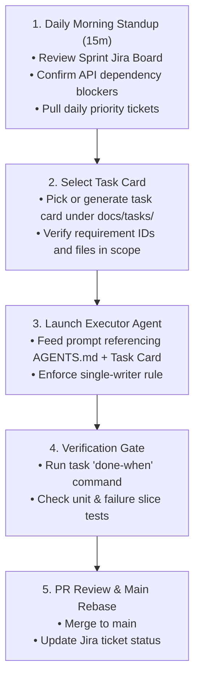

# APD Guide: Capstone Banking System (Integrated Specification)

This guide walks teammates, evaluators, and coding agents through the complete Analysis, Planning, and Design (APD) baseline for the **Capstone Banking System**. It synthesizes business requirements, technical specifications, cloud DevSecOps boundaries, Jira sprint tracking, and agent execution protocols into one cohesive operational blueprint.

---

## The System in One Minute

The platform delivers a modern, MariBank-inspired retail digital banking engine:
1. **Unified Customer Experience:** One customer receives one primary deposit account (PHP) linked to a single Virtual Card, with optional foreign currency sub-wallets ("pockets": USD, EUR).
2. **Smart FX Routing:** Transactions in foreign currencies debit the matching pocket with 0% FX fees. If the pocket has insufficient funds, the system computes the exact shortfall, presents a guaranteed 30-second quote, and auto-converts from the primary PHP pocket upon customer confirmation.
3. **Core Banking Guarantee:** The **Accounts Service** acts as the Mock Core Banking System (CBS) and is the **sole writer** of account balances. It executes multi-leg debit and credit operations in Oracle XE 21c inside a single atomic database transaction using deterministic ascending row locks (`SELECT ... FOR UPDATE`).
4. **Asynchronous Ledger Audit:** Balance mutations commit atomically with an Oracle outbox record. Kafka asynchronously relays these events to PostgreSQL 15+, where an append-only audit consumer records immutable legal legs protected by database triggers.
5. **Fail-Closed Security:** A Java Spring Boot **Risk Engine** screens transactions under a strict $\le 200\text{ms}$ SLA; if screening times out or exceeds risk thresholds, the transfer is terminated before any funds move.

> **Golden Architectural Rule:** *The Channel coordinates; the Core owns the money; Kafka delivers the audit trail; the Gateway protects the perimeter.*

---

## Document Map (The APD Structure)

| Stage | Document | Purpose & Reader |
|---|---|---|
| **Analysis** | [`REQUIREMENTS.md`](./REQUIREMENTS.md) | Business goals, user stories, constraints (Java-only, no OFS), and non-goals. |
| **Planning** | [`PLAN.md`](./PLAN.md) | 9-day implementation milestones, team ownership matrix, and Jira backlog mapping. |
| **Design** | [`ARCHITECTURE.md`](./ARCHITECTURE.md)<br/>[`CONTRACTS.md`](./CONTRACTS.md) | Full Mermaid diagrams, component boundaries, ERD, DDL deltas, and JSON REST/Kafka schemas. |
| **Verification** | [`ACCEPTANCE.md`](./ACCEPTANCE.md)<br/>[`SEED.md`](./SEED.md) | Definition of Done, 4 rubric-aligned chaos engineering test runbooks, and test fixtures. |
| **Agent Rules** | [`AGENTS.md`](./AGENTS.md)<br/>[`tasks/`](./tasks/) | Executor agent invariants, single-writer rules, and 14 bounded task cards (`T-001` through `T-014`). |

---

## 1. Resolved Architectural Decisions (No Spec Ambiguity)

The previous drafting discrepancies noted in earlier revisions are formally resolved as follows:

1. **Audit Writes are 100% Asynchronous via Kafka (Resolves B-02):**
   * The `transaction-service` **never writes directly to PostgreSQL in the HTTP mutate path**.
   * Balance changes commit atomically in Oracle with an `outbox_master` record.
   * The `AuditLedgerConsumer` reads Kafka topic `transaction.events` and inserts rows into PostgreSQL `ledger_mutation_audit`.
   * If PostgreSQL experiences downtime, the consumer pauses and retries with backoff. It does not drop financial events to the Dead Letter Topic (`.DLT`).
2. **Atomic Settlement & Outbox Table Ownership (Resolves B-01):**
   * The table is formally named **`outbox_master`** in Oracle XE (`LEDGER_APP` schema).
   * It is owned and written solely by `accounts-service` within the same local `@Transactional` commit as `account_master`.
3. **Risk Scoring Model & SLA (Resolves B-05):**
   * Pure Java Spring Boot service (`risk-engine`).
   * Weighted heuristics: Velocity ($V$), Amount anomaly ($A$), and Device anomaly ($D$).
   * Typical evaluation latency $< 50\text{ms}$. Callers enforce Resilience4j timeout of $200\text{ms}$.
   * Decisions:
     * $\text{Score} < 0.50 \implies \text{LOW} \implies \text{ALLOW}$
     * $0.50 \le \text{Score} \le 0.85 \implies \text{MEDIUM} \implies \text{STEP\_UP\_OTP}$
     * $\text{Score} > 0.85 \implies \text{HIGH} \implies \text{REJECT}$ (HTTP 422 `DECLINED_HIGH_RISK`)
     * Engine Timeout $\implies$ HTTP 503 `SECURITY_CHECK_UNAVAILABLE` (Fail-closed).
4. **Header Standardization & Deduplication:**
   * Inbound idempotency is strictly **`X-Idempotency-Key`** across Gateway, Flutter Web/Mobile, and Spring Boot filters.
5. **Cloud Scope Boundary:**
   * **In-Scope for Defense:** Local Docker Compose isolated bridge network (`banking-net`), port cloaking (only `:8080` and `:8090` exposed), Prometheus/Grafana observability, and the 4 chaos test runbooks.
   * **Post-Capstone Reference:** The 12-week Azure AKS / Terraform production rollout documented in `00_cloud-architecture/`.

---

## 2. Team Structure & Jira Backlog Ownership

The 7-member team is structured across 4 functional domains to maximize parallelism without merge collisions:

```
┌────────────────────────────────────────────────────────────────────────┐
│                        7-MEMBER DELIVERY MATRIX                        │
├─────────────────────┬───────────────────────────┬──────────────────────┤
│ Member & Track      │ Primary Component Domain  │ Jira Tickets Owned   │
├─────────────────────┼───────────────────────────┼──────────────────────┤
│ Yancey              │ Mock CBS & Master Data    │ DIG-3, DIG-4, DIG-9, │
│ (Full-Stack)        │ accounts-service, Oracle  │ DIG-16, DIG-17,      │
│                     │ DDL, Pessimistic Locking  │ DIG-52, DIG-58       │
├─────────────────────┼───────────────────────────┼──────────────────────┤
│ Rohan               │ Channel Orchestration     │ DIG-14, DIG-15,      │
│ (Full-Stack)        │ transaction-service,      │ DIG-20, DIG-23,      │
│                     │ Smart FX, Outbox Relay    │ DIG-24, DIG-35       │
├─────────────────────┼───────────────────────────┼──────────────────────┤
│ PK                  │ Identity, Risk & Admin UI │ DIG-6, DIG-7,        │
│ (Full-Stack)        │ login-service,            │ DIG-12, DIG-18,      │
│                     │ risk-engine, Thymeleaf    │ DIG-21, DIG-50       │
├─────────────────────┼───────────────────────────┼──────────────────────┤
│ Russel              │ Cloud Perimeter & Network │ DIG-8, DIG-25,       │
│ (Cloud Lead)        │ api-gateway, TLS,         │ DIG-28, DIG-30,      │
│                     │ Zero-Trust, Chaos Engine  │ DIG-31, DIG-60       │
├─────────────────────┼───────────────────────────┼──────────────────────┤
│ Gym                 │ Cloud Platform & Perf.    │ DIG-5, DIG-26,       │
│ (Cloud Ops)         │ Redis Rate Limiter,       │ DIG-27, DIG-29,      │
│                     │ Kafka Cluster, Grafana    │ DIG-32, DIG-61       │
├─────────────────────┼───────────────────────────┼──────────────────────┤
│ Lanz                │ Mobile Lead               │ DIG-10, DIG-38,      │
│ (Mobile)            │ Flutter Core, Dio Client, │ DIG-40, DIG-42,      │
│                     │ Secure Keystore, Send UI  │ DIG-44, DIG-48       │
├─────────────────────┼───────────────────────────┼──────────────────────┤
│ Angge               │ Mobile UI & Experience    │ DIG-11, DIG-13,      │
│ (Mobile)            │ Virtual Card Hub, Pockets,│ DIG-39, DIG-41,      │
│                     │ Receipts, Alert Screens   │ DIG-43, DIG-49       │
└─────────────────────┴───────────────────────────┴──────────────────────┘
```

---

## 3. Daily Execution Workflow (The 2-Tier Process)

To avoid developers and AI coding agents drifting or blocking each other, follow this execution rhythm:



### The 9-Day Milestone Schedule (Aligned to Jira Sprints)

* **Sprint 0 (Day 1) — Setup & Contract Freeze:**
  * Reconcile DDL deltas, freeze `CONTRACTS.md`, assign Jira tickets, and set up local environments.
* **Sprint 1 (Days 2–4) — Foundation & Core Banking:**
  * Implement `accounts-service` atomic settlement (`T-002`), Gateway JWT filters, and Flutter project shell with Keystore.
* **Sprint 2 (Days 5–6) — Orchestration, Risk & Channels:**
  * Implement Smart Payment orchestrator (`T-001`), Java Risk Engine (`T-003`), Outbox Kafka relay (`T-004`), and Flutter Send Money UI.
* **Sprint 3 (Day 7) — Hardening & Chaos Validation:**
  * Run JMeter load tests ($\ge 800$ TPS), execute the 4 Chaos Scenarios in `ACCEPTANCE.md`, and verify zero ledger drift.
* **Sprint 4 (Day 8) — Mock Defense:**
  * Full end-to-end dry-run walkthrough before panel.
* **Sprint 5 (Day 9) — Final Viva Defense:**
  * Project submission and technical evaluation.

---

## 4. How Teammates Hand Off Work to Their AI Agents

Every team member can independently instruct their coding agent by pasting this standardized prompt:

```text
You are an executor agent for the Capstone Banking System.
Before writing code, read:
1. docs/AGENTS.md (strict single-writer invariants and tech stack rules)
2. docs/tasks/T-00X.md (your assigned task card)
3. The relevant endpoint and DDL slice in docs/CONTRACTS.md

Invariants to follow:
- Only accounts-service may mutate account_master in Oracle.
- Do not write directly to PostgreSQL in the HTTP request path.
- Strictly adhere to the DTO field names and decimal string formats.
- Run the 'done-when' command specified in your task card to verify before finishing.
```

---

## 5. Summary Handoff Statement

> *"We are building a multi-currency retail digital bank with a clean channel/core split. The transaction service orchestrates payments and quotes; the accounts service authoritatively moves balances under Oracle row locks; Kafka delivers asynchronous audit records to PostgreSQL; and the Spring Cloud Gateway enforces zero-trust perimeter security. Our plan divides the work across 7 dedicated engineers using disciplined task cards, verified daily against the 9-day Jira backlog and validated through chaos testing."*
