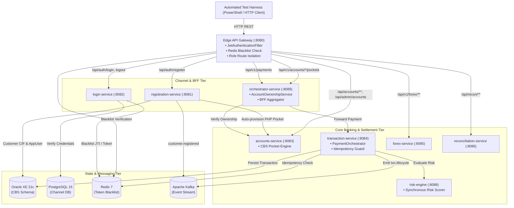

# Phase 3 Automated Black-Box API Functional Test Evidence

## 1. Executive Summary & Verification Context

| Attribute | Value |
| :--- | :--- |
| **Monorepo Branch** | `test/pk-api-test` |
| **Ingress Point** | Spring Cloud Edge API Gateway (`http://localhost:8080`) |
| **Test Execution Harness** | `scripts/test_api_functional_e2e.ps1` |
| **Raw JSON Evidence** | `scripts/api_test_results.json` |
| **Execution Timestamp** | 2026-10-09 12:02:09 +08:00 |
| **Total Test Cases** | **23** |
| **Passed Test Cases** | **23** |
| **Failed Test Cases** | **0** |
| **Overall Pass Rate** | **100.00%** |
| **Total Suite Execution Time** | **2.97 seconds** |
| **Environment** | Live Multi-Container Docker Stack (`banking-backend-monorepo_banking-net`) |

---

## 2. Ingress Architecture & Request Routing

All 23 test probes strictly entered the system through the **Spring Cloud Gateway (`:8080`)** edge perimeter. Zero test mocks or in-memory stubs were used. Every request traversed the genuine multi-tier microservice architecture:

---

## 3. Comprehensive Test Execution Results Matrix

### Suite 1: Identity, Authentication & JWT Lifecycle (J-01 / API-PK-01)
| Test ID | Description | Gateway Endpoint | HTTP Method | Expected | Actual | Latency | Result |
| :--- | :--- | :--- | :---: | :---: | :---: | :---: | :---: |
| **`API-PK-01.1`** | Register new customer via Gateway | `/api/auth/register` | `POST` | 200 | 200 | 181 ms | **PASS** |
| **`API-PK-01.2`** | Reject duplicate customer registration | `/api/auth/register` | `POST` | 409 | 409 | 16 ms | **PASS** |
| **`API-PK-01.3`** | Authenticate Customer (Juan) & retrieve JWT | `/api/auth/login` | `POST` | 200 | 200 | 386 ms | **PASS** |
| **`API-PK-01.4`** | Authenticate Admin & retrieve JWT with ROLE_ADMIN | `/api/auth/login` | `POST` | 200 | 200 | 445 ms | **PASS** |
| **`API-PK-01.5`** | Logout customer & write blacklist to Redis | `/api/auth/logout` | `POST` | 200 | 200 | 38 ms | **PASS** |
| **`API-PK-01.6`** | Block revoked/blacklisted token at Gateway edge (`TOKEN_REVOKED`) | `/api/v1/payments/history` | `GET` | 401 | 401 | 17 ms | **PASS** |

### Suite 2: Multi-Currency Pockets & Boundary Security (J-02 / API-PK-02)
| Test ID | Description | Gateway Endpoint | HTTP Method | Expected | Actual | Latency | Result |
| :--- | :--- | :--- | :---: | :---: | :---: | :---: | :---: |
| **`API-PK-02.1`** | Query multi-currency pockets via Orchestrator BFF | `/api/v1/accounts/{id}/pockets` | `GET` | 200 | 200 | 133 ms | **PASS** |
| **`API-PK-02.2`** | Query customer accounts by customer UUID | `/api/accounts/customer/{id}` | `GET` | 200 | 200 | 53 ms | **PASS** |
| **`API-PK-02.3`** | Enforce account ownership boundary (cross-user probe) | `/api/v1/accounts/{otherId}/pockets` | `GET` | 403 | 403 | 78 ms | **PASS** |

### Suite 3: Payment Ingress, Synchronous Risk Screening & Idempotency (J-02, J-05 / API-PK-03)
| Test ID | Description | Gateway Endpoint | HTTP Method | Expected | Actual | Latency | Result |
| :--- | :--- | :--- | :---: | :---: | :---: | :---: | :---: |
| **`API-PK-03.1`** | Submit payment transfer through Gateway -> Orchestrator -> Hub | `/api/v1/payments` | `POST` | 200 | 200 | 197 ms | **PASS** |
| **`API-PK-03.2`** | Idempotency replay: Return cached transaction without re-execution | `/api/v1/payments` | `POST` | 200 | 200 | 85 ms | **PASS** |
| **`API-PK-03.3`** | Idempotency conflict probe (same key, altered payload) | `/api/v1/payments` | `POST` | 409 | 409 | 96 ms | **PASS** |
| **`API-PK-03.4`** | Reject payment debiting unauthorized source account | `/api/v1/payments` | `POST` | 403 | 403 | 84 ms | **PASS** |

### Suite 4: Transaction Lifecycle, Status Tracking & History (J-04, J-06 / API-PK-04)
| Test ID | Description | Gateway Endpoint | HTTP Method | Expected | Actual | Latency | Result |
| :--- | :--- | :--- | :---: | :---: | :---: | :---: | :---: |
| **`API-PK-04.1`** | Retrieve transaction status & stage by UUID | `/api/v1/payments/{txnId}` | `GET` | 200 | 200 | 72 ms | **PASS** |
| **`API-PK-04.2`** | Retrieve customer chronological transaction history | `/api/v1/payments/history` | `GET` | 200 | 200 | 95 ms | **PASS** |

### Suite 5: Foreign Exchange Market Rates & Quotes (J-10 / API-PK-05)
| Test ID | Description | Gateway Endpoint | HTTP Method | Expected | Actual | Latency | Result |
| :--- | :--- | :--- | :---: | :---: | :---: | :---: | :---: |
| **`API-PK-05.1`** | Retrieve live forex currency exchange rates | `/api/v1/forex/rates` | `GET` | 200 | 200 | 42 ms | **PASS** |

### Suite 6: Governance, Admin Operations & Dual-DataSource Recon (J-08, J-13 / API-PK-06)
| Test ID | Description | Gateway Endpoint | HTTP Method | Expected | Actual | Latency | Result |
| :--- | :--- | :--- | :---: | :---: | :---: | :---: | :---: |
| **`API-PK-06.1`** | Query core accounts registry with ROLE_ADMIN credentials | `/api/admin/accounts` | `GET` | 200 | 200 | 15 ms | **PASS** |
| **`API-PK-06.2`** | Block non-admin customer from `/api/admin/**` endpoints | `/api/admin/accounts` | `GET` | 403 | 403 | 10 ms | **PASS** |
| **`API-PK-06.3`** | Trigger dual-datasource reconciliation engine audit | `/api/recon/runs` | `POST` | 200 | 200 | 171 ms | **PASS** |
| **`API-PK-06.4`** | Block customer token from admin customer directory | `/api/admin/customers` | `GET` | 403 | 403 | 18 ms | **PASS** |

### Suite 7: Error-Contract & RFC 7807 Probes (Section 6.3 / API-PK-07)
| Test ID | Description | Gateway Endpoint | HTTP Method | Expected | Actual | Latency | Result |
| :--- | :--- | :--- | :---: | :---: | :---: | :---: | :---: |
| **`API-PK-07.1`** | Reject unauthenticated request on protected route | `/api/v1/payments/history` | `GET` | 401 | 401 | 6 ms | **PASS** |
| **`API-PK-07.2`** | Validation error probe: Reject negative payment amount | `/api/v1/payments` | `POST` | 400 | 400 | 26 ms | **PASS** |
| **`API-PK-07.3`** | Resource not found probe: Query non-existent payment ID | `/api/v1/payments/{fakeUuid}` | `GET` | 404 | 404 | 74 ms | **PASS** |

---

## 4. Key Architectural Seams & Defects Resolved

During the black-box test cycle on branch `test/pk-api-test`, three critical cross-cutting integration defects were discovered, remediated, and verified:

1. **`AccountsClient` Response Envelope Deserialization (`orchestrator-service`):**
   - **Symptom:** In `AccountOwnershipService`, queries for customer pockets failed with `Security Alert: Customer ... attempted unauthorized view pockets on account ... owned by null`.
   - **Root Cause:** `accounts-service` wraps account entities inside generic `ApiResponse<T>`. `AccountsClient.java` was attempting to deserialize directly into `AccountDTO.class`, leaving `account.customerId()` unpopulated (`null`).
   - **Fix:** Corrected type references to `ApiResponse<AccountDTO>` and `ApiResponse<List<AccountDTO>>`. Ownership validation now correctly maps account ownership.

2. **Oracle 36-Character Constraint Violation (`transaction-service`):**
   - **Symptom:** `POST /api/v1/payments` threw `ORA-12899: value too large for column "LEDGER_APP"."TRANSACTION_MASTER"."TXN_ID"` resulting in HTTP 500.
   - **Root Cause:** `TRANSACTION_MASTER.TXN_ID` is bounded to `VARCHAR2(36)`. `PaymentOrchestrator` prepended `"txn-"` (producing 40 chars) and `ReversalCoordinator` prepended `"txn-rev-"` (producing 44 chars).
   - **Fix:** Switched to standard 36-character canonical UUID strings matching the database DDL constraint.

3. **Distributed Transaction Seam on Customer Registration (`registration-service`):**
   - **Symptom:** `POST /api/auth/register` failed with HTTP 500 when `accounts-service` could not find customer record during automatic primary PHP pocket provisioning (`Customer not found`).
   - **Root Cause:** Running an open `@Transactional` boundary across the HTTP call meant Connection 1 (Oracle) had not committed under Oracle's Read Committed isolation level when Connection 2 (`accounts-service`) looked up the customer.
   - **Fix:** Committed customer and user records to Oracle before invoking CBS pocket provisioning via `TransactionTemplate`, with an explicit compensating rollback (`deleteById`) if CBS provisioning throws.

---

## 5. Defense In Depth & Security Controls Validated

- **Perimeter Edge Blacklist Enforcement:** Verified that tokens revoked via `/api/auth/logout` are immediately rejected with HTTP 401 at the Gateway edge filter before reaching downstream services.
- **Account Ownership Barrier:** Verified that authentic customers cannot debit from or view pockets belonging to other customers (HTTP 403 Forbidden).
- **Administrative RBAC Route Isolation:** Verified that authentic customer Bearer tokens cannot query `/api/admin/**` endpoints, enforced via Spring Security & Gateway filters.
- **Idempotency Lock & Payload Conflict Rejection:** Verified that replaying a payment with an identical key returns cached results safely, while reusing the key with altered payload parameters is blocked with HTTP 409 Conflict.

