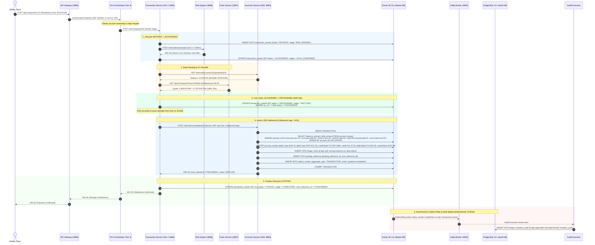

# System Architecture & Technical Design Specification

---

## 1. Executive Summary & Architecture Philosophy

The **Capstone Banking System** follows a strict multi-tier banking architecture adhering to real-world Core vs. Channel separation, single-writer data ownership, and defense-in-depth security:
1. **Tier 1 - Client Interfaces**: Customer Mobile App (Flutter Android), Customer Web App (Flutter Web), and Admin Web Operations Portal (Thymeleaf on `:8090`) with Customer 360, held queue review, and Grafana platform health monitoring.
2. **Tier 2 - Edge Perimeter**: Spring Cloud Gateway (`:8080`) providing JWT signature verification, reactive token-bucket rate limiting, token blacklist filtering, and port cloaking.
3. **Tier 3 - Channel Orchestration Layer**: 
   - **Orchestrator** (Thin, stateless BFF): Coordinates authenticated customer requests, verifies customer account ownership, and handles home aggregation.
   - **Login & Identity Service (`:8082`)**: BCrypt authentication, JWT minting, device binding, and token revocation.
   - **Registration Service (`:8081`)**: Customer onboarding coordinating core account opening and card issuance.
   - **Notification Service (`:8085`)**: Asynchronous customer push/email alerts and in-app notification inbox.
   - **Channel DB (PostgreSQL)**: Dedicated channel database (`app_user_master`, `notification_log`) physically isolated from core ledgers.
4. **Tier 4 - Core & Domain Services Layer (Oracle XE 21c - Multi-Schema)**:
   - **Transaction / Payment Service (`:8084`)** (`PAYMENT` schema): Executes the 7-status payment saga with atomic CAS claims, idempotency locks, shortfall routing, customer cancels, and 4-eyes reversals.
   - **Risk Engine (`:8088 / Java`)**: Synchronous fraud heuristics ($\le 200\text{ms}$ fail-closed SLA; advisory only, never mutates balances).
   - **Forex Service (`:8087`)** (`FX` schema): Hourly exchange rate poll from external API, 30-second locked conversion quotes with 1.5% spread margin, and stale rate guard.
   - **Mock Core Banking System (CBS - `accounts-service` `:8083`)** (`CBS` schema): Authoritative System of Record for balances. Executes ascending row locking (`SELECT ... FOR UPDATE`), available balance calculation (`balance - held`), atomic 6-leg settlement, core `ledger_entry` journal, and transactional outbox.
   - **EOD Batch Processing Service**: Scheduled auto-debit standing instructions execution.
5. **Tier 5 - Event Bus, Audit & Reconciliation Layer**:
   - **Apache Kafka (`:9092`)**: Partitioned event topics (`transaction.events`, `txn.lifecycle`), retry topics, and Dead Letter Queue (`*.dlq`).
   - **Audit Consumer (`audit-consumer`)**: Dedicated single-writer consuming Kafka events to append immutable records to PostgreSQL Audit DB.
   - **Reconciliation Service (`:8086`)**: Independent dual-data-source auditor comparing Oracle master balances against PostgreSQL audit ledger legs and hub-to-ledger transaction parity.
6. **Tier 6 - Data Persistence & Storage Layer**:
   - **Oracle XE 21c**: Master OLTP store with dedicated per-service schemas (`CBS`, `PAYMENT`, `FX`).
   - **PostgreSQL (Channel DB)**: User credentials and in-app notification logs.
   - **PostgreSQL 15+ (Audit DB)**: Append-only audit store with database triggers blocking `UPDATE` and `DELETE`.
   - **Redis 7**: High-speed disposable acceleration (JWT blacklist, rate limiter counters, balance fast-read cache, 120s idempotency fast-lock).

---

## 2. Comprehensive System Architecture Diagram

```mermaid
%% Core Retail Ledger & Balance Mutation Engine — Revised Multi-Tier Architecture
%% Solid line = Synchronous REST/HTTP | Dashed line = Asynchronous Kafka event | Dotted line = Internal/Admin

flowchart TB
    %% ================= EXTERNAL THIRD-PARTY (OUTSIDE ALL TIERS) =================
    FXApi[/"<b>api.frankfurter.dev</b><br/>(External FX Feed &bull; Daily EOD Poll)"/]:::external

    %% ================= TIER 1: CLIENTS =================
    subgraph T1["Tier 1 - Experience & Channel Clients"]
        direction LR
        MobileClient["<b>Customer Mobile App</b><br/>(Flutter Android)<br/>• Virtual Card & Pockets UI<br/>• QR Scan & Biometrics"]:::client
        WebClient["<b>Customer Web App</b><br/>(Flutter Web)<br/>• Shared Flutter Codebase<br/>• Pockets & FX Swap"]:::client
        AdminPortal["<b>Admin Web Portal</b><br/>(Thymeleaf + Spring Boot :8090)<br/>• Customer 360 & Holds Review<br/>• 4-Eyes Reversals & DLQ Replay"]:::admin
        GrafanaUI["<b>Grafana Dashboard (:3000)</b><br/>• TPS, Latencies, Hikari Pools<br/>• Kafka Lag Metrics"]:::metrics
    end

    %% ================= TIER 2: EDGE PERIMETER =================
    subgraph T2["Tier 2 - Edge Perimeter (:8080)"]
        GW["<b>Spring Cloud Gateway (:8080)</b><br/>• JWT Auth & Signature Verification<br/>• Redis Reactive Rate-Limiter<br/>• Token Blacklist & Port Cloaking (CH-03)"]:::gateway
    end

    %% ================= TIER 3: CHANNEL LAYER (CUSTOMER-FACING ONLY) =================
    subgraph T3["Tier 3 - Channel & Digital Banking Layer (Customer-Facing Only &bull; Channel DB)"]
        ORC["<b>Thin Orchestrator</b><br/>• Authenticated Customer Requests<br/>• Ownership Verification<br/>• Home Dashboard Aggregation"]:::channel
        RegSvc["<b>Registration Service (:8081)</b><br/>• Customer KYC Onboarding<br/>• Calls CBS to open CIF, Pocket & Card"]:::channel
        LoginSvc["<b>Login Service (:8082)</b><br/>• BCrypt Password & PIN Verification<br/>• Issues JWT & Refresh Tokens<br/>• Device Binding"]:::channel
        NotifSvc["<b>Notification Service (:8085)</b><br/>• Push, Email OTP & Alerts<br/>• In-App Inbox (notification_log)"]:::channel
    end

    %% ================= TIER 4: CORE & DOMAIN TIER =================
    subgraph T4["Tier 4 - Core & Domain Services Layer (Oracle XE Multi-Schema)"]
        TxnSvc["<b>Transaction / Payment Service (:8084)</b><br/><i>PAYMENT Schema</i><br/>• 7-Status Lifecycle with CAS Transitions<br/>• Smart Currency Shortfall Routing<br/>• Customer Cancel & 4-Eyes Reversals<br/>• Idempotency Fast-Lock Deduplication"]:::payment
        RiskSvc["<b>Risk & Fraud Engine (:8088 / Java)</b><br/>• Velocity & Heuristic Rules<br/>• SLA &le; 200ms Fail-Closed (Advisory)"]:::risk
        ForexSvc["<b>Forex Service (:8087)</b><br/><i>FX Schema</i><br/>• Daily EOD Frankfurter Poll<br/>• 30s Locked Quotes (1.5% Spread)<br/>• Stale Rate Guard (>24h)"]:::forex
        AccountsSvc["<b>Accounts Service (:8083) - Mock CBS Engine</b><br/><i>CBS Schema (Authoritative Vault)</i><br/>• Row-Locked Balances (SELECT ... FOR UPDATE)<br/>• Multi-Currency Pockets (PHP, USD, EUR)<br/>• Virtual Cards (card_master) & Daily Limits<br/>• account_hold & Available Balance<br/>• Core ledger_entry Journal<br/>• Atomic Settlement + outbox_master"]:::core
        BatchSvc["<b>EOD Batch Processing Service</b><br/>• Auto-Debit Standing Instructions<br/>• Checkpointed Batch Engine"]:::batch
    end

    %% ================= TIER 5: ASYNC & AUDIT =================
    subgraph T5["Tier 5 - Event Bus, Audit & Control Plane"]
        KafkaBroker["<b>Apache Kafka (:9092 / :29092)</b><br/>• Topics: transaction.events, txn.lifecycle<br/>• Retry Topics (*.retry) & DLQ (*.dlq)"]:::broker
        AuditConsumer["<b>Audit Consumer Module</b><br/>• Single-Writer of Evidence<br/>• Consumes Kafka & Appends to Postgres"]:::auditconsumer
        ReconSvc["<b>Reconciliation Service (:8086)</b><br/>• Dual DataSource: Oracle vs. PostgreSQL<br/>• Hub-to-Ledger & Audit Parity Check<br/>• Emits Discrepancies to Kafka"]:::recon
    end

    %% ================= TIER 6: STORAGE =================
    subgraph T6["Tier 6 - Data Persistence & Storage Layer"]
        direction LR
        OracleDB[("<b>Oracle XE 21c (Master DB)</b><br/>• <b>CBS:</b> customer_master, account_master,<br/>  card_master, account_hold, ledger_entry,<br/>  posting_reference, outbox_master<br/>• <b>PAYMENT:</b> transaction_master,<br/>  standing_instruction, admin_approval<br/>• <b>FX:</b> fx_rate")]:::master
        ChannelDB[("<b>PostgreSQL (Channel DB)</b><br/>• app_user_master<br/>• notification_log")]:::channeldb
        PostgresDB[("<b>PostgreSQL 15+ (Audit DB)</b><br/><i>Immutable Append-Only</i><br/>• ledger_mutation_audit<br/>• risk_screening_audit<br/>• fx_conversion_audit<br/>• recon_run_audit & result")]:::audit
        RedisCache[("<b>Redis 7 (In-Memory Tier)</b><br/>• jwt_blacklist:* (TTL)<br/>• rate_limiter:*<br/>• balance_cache:*<br/>• idempotency:* (120s TTL)")]:::cache
    end

    %% Wiring Connections — Ingress
    MobileClient -->|"HTTPS / REST"| GW
    WebClient -->|"HTTPS / REST"| GW
    AdminPortal -.->|"Embeds/Links"| GrafanaUI

    %% Internal Admin Access Plane (Direct internal staff access, bypasses customer Thin Orchestrator)
    AdminPortal ==>|"Customer 360 / Holds / Freezes"| AccountsSvc
    AdminPortal ==>|"4-Eyes Reversals / DLQ Replay"| TxnSvc
    AdminPortal -.->|"Inspect Recon Runs"| ReconSvc

    %% Gateway Routing (Customer Traffic)
    GW -->|"POST /api/auth/login, /logout"| LoginSvc
    GW -->|"POST /api/auth/register"| RegSvc
    GW -->|"Authenticated Customer Requests (/api/v1/**)"| ORC
    GW <-->|"Verify Blacklist & Rate Limits"| RedisCache

    %% Tier 3 Orchestrator Routing
    ORC -->|"1. Forward Transfer"| TxnSvc
    ORC -->|"2. Read Pockets"| AccountsSvc
    ORC -->|"3. Get Quotes"| ForexSvc

    %% Onboarding Flow: RegSvc -> CBS (provisions Customer CIF, Account & Card) -> ChannelDB (credentials)
    RegSvc -->|"1. Provision Customer, Pocket & Card"| AccountsSvc
    RegSvc -->|"2. Write App User Credentials"| ChannelDB
    LoginSvc -->|"Read/Write Credentials"| ChannelDB
    NotifSvc -->|"Append Alert Log"| ChannelDB

    %% Tier 4 Internal Calls
    TxnSvc <-->|"1. Sync Risk Check (SLA <= 200ms)"| RiskSvc
    TxnSvc <-->|"2. Fetch Locked Quote"| ForexSvc
    TxnSvc ==>|"3. POST /internal/core/settlement (aud=cbs)"| AccountsSvc
    TxnSvc <-->|"4. Sweeper Inquiry"| AccountsSvc
    BatchSvc -->|"Auto-Debit Execution"| TxnSvc
    ForexSvc -.->|"Daily EOD Polling (Every 24h)"| FXApi

    %% Database Writes
    AccountsSvc -->|"ACID Transaction (CBS Schema)"| OracleDB
    TxnSvc -->|"Read/Write (PAYMENT Schema)"| OracleDB
    ForexSvc -->|"Upsert fx_rate (FX Schema)"| OracleDB

    %% Cache Operations
    AccountsSvc <-->|"Invalidate / Read balance_cache"| RedisCache
    TxnSvc <-->|"Idempotency Fast-Lock (SETNX 120s)"| RedisCache
    LoginSvc -->|"Set jwt_blacklist (TTL on logout)"| RedisCache

    %% Async Kafka & Outbox
    AccountsSvc -.->|"OutboxRelay publishes transaction.events"| KafkaBroker
    TxnSvc -.->|"Publishes txn.lifecycle events"| KafkaBroker
    ForexSvc -.->|"Publishes fx.converted"| KafkaBroker
    KafkaBroker -.->|"Consumes transaction.events"| AuditConsumer
    KafkaBroker -.->|"Consumes events"| NotifSvc
    AuditConsumer -->|"Append Audit Rows"| PostgresDB
    KafkaBroker -.->|"Routes exhausted retries to *.dlq"| KafkaBroker

    %% Reconciliation
    ReconSvc -->|"1. Read Live Balances & Journal"| OracleDB
    ReconSvc -->|"2. Read Mutation History"| PostgresDB
    ReconSvc -->|"3. Write Recon Audit"| PostgresDB
    ReconSvc -.->|"Publishes Discrepancies"| KafkaBroker

    %% Styling Classes
    classDef client fill:#e8f0fe,stroke:#4285f4,stroke-width:2px,color:#1a1a1a,font-weight:bold
    classDef admin fill:#f1f3f4,stroke:#5f6368,stroke-width:2px,color:#1a1a1a,font-weight:bold
    classDef metrics fill:#ffe8d6,stroke:#d9480f,stroke-width:2px,color:#1a1a1a,font-weight:bold
    classDef gateway fill:#fff3cd,stroke:#e6a700,stroke-width:2px,color:#1a1a1a,font-weight:bold
    classDef channel fill:#d1e7dd,stroke:#198754,stroke-width:2px,color:#1a1a1a,font-weight:bold
    classDef payment fill:#cfe2ff,stroke:#0d6efd,stroke-width:2px,color:#1a1a1a,font-weight:bold
    classDef core fill:#d1ecf1,stroke:#0c5460,stroke-width:2px,color:#1a1a1a,font-weight:bold
    classDef risk fill:#f8d7da,stroke:#dc3545,stroke-width:2px,color:#1a1a1a,font-weight:bold
    classDef forex fill:#c9f7dc,stroke:#0f9960,stroke-width:2px,color:#1a1a1a,font-weight:bold
    classDef batch fill:#e9ecef,stroke:#495057,stroke-width:2px,color:#1a1a1a,font-weight:bold
    classDef broker fill:#e2d9f3,stroke:#6f42c1,stroke-dasharray: 4 2,stroke-width:2px,color:#1a1a1a,font-weight:bold
    classDef auditconsumer fill:#fde2c8,stroke:#fd7e14,stroke-width:2px,color:#1a1a1a,font-weight:bold
    classDef notif fill:#f3e8ff,stroke:#9333ea,stroke-width:2px,color:#1a1a1a,font-weight:bold
    classDef recon fill:#ffe0b3,stroke:#e67300,stroke-width:2px,color:#1a1a1a,font-weight:bold
    classDef master fill:#f8d7da,stroke:#dc3545,stroke-width:2px,color:#1a1a1a,font-weight:bold
    classDef channeldb fill:#d4edda,stroke:#28a745,stroke-width:2px,color:#1a1a1a,font-weight:bold
    classDef audit fill:#fde2c8,stroke:#fd7e14,stroke-width:2px,color:#1a1a1a,font-weight:bold
    classDef cache fill:#cfe2ff,stroke:#0d6efd,stroke-width:2px,color:#1a1a1a,font-weight:bold
    classDef external fill:#f0f0f0,stroke:#888,stroke-dasharray: 2 2,stroke-width:1px,color:#1a1a1a,font-weight:bold
```

---

## 3. Strict Single-Writer Data Ownership Matrix (ADR-002 Compliant)

| Database Store & Schema | Table / Entity | Sole Owning Service | Permitted Operations | Read Access by Other Services |
| :--- | :--- | :--- | :--- | :--- |
| **Oracle XE (`CBS`)** | `customer_master` | `accounts-service` (Mock CBS) | INSERT, UPDATE | `registration-service`, Admin Portal (Customer 360) |
| **Oracle XE (`CBS`)** | `account_master` | `accounts-service` (Mock CBS) | **INSERT, UPDATE (`SELECT ... FOR UPDATE`)** | `reconciliation-service` (Read-only), Admin Portal |
| **Oracle XE (`CBS`)** | `card_master` | `accounts-service` (Mock CBS) | **INSERT, UPDATE** (Virtual card issuance & limits) | `transaction-service` (via token), Admin Portal |
| **Oracle XE (`CBS`)** | `account_hold` | `accounts-service` (Mock CBS) | **INSERT, UPDATE, DELETE** | `transaction-service` (via CBS API), Admin Portal |
| **Oracle XE (`CBS`)** | `ledger_entry` | `accounts-service` (Mock CBS) | **INSERT ONLY** (Immutable Core Journal) | `reconciliation-service` (Read-only), Statement API |
| **Oracle XE (`CBS`)** | `posting_reference` | `accounts-service` (Mock CBS) | INSERT, UPDATE (`status`) | `transaction-service` (Deduplication) |
| **Oracle XE (`CBS`)** | `outbox_master` | `accounts-service` (Mock CBS) | **INSERT, UPDATE (`status`)** | `OutboxMasterRelayService` |
| **Oracle XE (`PAYMENT`)** | `transaction_master` | `transaction-service` | INSERT, UPDATE (CAS Transitions) | `reconciliation-service` (Read-only), Admin Portal |
| **Oracle XE (`PAYMENT`)** | `standing_instruction`| `transaction-service` | INSERT, UPDATE (`next_execution_date`)| `batch-service` (Auto-Debit Scheduler) |
| **Oracle XE (`PAYMENT`)** | `admin_approval` | `transaction-service` | INSERT, UPDATE (4-Eyes Maker-Checker) | Admin Web Portal |
| **Oracle XE (`FX`)** | `fx_rate` | `forex-service` | UPSERT (Daily EOD poll) | `transaction-service` (via Forex API) |
| **Postgres (Channel DB)**| `app_user_master` | `login-service` | INSERT, UPDATE | Stateless JWT Auth |
| **Postgres (Channel DB)**| `notification_log` | `notification-service` | INSERT, UPDATE (`status`, `read_at`) | Mobile/Web In-App Inbox |
| **Postgres (Audit DB)** | `ledger_mutation_audit`| `AuditLedgerConsumer` (Async) | **INSERT ONLY** (Triggers block UPDATE/DELETE) | `reconciliation-service`, Admin Portal |
| **Postgres (Audit DB)** | `risk_screening_audit` | `AuditLedgerConsumer` (Async) | **INSERT ONLY** | Compliance, Admin Portal |
| **Postgres (Audit DB)** | `fx_conversion_audit` | `AuditLedgerConsumer` (Async) | **INSERT ONLY** | `reconciliation-service`, Admin Portal |
| **Postgres (Audit DB)** | `recon_run_audit` / `_result` | `reconciliation-service` | INSERT, UPDATE | Admin Portal |
| **Redis 7** | `rate_limiter:*` | `api-gateway` | Atomic Increment / Window | Edge Gateway only |
| **Redis 7** | `jwt_blacklist:*` | `login-service` | Write TTL on Logout | `api-gateway` (Auth Filter) |
| **Redis 7** | `balance_cache:*` | `accounts-service` | Read, Invalidate on Commit | Fallback during DB degradation |
| **Redis 7** | `idempotency:*` | `transaction-service` | `SETNX` fast-lock (120s TTL) | Channel mutation endpoints |

---

## 4. End-to-End Lifecycle & Atomic Settlement Journey

---

## 5. Comprehensive Entity-Relationship Diagram (ERD) — Grouped by Layer & Schema

The 18 tables are structured across **3 physical databases** and **5 logical schemas**, reflecting our strict single-writer ownership boundaries:

### 5.1 Visual Schema & Layer Boundaries (Rendered Groupings)

```mermaid
flowchart TB
    %% =========================================================
    %% LAYER 1 & 2: ORACLE XE 21c (MASTER OLTP)
    %% =========================================================
    subgraph ORA["Oracle XE 21c (Master OLTP Database)"]
        
        subgraph CBS_SCHEMA["1. CBS Schema (accounts-service :8083)"]
            T_CUST["CUSTOMER_MASTER<br/><i>Core Customer Record & KYC</i>"]
            T_ACCT["ACCOUNT_MASTER<br/><i>Currency Pockets & Balances</i>"]
            T_CARD["CARD_MASTER<br/><i>Virtual Card & Limits</i>"]
            T_HOLD["ACCOUNT_HOLD<br/><i>Active Amount Holds</i>"]
            T_LEDG["LEDGER_ENTRY<br/><i>Authoritative Leg Journal</i>"]
            T_POST["POSTING_REFERENCE<br/><i>Settlement Deduplication</i>"]
            T_OUTB["OUTBOX_MASTER<br/><i>Core Event Outbox</i>"]
        end

        subgraph PMT_SCHEMA["2. PAYMENT Schema (transaction-service :8084)"]
            T_TXN["TRANSACTION_MASTER<br/><i>7-Status Saga Tracker</i>"]
            T_SI["STANDING_INSTRUCTION<br/><i>Auto-Debit Schedules</i>"]
            T_APPR["ADMIN_APPROVAL<br/><i>4-Eyes Maker-Checker</i>"]
        end

        subgraph FX_SCHEMA["3. FX Schema (forex-service :8087)"]
            T_FX["FX_RATE<br/><i>Daily EOD Cached Rates</i>"]
        end
    end

    %% =========================================================
    %% LAYER 3: POSTGRESQL (CHANNEL DB)
    %% =========================================================
    subgraph CHN["PostgreSQL (Channel DB)"]
        subgraph CHN_SCHEMA["4. Channel & Identity Layer (Customer-Facing Only)"]
            T_USER["APP_USER_MASTER<br/><i>BCrypt Passwords & Device Hash</i>"]
            T_NOTIF["NOTIFICATION_LOG<br/><i>In-App Inbox Alerts</i>"]
        end
    end

    %% =========================================================
    %% LAYER 4: POSTGRESQL 15+ (AUDIT DB)
    %% =========================================================
    subgraph AUD["PostgreSQL 15+ (Audit Database - Append-Only)"]
        subgraph AUD_SCHEMA["5. Audit Schema (AuditLedgerConsumer)"]
            T_AUD_LEDG["LEDGER_MUTATION_AUDIT<br/><i>Immutable Leg Mutations</i>"]
            T_AUD_RISK["RISK_SCREENING_AUDIT<br/><i>Fraud Scores & Rule Hits</i>"]
            T_AUD_FX["FX_CONVERSION_AUDIT<br/><i>Executed FX Conversions</i>"]
        end

        subgraph REC_SCHEMA["6. Recon Schema (reconciliation-service :8086)"]
            T_REC_RUN["RECON_RUN_AUDIT<br/><i>Reconciliation Run Metadata</i>"]
            T_REC_RES["RECON_RESULT_AUDIT<br/><i>Drift & Exception Break Records</i>"]
        end
    end

    %% Core CBS Relationships
    T_CUST --> T_ACCT
    T_CUST --> T_CARD
    T_ACCT --> T_CARD
    T_ACCT --> T_HOLD
    T_ACCT --> T_LEDG
    T_HOLD -.-> T_LEDG
    T_POST --> T_LEDG
    T_ACCT --> T_OUTB

    %% Channel Relationships
    T_CUST -.-> T_USER
    T_CUST -.-> T_NOTIF

    %% Payment Hub Relationships
    T_CUST --> T_TXN
    T_CUST --> T_SI
    T_CARD -.->|"references card_token"| T_TXN
    T_TXN --> T_APPR
    T_POST -.-> T_TXN

    %% Cross-DB Audit Feeds
    T_TXN -.-> T_AUD_LEDG
    T_TXN -.-> T_AUD_RISK
    T_TXN -.-> T_AUD_FX
    T_REC_RUN --> T_REC_RES

    %% Styling
    classDef cbsNode fill:#e0f2fe,stroke:#0284c7,stroke-width:2px,color:#0c4a6e;
    classDef pmtNode fill:#fef3c7,stroke:#d97706,stroke-width:2px,color:#78350f;
    classDef fxNode fill:#ecfdf5,stroke:#059669,stroke-width:2px,color:#064e3b;
    classDef chnNode fill:#f3e8ff,stroke:#9333ea,stroke-width:2px,color:#581c87;
    classDef audNode fill:#ffedd5,stroke:#ea580c,stroke-width:2px,color:#7c2d12;
    classDef recNode fill:#fee2e2,stroke:#dc2626,stroke-width:2px,color:#7f1d1d;

    class T_CUST,T_ACCT,T_CARD,T_HOLD,T_LEDG,T_POST,T_OUTB cbsNode;
    class T_TXN,T_SI,T_APPR pmtNode;
    class T_FX fxNode;
    class T_USER,T_NOTIF chnNode;
    class T_AUD_LEDG,T_AUD_RISK,T_AUD_FX audNode;
    class T_REC_RUN,T_REC_RES recNode;
```

### 5.2 Complete Entity Attribute Specification

```mermaid
erDiagram
    %% =========================================================
    %% 1. CORE BANKING SYSTEM (Oracle XE 21c - CBS Schema)
    %% Sole Writer: accounts-service (:8083)
    %% =========================================================
    CUSTOMER_MASTER ||--o{ ACCOUNT_MASTER : "owns pockets"
    CUSTOMER_MASTER ||--o{ CARD_MASTER : "owns virtual card"
    ACCOUNT_MASTER ||--o{ CARD_MASTER : "linked debit account"
    ACCOUNT_MASTER ||--o{ ACCOUNT_HOLD : "active holds"
    ACCOUNT_MASTER ||--o{ LEDGER_ENTRY : "posted journal legs"
    ACCOUNT_HOLD |o--o{ LEDGER_ENTRY : "captured by"
    POSTING_REFERENCE ||--o{ LEDGER_ENTRY : "deduplicates legs"
    ACCOUNT_MASTER ||--o{ OUTBOX_MASTER : "enqueues core event"

    %% =========================================================
    %% 2. CHANNEL & IDENTITY LAYER (PostgreSQL - Channel DB)
    %% Writers: login-service (:8082), notification-service (:8085)
    %% =========================================================
    CUSTOMER_MASTER ||--o{ APP_USER_MASTER : "customer login credentials"
    CUSTOMER_MASTER ||--o{ NOTIFICATION_LOG : "inbox alerts"

    %% =========================================================
    %% 3. PAYMENT ORCHESTRATION HUB (Oracle XE 21c - PAYMENT Schema)
    %% Sole Writer: transaction-service (:8084)
    %% =========================================================
    CUSTOMER_MASTER ||--o{ TRANSACTION_MASTER : "initiates transfer"
    CUSTOMER_MASTER ||--o{ STANDING_INSTRUCTION : "auto-debit schedule"
    CARD_MASTER ||--o{ TRANSACTION_MASTER : "card payment source (card_token)"
    TRANSACTION_MASTER ||--o{ ADMIN_APPROVAL : "maker-checker reviews"
    POSTING_REFERENCE ||--|| TRANSACTION_MASTER : "links core ref"

    %% =========================================================
    %% 4. AUDIT & RECONCILIATION LAYER (PostgreSQL 15+ - Audit DB)
    %% Writers: AuditLedgerConsumer (Audit), reconciliation-service (Recon)
    %% =========================================================
    TRANSACTION_MASTER ||--o{ LEDGER_MUTATION_AUDIT : "immutable audit"
    TRANSACTION_MASTER ||--o| RISK_SCREENING_AUDIT : "fraud score log"
    TRANSACTION_MASTER ||--o| FX_CONVERSION_AUDIT : "fx rate audit"
    RECON_RUN_AUDIT ||--o{ RECON_RESULT_AUDIT : "records breaks"

    %% =========================================================
    %% SCHEMA 1: Oracle XE - CBS Schema (Mock Core Banking Vault)
    %% =========================================================
    CUSTOMER_MASTER {
        string customer_id PK "VARCHAR2(36) UUID"
        string first_name "VARCHAR2(100)"
        string last_name "VARCHAR2(100)"
        string email "VARCHAR2(255) UNIQUE"
        string contact_no "VARCHAR2(20)"
        date birth_date "DATE"
        string kyc_status "PENDING, VERIFIED, REJECTED (R-09)"
        datetime created_at "TIMESTAMP"
    }

    ACCOUNT_MASTER {
        string account_id PK "VARCHAR2(36) UUID"
        string customer_id FK "NULL for BANK_* internal clearing accounts"
        string account_number "VARCHAR2(16) shared across customer pockets"
        string account_type "CUSTOMER, SAVINGS, CHECKING, BANK_FX_POSITION, BANK_FEE_INCOME, BANK_CASH_CLEARING"
        string currency_code "CHAR(3) PHP, USD, EUR"
        string normal_balance "CHAR(2) DR or CR (R-02)"
        decimal balance_amount "NUMBER(18,4) >= 0 only for CUSTOMER (R-02)"
        decimal held_amount "NUMBER(18,4) >= 0 and <= balance"
        string customer_locked "CHAR(1) Y/N (blocks debits only) (R-06)"
        string admin_frozen "CHAR(1) Y/N (blocks debits and credits) (R-06)"
        string account_status "ACTIVE, CLOSED"
        int version "NUMBER(19)"
    }

    ACCOUNT_HOLD {
        string hold_id PK "VARCHAR2(36) UUID"
        string account_id FK "VARCHAR2(36)"
        string txn_id "NULL for ADMIN_HOLD"
        string hold_type "RISK_HOLD, ADMIN_HOLD (BR-18, BR-33)"
        decimal amount "NUMBER(18,4) > 0"
        decimal captured_amount "NUMBER(18,4) default 0"
        string status "ACTIVE, RELEASED, CAPTURED, EXPIRED"
        string reason_code "VARCHAR2(40)"
        string customer_reason "VARCHAR2(200) user-facing notice"
        string placed_by "SYSTEM or admin username"
        datetime expires_at "TIMESTAMP"
        datetime resolved_at "TIMESTAMP"
    }

    LEDGER_ENTRY {
        string entry_id PK "VARCHAR2(36) UUIDv5(txn_id-leg-n)"
        string txn_id "VARCHAR2(36)"
        int leg_no "NUMBER(3)"
        string account_id FK "VARCHAR2(36)"
        string direction "DEBIT, CREDIT"
        decimal amount "NUMBER(18,4) > 0"
        string currency_code "CHAR(3)"
        decimal running_balance "NUMBER(18,4) balance after leg (R-07)"
        string hold_id "hold captured by this leg"
        date value_date "DATE (R-07)"
        date business_date "DATE"
        string narrative "VARCHAR2(255) statement line text (R-07)"
        string reversal_of_entry "VARCHAR2(36) links reversal entry"
        datetime posted_at "TIMESTAMP"
    }

    POSTING_REFERENCE {
        string posting_reference_id PK "VARCHAR2(36) equals txn_id"
        string core_reference_id "VARCHAR2(50) UNIQUE"
        string request_hash "VARCHAR2(64)"
        string txn_type "TRANSFER, REVERSAL, WITHDRAWAL, DEPOSIT (R-12)"
        string status "SETTLED, ABORTED"
        datetime settled_at "TIMESTAMP"
    }

    CARD_MASTER {
        string card_id PK "VARCHAR2(36) UUID"
        string customer_id FK "VARCHAR2(36)"
        string account_id FK "VARCHAR2(36) primary PHP pocket"
        string card_token "VARCHAR2(64) UNIQUE"
        string masked_pan "VARCHAR2(19)"
        string expiry_date "VARCHAR2(5)"
        string card_status "ACTIVE, FROZEN, BLOCKED"
        int ecom_enabled "NUMBER(1)"
        decimal daily_limit "NUMBER(18,2)"
    }

    OUTBOX_MASTER {
        string outbox_id PK "VARCHAR2(36) UUID"
        string aggregate_type "ACCOUNT, TRANSACTION, HOLD"
        string aggregate_id "VARCHAR2(36)"
        string event_type "payment.completed, balance.updated, hold.expired"
        string payload "CLOB JSON"
        string status "PENDING, PUBLISHED, FAILED"
        int attempt_count "NUMBER"
        datetime created_at "TIMESTAMP"
    }

    %% =========================================================
    %% SCHEMA 2: Oracle XE - PAYMENT Schema (Transaction Hub)
    %% Sole Writer: transaction-service (:8084)
    %% =========================================================
    TRANSACTION_MASTER {
        string txn_id PK "VARCHAR2(36) UUID"
        string customer_id FK "VARCHAR2(36)"
        string txn_type "TRANSFER, REVERSAL, WITHDRAWAL, DEPOSIT (R-12)"
        string debit_account_id "VARCHAR2(36)"
        string credit_account_id "VARCHAR2(36)"
        decimal mutation_amount "NUMBER(18,4) > 0"
        string currency_code "CHAR(3)"
        string is_cross_currency "Y/N"
        decimal fx_rate "NUMBER(18,8)"
        decimal dest_amount "NUMBER(18,4)"
        string dest_currency_code "CHAR(3)"
        string txn_status "INITIATED, RESERVED, AUTHORIZED, PROCESSING, POSTED, FAILED, CANCELLED"
        string stage "11-stage tracker string"
        string core_reference_id "VARCHAR2(50)"
        string idempotency_key "VARCHAR2(64)"
        string hold_id "VARCHAR2(36)"
        string original_txn_id "VARCHAR2(36)"
        string reversed "CHAR(1)"
        string reversal_txn_id "VARCHAR2(36)"
        date business_date "DATE"
        string failure_code "VARCHAR2(40)"
        decimal risk_score "NUMBER(4,2)"
        string risk_decision "ALLOW, STEP_UP_OTP, HOLD, REJECT"
        string risk_rules "JSON triggered rules"
    }

    STANDING_INSTRUCTION {
        string instruction_id PK "VARCHAR2(36) UUID"
        string customer_id FK "VARCHAR2(36)"
        string source_account_id "VARCHAR2(36)"
        string target_account_id "VARCHAR2(36)"
        decimal amount "NUMBER(18,4)"
        string currency_code "CHAR(3)"
        string frequency "DAILY, WEEKLY, MONTHLY"
        date next_execution_date "DATE (auto-debit schedule pointer)"
        string status "ACTIVE, PAUSED, CANCELLED"
        int consecutive_failures "NUMBER"
    }

    ADMIN_APPROVAL {
        string approval_id PK "VARCHAR2(36) UUID (R-05)"
        string target_type "REVERSAL, HOLD_REVIEW, ACCOUNT_UNFREEZE"
        string target_id "VARCHAR2(64)"
        string proposed_payload "CLOB"
        string maker_id "VARCHAR2(36)"
        string checker_id "VARCHAR2(36) CHECK (checker <> maker)"
        string status "PENDING, APPROVED, REJECTED"
        datetime decided_at "TIMESTAMP"
    }

    %% =========================================================
    %% SCHEMA 3: Oracle XE - FX Schema (Treasury & Quotes)
    %% Sole Writer: forex-service (:8087)
    %% =========================================================
    FX_RATE {
        string base_currency PK "CHAR(3)"
        string quote_currency PK "CHAR(3)"
        decimal rate "NUMBER(18,8)"
        datetime fetched_at "TIMESTAMP"
        string source "frankfurter"
    }

    %% =========================================================
    %% SCHEMA 4: PostgreSQL - Channel DB (Customer Identity & Inbox)
    %% Writers: login-service (:8082), notification-service (:8085)
    %% =========================================================
    APP_USER_MASTER {
        string user_id PK "UUID"
        string customer_id FK "UUID (null for staff)"
        string username "VARCHAR(50) UNIQUE"
        string password_hash "VARCHAR(255) BCrypt"
        string pin_hash "VARCHAR(255) BCrypt (R-10)"
        string device_hash "VARCHAR(64)"
        int failed_attempts "INTEGER"
        datetime locked_until "TIMESTAMPTZ"
        string active_status "ACTIVE, LOCKED, DISABLED"
        string role "CUSTOMER, OPS_VIEWER, ADMIN, CHECKER"
    }

    NOTIFICATION_LOG {
        string notif_id PK "UUID"
        string customer_id FK "UUID"
        string channel "PUSH, EMAIL, IN_APP"
        string message "TEXT"
        string status "PENDING, SENT, FAILED"
        datetime created_at "TIMESTAMPTZ"
    }

    %% =========================================================
    %% SCHEMA 5: PostgreSQL 15+ - Audit DB (Immutable Evidence & Recon)
    %% Writers: AuditLedgerConsumer (Audit), reconciliation-service (Recon)
    %% =========================================================
    LEDGER_MUTATION_AUDIT {
        string mutation_uuid PK "UUID (equals ledger_entry.entry_id)"
        string txn_id "VARCHAR(36)"
        int leg_no "INTEGER"
        string account_id "VARCHAR(36)"
        decimal mutation_amount "NUMERIC(18,4)"
        string currency_code "CHAR(3)"
        string mutation_type "DEBIT, CREDIT"
        string txn_type "TRANSFER, REVERSAL, WITHDRAWAL, DEPOSIT (R-12)"
        date business_date "DATE"
        datetime created_at "TIMESTAMPTZ"
    }

    RISK_SCREENING_AUDIT {
        string screening_id PK "UUID"
        string txn_id "VARCHAR(36)"
        string customer_id "VARCHAR(36)"
        decimal risk_score "NUMERIC(4,2)"
        string risk_level "LOW, MEDIUM, HIGH, CRITICAL"
        string risk_decision "ALLOW, STEP_UP_OTP, HOLD, REJECT"
        json triggered_rules "JSONB"
        datetime created_at "TIMESTAMPTZ"
    }

    FX_CONVERSION_AUDIT {
        string conversion_id PK "UUID"
        string txn_id "VARCHAR(36)"
        decimal fx_rate "NUMERIC(18,8)"
        decimal source_amount "NUMERIC(18,4)"
        decimal dest_amount "NUMERIC(18,4)"
        datetime created_at "TIMESTAMPTZ"
    }

    RECON_RUN_AUDIT {
        string run_id PK "UUID"
        date business_date "DATE"
        string scope "AUDIT_PARITY, HUB_TO_LEDGER"
        datetime run_started_at "TIMESTAMPTZ"
        int total_checked "INTEGER"
        int total_matched "INTEGER"
        int total_exceptions "INTEGER"
        string run_status "COMPLETED, FAILED"
    }

    RECON_RESULT_AUDIT {
        string result_id PK "UUID"
        string run_id FK "UUID"
        string txn_id "VARCHAR(36)"
        string account_id "VARCHAR(36)"
        string exception_type "BALANCE_DRIFT, AMOUNT_MISMATCH, UNMATCHED_LEG"
        decimal variance_amount "NUMERIC(18,4)"
    }
```

---

## 6. Holds, Standing Instructions & Lifecycle Specifications

### 6.1 Balance and Hold Mechanics
A hold is an in-flight reservation on an account balance (`balance_amount` remains unchanged; `available_balance` is reduced).
$$\text{Available Balance} = \text{balance\_amount} - \text{held\_amount}$$

* **Account Level (`account_master`):** Maintains `balance_amount` (total posted ledger) and `held_amount` (sum of active holds). `available_balance` is never stored; it is derived or computed via Oracle virtual column.
* **Per-Transaction Hold Breakdown (`account_hold`):** Granular tracking of individual holds (`hold_type`: `RISK_HOLD`, `ADMIN_HOLD`).
* **Atomic Hold Invariant:** `held_amount = \sum \text{amount of ACTIVE holds}`. `accounts-service` updates both in the same Oracle transaction under the row lock (`SELECT ... FOR UPDATE`) on hold placement, release, capture, or expiry.

### 6.2 Hold Lifecycle Across Service Boundaries
Because `accounts-service` owns `account_hold` in the `CBS` schema and `transaction-service` owns `transaction_master` in the `PAYMENT` schema:
1. **Placement:** `transaction-service` invokes `POST /internal/accounts/{id}/holds` (idempotent on `txn_id + hold_type`) and records `hold_id` on `transaction_master`.
2. **Settlement Capture:** In `POST /internal/core/settlement`, passing `capture_hold_id` debits the balance and marks the hold `CAPTURED` in the **same Oracle transaction**. Any excess held funds are released back to available balance.
3. **Cancellation / Reversal:** CAS transitions transaction status to `CANCELLED`, then triggers `DELETE /internal/accounts/{id}/holds/{holdId}`. If network drops, the background sweeper cleans up orphan holds for terminal transactions.
4. **Auto-Expiry:** A background CBS scheduler marks expired holds as `EXPIRED`, restores available balance, and publishes `hold.expired` via `outbox_master`.

### 6.3 Database Constraints & Business Invariants
* **`account_master`:**
  * `CHECK (held_amount >= 0)`
  * `CHECK (held_amount <= balance_amount)`
  * `CHECK (normal_balance IN ('DR', 'CR'))`
  * `CHECK ((account_type = 'CUSTOMER' AND balance_amount >= 0 AND customer_id IS NOT NULL) OR (account_type <> 'CUSTOMER' AND customer_id IS NULL))` (Ensures internal bank clearing accounts like `BANK_CASH_CLEARING` can carry negative balances without check constraint failures).
  * Filtered Unique Index: `UNIQUE (customer_id, currency_code)` for customer accounts; prevents multi-currency pocket duplication.
* **`account_hold`:**
  * `CHECK (amount > 0)`
  * Single-expression function-based unique index for active holds: `CASE WHEN status = 'ACTIVE' AND txn_id IS NOT NULL THEN txn_id || '|' || hold_type END`. Prevents duplicate active transaction holds while permitting multiple active `ADMIN_HOLD` rows.
* **`ledger_entry`:**
  * `UNIQUE (txn_id, leg_no)`
  * Settlement rule: $\sum \text{Debits} = \sum \text{Credits}$ per currency per posting reference.
* **`admin_approval`:**
  * `CHECK (checker_id IS NULL OR checker_id <> maker_id)` (4-Eyes Maker-Checker principle).

---

## 7. Migration & Seeding Strategy

* **Per-Schema DDL:** Run under dedicated Oracle schemas (`CBS`, `PAYMENT`, `FX`) and Postgres databases (`channel_db`, `audit_db`). Cross-schema references are strictly logical (validated via REST/service contracts).
* **Opening Balances as Ledger Entries:** System opening balances (PHP 100,000 seed pockets, bank clearing pools) must be inserted alongside initial `ledger_entry` records with `leg_no = 1` and narrative `OPENING_BALANCE`. This guarantees the Reconciliation Service verifies $\text{balance\_amount} = \sum \text{ledger\_entry}$ with zero false drift breaks.
* **Trial Balance Invariant:** At any point in time across all accounts:
$$\sum_{\text{all accounts}} \text{Credit-Normal Balances} - \sum_{\text{all accounts}} \text{Debit-Normal Balances} = 0$$

---

## 8. Key Architectural Rationales & Design Decisions

### 8.1 Why Mock CBS (`accounts-service`) Owns `card_master` (and Revised Onboarding Flow)
* **Core Banking Alignment:** In real-world retail banking, debit cards, virtual cards, daily transaction limits, and PAN tokens are intrinsic attributes of the customer's deposit account and CIF (Customer Information File). They are not separate independent payment entities.
* **Single Provisioning Journey:** Placing `card_master` in the `CBS` schema allows the onboarding workflow to be clean and atomic:
  1. Customer submits KYC registration via Gateway to `registration-service` (:8081).
  2. `registration-service` invokes Mock CBS (`accounts-service` :8083) via `POST /internal/customers`. In a single Oracle ACID transaction, CBS provisions:
     - The customer KYC CIF (`customer_master`),
     - The initial primary PHP pocket (`account_master`), and
     - The default virtual debit card (`card_master`) with its masked PAN and daily spend limit.
  3. `registration-service` receives the generated `customer_id` and writes the customer's login credentials (BCrypt password hash, PIN hash, device hash) directly to its own **Channel DB** (`app_user_master`).
  4. `registration-service` does **not** call `transaction-service`. `transaction-service` only references cards when a card transaction occurs, looking up or verifying the token via CBS contracts.

### 8.2 What `admin_approval` Is For (4-Eyes Maker-Checker — BR-32 / ADR-002)
* **Risk Segregation:** In banking operations, high-risk administrative mutations (such as manual transaction reversals, releasing high-value fraud holds, or unfreezing an admin-frozen account) cannot be executed by a single operator.
* **Maker-Checker Mechanism:**
  - **Maker Step:** An operations officer (Maker) submits a reversal or unfreeze request through the Admin Web Portal (:8090). This creates a record in `admin_approval` with `status = 'PENDING'`, capturing `target_type`, `target_id`, `maker_id`, and `proposed_payload`.
  - **Checker Step:** A senior supervisor or compliance officer (Checker) reviews the pending queue. The database enforces `CHECK (checker_id <> maker_id)`.
  - **Execution:** Only upon explicit approval (`status = 'APPROVED'`) does the system trigger the corresponding mutation on `transaction_master` or `account_master`.

### 8.3 What `posting_reference` Is For vs `txn_id`
* **Boundary Protection:** `txn_id` is an external identifier generated by the Payment Hub (`transaction-service`). Because microservices communicate over an unreliable network, retried HTTP requests or network timeouts could cause the Payment Hub to resubmit settlement.
* **Core Settlement Deduplication:** `posting_reference` acts as the CBS vault's internal settlement deduplication barrier:
  - `posting_reference_id` is set to `txn_id`.
  - `core_reference_id` is generated by the CBS (e.g., `FT2627800001`).
  - When CBS receives `POST /internal/core/settlement`, it first attempts an insert into `posting_reference`. If a row with `posting_reference_id` already exists with status `SETTLED`, CBS immediately returns the existing `core_reference_id` without re-executing balance mutations or journal inserts.
  - This guarantees absolute settlement idempotency at the database constraint level.

### 8.4 `ledger_entry` vs `ledger_mutation_audit` (OLTP Journal vs Regulatory Audit)
* **`ledger_entry` (Oracle XE `CBS` Schema):**
  - **Synchronous OLTP Master Journal:** Written **in the exact same ACID transaction** as `account_master` under ascending row locks (`SELECT ... FOR UPDATE`).
  - Contains `running_balance`, `value_date`, `business_date`, and `narrative`.
  - Powers real-time customer account statements and balance inquiries with zero latency.
* **`ledger_mutation_audit` (PostgreSQL `audit` Schema):**
  - **Asynchronous Regulatory Evidence:** Appended by `AuditConsumer` via Kafka events (`transaction.events`).
  - Immutable store protected by PostgreSQL triggers that strictly block `UPDATE` and `DELETE`.
  - Decoupled from Oracle OLTP: if PostgreSQL suffers an outage (CH-04), live transactions and statements in Oracle remain 100% operational.
  - Serves as the independent counterparty record for `reconciliation-service` to audit against Oracle.

### 8.5 Why Exactly One Outbox (`outbox_master` in CBS) Instead of Three
* **The Rule of Transactional Outbox:** The outbox pattern is required **only** when a service's local database transaction must publish domain events to an external message broker (Kafka) without dual-write risk.
* **Oracle XE (`CBS` Schema):** The sole database where financial balance mutations happen. Publishing `transaction.events` atomically alongside balance updates is mandatory to guarantee downstream audit and notification delivery. Hence, `outbox_master` lives in `CBS`.
* **Audit DB (PostgreSQL):** A **pure consumer/sink**. It only reads from Kafka and writes audit rows. It never originates business events; having an outbox here would be dead code and redundant overhead.
* **Channel DB (PostgreSQL):** Handles user credentials and in-app notification logs. Login generates stateless JWTs; Notification is an event consumer. Neither initiates financial lifecycle events requiring transactional outbox guarantees.
* **Result:** A single, clean outbox table (`outbox_master` in Oracle `CBS`) satisfies system-wide transactional reliability without unnecessary bloat.

### 8.6 Admin Staff Operations Plane vs Customer Channel Layer
* **Channel Layer is Customer-Facing Only:** Tier 3 (`thin-orchestrator`, `login-service`, `registration-service`) is designed exclusively for retail mobile and web banking apps.
* **Admin Web Portal (:8090) Direct Access:** The Admin Web Portal is an internal back-office application within the backend monorepo. Staff members authenticate with administrative privileges (`ROLE_ADMIN`, `ROLE_CHECKER`) and access internal endpoints directly:
  - Direct calls to `accounts-service` (:8083) for Customer 360 views, account locks, and manual hold reviews.
  - Direct calls to `transaction-service` (:8084) for 4-eyes approval execution and Kafka DLQ message inspections/replays.
  - Direct inspection of `reconciliation-service` (:8086) for discrepancy break reports.
* Staff operations never route through the customer-facing `thin-orchestrator`.

### 8.7 Daily EOD Forex Polling Architecture
* **Off Critical Path:** The Frankfurter API (`api.frankfurter.dev`) is an external third-party dependency located outside all architectural tiers.
* **EOD Batch Refresh:** In compliance with core retail banking standards, foreign exchange reference rates are updated once daily at End-of-Day (EOD / every 24 hours).
* **Guaranteed Uptime:** Live customer transactions never invoke external FX APIs. They execute against cached rates in Oracle XE (`fx_rate`), guarded by a 30-second locked quote (with 1.5% spread margin) and a >24h stale rate fail-safe.

---

## 9. Architectural Glossary

* **Core Banking System (CBS):** The authoritative ledger vault (`accounts-service`) that holds customer account balances, pocket structures, virtual cards, and executes row-locked money mutations in Oracle XE.
* **Core Journal (`ledger_entry`):** The authoritative, append-only record of every single double-entry leg posted inside CBS under the Oracle row lock. Carries `running_balance`, `value_date`, and `narrative` for statements.
* **Normal Balance Convention (`normal_balance`):** Standard double-entry convention where customer accounts are credit-normal (`CR`) and clearing/cash accounts are debit-normal (`DR`). Guarantees `BANK_CASH_CLEARING` can accept debit balances without check-constraint failures.
* **Compare-and-Set (CAS):** An atomic database update pattern (`UPDATE ... WHERE txn_status = 'AUTHORIZED'`) ensuring exactly one process wins a race between payment settlement and customer cancellation.
* **Amount Hold (`account_hold`):** A balance reservation placed in `accounts-service` that reduces `available_balance` without deducting `balance_amount`. Used for risk holds and pre-authorizations.
* **Transactional Outbox:** A pattern where domain events are stored in the same local database transaction as the entity mutation (`outbox_master`), guaranteeing zero lost messages across distributed systems.
* **Fail-Closed:** A security principle where any failure, timeout, or ambiguity in an authorization/fraud check causes the operation to be immediately rejected rather than allowed.
* **Dead Letter Queue (DLQ):** A Kafka error-handling topic (`*.dlq`) where unprocessable poison messages are routed after retry exhaustion for operational inspection and admin replay.
