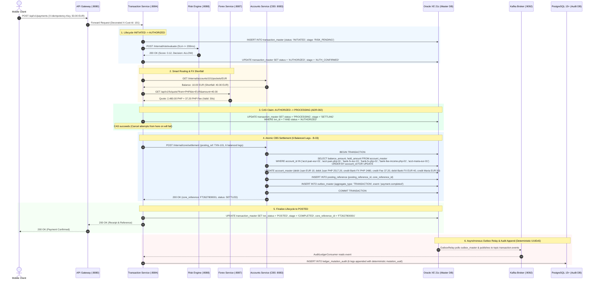

# System Architecture & Technical Design Specification

---

## 1. Executive Summary & Architecture Philosophy

The **Capstone Banking System** combines:
1. **Mock Core Banking System (CBS)**: Ledgers, accounts, currency pockets, pessimistic locks (`SELECT ... FOR UPDATE`), amount holds, and outbox events in Oracle XE 21c (`accounts-service`).
2. **Channel Orchestration & Experience Layer**: Spring Cloud Gateway, Authentication, Idempotency, 7-Status Transaction Lifecycle, Smart FX Routing, and Java Risk Engine (`transaction-service`, `login-service`, `risk-engine`, `forex-service`).
3. **Audit, Reconciliation & Resilience Layer**: Append-only PostgreSQL audit ledgers protected by blocking triggers, scheduled Dual-DataSource reconciliation engine, and Kafka event bus with retry topics and Dead Letter Queue (DLQ).
4. **Client Interfaces**: Customer Mobile App (Flutter Android), Customer Web App (Flutter Web), and Admin Web Operations Portal (Thymeleaf on `:8090`) with Customer 360, held queue review, and Grafana monitoring.

---

## 2. Comprehensive System Architecture Diagram

```mermaid
%% Core Retail Ledger & Balance Mutation Engine — Full System Architecture
%% Solid line = Synchronous REST/HTTP | Dashed line = Asynchronous Kafka event | Dotted line = Internal/Scheduled/DB

flowchart TD
    %% ================= CLIENT TIER =================
    subgraph ClientTier["1. Experience & Channel Client Tier"]
        direction LR
        MobileClient["<b>Customer Mobile App</b><br/>(Flutter Android)<br/>• Virtual Card & Pockets UI<br/>• QR Scan & Biometrics<br/>• Pin Fallback"]:::client
        WebClient["<b>Customer Web App</b><br/>(Flutter Web)<br/>• Shared Flutter Codebase<br/>• Responsive Pockets & FX Swap<br/>• Statement Download"]:::client
        AdminPortal["<b>Admin Web Portal</b><br/>(Thymeleaf + Spring Boot :8090)<br/>• Customer 360 Dashboard<br/>• Freeze/Unfreeze Accounts<br/>• Held Review & Reversals Queue<br/>• Real-Time Monitoring & DLQ Replay"]:::admin
        GrafanaUI["<b>Grafana Dashboard (:3000)</b><br/>• TPS, Latencies, Pool Status<br/>• Kafka Lag & Error Metrics"]:::metrics
    end

    %% ================= PERIMETER / GATEWAY =================
    subgraph PerimeterTier["2. API Gateway & Edge Perimeter (:8080)"]
        GW["<b>Spring Cloud Gateway</b><br/>• JWT Auth & Signature Verification<br/>• Redis Reactive Token-Bucket Rate Limiter<br/>• Token Blacklist Filter<br/>• Reverse Proxy & Port Cloaking"]:::gateway
        FXApi[/"<b>api.frankfurter.dev</b><br/>(External Hourly FX Source)"/]:::external
    end

    %% ================= CHANNEL & ORCHESTRATION LAYER =================
    subgraph ChannelTier["3. Channel & Digital Banking Orchestration Tier"]
        direction TB
        RegSvc["<b>Registration Service (:8081)</b><br/>• Customer KYC Onboarding<br/>• Auto-provisions PHP Account"]:::service
        LoginSvc["<b>Login Service (:8082)</b><br/>• BCrypt Password Verification<br/>• Issues JWT & Refresh Tokens<br/>• OTP Step-up & Device Binding"]:::service
        TxnSvc["<b>Transaction / Payment Service (:8084)</b><br/>• 7-Status Lifecycle with CAS Transitions<br/>• Smart Multi-Currency Shortfall Routing<br/>• Customer Cancel (AUTHORIZED &rarr; CANCELLED)<br/>• Administrative Reversal Coordinator<br/>• Stuck Transaction Sweeper<br/>• Idempotency-Key Deduplication"]:::service
        RiskSvc["<b>Risk & Fraud Engine (:8088 / Java)</b><br/>• Heuristics: Velocity, Amount, Device<br/>• Synchronous Call (SLA &le; 200ms fail-closed)<br/>• Score &gt; 0.85 &rarr; RESERVED (Risk Hold)"]:::risk
        ForexSvc["<b>Forex Service (:8087)</b><br/>• Hourly Frankfurter Poll Scheduler<br/>• 30-Second Locked FX Quotes<br/>• Stale Rate Guard (&gt; 24h &rarr; FX_RATE_STALE)"]:::forex
        BatchSvc["<b>EOD Batch Processing Service</b><br/>• Standing Instructions Execution<br/>• Checkpointed Batch Engine<br/>• EOD Completion Event"]:::batch
    end

    %% ================= CORE BANKING TIER (CBS) =================
    subgraph CoreTier["4. Core Banking System (Mock CBS Tier)"]
        direction TB
        AccountsSvc["<b>Accounts Service (:8083) - Mock CBS Engine</b><br/>• Authoritative System of Record for Balances<br/>• <code>SELECT ... FOR UPDATE</code> Ascending Row Locking<br/>• Multi-Currency Pockets (PHP, USD, EUR)<br/>• <code>account_hold</code> Engine & Available Balance<br/>• Atomic Multi-Leg Settlement + <code>outbox_master</code><br/>• Inquires: <code>GET /internal/core/settlement/{ref}</code>"]:::core
    end

    %% ================= ASYNC / AUDIT / RECON TIER =================
    subgraph AsyncTier["5. Event Bus, Audit & Reconciliation Tier"]
        direction TB
        KafkaBroker["<b>Apache Kafka (:9092 / :29092)</b><br/>• Topics: <code>txn.lifecycle</code>, <code>transaction.events</code><br/>• Retry Topics: <code>*.retry.1</code>, <code>*.retry.2</code><br/>• Dead Letter Queue (DLQ): <code>*.dlq</code>"]:::broker
        NotifSvc["<b>Notification Service (:8085)</b><br/>• Push, Email OTP & Transaction Alerts<br/>• Consumes Kafka Notification Events"]:::notif
        ReconSvc["<b>Reconciliation Service (:8086)</b><br/>• Dual DataSource Engine (Oracle vs. PostgreSQL)<br/>• Detects Balance Drift & Unmatched Legs<br/>• Publishes Discrepancies to Kafka"]:::recon
    end

    %% ================= DATA LAYER =================
    subgraph DataTier["6. Data Layer (Persistence & Cache)"]
        direction LR
        OracleDB[("<b>Oracle XE 21c (Master OLTP DB)</b><br/><i>Mutable State of Record</i><br/>• <code>customer_master</code><br/>• <code>app_user_master</code><br/>• <code>card_master</code><br/>• <code>account_master</code> (Pockets)<br/>• <code>account_hold</code><br/>• <code>transaction_master</code><br/>• <code>standing_instruction</code><br/>• <code>outbox_master</code>")]:::master

        PostgresDB[("<b>PostgreSQL 15+ (Audit Ledger DB)</b><br/><i>Immutable Append-Only Audit</i><br/>• <code>ledger_mutation_audit</code> (Triggers block UPDATE/DELETE)<br/>• <code>risk_screening_audit</code><br/>• <code>fx_conversion_audit</code><br/>• <code>fx_rate_cache</code><br/>• <code>recon_run_audit</code> & <code>recon_result_audit</code><br/>• <code>notification_audit</code><br/>• <code>outbox_audit</code>")]:::audit

        RedisCache[("<b>Redis 7 (In-Memory Tier)</b><br/>• JWT Blacklist (TTL on Logout)<br/>• Rate-Limiting Sliding Counters<br/>• Balance Read Cache (Fast-Lookups)<br/>• Idempotency-Key Fast Lock")]:::cache
    end

    %% ================= WIRING CONNECTIONS =================
    %% Client to Gateway
    MobileClient -->|"HTTPS / REST"| GW
    WebClient -->|"HTTPS / REST"| GW
    AdminPortal -->|"Internal REST / HTTPS"| GW
    AdminPortal -.->|"Embeds/Links"| GrafanaUI

    %% Gateway Routing
    GW -->|"POST /api/auth/register"| RegSvc
    GW -->|"POST /api/auth/login, /logout"| LoginSvc
    GW -->|"POST /api/v1/payments/**, /cards/**"| TxnSvc
    GW -->|"GET /api/v1/accounts/**"| AccountsSvc
    GW -->|"GET /api/v1/fx/**"| ForexSvc
    GW <-->|"Verify Blacklist & Rate Limits"| RedisCache

    %% Service to Oracle Master DB
    RegSvc -->|"INSERT customer_master"| OracleDB
    LoginSvc -->|"Read app_user_master"| OracleDB
    TxnSvc -->|"INSERT/UPDATE transaction_master,<br/>card_master"| OracleDB
    AccountsSvc -->|"SELECT ... FOR UPDATE on account_master,<br/>INSERT/UPDATE account_hold,<br/>INSERT outbox_master (atomic txn)"| OracleDB
    BatchSvc -->|"Read/Execute standing_instruction"| OracleDB

    %% Inter-service Sync Calls
    TxnSvc <-->|"1. Sync Risk Check (SLA &le; 200ms fail-closed)"| RiskSvc
    TxnSvc <-->|"2. Fetch Cached FX Quote + Spread"| ForexSvc
    TxnSvc -->|"3. Sync REST: POST /internal/core/settlement"| AccountsSvc
    TxnSvc <-->|"4. Sweeper Inquiry: GET /internal/core/settlement/{id}"| AccountsSvc

    %% Service to Postgres Audit DB
    ForexSvc -->|"Upsert fx_rate_cache"| PostgresDB
    ForexSvc -.->|"Hourly Polling (Not Per-Txn)"| FXApi
    NotifSvc -->|"Append notification_audit"| PostgresDB

    %% Cache Connections
    AccountsSvc <-->|"Invalidate / Read balance_cache"| RedisCache
    TxnSvc <-->|"Idempotency-Key fast-lock (SETNX)"| RedisCache
    LoginSvc -->|"Set jwt_blacklist (TTL)"| RedisCache

    %% Kafka Event Connections
    AccountsSvc -.->|"OutboxRelay publishes transaction.events"| KafkaBroker
    TxnSvc -.->|"Publishes txn.lifecycle events"| KafkaBroker
    ForexSvc -.->|"Publishes fx.converted"| KafkaBroker

    KafkaBroker -.->|"Consumes transaction.events & appends ledger_mutation_audit"| TxnSvc
    KafkaBroker -.->|"Consumes events"| NotifSvc
    KafkaBroker -.->|"Retry topics & DLQ routing"| KafkaBroker

    %% Reconciliation Dual-Datasource
    ReconSvc -->|"1. Read live balances (Read-Only)"| OracleDB
    ReconSvc -->|"2. Read mutation history (Read-Only)"| PostgresDB
    ReconSvc -->|"3. Write recon_run_audit & recon_result_audit"| PostgresDB
    ReconSvc -.->|"Publishes reconciliation.discrepancy"| KafkaBroker

    %% Styling Classes
    classDef client fill:#e8f0fe,stroke:#4285f4,stroke-width:2px,color:#1a1a1a,font-weight:bold
    classDef admin fill:#f1f3f4,stroke:#5f6368,stroke-width:2px,color:#1a1a1a,font-weight:bold
    classDef metrics fill:#ffe8d6,stroke:#d9480f,stroke-width:2px,color:#1a1a1a,font-weight:bold
    classDef gateway fill:#fff3cd,stroke:#e6a700,stroke-width:2px,color:#1a1a1a,font-weight:bold
    classDef service fill:#d4edda,stroke:#28a745,stroke-width:2px,color:#1a1a1a,font-weight:bold
    classDef core fill:#d1ecf1,stroke:#0c5460,stroke-width:2px,color:#1a1a1a,font-weight:bold
    classDef risk fill:#f8d7da,stroke:#dc3545,stroke-width:2px,color:#1a1a1a,font-weight:bold
    classDef forex fill:#c9f7dc,stroke:#0f9960,stroke-width:2px,color:#1a1a1a,font-weight:bold
    classDef batch fill:#e9ecef,stroke:#495057,stroke-width:2px,color:#1a1a1a,font-weight:bold
    classDef broker fill:#e2d9f3,stroke:#6f42c1,stroke-dasharray: 4 2,stroke-width:2px,color:#1a1a1a,font-weight:bold
    classDef notif fill:#f3e8ff,stroke:#9333ea,stroke-width:2px,color:#1a1a1a,font-weight:bold
    classDef recon fill:#ffe0b3,stroke:#e67300,stroke-width:2px,color:#1a1a1a,font-weight:bold
    classDef master fill:#f8d7da,stroke:#dc3545,stroke-width:2px,color:#1a1a1a,font-weight:bold
    classDef audit fill:#fde2c8,stroke:#fd7e14,stroke-width:2px,color:#1a1a1a,font-weight:bold
    classDef cache fill:#cfe2ff,stroke:#0d6efd,stroke-width:2px,color:#1a1a1a,font-weight:bold
    classDef external fill:#f0f0f0,stroke:#888,stroke-dasharray: 2 2,stroke-width:1px,color:#1a1a1a,font-weight:bold
```

---

## 3. Strict Single-Writer Data Ownership Matrix (ADR-002)

| Database Tier | Table / Entity | Sole Owning Service | Permitted Operations | Read Access by Other Services |
| :--- | :--- | :--- | :--- | :--- |
| **Oracle XE** | `customer_master` | `registration-service` | INSERT, UPDATE | `login-service`, Admin Portal (Customer 360) |
| **Oracle XE** | `app_user_master` | `login-service` | INSERT, UPDATE | None (Stateless JWT auth) |
| **Oracle XE** | `account_master` | **`accounts-service` (Mock CBS)** | **INSERT, UPDATE (`SELECT ... FOR UPDATE`)** | `reconciliation-service` (Read-only), Admin Portal (via CBS API) |
| **Oracle XE** | `account_hold` | **`accounts-service` (Mock CBS)** | **INSERT, UPDATE, DELETE** | `transaction-service` (via CBS API) |
| **Oracle XE** | `outbox_master` | **`accounts-service` (Mock CBS)** | **INSERT, UPDATE (`status`)** | `OutboxMasterRelayService` |
| **Oracle XE** | `transaction_master` | `transaction-service` | INSERT, UPDATE (CAS transitions) | `reconciliation-service` (Read-only), Admin Portal |
| **Oracle XE** | `card_master` | `transaction-service` | INSERT, UPDATE | Mobile/Web Apps (via Gateway) |
| **Oracle XE** | `standing_instruction`| `transaction-service` | INSERT, UPDATE (`next_execution_date`)| Batch Scheduler |
| **PostgreSQL**| `ledger_mutation_audit`| `AuditLedgerConsumer` (Async) | **INSERT ONLY** (Triggers block UPDATE/DELETE) | `reconciliation-service`, Admin Portal |
| **PostgreSQL**| `risk_screening_audit` | `transaction-service` | **INSERT ONLY** | Admin Portal, Compliance |
| **PostgreSQL**| `fx_rate_cache` | `forex-service` | UPSERT | `transaction-service` (via Forex API) |
| **PostgreSQL**| `fx_conversion_audit` | `forex-service` | **INSERT ONLY** | `reconciliation-service`, Admin Portal |
| **PostgreSQL**| `recon_run_audit` / `_result` | `reconciliation-service` | INSERT, UPDATE | Admin Portal |
| **PostgreSQL**| `notification_audit` | `notification-service` | INSERT | Admin Portal |
| **Redis 7** | `rate_limiter:*` | `api-gateway` | Atomic Increment / Window | Edge Gateway only |
| **Redis 7** | `jwt_blacklist:*` | `login-service` | Write TTL on Logout | `api-gateway` (Auth Filter) |
| **Redis 7** | `balance_cache:*` | `accounts-service` | Read, Invalidate on Commit | Fallback during DB degradation |
| **Redis 7** | `idempotency:*` | `transaction-service` | `SETNX` fast-lock (120s TTL) | Channel mutation endpoints |

---

## 4. End-to-End Lifecycle & Atomic Settlement Journey

---

## 5. Comprehensive Entity-Relationship Diagram (ERD)

```mermaid
erDiagram
    CUSTOMER_MASTER ||--o{ APP_USER_MASTER : "authenticates via"
    CUSTOMER_MASTER ||--o{ CARD_MASTER : "owns virtual card"
    CUSTOMER_MASTER ||--o{ ACCOUNT_MASTER : "owns currency pockets"
    CUSTOMER_MASTER ||--o{ STANDING_INSTRUCTION : "registers recurring"

    ACCOUNT_MASTER ||--o{ ACCOUNT_HOLD : "has active holds"
    ACCOUNT_MASTER ||--o{ TRANSACTION_MASTER : "source debit leg"
    ACCOUNT_MASTER ||--o{ TRANSACTION_MASTER : "target credit leg"
    ACCOUNT_MASTER ||--o{ OUTBOX_MASTER : "enqueues core event"

    CARD_MASTER ||--o{ TRANSACTION_MASTER : "initiates payment"
    POSTING_REFERENCE ||--|| TRANSACTION_MASTER : "deduplicates CBS execution"

    %% Logical cross-database audit links
    TRANSACTION_MASTER ||--o{ LEDGER_MUTATION_AUDIT : "immutable audit in"
    TRANSACTION_MASTER ||--o| RISK_SCREENING_AUDIT : "screened by"
    TRANSACTION_MASTER ||--o| FX_CONVERSION_AUDIT : "converted via"
    CUSTOMER_MASTER ||--o{ NOTIFICATION_AUDIT : "alert logged in"

    CUSTOMER_MASTER {
        string customer_id PK "VARCHAR2(36) UUID"
        string first_name "VARCHAR2(100)"
        string last_name "VARCHAR2(100)"
        string email "VARCHAR2(255) UNIQUE"
        string contact_no "VARCHAR2(20)"
        date birth_date "DATE"
        datetime created_at "TIMESTAMP"
    }

    APP_USER_MASTER {
        string user_id PK "VARCHAR2(36) UUID"
        string customer_id FK "VARCHAR2(36)"
        string username "VARCHAR2(50) UNIQUE"
        string password_hash "VARCHAR2(255) BCrypt"
        string active_status "ACTIVE, LOCKED, DISABLED"
        string role "CUSTOMER, ADMIN"
    }

    ACCOUNT_MASTER {
        string account_id PK "VARCHAR2(36) UUID"
        string customer_id FK "VARCHAR2(36)"
        string account_type "SAVINGS, CHECKING, WALLET, INTERNAL_BANK_FX"
        string currency_code "CHAR(3) - PHP, USD, EUR"
        string is_primary "CHAR(1) - Y for Base PHP, N for foreign"
        decimal balance_amount "NUMBER(18,4) >= 0 (Row Locked)"
        decimal held_amount "NUMBER(18,4) >= 0"
        string account_status "ACTIVE, FROZEN, CLOSED"
        int version "NUMBER(19)"
    }

    ACCOUNT_HOLD {
        string hold_id PK "VARCHAR2(36) UUID"
        string account_id FK "VARCHAR2(36)"
        string txn_id "VARCHAR2(36)"
        decimal amount "NUMBER(18,4) > 0"
        string currency_code "CHAR(3)"
        string hold_type "RISK, SI, PREAUTH"
        string status "ACTIVE, RELEASED, CAPTURED, EXPIRED"
        datetime expires_at "TIMESTAMP"
    }

    POSTING_REFERENCE {
        string posting_reference_id PK "VARCHAR2(36) UUID"
        string core_reference_id "VARCHAR2(50) UNIQUE"
        string request_hash "VARCHAR2(64)"
        string txn_type "TRANSFER, REVERSAL"
        string status "SETTLED, ABORTED"
        datetime settled_at "TIMESTAMP"
    }

    TRANSACTION_MASTER {
        string txn_id PK "VARCHAR2(36) UUID"
        string customer_id FK "VARCHAR2(36)"
        string txn_type "WITHDRAWAL, DEPOSIT, TRANSFER, REVERSAL"
        string debit_account_id FK "VARCHAR2(36)"
        string credit_account_id FK "VARCHAR2(36)"
        decimal mutation_amount "NUMBER(18,4) > 0"
        string currency_code "CHAR(3)"
        string is_cross_currency "VARCHAR2(1) Y/N"
        decimal fx_rate "NUMBER(18,8)"
        decimal dest_amount "NUMBER(18,4)"
        string dest_currency_code "CHAR(3)"
        string txn_status "INITIATED, AUTHORIZED, PROCESSING, POSTED, RESERVED, CANCELLED, FAILED, REVERSED"
        string stage "STAGE TRACKING"
        string core_reference_id "VARCHAR2(50)"
        string reversal_of_txn_id "VARCHAR2(36)"
        string idempotency_key "VARCHAR2(64)"
    }

    CARD_MASTER {
        string card_id PK "VARCHAR2(36) UUID"
        string customer_id FK "VARCHAR2(36)"
        string account_id FK "VARCHAR2(36)"
        string card_token "VARCHAR2(64) UNIQUE"
        string masked_pan "VARCHAR2(19)"
        string expiry_date "VARCHAR2(5)"
        string card_status "ACTIVE, FROZEN, BLOCKED"
        int ecom_enabled "NUMBER(1)"
        decimal daily_limit "NUMBER(18,2)"
    }

    STANDING_INSTRUCTION {
        string instruction_id PK "VARCHAR2(36) UUID"
        string customer_id FK "VARCHAR2(36)"
        string source_account_id FK "VARCHAR2(36)"
        string target_account_id FK "VARCHAR2(36)"
        decimal amount "NUMBER(18,4)"
        string currency_code "CHAR(3)"
        string frequency "DAILY, WEEKLY, MONTHLY"
        date next_execution_date "DATE"
        string status "ACTIVE, PAUSED, CANCELLED"
    }

    OUTBOX_MASTER {
        string outbox_id PK "VARCHAR2(36) UUID"
        string source_service "VARCHAR2(50)"
        string aggregate_type "ACCOUNT, TRANSACTION"
        string aggregate_id "VARCHAR2(36)"
        string event_type "payment.completed, balance.updated"
        string payload "CLOB / JSON"
        string status "PENDING, PUBLISHED, FAILED"
    }

    LEDGER_MUTATION_AUDIT {
        string mutation_uuid PK "UUID (PostgreSQL)"
        string txn_id "VARCHAR(36)"
        string account_id "VARCHAR(36)"
        int leg_no "INTEGER"
        decimal mutation_amount "NUMERIC(18,4) > 0"
        string currency_code "CHAR(3)"
        string mutation_type "DEBIT, CREDIT"
        string txn_type "TRANSFER, REVERSAL"
        string audit_state "COMMITTED, POSTED"
        datetime created_at "TIMESTAMPTZ"
    }

    RISK_SCREENING_AUDIT {
        string screening_id PK "UUID (PostgreSQL)"
        string txn_id "VARCHAR(36)"
        string customer_id "VARCHAR(36)"
        decimal risk_score "NUMERIC(4,2)"
        string risk_level "LOW, MEDIUM, HIGH, CRITICAL"
        string risk_decision "ALLOW, STEP_UP_OTP, HOLD, REJECT"
        json triggered_rules "JSONB"
        decimal evaluation_latency_ms "NUMERIC(8,2)"
    }

    FX_CONVERSION_AUDIT {
        string conversion_id PK "UUID (PostgreSQL)"
        string txn_id "VARCHAR(36)"
        string source_currency "CHAR(3)"
        string dest_currency "CHAR(3)"
        decimal source_amount "NUMERIC(18,4)"
        decimal fx_rate "NUMERIC(18,8)"
        decimal dest_amount "NUMERIC(18,4)"
        string conversion_status "COMPLETED, FAILED"
        datetime created_at "TIMESTAMPTZ"
    }

    NOTIFICATION_AUDIT {
        string notif_id PK "UUID (PostgreSQL)"
        string customer_id "VARCHAR(36)"
        string message "TEXT"
        string status "PENDING, SENT, FAILED"
        datetime created_at "TIMESTAMPTZ"
    }

    OUTBOX_AUDIT {
        string outbox_id PK "UUID (PostgreSQL)"
        string source_service "VARCHAR(50)"
        string aggregate_type "TRANSACTION, FOREX"
        string aggregate_id "VARCHAR(36)"
        string event_type "VARCHAR(60)"
        json payload "JSONB"
        string status "PENDING, PUBLISHED, FAILED"
    }

    FX_RATE_CACHE {
        string rate_id PK "UUID"
        string base_currency "CHAR(3)"
        string quote_currency "CHAR(3)"
        decimal rate "NUMERIC(18,8)"
        datetime fetched_at "TIMESTAMPTZ"
    }

    RECON_RUN_AUDIT {
        string run_id PK "UUID"
        datetime run_started_at "TIMESTAMPTZ"
        int total_txn_checked "INTEGER"
        int total_matched "INTEGER"
        int total_exceptions "INTEGER"
        string run_status "COMPLETED, FAILED"
    }

    RECON_RESULT_AUDIT {
        string result_id PK "UUID"
        string run_id FK "UUID"
        string txn_id "VARCHAR(36)"
        string account_id "VARCHAR(36)"
        string recon_status "MATCHED, EXCEPTION"
        string exception_type "BALANCE_DRIFT, AMOUNT_MISMATCH, etc."
        decimal variance_amount "NUMERIC(18,4)"
    }
```

---

## 6. Architectural Glossary

* **Core Banking System (CBS):** The authoritative ledger vault (`accounts-service`) that holds customer account balances and executes row-locked money mutations in Oracle XE.
* **Channel Orchestrator:** The middle-tier banking workflow engine (`transaction-service`) that manages the multi-step payment saga, idempotency, customer cancellations, and risk checks before calling the CBS.
* **Compare-and-Set (CAS):** An atomic database update pattern (`UPDATE ... WHERE txn_status = 'AUTHORIZED'`) ensuring exactly one process wins a race between payment settlement and customer cancellation.
* **Amount Hold (`account_hold`):** A balance reservation placed in `accounts-service` that reduces `available_balance` without deducting `balance_amount`. Used for risk holds, standing instructions, and pre-authorizations.
* **Transactional Outbox:** A pattern where domain events are stored in the same local database transaction as the entity mutation (`outbox_master`), guaranteeing zero lost messages across distributed systems.
* **Fail-Closed:** A security principle where any failure, timeout, or ambiguity in an authorization/fraud check causes the operation to be immediately rejected rather than allowed.
* **Dead Letter Queue (DLQ):** A Kafka error-handling topic (`*.dlq`) where unprocessable poison messages are routed after retry exhaustion for operational inspection.

