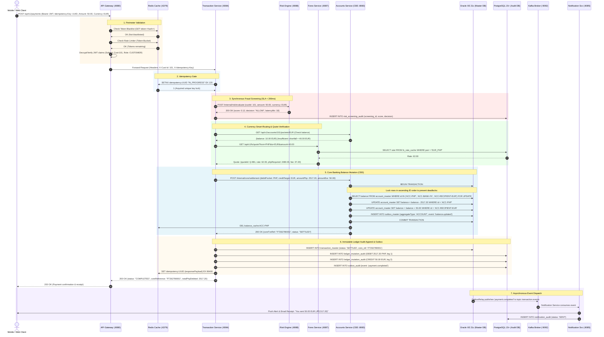
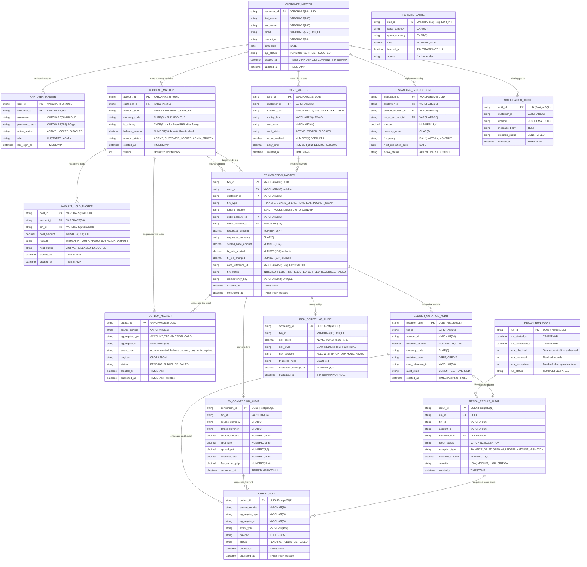

# System Architecture & Technical Design Specification

---

## 1. Executive Summary & Architecture Philosophy

This document defines the functional and technical architecture of the **Capstone Banking System**, combining:
1. **Mock Core Banking System (CBS)**: Ledgers, accounts, currency pockets, pessimistic locks (`SELECT ... FOR UPDATE`), and outbox events in Oracle XE 21c.
2. **Channel Orchestration & Experience Layer**: Spring Cloud Gateway, Authentication, Idempotency, Transaction/Payment Orchestrator, Smart FX Routing, Hold & Reservation Management, and Java Risk Engine.
3. **Audit, Reconciliation & Resilience Layer**: Append-only PostgreSQL audit ledgers protected by blocking triggers, scheduled Dual-DataSource reconciliation engine, and Kafka event bus with Dead Letter Queue (DLQ).
4. **Client Interfaces**: Customer Mobile App & Customer Web App (built with Flutter), and an Admin Web Operations Portal (Thymeleaf + Spring Boot) with Customer 360 and Grafana monitoring.

---

## 2. Comprehensive System Architecture Diagram

```mermaid
%% Core Retail Ledger & Balance Mutation Engine — Full System Architecture
%% Solid line = Synchronous REST/HTTP | Dashed line = Asynchronous Kafka event | Dotted line = Polling/Scheduled/Internal DB

flowchart TD
    %% ================= CLIENT TIER =================
    subgraph ClientTier["1. Experience & Channel Client Tier"]
        direction LR
        MobileClient["<b>Customer Mobile App</b><br/>(Flutter Android/iOS)<br/>• Virtual Card & Pockets UI<br/>• QR Scan & Biometrics<br/>• Pin Fallback"]:::client
        WebClient["<b>Customer Web App</b><br/>(Flutter Web)<br/>• Shared Flutter Codebase<br/>• Responsive Pockets & FX Swap<br/>• Statement Download"]:::client
        AdminPortal["<b>Admin Web Portal</b><br/>(Thymeleaf + Spring Boot :8090)<br/>• KYC Review & Freeze/Unfreeze<br/>• Real-Time Monitor & Holds/Reversals<br/>• Customer 360 & DLQ Retries"]:::admin
        GrafanaUI["<b>Grafana Dashboard (:3000)</b><br/>• TPS, Latencies, Pool Status<br/>• Kafka Lag & Error Metrics"]:::metrics
    end

    %% ================= PERIMETER / GATEWAY =================
    subgraph PerimeterTier["2. API Gateway & Edge Perimeter (:8080)"]
        GW["<b>Spring Cloud Gateway</b><br/>• JWT Auth & Signature Verification<br/>• Redis Reactive Token-Bucket Rate Limiter<br/>• Token Blacklist Filter<br/>• Reverse Proxy & Port Cloaking"]:::gateway
        FXApi[/"<b>api.frankfurter.dev</b><br/>(External Hourly FX Source)"/]:::external
    end

    %% ================= CHANNEL & ORCHESTRATION LAYER =================
    subgraph ChannelTier["3. Channel & Digital Banking Orchestration Tier"]
        direction TB
        RegSvc["<b>Registration Service (:8081)</b><br/>• Customer KYC Onboarding<br/>• Demo User Provisioning"]:::service
        LoginSvc["<b>Login Service (:8082)</b><br/>• BCrypt Password Verification<br/>• Issues JWT & Refresh Tokens<br/>• OTP Step-up & Device Binding"]:::service
        TxnSvc["<b>Transaction / Payment Service (:8084)</b><br/>• Smart Multi-Currency Routing Engine<br/>• Virtual Card Payment Authorizer<br/>• Amount Holds & Reservations<br/>• Transaction Reversal Coordinator<br/>• Idempotency-Key Deduplication"]:::service
        RiskSvc["<b>Risk & Fraud Engine (:8088 / Java)</b><br/>• Heuristics: Velocity, Amount, Location<br/>• Synchronous Call (SLA &lt; 200ms fail-closed)<br/>• Score: LOW (Allow) / MED (OTP) / HIGH (Hold)"]:::risk
        ForexSvc["<b>Forex Service (:8087)</b><br/>• Hourly Frankfurter Poll Scheduler<br/>• Locked FX Quotes & Spread Calculator<br/>• Own-Pocket Currency Swaps"]:::forex
        BatchSvc["<b>EOD Batch Processing Service</b><br/>• Standing Instructions Execution<br/>• End-of-Day General Ledger Run<br/>• E-Statement PDF Generator"]:::batch
    end

    %% ================= CORE BANKING TIER (CBS) =================
    subgraph CoreTier["4. Core Banking System (Mock CBS Tier)"]
        direction TB
        AccountsSvc["<b>Accounts Service (:8083) - Mock CBS Engine</b><br/>• System of Record (SoR) for Balances<br/>• <code>SELECT ... FOR UPDATE</code> Pessimistic Row Locking<br/>• Deterministic Ascending-ID Multi-Lock Ordering<br/>• Multi-Currency Pockets (PHP, USD, EUR)<br/>• Bank FX Position Balancing Accounts<br/>• Virtual Card Master & Hold Enforcer"]:::core
    end

    %% ================= ASYNC / AUDIT / RECON TIER =================
    subgraph AsyncTier["5. Event Bus, Audit & Reconciliation Tier"]
        direction TB
        KafkaBroker["<b>Apache Kafka (:9092 / :29092)</b><br/>• Topics: <code>transaction.events</code>, <code>audit.events</code><br/>• Dead Letter Queue (DLQ): <code>dlq.failed.mutations</code>"]:::broker
        NotifSvc["<b>Notification Service (:8085)</b><br/>• Push, Email OTP & Transaction Alerts<br/>• Consumes Kafka Notification Events"]:::notif
        ReconSvc["<b>Reconciliation Service (:8086)</b><br/>• Dual DataSource Engine (Oracle vs. PostgreSQL)<br/>• Detects Balance Drift & Unmatched Legs<br/>• Publishes Discrepancies to Kafka"]:::recon
    end

    %% ================= DATA LAYER =================
    subgraph DataTier["6. Data Layer (Persistence & Cache)"]
        direction LR
        OracleDB[("<b>Oracle XE 21c (Master OLTP DB)</b><br/><i>Mutable State of Record</i><br/>• <code>customer_master</code><br/>• <code>app_user_master</code><br/>• <code>card_master</code><br/>• <code>account_master</code> (Pockets)<br/>• <code>amount_hold_master</code><br/>• <code>transaction_master</code><br/>• <code>standing_instruction</code><br/>• <code>outbox_master</code>")]:::master

        PostgresDB[("<b>PostgreSQL 15+ (Audit Ledger DB)</b><br/><i>Immutable Append-Only Audit</i><br/>• <code>ledger_mutation_audit</code> (Triggers block UPDATE/DELETE)<br/>• <code>risk_screening_audit</code><br/>• <code>fx_conversion_audit</code><br/>• <code>fx_rate_cache</code><br/>• <code>recon_run_audit</code> & <code>recon_result_audit</code><br/>• <code>notification_audit</code><br/>• <code>outbox_audit</code>")]:::audit

        RedisCache[("<b>Redis 7 (In-Memory Tier)</b><br/>• JWT Blacklist (TTL on Logout)<br/>• Rate-Limiting Sliding Counters<br/>• Balance Read Cache (Fast-Lookups)<br/>• Idempotency-Key Cache")]:::cache
    end

    %% ================= WIRING CONNECTIONS =================
    %% Client to Gateway
    MobileClient -->|"HTTPS / REST"| GW
    WebClient -->|"HTTPS / REST"| GW
    AdminPortal -->|"Internal REST / HTTPS"| GW
    AdminPortal -.->|"Embeds/Links"| GrafanaUI

    %% Gateway Routing
    GW -->|"POST /api/auth/register"| RegSvc
    GW -->|"POST /api/auth/login, /logout"| LoginSvc
    GW -->|"POST /api/v1/payments, /cards"| TxnSvc
    GW -->|"GET /api/v1/accounts/**"| AccountsSvc
    GW -->|"GET /api/v1/fx/**"| ForexSvc
    GW <-->|"Verify Blacklist & Rate Limits"| RedisCache

    %% Service to Oracle Master DB
    RegSvc -->|"INSERT customer_master"| OracleDB
    LoginSvc -->|"Read app_user_master"| OracleDB
    TxnSvc -->|"INSERT/UPDATE transaction_master,<br/>card_master, amount_hold_master"| OracleDB
    AccountsSvc -->|"SELECT ... FOR UPDATE on account_master,<br/>INSERT outbox_master (atomic txn)"| OracleDB
    BatchSvc -->|"Read/Execute standing_instruction"| OracleDB

    %% Inter-service Sync Calls
    TxnSvc <-->|"1. Sync Risk Check (SLA &lt; 200ms fail-closed)"| RiskSvc
    TxnSvc <-->|"2. Fetch Cached FX Quote + Spread"| ForexSvc
    TxnSvc -->|"3. Sync REST: Debit/Credit/Hold Instruction"| AccountsSvc

    %% Service to Postgres Audit DB
    TxnSvc -->|"Append risk_screening_audit,<br/>INSERT outbox_audit"| PostgresDB
    ForexSvc -->|"Upsert fx_rate_cache,<br/>Append fx_conversion_audit"| PostgresDB
    ForexSvc -.->|"Hourly Polling (Not Per-Txn)"| FXApi
    NotifSvc -->|"Append notification_audit"| PostgresDB
    BatchSvc -->|"Append EOD run audit"| PostgresDB

    %% Cache Connections
    AccountsSvc <-->|"Invalidate / Read balance_cache"| RedisCache
    TxnSvc <-->|"Idempotency-Key check & store"| RedisCache
    LoginSvc -->|"Set jwt_blacklist (TTL)"| RedisCache

    %% Kafka Event Connections
    AccountsSvc -.->|"OutboxRelay publishes account/balance events"| KafkaBroker
    TxnSvc -.->|"OutboxRelay publishes payment.completed"| KafkaBroker
    ForexSvc -.->|"OutboxRelay publishes fx.converted"| KafkaBroker
    BatchSvc -.->|"OutboxRelay publishes batch.eod.completed"| KafkaBroker

    KafkaBroker -.->|"Consumes events"| NotifSvc
    KafkaBroker -.->|"Unprocessable events redirected"| KafkaBroker

    %% Reconciliation Dual-Datasource
    ReconSvc -->|"1. Read live balances (Read-Only)"| OracleDB
    ReconSvc -->|"2. Read mutation history (Read-Only)"| PostgresDB
    ReconSvc -->|"3. Write recon_run_audit & recon_result_audit"| PostgresDB
    ReconSvc -.->|"Publishes reconciliation.discrepancy"| KafkaBroker

    %% Styling Classes
    classDef client fill:#e8f0fe,stroke:#4285f4,stroke-width:2px,color:#1a1a1a,font-weight:bold
    classDef admin fill:#f1f3f4,stroke:#5f6368,stroke-width:2px,color:#1a1a1a,font-weight:bold
    classDef metrics fill:#ffe8d6,stroke:#d9480f,stroke-width:2px,color:#1a1a1a,font-weight:bold
    classDef gateway fill:#fff3cd,stroke:#e6a700,stroke-width:2px,color:#1a1a1a,font-weight:bold
    classDef service fill:#d4edda,stroke:#28a745,stroke-width:2px,color:#1a1a1a,font-weight:bold
    classDef core fill:#d1ecf1,stroke:#0c5460,stroke-width:2px,color:#1a1a1a,font-weight:bold
    classDef risk fill:#f8d7da,stroke:#dc3545,stroke-width:2px,color:#1a1a1a,font-weight:bold
    classDef forex fill:#c9f7dc,stroke:#0f9960,stroke-width:2px,color:#1a1a1a,font-weight:bold
    classDef batch fill:#e9ecef,stroke:#495057,stroke-width:2px,color:#1a1a1a,font-weight:bold
    classDef broker fill:#e2d9f3,stroke:#6f42c1,stroke-dasharray: 4 2,stroke-width:2px,color:#1a1a1a,font-weight:bold
    classDef notif fill:#f3e8ff,stroke:#9333ea,stroke-width:2px,color:#1a1a1a,font-weight:bold
    classDef recon fill:#ffe0b3,stroke:#e67300,stroke-width:2px,color:#1a1a1a,font-weight:bold
    classDef master fill:#f8d7da,stroke:#dc3545,stroke-width:2px,color:#1a1a1a,font-weight:bold
    classDef audit fill:#fde2c8,stroke:#fd7e14,stroke-width:2px,color:#1a1a1a,font-weight:bold
    classDef cache fill:#cfe2ff,stroke:#0d6efd,stroke-width:2px,color:#1a1a1a,font-weight:bold
    classDef external fill:#f0f0f0,stroke:#888,stroke-dasharray: 2 2,stroke-width:1px,color:#1a1a1a,font-weight:bold
```

---

## 3. End-to-End Request Journey: From Client to Channel to Core

Here is the exact step-by-step path of a **Smart Cross-Currency Payment** (e.g., paying 50.00 EUR from a primary PHP account with insufficient EUR balance):

---

## 4. Deep-Dive Answers to Core Architectural Questions

### Q1: Why is Reconciliation Service connected to Kafka?
1. **Event-Driven Discrepancy Alerting**: When `reconciliation-service` detects a ledger break (e.g., Oracle balance does not equal sum of PostgreSQL ledger mutation rows), it writes to `recon_result_audit` AND publishes a high-priority `reconciliation.discrepancy` event to Kafka.
2. **Immediate Alert Routing**: The `notification-service` consumes this Kafka topic to instantly trigger email/Slack alerts to Bank Ops and update the real-time discrepancy counter on the Admin Web Portal.
3. **Triggering On-Demand Re-Scans**: Kafka allows the Admin Portal to emit an asynchronous `recon.run.requested` event, enabling background batch audits without holding HTTP connections open.

### Q2: Why are the Batch Processor and ForEx Service in the Channel Layer and NOT in the Core?
1. **Core Banking System (CBS) Single Responsibility**: The Core (`accounts-service`) must do exactly one thing with extreme performance and zero side effects: **authoritatively store and mutate ledger account balances under pessimistic locks**. 
2. **Isolating External I/O**: The `forex-service` interacts with third-party web endpoints (`api.frankfurter.dev`). Placing network I/O inside the Core would tie database transaction locks to outside network latency, risking connection pool starvation and core deadlocks.
3. **Channel-Side Orchestration**: Batch operations (Standing Instructions, EOD Statements) are multi-step customer workflows. The Channel triggers them on schedule, computes fees/quotes, and passes clean, atomic debit/credit instructions down to the Core.

### Q3: What layer touches which data? (Strict Single-Writer Matrix)

| Layer | Service Component | Database Table(s) Owned | Permitted Operations | Concurrency & Integrity Rule |
| :--- | :--- | :--- | :--- | :--- |
| **Experience / Edge** | `api-gateway` | `Redis: rate_limiter:*` | Write / Increment | In-memory atomic sliding window |
| **Auth** | `login-service` | `Oracle: app_user_master` `Redis: jwt_blacklist:*` | Read/Write (Oracle) Write TTL (Redis) | BCrypt hashing; Redis blacklist TTL matching JWT expiry |
| **Auth** | `registration-service` | `Oracle: customer_master` | Write (INSERT) | Unique constraints on `email`, `contact_no` |
| **Channel** | `transaction-service` | `Oracle: transaction_master` `Oracle: card_master` `Oracle: amount_hold_master` `Postgres: ledger_mutation_audit` `Postgres: risk_screening_audit` `Redis: idempotency:*` | Read / Write / Update Append-only on Postgres | Oracle stores mutable business states; Postgres audit table has DB trigger blocking `UPDATE` and `DELETE` |
| **Channel** | `forex-service` | `Postgres: fx_rate_cache` `Postgres: fx_conversion_audit` | Upsert (Cache) Append-only (Audit) | Cached rates TTL refreshed hourly; spot conversions permanently logged |
| **Channel** | `Batch Engine` | `Oracle: standing_instruction` | Read / Update next run | Scheduled background execution |
| **Core (CBS)** | **`accounts-service`** | **`Oracle: account_master`** **`Oracle: outbox_master`** `Redis: balance_cache:*` | **SOLE WRITER to balances** Write (outbox) Invalidate (Redis) | **Pessimistic row locks (`SELECT ... FOR UPDATE`) in ascending account ID sequence** |
| **Audit / Recon** | `reconciliation-service` | `Postgres: recon_run_audit` `Postgres: recon_result_audit` | Append / Insert *Read-only* on Oracle & PG | Dual-DataSource read; append-only discrepancy reports |
| **Audit / Ops** | `notification-service` | `Postgres: notification_audit` | Append / Insert | Asynchronous Kafka consumer execution |

---

## 5. Comprehensive Entity-Relationship Diagram (ERD)

---

## 6. Requirements Coverage Traceability Matrix

Every single requirement from `00_business-and-technical-requirements.md` and `00_additional-requirements.md` is accounted for:

| Requirement Category | Requirement Code & Summary | Architectural Component Handling It | Data Layer Entity |
| :--- | :--- | :--- | :--- |
| **Balance Integrity** | **BR-01, TR-L01, TR-L06**: Zero overdraft, concurrency safety | `Accounts Service` (Mock CBS) | `ACCOUNT_MASTER` (`SELECT ... FOR UPDATE`) |
| **Audit Parity** | **BR-02, TR-L05, TR-L07**: Immutable audit, 100% parity | `Transaction Service`, PostgreSQL triggers | `LEDGER_MUTATION_AUDIT` (`BEFORE UPDATE/DELETE` block triggers) |
| **Idempotency** | **BR-05, TR-I01-I03**: No duplicate postings on network retry | `Transaction Service`, `API Gateway` | `Redis: idempotency:*`, `TRANSACTION_MASTER.idempotency_key` |
| **Smart FX & Pockets**| **BR-26, BR-28, TR-X01-X07, TR-Y01-Y05**: Pockets, auto-conversion | `Transaction Service`, `Forex Service`, CBS | `ACCOUNT_MASTER` (Currency pockets), `FX_CONVERSION_AUDIT` |
| **FX Resiliency** | **BR-04, TR-F01-F04**: Hourly cached FX rates, stale rate guard | `Forex Service` scheduled job | `FX_RATE_CACHE` in PostgreSQL |
| **Fraud Screening** | **BR-08, BR-18, TR-R01-R06**: Synchronous check &lt; 200ms | Java `Risk Engine` | `RISK_SCREENING_AUDIT` in PostgreSQL |
| **Virtual Card & Controls**| **BR-09, BR-12, BR-25, TR-CD01-03**: Masked PAN, lock/unlock, e-com | `Accounts Service`, `Transaction Service` | `CARD_MASTER` (`ecom_enabled`, `card_status`) |
| **Auth & Biometrics** | **BR-07, BR-20, TR-S01-S06, TR-S10**: JWT, OTP, Biometrics fallback | `Login Service`, Flutter App (`local_auth`) | `APP_USER_MASTER`, `Redis: jwt_blacklist:*` |
| **Reversals & Holds** | **Additional #1, #2**: Transaction reversals, balance holds | `Transaction Service`, `Accounts Service` | `AMOUNT_HOLD_MASTER`, `TRANSACTION_MASTER` (`REVERSED`) |
| **DLQ Management** | **Additional #3**: Failed transaction retry & dead letter queue | `KafkaBroker` (`dlq.failed.mutations`), Admin Web | Kafka DLQ topic & Admin re-try API |
| **Batch / EOD Processing**| **Additional #4, #5**: Standing instructions, GL balance run | `EOD Batch Processing Service` | `STANDING_INSTRUCTION`, `ACCOUNT_MASTER` |
| **Customer 360 & Admin** | **Additional #6, #7, TR-E02**: Real-time monitor, Customer 360 | `Admin Web Portal` (Thymeleaf), Grafana | Read aggregation across Oracle, Postgres, and Actuator |
| **Notifications** | **BR-11, TR-N01-N02**: Push/Email alerts on transactions | `Notification Service` (Kafka consumer) | `NOTIFICATION_AUDIT` in PostgreSQL |
| **Dual Recon Engine** | **TR-L07, Additional #6**: Scheduled Oracle vs Postgres check | `Reconciliation Service` (Dual DataSource) | `RECON_RUN_AUDIT`, `RECON_RESULT_AUDIT` |

---

## 7. Plain-English ("ELI5") & Technical Component Guide

Use this section to walk teammates, evaluators, or stakeholders through each piece of the system:

### 1. Client Tier (Mobile, Web & Admin)
*   **ELI5**: The front desk where people interact with the bank. Customers use their phone or browser to see their money, spend with their virtual card, or send transfers. Bank managers use a special staff website to review accounts and watch for fraud.
*   **Technical**: Cross-platform Flutter client compiling to native Android APK and Web static bundle. Interfaces with backend exclusively over TLS via the API Gateway using signed JWT Bearer tokens and client-generated `X-Idempotency-Key` UUIDs. Uses `flutter_secure_storage` (Android KeyStore / iOS Keychain) for credentials. The Admin Portal is a server-rendered Spring Boot Thymeleaf application on port `8090` with Spring Security RBAC (`ROLE_ADMIN`).

### 2. API Gateway & Redis Perimeter
*   **ELI5**: The security guard at the building entrance. It inspects your badge, checks if you are blocked, ensures nobody rushes the door too fast, and directs you to the right department.
*   **Technical**: Spring Cloud Gateway (Netty reactive engine on `:8080`). Evaluates a Global Filter chain: (1) CORS origin validation, (2) Redis reactive Token-Bucket rate limiting (HTTP 429), (3) JWT signature validation & claims decoration (`X-Cust-Id`), and (4) Redis blacklist check. Internal microservices are cloaked on the private network.

### 3. Identity Services (Registration & Login)
*   **ELI5**: The membership desk. It creates your banking profile, verifies your email/phone, checks your password, and gives you a secure temporary key card (token) to use the bank.
*   **Technical**: `registration-service` creates `CUSTOMER_MASTER` records in Oracle. `login-service` validates BCrypt passwords in `APP_USER_MASTER`, generates 15-minute access JWTs and rotating refresh tokens, enforces email OTP step-up for unfamiliar devices, and invalidates tokens upon logout by writing them to Redis with TTL.

### 4. Transaction / Payment Service (Channel Orchestrator)
*   **ELI5**: The head teller who guides your transfer. If you want to pay Euros but only have Pesos, this teller calculates the exchange rate, checks with the security guard to make sure it's not a scam, locks the money so you don't double-spend, and writes down a permanent legal receipt.
*   **Technical**: The central saga orchestrator. Handles `/api/v1/payments`. Validates idempotency against Redis, triggers synchronous sub-200ms fraud screening against the Risk Engine, queries `forex-service` for locked quotes, invokes the Mock CBS for balance deduction, and executes dual-writing: commits transaction state in Oracle and permanently appends debit/credit legs in PostgreSQL `ledger_mutation_audit`.

### 5. Accounts Service (Mock Core Banking System)
*   **ELI5**: The impregnable vault keeper. It is the *only* component allowed to actually move or change money in the accounts. It literally locks the account vault door while changing numbers so two people cannot take out the same 1,000 pesos at the exact same split-second.
*   **Technical**: The authoritative System of Record (SoR) for ledger balances. Implements strict pessimistic write locks (`SELECT balance_amount FROM account_master WHERE account_id = ? FOR UPDATE`). To prevent multi-account deadlocks in transfers, it deterministically sorts and locks account IDs in ascending alphanumeric order. Updates Oracle `account_master`, clears Redis `balance_cache`, and inserts an atomic row into `outbox_master`.

### 6. Risk & Fraud Engine (Java Spring Boot)
*   **ELI5**: The silent bank security scanner. Before any money moves, it instantly checks if you are sending money from a strange country, sending too much, or tapping the button 10 times in a minute. If it doesn't give the all-clear within a fraction of a second, the bank stops the transfer immediately.
*   **Technical**: High-throughput rules engine running in Java. Evaluates weighted fraud heuristics: velocity spikes ($V$), amount anomaly structuring ($A$), geo-IP impossible travel ($G$), and unverified device flags ($D$). Returns a normalized score $S \in [0.00, 1.00]$. Enforces a strict Resilience4j timeout of $\le 200\text{ms}$; if the engine times out or score $> 0.85$, the transfer fails closed (`HTTP 422`).

### 7. ForEx Service (Foreign Exchange Engine)
*   **ELI5**: The currency exchange booth. It keeps a board of foreign currency prices that updates once an hour. When you convert money, it uses its current price board so it doesn't have to call outside websites while you wait.
*   **Technical**: Manages multi-currency pocket conversions. A background Spring `@Scheduled` job fetches spot rates every hour from `api.frankfurter.dev` and upserts `fx_rate_cache` in PostgreSQL. Provides locked 30-second quotes with a configurable bank spread (e.g., 1.5%). Protects against stale rates by returning `FX_RATE_STALE` if the cache is older than 24 hours.

### 8. EOD Batch Processor
*   **ELI5**: The night auditor who works after the bank closes. It runs all automatic scheduled payments (like paying your monthly gym bill) and checks that all of the bank's books balance at the end of the day.
*   **Technical**: Scheduled execution engine for recurring background banking jobs. Scans `standing_instruction` in Oracle for due dates, dispatches payments through the Transaction Service, executes general ledger reconciliation runs, and triggers e-statement generation.

### 9. Reconciliation Service (The Internal Auditor)
*   **ELI5**: The independent accountant who compares the vault's live cash count against the legal transaction receipt book. If a single cent is missing or doesn't match, it sounds the alarm.
*   **Technical**: Implements a Dual-DataSource pattern connecting to both Oracle XE (read-only) and PostgreSQL (read-only). Compares live account balances in `account_master` against the sum of committed legs in `ledger_mutation_audit`. Records audit outcomes in `recon_run_audit` and breaks in `recon_result_audit`, publishing any variance as a `reconciliation.discrepancy` event to Kafka.

### 10. Kafka & Dead Letter Queue (DLQ)
*   **ELI5**: The internal postal conveyor belt. When an event happens, a notice is dropped into the conveyor. If a letter gets stuck or cannot be delivered because a machine is down, it goes into a special "trouble bin" (Dead Letter Queue) so engineers can fix it without losing any mail.
*   **Technical**: Distributed event backbone. Decouples asynchronous operations like notifications, audit logging, and risk notifications. Employs Spring Kafka error-handling with `DeadLetterPublishingRecoverer` routing unprocessable events to `dlq.failed.mutations` after 3 failed retries with exponential backoff.

### 11. Transactional Outbox Tables (`outbox_master` & `outbox_audit`)
*   **ELI5**: A reminder notepad written in the same stroke of a pen. Whenever the bank changes a balance, it writes down a reminder to tell Kafka in the exact same database action. If power is cut right after, the reminder is saved on disk, and as soon as power returns, the message is sent. No lost messages ever.
*   **Technical**: Solves the dual-write problem across distributed databases and messaging systems. Avoids 2-phase commit (2PC). `outbox_master` lives in Oracle with account balance mutations; `outbox_audit` lives in PostgreSQL alongside audit records. A dedicated poller (`ScheduledOutboxRelay`) reads pending rows, dispatches them to Kafka, and marks them `PUBLISHED`.
