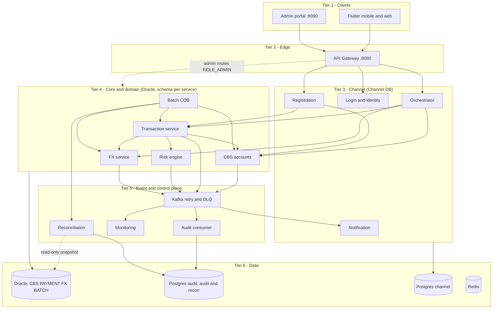

# Revised Architecture Proposal (Brainstorm)

Builds on your six-tier dashboard, `ARCHITECTURE.md`, ADR-002/003/004 and the backlog. These are **recommendations for the team to decide**, not frozen spec. Numbers marked *(est.)* are my estimates.

**Reading of your idea #2 (Option A confirmed):** the existing `transaction-service` moves to Tier 4 **with its name and code unchanged** (it keeps lifecycle, idempotency, cancel/reversal, sweeper and `transaction_master`). The Tier 3 orchestrator is a **new, thin** service; it is not the old transaction-service with a new job.

---

## 0. Simple version

Think of the bank branch again.

- **Tier 3** is the customer service desk. It talks to customers, checks who they are, and walks a request through the back office. It has its **own filing cabinet** (Channel DB) for desk-only paperwork: logins, devices, notification history.
- **Tier 4** is the back office, one department per job: **ledger** (CBS), **payments**, **treasury** (FX), **fraud desk** (Risk), **operations** (Batch/COB). Each has its own locked cabinet; nobody opens another department's cabinet, they send a request.
- **Audit** is a separate office that only receives copies and never edits them. **Reconciliation** is the internal checker who compares the ledger to the audit copies.

---

## 1. Verdicts on your ideas

| # | Idea | Verdict | Adjustment |
| --- | --- | --- | --- |
| 1 | Move Transactions + FX + Batch to Tier 4 | **Agree** | Rename Tier 4 to "Core & domain services". The invariant stays *only CBS mutates balances*. Real banks run COB, rates and payment processing behind the channel layer |
| 2 | Orchestrator in Tier 3 for all customer requests | **Agree, thin** | Orchestrator coordinates *authenticated* customer requests, not money state (§8.2). It never calls CBS settlement; money movement goes through `transaction-service` only |
| 3 | Batch runs standing instructions, FX refresh, recon at COB | **Mostly** | Batch *triggers* recon, doesn't contain it. FX hourly refresh stays; COB adds an end-of-day rate snapshot (§4) |
| 4 | FX rate table to the main DB | **Agree** | Oracle `FX` schema owned by `fx-service`. Fixes the CH-04 conflict |
| 5 | Only CBS touches main and audit DBs | **Adjust** | Main: Tier 4 only, one schema per service. Audit: **only `audit-consumer`** (not CBS). One read-only exception: recon |

---

## 2. Rules the design follows

1. **Tiers follow authority over state**, not who calls whom.
2. **Only Tier 4 writes the Main DB (Oracle)**, one schema per service, no cross-schema access. Others ask via API.
3. **Audit DB is written only by `audit-consumer`** (INSERT-only role). Recon and the audit read API get read-only roles.
4. **Tier 3 owns a separate Channel DB** and never touches Main or Audit.
5. **Calls go down:** Tier 2 → 3 → 4. Inside Tier 4 only along the dependency graph below. Everything "upward" travels as Kafka events. Admin routes are a documented exception (§3).
6. **Money moves only through `transaction-service`** (and CBS beneath it).

---

## 3. Target picture



**Why two planes?** Customer requests go Gateway → Orchestrator. Admin requests go Gateway → the owning Tier 4 service with `ROLE_ADMIN`, re-checked in the service. The customer orchestrator should not carry staff powers: different authorization, maker-checker, and audit.

| Tier | Service | Owns | Calls |
| --- | --- | --- | --- |
| 3 | **Orchestrator** (new, thin) | none (stateless) | Transaction, CBS (reads), FX (quotes) |
| 3 | **Login / Identity** | Channel DB: `app_user_master`, `user_device`; Redis OTP, blacklist | none |
| 3 | **Registration** | Channel DB: `onboarding_request` | CBS (create customer + account), Transaction (issue card), Login (create credentials) |
| 3 | **Notification** | Channel DB: `notification_log` (also the in-app inbox) | none (consumes Kafka) |
| 4 | **CBS** (`accounts-service`) | `CBS` schema: `customer_master` (CIF + KYC), `account_master`, `account_hold`, `ledger_entry`, `posting_reference`, `outbox_master`, `system_parameter`, `eod_balance_snapshot`, `business_day` | none (leaf) |
| 4 | **Transaction / Payment** (`transaction-service`, same service) | `PAYMENT` schema: `transaction_master`, `card_master`, `standing_instruction`, `standing_instruction_occurrence`, `admin_approval`, `suspicious_report` | Risk, FX, CBS |
| 4 | **FX** | `FX` schema: `fx_rate` | Frankfurter (when Batch triggers refresh) |
| 4 | **Risk** | No DB; Redis velocity counters | none |
| 4 | **Batch** | `BATCH` schema: `eod_run`, `eod_step` | Payment, FX, CBS, Recon |
| 5 | **audit-consumer** | Audit PG `audit` schema (INSERT-only): `ledger_mutation_audit`, `risk_screening_audit`, `fx_conversion_audit` (risk/FX paths per §8.1) | none (consumes Kafka) |
| 5 | **Monitoring** | Redis live window; Audit PG `monitoring` schema: `txn_stage_event`, `dlq_entry`, `dlq_action` | none (consumes Kafka) |
| 5 | **Recon** | Audit PG `recon` schema, append-only run + result rows | none (reads) |

**Request walk-throughs**

- **Payment:** App → Gateway → Orchestrator (JWT, ownership check) → Payment saves `INITIATED` → Risk (≤200 ms, fail closed) → FX quote if needed → claim `PROCESSING` → CBS settlement (one Oracle transaction + outbox row) → `POSTED` → response. Async: outbox → Kafka → audit-consumer, Notification, Monitoring.
- **Registration:** Registration service → CBS `POST /internal/customers` (customer + account in **one** Oracle transaction) → Payment `POST /internal/cards` → Login `POST /internal/users`. All idempotent on `request_id`; progress in `onboarding_request`, so a timeout after a downstream success is safe to retry. This replaces the saga I suggested earlier with `onboarding_status` on `customer_master`.
- **COB:** Batch → Payment (run standing instructions) → CBS (drain check, snapshot) → FX (rate snapshot) → Recon (trigger) → CBS (roll business date) → publish `eod.completed`.

---

## 4. Your questions

### Q1. Should only Tier 4 services touch the main and audit DBs?

- **Main: yes, Tier 4 only**, but "Tier 4" is not one shared bucket. Each service gets its own Oracle schema and user (`CBS`, `PAYMENT`, `FX`, `BATCH`). Cost: no cross-schema foreign keys, so cross-service links are validated by API at write time. Seed scripts (DIG-64) must run per schema.
- **Audit: no, only `audit-consumer`.** If CBS wrote audit synchronously, (1) settlement would depend on Postgres, which breaks CH-04 ("payments continue when Postgres is stopped"); (2) the audited party would write its own evidence, so maker = checker. Keeping the outbox → Kafka → consumer path preserves both.
- **One exception: recon reads** `eod_balance_snapshot` and `ledger_entry` through a read-only Oracle role. A checker that goes through CBS's API cannot independently check CBS.

### Q2. Do Tier 3 services need a separate DB?

**Yes.** Login credentials, devices, notification history and onboarding state are channel data. Real banks keep them out of the core, and it makes "Tier 3 never touches Main/Audit" enforceable.

- **Recommended:** a second Postgres container `postgres-channel`. It **must not** share the audit Postgres, or CH-04 would also take down login.
- **Fallback (no new container):** an Oracle `CHANNEL` schema. Costs XE headroom and ties login to Oracle availability.
- **Moves out of the way:** `customer_master` goes **down** to CBS (it is the CIF); `card_master` goes to Payment; risk records become events written by audit-consumer. Channel DB holds only `customer_id` references, never copies of core data.

### Q3. Should the risk engine go down to Tier 4 if it appends to audit?

**Yes to Tier 4, but not because of audit.**

- **The right reason:** `transaction-service` must call Risk *inside* the payment lifecycle (≤200 ms, fail closed → `REJECTED`). Under the "calls go down" rule, something Payment calls cannot sit above it. If the orchestrator called Risk first, a direct call to Payment could skip the check.
- **Fix the audit write instead:** keep Postgres off the 200 ms fail-closed path (§8.1). Preferred: `transaction-service` records the decision and the lifecycle event carries it; audit-consumer writes `risk_screening_audit`. Risk then needs **no database**, only Redis counters.

### Q4. How should batch and recon work? Integrate with the orchestrator and just allow admin access?

**No. Neither goes through the customer orchestrator.** Nothing in batch or recon is a customer journey. Batch is started by a clock (or admin "run now"); recon is started by Batch (or admin). Admin access uses the admin plane (§3).

- **Batch = sequencer only.** It owns `eod_run` (UNIQUE `business_date` is the lock) and `eod_step` (restart, CH-11). Jobs stay with the data owner: sweeper in Payment, hold expiry in CBS, outbox relay in CBS. Batch only runs the cross-service steps.
- **FX refresh:** keep the **hourly** job (DIG-74) and add an **end-of-day rate snapshot** to COB. Refresh *only* at EOD would make rates a day old, and the stale-rate guard (`FX_RATE_STALE`) would then block cross-currency payments.
- **Recon:** Batch calls `POST /internal/recon/runs {business_date}` (idempotent per date) *after* the drain step, then reads the result. Recon stays a separate service (§11 of the explainer: checker ≠ checked) and remains runnable on demand.
- **Order inside COB:** standing instructions **first**, then drain, then snapshot, then recon, then roll date. Running SI before drain means the postings they create are caught up before recon compares.

### Q5. Does the repo split (backend monorepo + client monorepo) hold?

**Yes.** Tiers are runtime boundaries; repos are team and CI boundaries. Don't split per tier.

- **Backend monorepo** (Maven multi-module, DIG-63): add modules `orchestrator`, `batch-service`, `monitoring-service` (and `audit-consumer`, §8.1); `transaction-service` keeps its name and moves tier; Registration stays a separate module. The admin portal (`frontend-web`) stays here.
- **Client monorepo** (Flutter): unchanged. Its only dependency is the OpenAPI contract (DIG-62) and the mock server, which now describe the *orchestrator's* API.
- **Watch `common`:** keep it to Money, error envelope, correlation ID and event DTOs. Do not put repositories or business logic there, or the tiers collapse into one codebase.
- **Add:** a `contracts/` folder (OpenAPI + event schemas), per-schema migration folders, and CODEOWNERS per module.

---

## 5. Making the rules physical

| Rule | Enforcement (cheap) |
| --- | --- |
| Tier 3 never reaches Main/Audit | Docker networks `edge`, `channel`, `core`, `data`; Oracle and audit Postgres are not on the channel network |
| One writer per schema | Separate Oracle users with grants only on their own schema |
| Audit append-only | INSERT-only Postgres role plus the existing triggers |
| Tier dependency graph | ArchUnit or Maven Enforcer test: orchestrator may not depend on Tier 4 internals; no module imports another's repository package |
| `/internal/**` not public | Gateway routes only the customer and admin allowlists (CH-03) |

---

## 6. Costs and honest risks

- **More moving parts:** about **13 Spring Boot apps vs 11 today** *(est., my count)*, plus a Postgres container. Use compose profiles so laptops can run a subset.
- **More hops:** Gateway → Orchestrator → Payment → CBS. Timeouts must **nest** (outer > inner), the idempotency key and correlation ID must propagate unchanged, and CONTRACTS must say so.
- **Orchestrator risks becoming a god service or a pass-through hop** (§8.2). It earns its place only if it does ownership authorization, aggregation (home screen) and error mapping (BR-23) for *authenticated* requests. **Tripwire:** if it isn't doing those by the end of Sprint 1, drop it and route Gateway → Payment (Option C below).
- **No cross-schema foreign keys:** integrity moves into API validation and tests.

**Orchestrator options**

| Option | Shape | Verdict |
| --- | --- | --- |
| **A** | Thin orchestrator (T3) + Payment (T4) | **Recommended** |
| B | Orchestrator *is* the payment service, stays in Tier 3 with its own DB | Cheaper, but payment state in the channel tier is not how banks do it |
| C | No orchestrator; Gateway → Payment; Registration stays separate | Cheapest fallback; least "real-life" |

---

## 7. Impact and phasing

| Change | Effort *(est.)* | Backlog impact |
| --- | --- | --- |
| Rename and redraw tiers; update dashboard | S | Docs only |
| Schema-per-service in Oracle; update DDL (DIG-3/64) | S | Seed scripts per schema |
| FX table to Oracle; `fx.converted` event | S | DIG-74/75 |
| Risk emits event; audit-consumer extracted | S–M | DIG-79, DIG-88 |
| Channel DB + move `app_user_master` etc. | S–M | DIG-5/6/7, T-006 |
| `transaction-service` moves to Tier 4 (no rename) | S | Diagram label only; backlog component names unchanged |
| New thin orchestrator | **M** | \~3 new issues (ownership check, home aggregate, error mapping); DIG-6 unchanged |
| Thin `batch-service` (SI, drain, recon trigger, roll date) | M | Pulls part of DIG-104 forward; amend ADR-004 |

**Phasing:** (1) *Now, before code:* docs, schemas, contracts. (2) *Sprint 1–2:* Channel DB, audit-consumer module, thin orchestrator (payments, ownership check, home aggregate). (3) *Sprint 3, if capacity:* thin Batch. (4) *Narrate in the defense:* full COB (cut-off, snapshot, GL, reports).

**Decisions to record (ADR-005+):** orchestrator option; Channel DB engine; audit-consumer as a module inside `transaction-service` vs own container; risk-audit path (§8.1); Risk placement; admin-plane routing; `customer_master` moving to CBS; Batch scope.

---

## 8. Follow-up Q&A

### 8.1 Why `audit-consumer`? Your previous project didn't have one

**Simple version.** Two record books sit in two buildings (Oracle, Postgres). If one clerk must write both at the same moment, the phone line can drop in between: one book gets the entry, the other doesn't. Your previous Transaction Service did exactly that. Now the settlement happens inside CBS, so the safe way is: CBS writes a note in its own drawer (the outbox) in the same transaction as the money move, and **something later copies the notes into the audit book**. That copier is the audit-consumer.

**W-H-Y**

- **What:** a Kafka listener plus one repository that inserts audit rows idempotently (UUIDv5, UNIQUE `(txn_id, leg_no)`).
- **It isn't a new idea.** It is the `AuditLedgerConsumer` already in T-004, hosted inside `transaction-service`. The only open question is *where it is deployed*.
- **Why it exists:** the ledger change commits in Oracle, and an insert into Postgres cannot join that transaction. Writing both in the same request is a dual write: one can succeed while the other fails (audit gap), and settlement then depends on Postgres being up, which breaks CH-04.
- **Why you didn't need it before:** the Transaction Service owned the ledger write, so it could write the audit row itself. Moving the ledger to CBS is what created the need.

**The rule:** anything that records a state change made *elsewhere* is written from that change's event. Anything that is a service's *own* record can be written by that service. I over-listed what audit-consumer writes earlier; applied per table:

| Table | Previous project | Direct write still OK? | Proposed |
| --- | --- | --- | --- |
| `ledger_mutation_audit` | transaction-service, direct | **No.** The change happens inside CBS's Oracle transaction | Consumer, from the outbox |
| `fx_conversion_audit` | forex | Quote issuance: yes. Executed conversions are ledger legs in one CBS transaction, so rate and fee can ride the same outbox payload | Consumer for executed conversions; forex may keep its own quote log |
| `risk_screening_audit` | risk engine | **Not synchronously.** A Postgres write on the 200 ms fail-closed path means a Postgres outage either blocks payments or drops evidence (conflicts with CH-04) | See options below |
| `recon_*` | reconciliation | **Yes.** Results are recon's own; no state change elsewhere | Stays with recon |
| notification log | notification | **Yes.** Its own log | Stays (Channel DB) |

**Risk audit options**

| Option | How | Trade-off |
| --- | --- | --- |
| R1 (fallback) | Risk writes its own row **after** returning the decision (async, bounded queue, retry) | Matches DIG-79 and your old pattern; simplest. Risk holds Postgres credentials, and a crash before the write loses the row |
| **R2 (preferred)** | `transaction-service` stores the decision and rule hits on the transaction in Oracle (same transaction as the status change); the lifecycle event carries them; the consumer writes the audit row | Durable, because the caller owns the database. Risk stays DB-free. Needs a few columns and an event field |

**Separate container or not?** Build it as its own Maven module with its own datasource and Postgres role from day one. Then choose:

- **Deploy inside `transaction-service`** (as T-004 says today): no extra container; Transaction holds the Postgres INSERT credentials; CH-04 still works because the listener just pauses.
- **Own container:** separate credentials and failure domain, cleaner defense story; costs a compose entry and config (S).

I presented extraction as "recommended" more strongly than the evidence supports. The *function* is necessary; the separate deployable is optional and can be promoted later.

### 8.2 What "god service" means, and what the orchestrator does

**God service:** one service that knows and does too much. Every request passes through it, it holds business rules from many domains, and it can call everything. Symptoms: it becomes the bottleneck and single point of failure, every team's change lands in it (merge conflicts across seven people), and one slow downstream can exhaust its threads and stall unrelated requests. The phrase "all customer requests" plus "can talk to any Tier 4 service" is how that happens. It is a risk to design against, not a criticism of Option A.

**You're right on two points; I blurred them.** Authentication stays with Gateway and Login, and onboarding stays with Registration. The remaining concern is a *different* one:

| Concern | Who does it |
| --- | --- |
| Authentication (valid token, blacklist, rate limit) | Gateway validates; Login issues |
| **Authorization** (is this account *yours*?) | Orchestrator for the customer plane; Transaction re-checks before money moves |
| Onboarding journey | **Registration** (stays separate): CBS creates customer + account, Transaction issues the card, Login creates credentials |
| Aggregation (home screen) | Orchestrator |
| Error mapping (BR-23) | Orchestrator maps Tier 4 codes to the customer-facing envelope |

Example: Maria logs in and sends `GET /accounts/{Juan's account}`. The Gateway sees a valid token and lets it through. Login isn't involved. Someone must check ownership. Without the orchestrator, every Tier 4 service has to do it separately.

**Revised rule:** the orchestrator handles *authenticated* customer requests (payments, cards, FX quotes, statements, balances, home). Login, register, OTP and refresh go Gateway → Login/Registration directly, since there is no customer context yet. I'm withdrawing my suggestion to fold Registration into the orchestrator; it was optional.

**Honest check:** that leaves a modest scope: ownership check, home aggregate, error mapping, plus intake for payments, cards, FX and statements. If the team won't build those, the orchestrator is a pass-through hop and Option C is better.

**Guardrails against becoming a god service**

- No business rules: no limits, fees, fraud logic or balance math.
- No database; stateless, so it can run two replicas.
- Never calls CBS settlement.
- A bulkhead and circuit breaker per downstream (as in your Day-21 resilience lab), so one slow service can't starve the rest.
- Timeouts nest: Gateway > Orchestrator > Transaction > CBS.

### 8.3 Is the Tier 4 Payment Service the Transaction Service?

**Yes. Same service, same code** (T-001, T-004, T-008 paths), moved to Tier 4. "Payment" was only a label. **Keep the name `transaction-service`** to avoid renaming about 17 backlog issues. The new Tier 3 orchestrator is a *different, new* service.

|  | `transaction-service` |
| --- | --- |
| Keeps | `transaction_master` (now in the `PAYMENT` schema), `card_master`, `standing_instruction`, lifecycle CAS, idempotency, cancel/reversal, sweeper, calls to Risk, FX and CBS |
| Loses | Customer-facing intake, DTO mapping and error mapping (to the orchestrator) |
| `ledger_mutation_audit` | Previously a direct write. Never inline now. It touches that table only if the audit-consumer module is deployed inside it, and then only through the async consumer |

---

## 9. Monitoring: Grafana, the live feed, and the admin portal

### 9.1 Does Grafana cover BR-41 (real-time transaction monitoring)?

**No. It answers a different question.** Grafana shows the car's dashboard gauges (speed, engine temperature, fuel): *how is the platform doing?* BR-41 is a live feed of each parcel moving through the sorting centre: *where is each transaction right now?* Gauges can't show a parcel.

| Need | Grafana (Prometheus, DIG-34) | monitoring-service + portal UI (DIG-101/102) |
| --- | --- | --- |
| TPS, p95, error rate, Hikari pool, Kafka lag, DLQ depth/age; threshold alerts | **Yes**, its strength | Partly duplicated in the summary API |
| Per-transaction live feed, 11-stage tracker with durations | No: metrics carry no transaction identity, and using `txn_id` as a label would explode Prometheus cardinality | **Yes** |
| Search by transaction or correlation ID, drill-down | No | **Yes** |
| Event-to-screen p95 ≤ 2 s, push (SSE), stale-feed banner | No: polled dashboards | **Yes** |
| Names and accounts masked by default | Not applicable (and Grafana should hold no PII queries) | **Yes** |
| Status chips (TR-MD03), stuck and UNRECONCILED counts | No | **Yes** |

Grafana is evidence for **BR-14 / TR-C07** and the performance pack (DIG-119). **BR-41 traces to DIG-81, DIG-101 and DIG-102**, so it can't be claimed with Grafana alone.

**Small duplication to settle:** both compute TPS and p95, from different sources (service timers vs event timestamps) and they may differ slightly. Label them ("Platform TPS" vs "Flow TPS") or take the portal's summary from one source.

**Contingency only:** if DIG-102 slips, a Grafana table panel over a *masked* Postgres view gives a list and filter, but no stage tracker, no push and no ≤ 2 s guarantee. Don't plan on it.

### 9.2 Is embedding Grafana in the portal a thing?

Yes, it's common. Your docs already lean that way: `ARCHITECTURE.md` draws "Embeds/Links", and T-014 says Grafana runs on :3000 "via reverse proxy or dev profile only". What is undefined is **who proxies it and how authentication works.**

**Recommended: same-origin reverse proxy through the portal**

1. **Do not publish :3000 on the host.** DIG-30 / CH-03 allow only :8080 and :8090.
2. The portal (:8090) proxies `/grafana/**` to Grafana on the private network, **after** its own RBAC check (DIG-50).
3. Grafana settings: `allow_embedding = true`; `root_url` ending in `/grafana/` with `serve_from_sub_path = true`. Authentication: either anonymous Viewer (acceptable only because Grafana is reachable solely through the portal) or `[auth.proxy]`, with the portal sending a viewer username header (`X-WEBAUTH-USER`). If you use live panels, also proxy `/grafana/api/live/`.
4. UI: a **"Platform health"** tab with an iframe on kiosk-mode dashboard URLs.
5. Hardening: change Grafana's default admin password (DIG-28); Prometheus as the only data source (no DB credentials, no PII); no customer, account or transaction IDs as metric labels; portal CSP `frame-src 'self'`.

**Alternative:** a plain link to a separate port. Fine for the dev profile; it conflicts with CH-03 otherwise. **Cost:** S *(est. about half a day)*. Building the native live feed (DIG-102) is the real work.

### 9.3 Should monitoring live in the portal with Customer 360, freeze, held review and DLQ replay?

**Yes at the UI level, no at the backend level.**

- **UI: one console.** The ops flow "spot a failure → open the customer → freeze or review the hold → replay the DLQ item" benefits from deep links between screens. DIG-102 already lives in the portal.
- **Backend: keep `monitoring-service` separate** (DIG-101). It never touches Oracle master, holds long-lived SSE connections, and consumes Kafka. The portal renders and proxies; it does not consume Kafka.
- **The SSE door:** only :8080 and :8090 are reachable, so the browser must reach the stream through one of them. Recommended: the portal proxies the stream, giving same-origin and session-based auth (no CORS, no JWT in the browser). DIG-101 AC2 lists `/v1/admin/transactions/stream`, which implies a gateway route; pick one in CONTRACTS.
- **Split roles: read vs act.** `ROLE_OPS_VIEWER` for monitoring and Grafana (read-only); `ROLE_ADMIN` for freeze and parameters; maker/checker roles for reversal and hold review; DLQ replay/discard needs an ops role, a reason and an audit entry. A wall display or an auditor should not hold a session that can freeze accounts.
- **Keep Grafana out of the action path:** no write controls in Grafana.

---

## 10. Architecture & ERD Patch: 18 Entities vs. 34-Table Proposal (Applied Changes)

This section incorporates [docs/ARCHITECTURE_ERD_PATCH.md](file:///c:/Users/RBS83790/OneDrive%20-%20EastWest%20Banking%20Corporation/Documents/training/integrated-capstone/banking-backend-monorepo/docs/ARCHITECTURE_ERD_PATCH.md) to record the decision trail and track the exact architectural changes applied to our system.

### 10.1 The 16 Cut Tables vs. The 18 Retained Tables

To prevent enterprise bloat and maintain compliance with **ADR-004** while satisfying **BR-01 through BR-36** and chaos scenarios **CH-01 through CH-04**, the 34-table draft was pruned down to exactly **18 in-scope tables**:

#### A. 16 Enterprise-Overkill Tables Cut

| # | Cut Table | Why Cut / How Handled Simply |
|---|---|---|
| 1 | `PAYMENT_OUTBOX` | **Redundant.** CBS `OUTBOX_MASTER` commits core events. `transaction-service` uses Spring `@Retryable`. |
| 2 | `STANDING_INSTRUCTION_OCCURRENCE` | **Overkill.** Auto-debit tracks `next_execution_date` and `status` directly on `STANDING_INSTRUCTION`. |
| 3 | `TXN_STAGE_EVENT` | **Bloat.** 11-stage progress is already tracked in `TRANSACTION_MASTER.stage`. |
| 4 | `EOD_BALANCE_SNAPSHOT` | **Unnecessary.** Recon reads live balances directly; GL snapshots are deferred under ADR-004. |
| 5 | `BUSINESS_DAY` | **YAGNI.** Standard Oracle `SYSDATE` / `business_date` column on transactions suffices. |
| 6 | `EOD_RUN` | **Deferred.** EOD batch runs are deferred to post-capstone under ADR-004 §2. |
| 7 | `EOD_STEP` | **Deferred.** Checkpointed batch step engine is deferred under ADR-004 §2. |
| 8 | `RECON_BREAK_EVENT` | **Duplicate.** Discrepancies and breaks are already logged in `RECON_RESULT_AUDIT`. |
| 9 | `RECON_RUN_SUMMARY` | **Duplicate.** Status and timestamps are already tracked in `RECON_RUN_AUDIT`. |
| 10 | `CUSTOMER_LIMIT_USAGE` | **Over-engineered.** Daily limits are verified via query or Redis counters. |
| 11 | `FX_RATE_EOD` | **Deferred.** Historical EOD rate snapshots are not required for live 30s locked quote conversions. |
| 12 | `DLQ_ENTRY` | **Native Kafka.** Spring Kafka `@DltHandler` routes dead letters directly to Kafka DLQ topics. |
| 13 | `DLQ_ACTION` | **Native Kafka.** Admin DLQ replay publishes back to the main topic without a separate DB table. |
| 14 | `USER_DEVICE` | **Normalized bloat.** Device hash and push token live directly on `APP_USER_MASTER.device_hash`. |
| 15 | `ONBOARDING_REQUEST` | **Unnecessary saga.** Registration directly invokes CBS and writes to `CUSTOMER_MASTER`. |
| 16 | `ADMIN_ACTION_AUDIT` | **Overkill.** Staff actions are logged via Spring AOP and standard application loggers. |

#### B. The 18 Retained In-Scope Tables

```
Total: 18 Tables Across 3 Stores and 5 Schemas
├── Oracle XE 21c (Master OLTP - 11 Tables)
│   ├── CBS Schema (Core Vault - accounts-service :8083) [6 Tables]
│   │   ├── 1. CUSTOMER_MASTER
│   │   ├── 2. ACCOUNT_MASTER
│   │   ├── 3. ACCOUNT_HOLD
│   │   ├── 4. LEDGER_ENTRY
│   │   ├── 5. POSTING_REFERENCE
│   │   └── 6. OUTBOX_MASTER
│   ├── PAYMENT Schema (Payment Hub - transaction-service :8084) [4 Tables]
│   │   ├── 7. TRANSACTION_MASTER
│   │   ├── 8. CARD_MASTER
│   │   ├── 9. STANDING_INSTRUCTION
│   │   └── 10. ADMIN_APPROVAL
│   └── FX Schema (Treasury - forex-service :8087) [1 Table]
│       └── 11. FX_RATE
│
├── Channel DB - PostgreSQL (Tier 3 - Channel Layer) [2 Tables]
│   ├── 12. APP_USER_MASTER
│   └── 13. NOTIFICATION_LOG
│
└── Audit DB - PostgreSQL 15+ (Tier 5 - Append-Only Compliance) [5 Tables]
    ├── Audit Schema (audit-consumer) [3 Tables]
    │   ├── 14. LEDGER_MUTATION_AUDIT
    │   ├── 15. RISK_SCREENING_AUDIT
    │   └── 16. FX_CONVERSION_AUDIT
    └── Recon Schema (reconciliation-service :8086) [2 Tables]
        ├── 17. RECON_RUN_AUDIT
        └── 18. RECON_RESULT_AUDIT
```

### 10.2 Critical DDL and Structural Defect Fixes

1. **R-01 (Composite NULL Constraints on Oracle XE):**
   * Oracle indexes composite keys with NULLs, meaning `UNIQUE (customer_id, currency_code)` collides when `customer_id` is null on multiple bank clearing accounts.
   * *Resolution:* Filtered unique constraint / index on customer accounts, and single-expression function-based index for `account_hold` (`CASE WHEN status='ACTIVE' AND txn_id IS NOT NULL THEN txn_id||'|'||hold_type END`).
2. **R-02 (Normal Balance Convention & Customer Non-Negative Check):**
   * Added `normal_balance CHAR(2)` (`DR` or `CR`) to `account_master`.
   * Restructured check constraint so `balance_amount >= 0` applies **only** when `account_type = 'CUSTOMER'`. Internal accounts like `BANK_CASH_CLEARING` operate as debit-normal accounts without breaking.
3. **R-04 (Inter-Service Settlement Authorization):**
   * CBS `/internal/core/settlement` verifies client-credentials JWT with `aud=cbs` and `scope=settlement`. Thin Orchestrator and other channel services cannot invoke CBS settlement directly.
4. **R-07 (Enriched Core Journal):**
   * Core `ledger_entry` includes `running_balance`, `value_date`, `business_date`, `narrative`, and `reversal_of_entry`.
5. **R-12 (Unified Transaction Types):**
   * Aligned `txn_type` across `TRANSACTION_MASTER`, `POSTING_REFERENCE`, and `LEDGER_MUTATION_AUDIT` (`TRANSFER`, `REVERSAL`, `WITHDRAWAL`, `DEPOSIT`).

> **Single Source of Truth:** The consolidated architecture, complete entity attributes, and DDL specifications are maintained in [docs/ARCHITECTURE.md](file:///c:/Users/RBS83790/OneDrive%20-%20EastWest%20Banking%20Corporation/Documents/training/integrated-capstone/banking-backend-monorepo/docs/ARCHITECTURE.md).