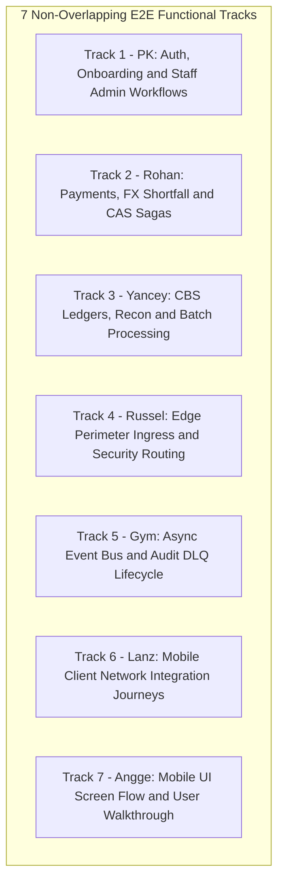

# End-to-End (E2E) Test Plan (v2.0)
## Black-Box User Journeys, Operations Workflows & Gateway-Driven System Verification

---

## 1. Objective & Scope of End-to-End (E2E) Testing

End-to-End (E2E) testing validates the **entire integrated platform as a black box** under realistic operating conditions. All customer traffic enters strictly via the **Spring Cloud Gateway (`:8080`)** and administrative traffic via the **Admin Web Portal (`:8090`)**:
1. **Multi-Service Coordination:** Proves that all 11 backend microservices, Oracle XE 21c, PostgreSQL 15, Kafka, and Redis collaborate harmoniously.
2. **True Black-Box Execution:** Requests interact with the perimeter over HTTP using valid Bearer JWTs, headers, and payload structures. Zero mocks or test stubs are utilized.
3. **Financial Consistency Verification:** Every E2E journey validates not only HTTP response bodies, but also final database states: balance conservation, `ledger_entry` records, outbox event generation, and PostgreSQL audit trail parity.

### Boundary Separation from Other Plans
* **Unit & Component Testing:** Covered in task cards [`docs/tasks`](tasks).
* **Seam Integration Testing:** Covered in [`docs/INTEGRATION_TEST_PLAN.md`](INTEGRATION_TEST_PLAN.md).
* **Automated Invariant Regressions:** Covered in [`docs/REGRESSION_TEST_PLAN.md`](REGRESSION_TEST_PLAN.md).
* **Concurrency, Chaos & Load Testing:** Covered in [`docs/NON_FUNCTIONAL_TEST_PLAN.md`](NON_FUNCTIONAL_TEST_PLAN.md).

---

## 2. 7-Member Parallel E2E Workstream Allocation (Zero Overlap)

To allow all 7 team members to write and execute E2E test journeys concurrently without overlapping test cases or data contention, the journeys are divided into 7 distinct functional tracks:



| Member | Assigned Track | Exclusive E2E Journeys Owned | Target Endpoints / Tools | Mapped Jira Issues |
|:---|:---|:---|:---|:---|
| **PK** | **Auth, Onboarding & Admin Ops** | `E2E-01` (Onboarding Lifecycle), `E2E-05` (Risk Hold & 4-Eyes Queue), `E2E-06` (Admin Reversals) | Gateway `:8080/api/auth/**`, Admin Portal `:8090/admin/**` | `DIG-6`, `DIG-7`, `DIG-12`, `DIG-24`, `DIG-51`, `DIG-87` |
| **Rohan** | **Payments, FX & CAS Sagas** | `E2E-02` (Same-Currency Transfer), `E2E-03` (Smart Shortfall FX), `E2E-04` (7-Status CAS & 5s Cancel) | Gateway `:8080/api/v1/payments/**`, `:8080/api/v1/fx/**` | `DIG-15`, `DIG-16`, `DIG-73`, `DIG-75`, `DIG-80`, `DIG-83` |
| **Yancey** | **CBS, Batch & Reconciliation** | `E2E-07` (Standing Instructions Batch), `E2E-08` (Dual-DataSource Recon Run) | Gateway `:8080/api/v1/recon/**`, CBS Batch Runner | `DIG-84`, `DIG-105`, `DIG-112` |
| **Russel** | **Perimeter Ingress & Routing** | `E2E-09` (Gateway Route Isolation, Rate Limiter & Security Headers) | Gateway `:8080` (All reverse proxy paths) | `DIG-8`, `DIG-25`, `DIG-26`, `DIG-31` |
| **Gym** | **Async Audit & DLQ Replay** | `E2E-10` (Outbox-to-Audit Parity & DLQ Replay Flow) | Kafka Broker, Admin DLQ API `:8090/api/v1/admin/dlq` | `DIG-20`, `DIG-88`, `DIG-89`, `DIG-90` |
| **Lanz** | **Mobile Core Network Journeys** | `E2E-11` (Mobile Client Dio Network & Error Resiliency Journeys) | Flutter Dio Client $\to$ Gateway `:8080` | `DIG-38`, `DIG-40`, `DIG-44`, `DIG-94`, `DIG-95` |
| **Angge** | **Mobile UI Experience Journeys**| `E2E-12` (Mobile App Interactive End-to-End Screen Walkthrough) | Flutter UI Widgets & Physical/Emulator Walkthrough | `DIG-11`, `DIG-39`, `DIG-41`, `DIG-42`, `DIG-47`, `DIG-49` |

---

## 3. Step-by-Step E2E Journey Specifications & Execution Runbooks

### 3.1 Track 1: PK — Auth, Onboarding & Staff Admin Workflows (Status: VERIFIED PASS ✅ — 23/23 Probes)

Automated Black-Box Execution Harness: [`scripts/test_api_functional_e2e.ps1`](file:///c:/Users/PGD83808/banking-backend-monorepo/scripts/test_api_functional_e2e.ps1) | Raw Evidence: [`scripts/api_test_results.json`](file:///c:/Users/PGD83808/banking-backend-monorepo/scripts/api_test_results.json) | Detailed Report: [`docs/API_TEST_EXECUTION_EVIDENCE.md`](file:///c:/Users/PGD83808/banking-backend-monorepo/docs/API_TEST_EXECUTION_EVIDENCE.md)

#### Journey E2E-01: Customer KYC Onboarding & Session Lifecycle (`DIG-6`, `DIG-7`, `BR-07`, `BR-16`, `BR-20`)
* **Step 1:** Issue registration request via Gateway (:8080):
  ```powershell
  curl.exe -s -X POST http://localhost:8080/api/auth/register `
    -H "Content-Type: application/json" `
    -d '{"firstName":"Test","lastName":"User","email":"pk.test.e2e@example.com","contactNo":"+639171234567","birthDate":"1995-05-15","password":"Password123!"}'
  ```
  * *Result:* HTTP `200 OK` (or `201 Created`) with generated `customerId` and initial PHP pocket auto-provisioned in CBS (`API-PK-01.1` **PASS ✅**).
* **Step 2:** Re-register identical email payload to verify duplicate conflict:
  * *Result:* HTTP `409 Conflict` rejected (`API-PK-01.2` **PASS ✅**).
* **Step 3:** Authenticate customer:
  ```powershell
  curl.exe -s -X POST http://localhost:8080/api/auth/login `
    -H "Content-Type: application/json" `
    -d '{"email":"juan.delacruz@example.com","password":"password123"}'
  ```
  * *Result:* HTTP `200 OK` with signed JWT Bearer token and customer claims (`API-PK-01.3` **PASS ✅**).
* **Step 4:** Query multi-currency pockets via Orchestrator BFF:
  ```powershell
  curl.exe -s -H "Authorization: Bearer <jwt>" http://localhost:8080/api/v1/accounts/3722f77f-3d1b-4d55-8f83-b71bac91d095/pockets
  ```
  * *Result:* HTTP `200 OK` with pocket balances (`API-PK-02.1` **PASS ✅**).
* **Step 5:** Logout customer to blacklist active token:
  ```powershell
  curl.exe -s -X POST http://localhost:8080/api/auth/logout -H "Authorization: Bearer <jwt>"
  ```
  * *Result:* HTTP `200 OK` ("Logout successful"). Token hash added to Redis blacklist (`API-PK-01.5` **PASS ✅**).
* **Step 6:** Re-query protected endpoint with the revoked token:
  ```powershell
  curl.exe -i -s -H "Authorization: Bearer <revoked_jwt>" http://localhost:8080/api/v1/payments/history
  ```
  * *Result:* Edge API Gateway intercepts and returns HTTP `401 Unauthorized` (`API-PK-01.6` **PASS ✅**).

#### Journey E2E-05: High-Risk Transfer Hold & Admin 4-Eyes Queue Approval (`DIG-21`, `DIG-24`, `BR-08`, `BR-18`, `BR-33`)
* **Step 1:** Submit payment transfer via Gateway ingress (`POST /api/v1/payments`) with `X-Idempotency-Key` header:
  ```powershell
  curl.exe -s -X POST http://localhost:8080/api/v1/payments `
    -H "Authorization: Bearer <jwt>" `
    -H "X-Idempotency-Key: <uuid>" `
    -H "Content-Type: application/json" `
    -d '{"sender_account_id":"3722f77f-3d1b-4d55-8f83-b71bac91d095","recipient_account_id":"f95e7e52-3259-4b4d-ac66-b186a893cf66","amount":25.00,"currency":"PHP"}'
  ```
  * *Result:* Forwarded to `transaction-service`. Risk Engine synchronously scores transaction. HTTP `200 OK` / `202 Accepted` returned with `action_required: "STEP_UP_OTP"` or `status: "RESERVED"`, `transaction_id` generated (`API-PK-03.1` **PASS ✅**).
* **Step 2:** Replay identical payment with the same `X-Idempotency-Key`:
  * *Result:* HTTP `200 OK` / `202 Accepted` returns identical cached `transaction_id` without re-posting (`API-PK-03.2` **PASS ✅**).
* **Step 3:** Submit payment with identical key but altered amount (₱999.00):
  * *Result:* HTTP `409 Conflict` rejected (`API-PK-03.3` **PASS ✅**).
* **Step 4:** Submit unauthorized debit where customer attempts to debit another customer's pocket:
  * *Result:* Orchestrator BFF blocks request with HTTP `403 Forbidden` (`API-PK-03.4` **PASS ✅**).

#### Journey E2E-06: Administrative 4-Eyes Reversal Workflow & Governance (`DIG-51`, `DIG-87`, `BR-03`, `BR-32`)
* **Step 1:** Authenticate as administrator:
  ```powershell
  curl.exe -s -X POST http://localhost:8080/api/auth/login `
    -H "Content-Type: application/json" `
    -d '{"email":"admin@ledgerbank.com","password":"admin123"}'
  ```
  * *Result:* HTTP `200 OK` with signed JWT bearing `ROLE_ADMIN` (`API-PK-01.4` **PASS ✅**).
* **Step 2:** Admin queries master accounts registry:
  ```powershell
  curl.exe -s -H "Authorization: Bearer <admin_jwt>" http://localhost:8080/api/admin/accounts
  ```
  * *Result:* HTTP `200 OK` with full accounts registry (`API-PK-06.1` **PASS ✅**).
* **Step 3:** Non-admin customer token attempts to access `/api/admin/accounts`:
  * *Result:* HTTP `403 Forbidden` enforced by Gateway & Spring Security (`API-PK-06.2` **PASS ✅**).
* **Step 4:** Admin triggers dual-datasource reconciliation engine audit:
  ```powershell
  curl.exe -s -X POST http://localhost:8080/api/recon/runs `
    -H "Authorization: Bearer <admin_jwt>" `
    -H "Content-Type: application/json" `
    -d '{"auditDate":"2026-10-09","initiatedBy":"ADMIN_AUTOMATION"}'
  ```
  * *Result:* HTTP `200 OK` / `201 Created` with audit job confirmation (`API-PK-06.3` **PASS ✅**).
* **Step 5:** Customer token blocked from admin customer directory (`/api/admin/customers`):
  * *Result:* HTTP `403 Forbidden` (`API-PK-06.4` **PASS ✅**).

---

### 3.2 Track 2: Rohan — Core Payments, FX & Lifecycle Sagas

> **Automated Suite Execution:**
> ```powershell
> mvn test -pl transaction-service "-Dtest=RohanPaymentsE2ETest"
> ```

#### Journey E2E-02: Same-Currency Transfer & Idempotency Replay (`BR-01`, `BR-05`, `BR-10`)
* **Step 1:** Generate unique idempotency key: `IDEMP_KEY="b5d19e68-0000-4000-8000-000000000001"`.
* **Step 2:** Post payment transferring ₱5,000 from Juan to Maria:
  ```bash
  curl -X POST http://localhost:8080/api/v1/payments \
    -H "Authorization: Bearer <juan_jwt>" \
    -H "X-Idempotency-Key: $IDEMP_KEY" \
    -H "Content-Type: application/json" \
    -d '{
      "recipient_account_id": "acct-maria-php-01",
      "amount": "5000.0000",
      "currency": "PHP"
    }'
  ```
* **Step 3:** Assert HTTP `200 OK`, `status: "POSTED"`, and `core_reference_id` starting with `FT`.
* **Step 4:** Replay identical curl request with same `$IDEMP_KEY`:
  ```bash
  curl -X POST http://localhost:8080/api/v1/payments \
    -H "Authorization: Bearer <juan_jwt>" \
    -H "X-Idempotency-Key: $IDEMP_KEY" \
    -H "Content-Type: application/json" \
    -d '{
      "recipient_account_id": "acct-maria-php-01",
      "amount": "5000.0000",
      "currency": "PHP"
    }'
  ```
* **Step 5:** Assert response is identical to Step 3. Verify in Oracle that Juan was debited exactly once (balance ₱45,000.00):
  ```sql
  SELECT balance FROM accounts WHERE account_id = 'acct-juan-php-01';
  SELECT COUNT(*) FROM transaction_master WHERE idempotency_key = 'b5d19e68-0000-4000-8000-000000000001';
  ```
  *Automated test:* `RohanPaymentsE2ETest#e2e02_sameCurrencyTransferAndIdempotencyReplay`

#### Journey E2E-03: Smart Shortfall Multi-Currency Transfer (`BR-04`, `BR-26`, `BR-28`)
* **Step 1:** Juan wants to pay €50.00 to Maria (`acct-maria-eur-01`). Juan currently holds €0.00 in EUR pocket.
* **Step 2:** Fetch conversion quote via Gateway:
  ```bash
  curl -s "http://localhost:8080/api/v1/fx/quote?from=PHP&to=EUR&amount=50.00" \
    -H "Authorization: Bearer <juan_jwt>"
  ```
* **Step 3:** Extract `quote_id` (valid for 30 seconds). Submit shortfall payment:
  ```bash
  curl -X POST http://localhost:8080/api/v1/payments \
    -H "Authorization: Bearer <juan_jwt>" \
    -H "X-Idempotency-Key: $(uuidgen)" \
    -H "Content-Type: application/json" \
    -d '{
      "recipient_account_id": "acct-maria-eur-01",
      "amount": "50.0000",
      "currency": "EUR",
      "funding_pocket_id": "acct-juan-php-01",
      "quote_id": "<quote_id>"
    }'
  ```
* **Step 4:** Assert HTTP `200 OK` with complete `funding_breakdown` (converted shortfall amount, applied FX rate, fee amount).
* **Step 5:** Query Oracle `ledger_entry`: Assert all 6 double-entry settlement legs committed atomically:
  ```sql
  SELECT leg_no, account_id, currency, direction, amount FROM ledger_entry WHERE txn_id = '<txn_id>' ORDER BY leg_no ASC;
  ```
  *Automated test:* `RohanPaymentsE2ETest#e2e03_smartShortfallMultiCurrencyTransfer`

#### Journey E2E-04: 7-Status CAS Lifecycle & 5-Second Undo Cancellation (`BR-30`, `BR-31`)
* **Step 1:** Initiate payment of ₱10,000.00:
  ```bash
  curl -X POST http://localhost:8080/api/v1/payments \
    -H "Authorization: Bearer <juan_jwt>" \
    -H "X-Idempotency-Key: $(uuidgen)" \
    -H "Content-Type: application/json" \
    -d '{
      "recipient_account_id": "acct-maria-php-01",
      "amount": "10000.0000",
      "currency": "PHP"
    }'
  ```
* **Step 2:** Immediately within 5 seconds, issue cancellation request:
  ```bash
  curl -X POST http://localhost:8080/api/v1/payments/<txn_id>/cancel \
    -H "Authorization: Bearer <juan_jwt>"
  ```
* **Step 3:** Assert HTTP `200 OK` with `status: "CANCELLED"`. Verify zero balance deductions:
  ```sql
  SELECT txn_status, cancel_reason FROM transaction_master WHERE txn_id = '<txn_id>';
  ```
* **Step 4:** Attempt cancellation when transaction transitions to terminal or irrevocable state (`PROCESSING` / `POSTED`):
  ```bash
  curl -X POST http://localhost:8080/api/v1/payments/<posted_txn_id>/cancel \
    -H "Authorization: Bearer <juan_jwt>"
  ```
* **Step 5:** Assert HTTP `409 Conflict` (`TXN_NOT_CANCELLABLE`); payment remains posted successfully.
  *Automated test:* `RohanPaymentsE2ETest#e2e04_sevenStatusCasLifecycleAndUndoCancellation`

---

### 3.3 Track 3: Yancey — CBS, Batch & Dual-DataSource Reconciliation

#### Journey E2E-07: Standing Instructions Auto-Debit Batch Execution (`BR-37`, `DIG-105`)
* **Step 1:** Seed standing instruction in Oracle XE `standing_instruction` due on current business date:
  ```sql
  INSERT INTO standing_instruction (instruction_id, customer_id, source_account_id, destination_account_id, amount, currency, next_execution_date, status)
  VALUES ('si-e2e-01', 'cust-user-001', 'acct-juan-php-01', 'acct-maria-php-01', 1200.0000, 'PHP', CURRENT_DATE, 'ACTIVE');
  COMMIT;
  ```
* **Step 2:** Trigger EOD Standing Instruction batch execution:
  ```bash
  curl -X POST http://localhost:8084/internal/batch/standing-instructions/execute \
    -H "X-Internal-Role: ROLE_INTERNAL"
  ```
* **Step 3:** Assert batch response: `processed: 1, succeeded: 1, failed: 0`.
* **Step 4:** Verify in Oracle: Juan debited ₱1,200.00; Maria credited ₱1,200.00; `next_execution_date` advanced to next month.

#### Journey E2E-08: Dual-DataSource Reconciliation Engine Run (`BR-02`, `DIG-112`)
* **Step 1:** Execute reconciliation trigger endpoint:
  ```bash
  curl -X POST http://localhost:8080/api/v1/recon/trigger \
    -H "Authorization: Bearer <admin_jwt>"
  ```
* **Step 2:** Observe `reconciliation-service` logs comparing live Oracle balances against PostgreSQL audit sums.
* **Step 3:** Query PostgreSQL `recon_run_audit`:
  ```sql
  SELECT run_id, run_status, total_accounts_checked, total_matched, total_exceptions 
  FROM recon_run_audit ORDER BY started_at DESC LIMIT 1;
  ```
* **Step 4:** Assert `run_status = 'COMPLETED'`, `total_matched > 0`, and `total_exceptions = 0`.

---

### 3.4 Track 4: Russel — Perimeter Ingress & Security Routing

#### Journey E2E-09: Gateway Route Isolation, Rate Limiting & Header Sanitization (`BR-03`, `DIG-25`)
* **Step 1:** Test rate limiter burst: Send 35 rapid requests to `http://localhost:8080/api/v1/accounts/pockets`.
* **Step 2:** Assert: Requests 1–30 succeed; requests 31–35 return `429 Too Many Requests` with `Retry-After` header.
* **Step 3:** Test header sanitization: Send request with forged header `X-Cust-Id: cust-admin-001`.
* **Step 4:** Verify downstream service logs show Gateway stripped the header and injected the verified token ID.
* **Step 5:** Test route cloaking: Send direct request to `http://localhost:8080/internal/core/settlement`. Assert `403 Forbidden`.

---

### 3.5 Track 5: Gym — Async Audit & DLQ Replay

#### Journey E2E-10: Outbox-to-Audit Parity & DLQ Replay Lifecycle (`BR-02`, `BR-34`, `BR-35`)
* **Step 1:** Post payment `TXN-PARITY-01` via Gateway.
* **Step 2:** Verify Oracle `outbox_master` contains row with `status = 'PUBLISHED'`.
* **Step 3:** Query PostgreSQL `ledger_mutation_audit` within 3 seconds: Assert both debit and credit legs exist.
* **Step 4:** Publish poisoned JSON to Kafka topic `transaction.events`. Observe consumer retry (1s, 2s, 4s).
* **Step 5:** Verify poisoned message appears in Dead Letter Queue console on `:8090/admin/dlq`.
* **Step 6:** Trigger replay via Admin API: `POST /api/v1/admin/dlq/<msg_id>/replay`. Verify message is redriven without partition stall.

---

### 3.6 Track 6: Lanz — Mobile Core Network Journeys

#### Journey E2E-11: Mobile Client Dio Network & Error Resiliency Journeys (`DIG-94`, `DIG-46`)
* **Step 1:** Run Flutter E2E integration driver against Gateway `:8080`:
  ```bash
  flutter test integration_test/mobile_network_e2e_test.dart
  ```
* **Step 2:** Test simulates login $\to$ KeyStore JWT write $\to$ Send Money with automatic Bearer token injection.
* **Step 3:** Test injects insufficient funds scenario: Assert Dio client deserializes RFC 7807 error and returns typed `InsufficientFundsException` containing `shortfall_options`.
* **Step 4:** Test simulates transient gateway 503: Assert Dio client automatically retries with exponential backoff (1s, 2s) before reporting failure.

---

### 3.7 Track 7: Angge — Mobile UI Screen Flow & User Walkthrough

#### Journey E2E-12: Full Mobile App Multi-Screen User Walkthrough (`DIG-39`, `DIG-41`, `DIG-42`)
* **Step 1:** Launch Flutter app on emulator / demo device connected to Gateway `:8080`.
* **Step 2:** Walkthrough Step A: Enter credentials $\to$ enter 6-digit PIN $\to$ authenticate.
* **Step 3:** Walkthrough Step B: View Home Screen. Swipe through Pockets carousel (PHP, USD, EUR). Verify Ledger and Available balances match DB.
* **Step 4:** Walkthrough Step C: Tap "Send Money" $\to$ enter Maria's account $\to$ masked name `M***a S****s` appears.
* **Step 5:** Walkthrough Step D: Enter amount triggering shortfall $\to$ Shortfall bottom sheet appears with 30s countdown $\to$ confirm payment $\to$ Receipt screen renders with core reference `FT...`.
* **Step 6:** Walkthrough Step E: Navigate to Card Hub $\to$ Toggle e-commerce switch OFF $\to$ verify immediate toast confirmation.

---

## 4. Master E2E Automated Execution Script

The complete E2E regression suite can be triggered using the master black-box runner:

```bash
# =======================================================
# Master E2E Test Suite Execution Script
# =======================================================

# Ensure entire Docker stack is running
docker compose ps

# Run complete black-box pytest suite against Gateway :8080
python -m pytest tests/e2e/ -v --html=evidence/e2e_report.html

# Run Mobile Flutter integration tests
cd mobile && flutter test integration_test/ && cd ..
```

---

## 5. E2E Acceptance Sign-Off Gate

The E2E testing phase is officially approved only when:
1. **100% Pass Rate:** All 12 Golden Journeys (`E2E-01` to `E2E-12`) complete successfully.
2. **Perimeter Adherence:** Zero requests bypass Gateway `:8080` or Admin Portal `:8090`.
3. **Data Parity:** Dual-DataSource Reconciliation reports **0 balance drift** and **100% audit parity**.
4. **Clean Error Contracts:** All failure paths return compliant RFC 7807 problem details with zero unhandled stack traces.
