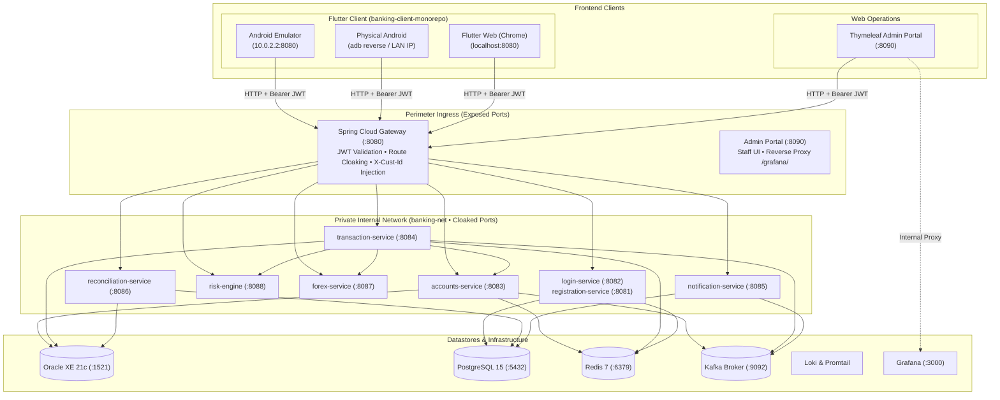

# Full-System Wiring & Integration Guide (v1.1)
## Multi-Client (Flutter Mobile/Web & Thymeleaf Admin) to Gateway Ingress & Microservices
### Verified Consistent with `CONTRACTS.md`, `openapi.yaml`, and `SEED.md`

---

## 1. System Topology & Network Map

During full-system and E2E testing, all client traffic enters exclusively through two designated perimeter ingress points. Internal microservices and datastores reside on a private bridge network (`banking-net`) and are cloaked from direct host access per zero-trust architecture (`CH-03`).



---

## 2. Ingress & Address Resolution Matrix

Because client runtimes resolve host networking differently, use the exact base URL corresponding to the execution target:

| Client Target | Environment | Target Base URL | How Host Machine Port `:8080` is Resolved |
| :--- | :--- | :--- | :--- |
| **Android Emulator** | Android Studio / AVD | `http://10.0.2.2:8080` | Android QEMU virtual router maps `10.0.2.2` directly to host machine loopback `127.0.0.1`. |
| **Physical Android Phone** | USB Debugging Cable | `http://localhost:8080` | Requires running `adb reverse tcp:8080 tcp:8080` prior to app launch. |
| **Physical Android Phone** | Wi-Fi / Local LAN | `http://<HOST_LAN_IP>:8080` | e.g. `http://192.168.1.50:8080`. Host firewall must permit port 8080 inbound. |
| **Flutter Web (Chrome)** | Browser | `http://localhost:8080` | Browser shares host network stack directly. |
| **Thymeleaf Admin (Docker)** | Docker Compose | `http://api-gateway:8080` | Container DNS inside bridge network `banking-net`. |
| **Thymeleaf Admin (Local)** | Local JVM | `http://localhost:8080` | Local process targeting exposed gateway port. |

---

## 3. Global Conventions & Data Formats (from `CONTRACTS.md`)

All clients communicating with `:8080` must strictly observe these contract standards:

1. **Authentication:** `Authorization: Bearer <jwt>` on all protected endpoints.
2. **Idempotency Key:** `X-Idempotency-Key: <uuid>` header required for all mutating endpoints (`/api/v1/payments`, `/api/v1/ledger/mutate`, `/api/v1/fx/convert`). Scoped per customer with 24-hour Redis TTL.
3. **Monetary Representation:** Strings formatted as fixed-point decimals with scale 4 (e.g. `"50.0000"`, `"120000.0000"`). Floats are strictly prohibited to avoid precision loss.
4. **Timestamps:** ISO-8601 UTC string (`"2026-10-05T11:15:00.000Z"`).
5. **RFC 7807 Error Envelope:** All error responses adhere to standard JSON:
   ```json
   {
     "error_code": "INSUFFICIENT_FUNDS",
     "message": "Primary pocket balance is insufficient for this payment",
     "status": 422,
     "timestamp": "2026-10-05T11:15:00.000Z"
   }
   ```
6. **Network Boundary Protection (B-06):**
   - Core settlement (`/internal/core/settlement/**`), direct balance mutations (`/api/accounts/*/credit`, `/api/accounts/*/debit`), and risk internal routes (`/internal/risk/**`) are strictly blocked at Gateway `:8080` with `403 Forbidden` (`ACCESS_DENIED`). Clients must always route mutations through `transaction-service` (`/api/v1/payments`).

---

## 4. Client Wiring Configurations

### 4.1 Flutter Mobile & Web Client (`banking-client-monorepo`)

The client repository features compile-time and runtime environment injection in `lib/core/network/api_client.dart`:

```dart
static const String defaultGatewayUrl = String.fromEnvironment(
  'API_BASE_URL',
  defaultValue: kIsWeb ? 'http://localhost:8080' : 'http://10.0.2.2:8080',
);
```

#### Launch Commands by Target

* **Android Emulator (Default):**
  ```powershell
  cd "banking-client-monorepo"
  flutter run -d emulator-5554
  ```
  *(Automatically resolves to `http://10.0.2.2:8080`)*

* **Physical Android Device via USB Port Forwarding:**
  ```powershell
  # 1. Reverse port 8080 from device to host
  adb reverse tcp:8080 tcp:8080

  # 2. Run app overriding API_BASE_URL to localhost
  cd "banking-client-monorepo"
  flutter run -d <DEVICE_ID> --dart-define=API_BASE_URL=http://localhost:8080
  ```

* **Flutter Web (Chrome Browser):**
  ```powershell
  cd "banking-client-monorepo"
  flutter run -d chrome --dart-define=API_BASE_URL=http://localhost:8080
  ```

* **Network Security Verification:**
  `android/app/src/main/AndroidManifest.xml` is configured with:
  ```xml
  <application
      android:label="North South Bank"
      android:usesCleartextTraffic="true"
      ... >
  ```
  This allows cleartext `http://` traffic for local test execution without TLS certificates.

---

### 4.2 Thymeleaf Admin Portal (`banking-backend-monorepo/frontend-web`)

The Thymeleaf portal runs on port **`:8090`** to prevent port collisions with the API Gateway on **`:8080`**.

#### Configuration (`frontend-web/src/main/resources/application.yml`):
```yaml
server:
  port: 8090

banking:
  backend:
    mode: ${BANKING_BACKEND_MODE:gateway} # Options: 'mock' (standalone) or 'gateway' (live backend)
    gateway-url: ${BANKING_GATEWAY_URL:http://localhost:8080}
    connect-timeout-ms: 3000
    read-timeout-ms: 5000
```

* **Running inside Docker Compose:**
  Managed automatically. Environment variables are set to:
  ```yaml
  BANKING_BACKEND_MODE: gateway
  BANKING_GATEWAY_URL: http://api-gateway:8080
  ```
* **Running Standalone (Local JVM):**
  ```powershell
  cd "banking-backend-monorepo"
  ./mvnw spring-boot:run -pl frontend-web -Dspring-boot.run.arguments="--banking.backend.mode=gateway --banking.backend.gateway-url=http://localhost:8080"
  ```

---

## 5. API Gateway Routing & Contract Seams

All requests entering `:8080` map to downstream microservices per `openapi.yaml` and `CONTRACTS.md`:

| Route Prefix / Endpoints | Target Microservice | Internal Port | Auth Filter | Associated Spec & Contract Functions |
| :--- | :--- | :--- | :--- | :--- |
| `/api/auth/register`, `/api/auth/register/**` | `registration-service` | `8081` | None (Public) | Customer onboarding & auto-provisioned PHP pocket (`openapi.yaml`) |
| `/api/auth/login`, `/api/auth/logout`, `/api/auth/refresh`, `/api/auth/otp/**` | `login-service` | `8082` | None / Public | BCrypt login, JWT issuance, Redis blacklist revocation, Step-up OTP |
| `/api/accounts`, `/api/accounts/{id}`, `/api/accounts/{id}/balance`, `/api/accounts/customer/{id}` | `accounts-service` | `8083` | `JwtAuthentication` | Account lookup, balance inquiry, multi-currency pockets (`openapi.yaml`) |
| `/api/v1/accounts/{id}/lock`, `/api/v1/accounts/{id}/unlock` | `accounts-service` | `8083` | `JwtAuthentication` | Customer account self-lock & OTP unlock (`CONTRACTS.md §2.3`) |
| `/api/v1/payments`, `/api/v1/payments/**` | `transaction-service` | `8084` | `JwtAuthentication` | Direct transfer, Smart shortfall saga, CAS cancel (`CONTRACTS.md §2.1`) |
| `/api/v1/cards`, `/api/v1/cards/**` | `transaction-service` | `8084` | `JwtAuthentication` | Virtual card controls, e-commerce toggle, status (`CONTRACTS.md §2.3`) |
| `/api/v1/recipients/lookup` | `transaction-service` | `8084` | `JwtAuthentication` | Masked recipient name lookup before confirmation (`CONTRACTS.md §2.3`) |
| `/api/v1/ledger/mutate` | `transaction-service` | `8084` | `JwtAuthentication` | Legacy Sprint 0 adapter route for atomic CBS mutation (`openapi.yaml`) |
| `/api/v1/ledger/audit/{txnId}` | `transaction-service` | `8084` | `JwtAuthentication` | PostgreSQL append-only audit trail inquiry (`openapi.yaml`) |
| `/api/v1/fx/quote`, `/api/v1/fx/convert` | `forex-service` | `8087` | `JwtAuthentication` | 30s locked quote & own-pocket FX conversion (`CONTRACTS.md §2.2`) |
| `/api/v1/fx-rate`, `/api/v1/forex/rates` | `forex-service` | `8087` | None (Public) | Cached FX rate listing from `frankfurter.dev` (`openapi.yaml`) |
| `/api/notifications/**` | `notification-service` | `8085` | `JwtAuthentication` | Customer notifications & Kafka alert consumers |
| `/api/recon/runs`, `/api/recon/breaks` | `reconciliation-service` | `8086` | `JwtAuthentication` | Dual-DS CBS vs Audit drift detection engine (`openapi.yaml`) |
| `/api/admin/accounts/**` | `accounts-service` | `8083` | `JwtAuthentication` (`ROLE_ADMIN`) | Administrative freeze/unfreeze governance (`openapi.yaml`) |
| `/api/admin/customers/**` | `registration-service` | `8081` | `JwtAuthentication` (`ROLE_ADMIN`) | Staff customer KYC verification (`openapi.yaml`) |
| `/api/v1/admin/transfers/{id}/reverse` | `transaction-service` | `8084` | `JwtAuthentication` (`ROLE_ADMIN`) | Maker-checker reversal with linked compensating legs (`CONTRACTS.md §2.5`) |

### Token & Identity Forwarding Protocol
1. **Client Header:** Client sends `Authorization: Bearer <JWT>`.
2. **Gateway Interception:** `JwtAuthenticationGatewayFilterFactory` validates JWT signature (`jwt.secret`), checks expiration, and verifies token against Redis blacklist (`blacklist:<token>`).
3. **Identity Injection:** Gateway extracts `customerId` from JWT claims and injects downstream headers:
   ```http
   X-Cust-Id: cust-user-001
   X-User-Role: ROLE_CUSTOMER
   ```
4. **Header Stripping:** Gateway strips any incoming client-forged `X-Cust-Id` or `X-User-Role` before forwarding.

---

## 6. Full-System Startup Runbook

Execute this ordered sequence to bring up the entire stack for E2E testing:

### Step 1: Start Backend Infrastructure & Microservices
```powershell
cd "banking-backend-monorepo"

# Stop any dangling containers and reset volumes for a clean state
docker compose down -v

# Start full backend stack
docker compose up -d
```

### Step 2: Health Check & Seam Verification
Verify all exposed endpoints and core services are healthy before launching frontends:

```powershell
# 1. Check container health status
docker compose ps

# 2. Verify API Gateway ingress
Invoke-RestMethod -Uri "http://localhost:8080/actuator/health" -Method Get

# 3. Verify Admin Portal ingress
Invoke-RestMethod -Uri "http://localhost:8090/actuator/health" -Method Get
```

### Step 3: Launch Flutter Client
```powershell
cd "banking-client-monorepo"

# Run on Android Emulator
flutter run -d emulator-5554

# Or run in Chrome
flutter run -d chrome
```

---

## 7. Pre-Seeded Personas for E2E Verification (Aligned with `SEED.md`)

The following seeded users and credentials from [`docs/SEED.md`](SEED.md) are pre-loaded in the databases:

| Persona | Role | Email / Username | Password | Default Accounts & Balances (Oracle XE) | Virtual Card |
| :--- | :--- | :--- | :--- | :--- | :--- |
| **Juan Dela Cruz** | Retail Customer (`cust-user-001`) | `juan.delacruz@example.com` | `password123` | • `acct-juan-php-01` (PHP Savings, Primary): **₱50,000.0000**<br/>• `acct-juan-usd-01` (USD Checking): **$1,500.0000** | `card-juan-01`<br/>`4532-XXXX-XXXX-8821`<br/>Ecom: `1` |
| **Maria Santos** | Retail Customer (`cust-user-002`) | `maria.santos@example.com` | `password123` | • `acct-maria-php-01` (PHP Savings, Primary): **₱120,000.0000**<br/>• `acct-maria-eur-01` (EUR Wallet): **€800.0000** | `card-maria-01`<br/>`4532-XXXX-XXXX-1194`<br/>Ecom: `1` |
| **System Admin** | Staff Operator (`cust-admin-001`) | `admin@ledgerbank.com` | `admin123` | Admin Portal access on `:8090` (Recon, Holds, DLQ, Freezes) | N/A |

---

## 8. Troubleshooting & Common Wiring Traps

| Symptom | Root Cause | Immediate Fix |
| :--- | :--- | :--- |
| **`DioException: SocketException: OS Error: Connection refused` on Android** | App is trying to access `http://localhost:8080` instead of `http://10.0.2.2:8080`. | Ensure `--dart-define=API_BASE_URL=http://10.0.2.2:8080` is passed, or rely on `ApiClient` default. |
| **`Connection refused` on Physical Android Device** | Device cannot resolve host loopback. | Run `adb reverse tcp:8080 tcp:8080` in PowerShell while phone is connected via USB. |
| **`Cleartext HTTP traffic to 10.0.2.2 not permitted`** | Android Network Security Policy blocking cleartext `http://`. | Verify `android:usesCleartextTraffic="true"` is set inside `<application>` in `AndroidManifest.xml`. |
| **CORS Error in Chrome (`XMLHttpRequest blocked by CORS policy`)** | Browser security blocks requests to `:8080` from `localhost:<flutter_web_port>`. | Launch Chrome with web security disabled for local testing: `flutter run -d chrome --web-browser-flag "--disable-web-security"`. |
| **`401 Unauthorized (TOKEN_REVOKED)`** | Token was invalidated via `/api/auth/logout` or present in Redis blacklist. | Re-authenticate via `/api/auth/login` to obtain fresh JWT. |
| **`401 Unauthorized (INVALID_CREDENTIALS)` after 15 min** | Access tokens have a 15-minute validity window. | Call `POST /api/auth/refresh` with refresh token, or re-authenticate persona. |
| **`409 Conflict (IDEMPOTENCY_IN_PROGRESS)`** | Duplicate `X-Idempotency-Key` sent while initial transaction is still processing. | Await original response or supply a distinct UUID (`Uuid().v4()`). |
| **`403 Forbidden (ACCESS_DENIED)` on `/internal/**` or balance mutations** | B-06 Boundary rule blocks internal routes (`/internal/core/**`, `/api/accounts/*/credit`) at Gateway. | Route payments through `/api/v1/payments`. |
| **`422 Unprocessable (FX_RATE_STALE)`** | Cached exchange rate in `fx_rate_cache` is older than 24 hours. | Run Forex rate refresh scheduler or trigger `/api/v1/fx-rate` update. |
