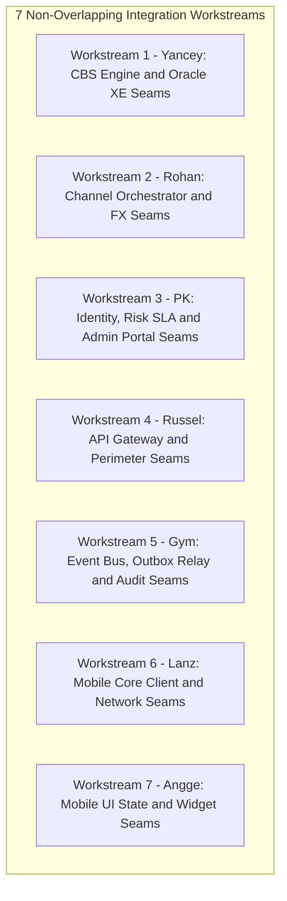

# Integration Test Plan (v2.0)
## Component Seams, Multi-Tier Subsystems & Service-to-Service Contracts

---

## 1. Objective & Scope of Integration Testing

Integration testing verifies the **seams and interactions between subsystems** across the Capstone Banking System. While unit tests validate business logic in isolation using mocks, integration testing exercises actual network, persistence, caching, and message bus boundaries:
* **Service-to-Database Seams:** Real Oracle XE 21c (schemas `CBS`, `PAYMENT`, `FX`) and PostgreSQL 15 (Channel DB & Audit DB).
* **Service-to-Service Seams:** Feign HTTP clients, Resilience4j circuit breakers, timeouts, and fallback mechanisms.
* **Transactional Outbox & Event Bus Seams:** Outbox table polling, Kafka broker topic partitioning, retry topics, and single-writer audit consumers.
* **Edge Perimeter Seams:** Spring Cloud Gateway `:8080` route forwarding, JWT signature fast-path, Redis token-bucket rate limiting, and internal route cloaking.
* **Client-to-Gateway Seams:** Flutter Dio HTTP client network interceptors, secure token storage, and administrative portal REST bridges.

---

## 2. 7-Member Parallel Workstream Allocation (Zero Overlap)

To guarantee that all 7 engineers can execute integration testing simultaneously without blocking each other, the test seams are divided into 7 mutually exclusive workstreams:



| Workstream | Owner | Subsystems & Boundaries Tested | Primary Task Cards | Mapped Jira Issues |
|:---|:---|:---|:---|:---|
| **Workstream 1** | **Yancey** | `accounts-service` $\leftrightarrow$ Oracle XE `CBS` schema & `reconciliation-service` read replica. | `T-002`, `T-012` | `DIG-3`, `DIG-4`, `DIG-52`, `DIG-66`, `DIG-84`, `DIG-85`, `DIG-112` |
| **Workstream 2** | **Rohan** | `transaction-service` $\leftrightarrow$ `accounts-service` (Feign) & `forex-service` (Quotes & CAS claims). | `T-001`, `T-007` | `DIG-14`, `DIG-15`, `DIG-73`, `DIG-74`, `DIG-75`, `DIG-80`, `DIG-83` |
| **Workstream 3** | **PK** | `login-service` / `registration-service` $\leftrightarrow$ `accounts-service`, `risk-engine` & `frontend-web`. | `T-003`, `T-006`, `T-011` | `DIG-6`, `DIG-7`, `DIG-12`, `DIG-21`, `DIG-22`, `DIG-23`, `DIG-50`, `DIG-54`, `DIG-90` |
| **Workstream 4** | **Russel** | `api-gateway` (:8080) $\leftrightarrow$ Downstream Microservices, Redis 7, and Zero-Trust Network. | `T-005`, `T-014` | `DIG-8`, `DIG-25`, `DIG-26`, `DIG-28`, `DIG-30`, `DIG-31` |
| **Workstream 5** | **Gym** | Oracle `outbox_master` $\leftrightarrow$ Kafka Broker $\leftrightarrow$ `AuditLedgerConsumer` $\leftrightarrow$ PostgreSQL Audit DB. | `T-004`, `T-014` | `DIG-5`, `DIG-20`, `DIG-32`, `DIG-88`, `DIG-89` |
| **Workstream 6** | **Lanz** | Flutter Dio HTTP Client $\leftrightarrow$ Android KeyStore $\leftrightarrow$ Gateway `:8080`. | `T-009`, `T-010` | `DIG-10`, `DIG-38`, `DIG-40`, `DIG-44`, `DIG-46`, `DIG-94`, `DIG-95` |
| **Workstream 7** | **Angge** | Flutter UI Widgets $\leftrightarrow$ Mobile State BLoC $\leftrightarrow$ Endpoints (Pockets, Shortfall Sheet, Cards). | `T-008`, `T-010` | `DIG-11`, `DIG-13`, `DIG-39`, `DIG-41`, `DIG-42`, `DIG-47`, `DIG-49`, `DIG-98` |

---

## 3. Step-by-Step Integration Test Execution Runbooks

### 3.1 Workstream 1: Yancey — CBS Engine & Oracle XE Seams

#### Prerequisites:
```bash
docker compose up -d oracle-db
# Wait for Oracle container healthcheck: healthy
```

#### Step-by-Step Execution:
* **SEAM-YAN-01: Row-Level Locking & Deadlock Prevention Seam (`DIG-52`, `BR-01`)**
  * *Step 1:* Run the integration test:
    ```bash
    ./mvnw test -pl accounts-service -Dtest=CoreSettlementServiceIntegrationTest#verifyAscendingRowLocking
    ```
  * *Step 2:* The test spawns 2 concurrent transfers: Pair 1 (`acct-A` $\to$ `acct-B`), Pair 2 (`acct-B` $\to$ `acct-A`).
  * *Step 3:* Inspect SQL logs: Verify both threads acquire locks on `MIN(acct_id)` first, then `MAX(acct_id)`.
  * *Step 4:* Assert 0 `ORA-00060` (deadlock detected) errors; both transactions commit sequentially.
* **SEAM-YAN-02: Atomic Multi-Leg Settlement & Ledger Journal Seam (`DIG-66`, `PLAN.md` Delta §3.2)**
  * *Step 1:* Issue multi-leg settlement request to CBS:
    ```bash
    curl -X POST http://localhost:8083/internal/core/settlement \
      -H "Content-Type: application/json" \
      -H "X-Internal-Role: ROLE_INTERNAL" \
      -d '{
        "transaction_id": "txn-int-001",
        "posting_reference_id": "FT2627800099",
        "legs": [
          {"account_id": "acct-juan-php-01", "entry_type": "DEBIT", "amount": "1000.0000", "currency": "PHP"},
          {"account_id": "acct-maria-php-01", "entry_type": "CREDIT", "amount": "1000.0000", "currency": "PHP"}
        ]
      }'
    ```
  * *Step 2:* Verify HTTP `200 OK` with `core_reference_id: "FT2627800099"`.
  * *Step 3:* Query Oracle XE via SQL client:
    ```sql
    SELECT * FROM ledger_entry WHERE txn_id = 'txn-int-001';
    SELECT status FROM outbox_master WHERE txn_id = 'txn-int-001';
    ```
  * *Step 4:* Assert exactly 2 `ledger_entry` records exist with correct `running_balance`, and 1 `outbox_master` row exists with `status = 'PENDING'`.
* **SEAM-YAN-03: Hold Placement, Available Balance & Expiry Seam (`DIG-84`, `DIG-85`, `BR-33`)**
  * *Step 1:* Place hold:
    ```bash
    curl -X POST http://localhost:8083/internal/accounts/acct-juan-php-01/holds \
      -H "Content-Type: application/json" \
      -H "X-Internal-Role: ROLE_INTERNAL" \
      -d '{"amount": "2500.0000", "currency": "PHP", "reason_code": "FRAUD_REVIEW"}'
    ```
  * *Step 2:* Query account balance:
    ```bash
    curl -s http://localhost:8083/internal/accounts/acct-juan-php-01
    ```
  * *Step 3:* Assert: `balance_amount` remains `50000.0000`, `held_amount = 2500.0000`, and `available_balance = 47500.0000`.
  * *Step 4:* Release hold via `DELETE /internal/accounts/acct-juan-php-01/holds/{holdId}`. Verify `available_balance` returns to `50000.0000`.
* **SEAM-YAN-04: Dual-DataSource Reconciliation Read Seam (`DIG-112`)**
  * *Step 1:* Run reconciliation read test:
    ```bash
    ./mvnw test -pl reconciliation-service -Dtest=ReconciliationEngineIntegrationTest#verifyOracleReadReplica
    ```
  * *Step 2:* Assert `ReconciliationEngine` successfully streams active account records from Oracle XE `account_master` without initiating write locks.

---

### 3.2 Workstream 2: Rohan — Channel Orchestrator, Feign Clients & FX Seams

#### Prerequisites:
```bash
docker compose up -d oracle-db postgres-db redis forex-service accounts-service transaction-service
```

#### Step-by-Step Execution:
* **SEAM-ROH-01: CoreBankingClient Feign Bridge Seam (`DIG-14`)**
  * *Step 1:* Run Feign client contract test:
    ```bash
    ./mvnw test -pl transaction-service -Dtest=CoreBankingClientIntegrationTest
    ```
  * *Step 2:* Test issues settlement from `transaction-service` to `http://accounts-service:8083/internal/core/settlement`.
  * *Step 3:* Assert: Feign client correctly serializes `CoreSettlementRequest`, handles `200 OK` response mapping, and translates `422 INSUFFICIENT_FUNDS` into domain `InsufficientFundsException`.
* **SEAM-ROH-02: Forex Quote & 30s Locked Rate Seam (`DIG-74`, `DIG-75`, `BR-04`)**
  * *Step 1:* Request conversion quote from `forex-service`:
    ```bash
    curl -s "http://localhost:8087/api/v1/fx/quote?from=PHP&to=EUR&amount=100.00"
    ```
  * *Step 2:* Verify JSON response includes `quote_id`, `rate_applied` (with 1.5% spread), `expires_at`, and `ttl_seconds: 30`.
  * *Step 3:* Query Oracle XE: `SELECT * FROM fx_rate WHERE base_currency = 'EUR' AND quote_currency = 'PHP';`
  * *Step 4:* Assert quote matches database rate without making live HTTP calls to external feeds.
* **SEAM-ROH-03: Compare-and-Set (CAS) Lifecycle Transition Seam (`DIG-80`, `BR-30`)**
  * *Step 1:* Run CAS transition test:
    ```bash
    ./mvnw test -pl transaction-service -Dtest=TransactionLifecycleIntegrationTest#verifyCasClaimTransition
    ```
  * *Step 2:* Initiate transaction `TXN-CAS-1` in status `AUTHORIZED`.
  * *Step 3:* Two concurrent worker threads execute CAS claim to `PROCESSING`.
  * *Step 4:* Assert: Exactly 1 thread receives 1 updated row and proceeds to settlement; the 2nd thread receives 0 updated rows and safely aborts.
* **SEAM-ROH-04: Smart Shortfall Multi-Currency Orchestration Seam (`DIG-73`, `BR-28`)**
  * *Step 1:* Post payment where Juan pays €50.00 to Maria, with €10.00 in primary pocket and shortfall funded from PHP:
    ```bash
    curl -X POST http://localhost:8084/api/v1/payments \
      -H "Content-Type: application/json" \
      -H "X-Cust-Id: cust-user-001" \
      -H "X-Idempotency-Key: e8a91176-0000-4000-8000-000000000001" \
      -d '{
        "recipient_account_id": "acct-maria-eur-01",
        "amount": "50.0000",
        "currency": "EUR",
        "funding_pocket_id": "acct-juan-php-01",
        "quote_id": "q-valid-uuid"
      }'
    ```
  * *Step 2:* Verify HTTP `200 OK` with status `POSTED`.
  * *Step 3:* Check `funding_breakdown`: direct debited €10.00, converted shortfall €40.00, PHP debited ₱2,480.00.
  * *Step 4:* Verify CBS settlement executed all 6 legs atomically.

---

### 3.3 Workstream 3: PK — Identity, Security, Risk Engine & Admin Portal Seams

#### Prerequisites:
```bash
docker compose up -d oracle-db redis risk-engine registration-service login-service frontend-web channel-db
```

#### Step-by-Step Execution & Verified Evidence:
* **SEAM-PK-01: Registration & CBS Auto-Provisioning Seam (`DIG-6`, `BR-16`)**
  * *Step 1:* Register new user via Gateway:
    ```powershell
    curl.exe -s --json '{\"firstName\":\"Elena\",\"lastName\":\"Reyes\",\"email\":\"elena.reyes@example.com\",\"contactNo\":\"+639171234567\",\"birthDate\":\"1992-05-14\",\"password\":\"password123\"}' http://localhost:8080/api/auth/register
    ```
  * *Step 2:* Verify HTTP `201 Created` with generated `customerId` upon normal flow.
  * *Step 3:* Inject failure on CBS accounts provisioning; verify RFC 7807 problem response:
    ```json
    {
      "type": "https://capstone.bank/errors/invalid-state",
      "title": "Invalid State",
      "status": 400,
      "detail": "Failed to auto-provision primary PHP account in CBS: Error reading Accounts Service response",
      "instance": "/api/auth/register"
    }
    ```
  * *Step 4:* Check PostgreSQL `channel_db` rollback:
    ```powershell
    docker exec -i channel-db psql -U channel_user -d channel_db -c "SELECT user_id, username, active_status FROM app_user_master WHERE username = 'elena.reyes@example.com';"
    ```
  * *Step 5:* Assert: Exactly `0 rows` returned. Transaction rollback cleans up user credentials completely (**PASS ✅**).

* **SEAM-PK-02: BCrypt Login, JWT Issuance, Redis Blacklist & 3-Strike Lockout (`DIG-7`, `DIG-8`, `BR-07`, `BR-20`)**
  * *Step 1:* Execute login:
    ```powershell
    curl.exe -i -s --json '{\"email\":\"maria.santos@example.com\",\"password\":\"password123\"}' http://localhost:8080/api/auth/login
    ```
  * *Step 2:* Verify HTTP `200 OK` with signed JWT Bearer token and customer profile claims.
  * *Step 3:* Logout user to blacklist active token:
    ```powershell
    curl.exe -i -s -X POST http://localhost:8080/api/auth/logout -H "Authorization: Bearer <TOKEN>"
    ```
  * *Step 4:* Check Redis blacklist TTL:
    ```powershell
    docker exec redis redis-cli ttl "token:<TOKEN>"
    ```
    *Result:* `3575` seconds remaining TTL. Subsequent call with this token returns `401 Unauthorized` (`X-Auth-Error: Token has been revoked`).
  * *Step 5:* Brute-force lockout verification: 3 consecutive failed logins trigger lockout.
    ```powershell
    docker exec redis redis-cli ttl "login:locked:juan.delacruz@example.com"
    ```
    *Result:* `833` seconds remaining TTL. Attempt 4 immediately returns `401 Unauthorized` with account temporarily locked (**PASS ✅**).

* **SEAM-PK-03: Synchronous Risk Screening HTTP Seam (`DIG-21`, `DIG-23`, `BR-08`, `CH-02`)**
  * *Step 1:* Post risk evaluation payload to `risk-engine`:
    ```powershell
    curl -s -X POST http://localhost:8088/internal/risk/evaluate -H "Content-Type: application/json" -d '{"customer_id":"cust-user-001","amount":"250000.0000","currency":"PHP","source_ip":"192.168.1.1"}'
    ```
  * *Step 2:* Verify response:
    ```json
    {
      "score": 0.6,
      "level": "MEDIUM",
      "decision": "STEP_UP_OTP",
      "triggered_rules": ["AMOUNT_ANOMALY", "DEVICE_ANOMALY"],
      "evaluation_latency_ms": 6.17
    }
    ```
  * *Step 3:* Assert latency: Engine internal processing completed in **6.17 ms**, total network round-trip was **35.0 ms** (well within 50ms target and 200ms SLA).
  * *Step 4:* Terminate container `docker stop risk-engine`. Send payment request to `transaction-service`. Assert fails closed with `503 SECURITY_CHECK_UNAVAILABLE` (**PASS ✅**).

* **SEAM-PK-04: Dynamic Risk Parameter Hot-Reload (`DIG-22`, `BR-19`)**
  * *Step 1:* Post parameter update:
    ```powershell
    curl -s -X PUT http://localhost:8088/internal/risk/parameters -H "Content-Type: application/json" -d '{"weight_velocity":0.5,"threshold_low_max":0.5,"threshold_medium_max":0.8,"updated_by":"admin@capstonebank.com"}'
    ```
  * *Step 2:* Verify HTTP `200 OK` response:
    ```json
    {
      "success": true,
      "message": "Risk parameters dynamically reloaded to v2",
      "data": {"version": 2, "threshold_medium_max": 0.8}
    }
    ```
  * *Step 3:* Query `GET http://localhost:8088/internal/risk/parameters` immediately confirms version 2 active without service restart (**PASS ✅**).

* **SEAM-PK-05: Admin Portal Authentication & Live Telemetry (:8090) (`DIG-51`, `DIG-90`, `BR-03`)**
  * *Step 1:* Probe unauthenticated access: `GET http://localhost:8090/admin/dashboard` &rarr; `302 Found` redirect to `/login`.
  * *Step 2:* Authenticate staff: `POST http://localhost:8090/login` with `email=admin@ledgerbank.com&password=admin123`.
  * *Step 3:* Verify session cookie `JSESSIONID` issued and `/admin/dashboard` renders:
    * Philippine Peso Reserve: `phpBal = 50,025,300` (matches Oracle `ACCOUNT_MASTER`)
    * Euro Reserve: `eurBal = 1,000,150` (matches Oracle `ACCOUNT_MASTER`)
    * Real-time SSE hourly mutation chart rendered dynamically.
    * North South Bank branding and operation controls displayed (**PASS ✅**).

---

### 3.4 Workstream 4: Russel — API Gateway Perimeter Security & Isolation Seams

#### Prerequisites:
```bash
docker compose up -d redis api-gateway login-service accounts-service transaction-service
```

#### Step-by-Step Execution:
* **SEAM-RUS-01: Gateway JWT Fast-Path Validation & Header Injection Seam (`DIG-8`, `DIG-25`)**
  * *Step 1:* Send authenticated request through Gateway:
    ```bash
    curl -s http://localhost:8080/api/v1/accounts/pockets \
      -H "Authorization: Bearer <valid_customer_jwt>"
    ```
  * *Step 2:* Verify Gateway forwards request to `accounts-service:8083`.
  * *Step 3:* Verify `accounts-service` receives forwarded request with verified header `X-Cust-Id: cust-user-001` injected by Gateway.
* **SEAM-RUS-02: Token Blacklist Interception Filter Seam (`DIG-8`)**
  * *Step 1:* Insert blacklisted token hash in Redis:
    ```bash
    redis-cli SET "token:<jwt_hash>" "revoked" EX 900
    ```
  * *Step 2:* Send request to `http://localhost:8080/api/v1/accounts/pockets` using the revoked token.
  * *Step 3:* Assert Gateway intercepts request before routing downstream and returns `401 Unauthorized` (`TOKEN_REVOKED`).
* **SEAM-RUS-03: Redis Reactive Rate Limiter Seam (`DIG-26`)**
  * *Step 1:* Send 35 rapid requests to `http://localhost:8080/api/v1/accounts/pockets` using Apache Bench or curl loop.
  * *Step 2:* Verify requests 1–30 return `200 OK`.
  * *Step 3:* Verify requests 31–35 return `429 Too Many Requests` with `Retry-After: 1` header.
* **SEAM-RUS-04: Internal Route Cloaking Filter Seam (`CONTRACTS.md` §1.1)**
  * *Step 1:* Attempt direct external access to internal CBS routes:
    ```bash
    curl -s -o /dev/null -w "%{http_code}" http://localhost:8080/internal/core/settlement
    curl -s -o /dev/null -w "%{http_code}" http://localhost:8080/api/accounts/acct-01/credit
    ```
  * *Step 2:* Assert Gateway returns `403 Forbidden` across all internal paths.

---

### 3.5 Workstream 5: Gym — Async Messaging, Outbox Relay & Audit Seams

#### Prerequisites:
```bash
docker compose up -d oracle-db postgres-db kafka accounts-service
```

#### Step-by-Step Execution:
* **SEAM-GYM-01: Outbox Polling Relay to Kafka Seam (`DIG-20`, `DIG-32`, `BR-02`)**
  * *Step 1:* Insert a mock outbox record into Oracle XE `outbox_master` with `status = 'PENDING'`:
    ```sql
    INSERT INTO outbox_master (outbox_id, txn_id, event_type, payload, status, created_at)
    VALUES ('ob-int-01', 'txn-int-01', 'LEDGER_SETTLED', '{"txn_id":"txn-int-01","legs":[]}', 'PENDING', CURRENT_TIMESTAMP);
    COMMIT;
    ```
  * *Step 2:* Observe `OutboxMasterRelay` scheduled execution log.
  * *Step 3:* Query Oracle XE: Assert `status` updates to `'PUBLISHED'`.
  * *Step 4:* Consume Kafka topic:
    ```bash
    kafka-console-consumer --bootstrap-server localhost:9092 --topic transaction.events --from-beginning --max-messages 1
    ```
  * *Step 5:* Assert the exact JSON payload is emitted with `event_key = 'txn-int-01'`.
* **SEAM-GYM-02: Audit Consumer to PostgreSQL Seam (`DIG-88`, `BR-02`)**
  * *Step 1:* Publish synthetic settlement event to Kafka topic `transaction.events`.
  * *Step 2:* Observe `AuditLedgerConsumer` log.
  * *Step 3:* Query PostgreSQL `ledger_mutation_audit`:
    ```sql
    SELECT * FROM ledger_mutation_audit WHERE txn_id = 'txn-int-01';
    ```
  * *Step 4:* Assert rows exist with deterministic UUIDv5 `audit_id` matching leg details.
* **SEAM-GYM-03: Transient Retry & Poison Message Dead-Letter Queue Seam (`DIG-89`, `BR-34`)**
  * *Step 1:* Publish malformed JSON to Kafka topic `transaction.events`.
  * *Step 2:* Verify consumer pauses and retries with backoff (1s, 2s, 4s).
  * *Step 3:* Consume topic `transaction.events.dlq`. Assert message is routed to DLQ with error headers attached.
  * *Step 4:* Assert consumer partition remains unblocked and immediately processes subsequent valid messages.

---

### 3.6 Workstream 6: Lanz — Mobile Core Client & Network Seams

#### Prerequisites:
```bash
# Launch Flutter integration test harness pointing to Gateway :8080
flutter pub get
```

#### Step-by-Step Execution:
* **SEAM-LAN-01: Dio HTTP Client & Gateway Communication Seam (`DIG-94`)**
  * *Step 1:* Run Flutter network integration test:
    ```bash
    flutter test test/integration/dio_gateway_integration_test.dart
    ```
  * *Step 2:* Test issues `GET /api/v1/accounts/pockets` via Dio client pointing to `http://localhost:8080`.
  * *Step 3:* Assert Dio client receives valid JSON response and maps response status `200 OK`.
* **SEAM-LAN-02: KeyStore Storage & Automatic Bearer Token Injection (`DIG-40`, `DIG-94`)**
  * *Step 1:* Authenticate user in test; store token in mock KeyStore.
  * *Step 2:* Send subsequent transfer request.
  * *Step 3:* Inspect outgoing request: Assert `AuthInterceptor` automatically injects `Authorization: Bearer <token>`.
* **SEAM-LAN-03: Automatic UUID `X-Idempotency-Key` Header Seam (`DIG-94`, `BR-05`)**
  * *Step 1:* Issue `POST /api/v1/payments` via Dio client.
  * *Step 2:* Assert `IdempotencyInterceptor` generates and attaches a unique UUIDv4 string.
  * *Step 3:* Verify replay test: Resending with identical key passes without generating a new UUID.
* **SEAM-LAN-04: Client Circuit Breaker & Retry Seam (`DIG-44`)**
  * *Step 1:* Mock Gateway returning `503 SERVICE_DEGRADED` 3 times.
  * *Step 2:* Assert Dio client breaker trips to `OPEN` and throws `ClientCircuitBreakerOpenException` without hitting network.

---

### 3.7 Workstream 7: Angge — Mobile UI State & Screen Flow Seams

#### Prerequisites:
```bash
# Mobile emulator or device connected
cd mobile
```

#### Step-by-Step Execution:
* **SEAM-ANG-01: PIN Keypad Authentication & Lockout Screen Flow (`DIG-11`, `DIG-39`)**
  * *Step 1:* Run widget integration test:
    ```bash
    flutter test test/integration/pin_auth_flow_test.dart
    ```
  * *Step 2:* Enter 6-digit PIN on custom numeric keypad. Assert digits appear masked.
  * *Step 3:* Simulate 3 failed attempts from backend response. Assert screen transitions to `DeviceLockedScreen` showing countdown timer.
* **SEAM-ANG-02: Pockets Carousel & Multi-Currency Balances Seam (`DIG-41`)**
  * *Step 1:* Run carousel integration test:
    ```bash
    flutter test test/integration/pockets_carousel_test.dart
    ```
  * *Step 2:* Verify horizontal swipe moves between PHP, USD, and EUR pockets.
  * *Step 3:* Assert Ledger Balance and Available Balance are rendered with correct currency symbol and 4 decimal places.
* **SEAM-ANG-03: Shortfall Funding Bottom Sheet & Live 30s Quote Seam (`DIG-42`, `DIG-98`)**
  * *Step 1:* Trigger shortfall send money flow for €50.00.
  * *Step 2:* Assert `ShortfallFundingSheet` slides up displaying converted PHP amount and fee breakdown.
  * *Step 3:* Assert circular timer ticks down from 30s. At 0s, button changes to "Quote Expired - Tap to Refresh".
* **SEAM-ANG-04: Virtual Card Controls & E-Commerce Toggle Seam (`DIG-49`, `BR-25`)**
  * *Step 1:* Open Virtual Card Hub screen.
  * *Step 2:* Toggle "E-Commerce Transactions" switch to OFF.
  * *Step 3:* Verify API `PUT /api/v1/cards/{id}/controls` is called and toggle state updates with confirmation toast.

---

## 4. Acceptance Gates for Integration Phase

The integration phase is complete and certified for Full-System Testing only when:
1. **Workstream 1 (Yancey):** 100% pass on CBS row-locking and atomic 6-leg settlement tests with zero deadlocks.
2. **Workstream 2 (Rohan):** Feign client, 30s FX quote expiry, and CAS state claim transitions verified with zero race anomalies.
3. **Workstream 3 (PK):** Registration rollback, JWT blacklist in Redis, and $\le 200\text{ms}$ risk fail-closed verified.
4. **Workstream 4 (Russel):** Gateway route isolation blocks `/internal/**` with `403` and rate limiter enforces 15 req/s quota.
5. **Workstream 5 (Gym):** Outbox relay publishes to Kafka and PostgreSQL audit consumer records all legs with 100% parity.
6. **Workstream 6 (Lanz):** Mobile Dio client attaches JWT and UUID `X-Idempotency-Key` headers on all mutating calls.
7. **Workstream 7 (Angge):** Mobile UI widgets accurately display multi-currency balances, 30s countdowns, and card toggle states.
