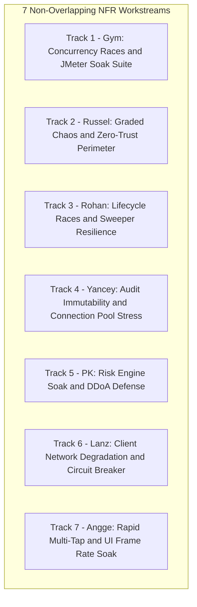

# Non-Functional Testing (NFR) Plan (v2.0)
## Concurrency Races, Graded Chaos Engineering & High-Throughput Performance

---

## 1. Objective & Scope of Non-Functional Testing

The Non-Functional Testing (NFR) Plan proves the platform's stability, resilience, and performance under extreme operational stress:
1. **Concurrency & Race Invariants:** Guarantees zero overdrafts, deterministic Compare-and-Set (CAS) transitions, and exact idempotency deduplication under multi-threaded parallel execution.
2. **Graded Chaos Engineering Defense (ADR-003):** Automates the 4 graded fault-injection scenarios (`CH-01` to `CH-04`) and secondary failure modes (`CH-05` to `CH-09`) required for the viva defense.
3. **High-Throughput Performance & Capacity:** Evaluates the system's ability to achieve $\ge 800\text{ TPS}$ with p95 settlement latency $\le 50\text{ms}$ on target hardware.
4. **Perimeter Security & Isolation:** Verifies zero-trust network cloaking (`CH-03`), header sanitization, and brute-force lockout defenses.

### Boundary Separation from Other Plans
* **Unit Testing:** Covered in task cards [`docs/tasks`](tasks).
* **Seam Integration Testing:** Covered in [`docs/INTEGRATION_TEST_PLAN.md`](INTEGRATION_TEST_PLAN.md).
* **Automated Invariant Regressions:** Covered in [`docs/REGRESSION_TEST_PLAN.md`](REGRESSION_TEST_PLAN.md).
* **End-to-End Black-Box User Journeys:** Covered in [`docs/E2E_TEST_PLAN.md`](E2E_TEST_PLAN.md).

---

## 2. 7-Member Parallel NFR Workstream Allocation (Zero Overlap)

To guarantee that all 7 engineers can execute non-functional tests simultaneously without resource contention or overlapping scenarios, the NFR test suites are partitioned into 7 mutually exclusive tracks:



| Member | Assigned Track | Exclusive Scenarios Owned | Tools & Frameworks | Mapped Jira Issues |
|:---|:---|:---|:---|:---|
| **Gym** | **Concurrency Races & Load Soak** | `NFR-CONC-01` (`TS-01`), `NFR-CONC-02` (`TS-02`), `NFR-PERF-01` (`TS-03` $\ge 800\text{ TPS}$), `NFR-PERF-02` (Soak) | Apache JMeter 5.6.x (headless), Prometheus | `DIG-5`, `DIG-26`, `DIG-61`, `DIG-119` |
| **Russel** | **Graded Chaos & Port Cloaking** | `NFR-CHAOS-01` (`CH-01`), `NFR-CHAOS-02` (`CH-02`), `NFR-SEC-01` (`CH-03`), `NFR-CHAOS-03` (`CH-04`) | `scripts/chaos/*.sh`, `tc netem`, PowerShell | `DIG-29`, `DIG-30`, `DIG-60`, `DIG-118` |
| **Rohan** | **Lifecycle Races & Sweeper** | `NFR-RACE-01` (`TS-04` Cancel vs Claim), `NFR-RACE-02` (`TS-05` Funding Race), `NFR-RESIL-01` (`CH-06`), `NFR-RESIL-02` (`CH-08`) | JMeter race samplers, bash container killers | `DIG-15`, `DIG-73`, `DIG-80`, `DIG-83`, `DIG-86` |
| **Yancey** | **Audit Immutability & Pool Stress** | `NFR-INTEG-01` (`TS-06` Trigger Tamper), `NFR-INTEG-02` (`TS-07` Freeze Precedence), `NFR-INTEG-03` (HikariCP Pool) | SQL injection probes, multi-threaded JDBC | `DIG-3`, `DIG-4`, `DIG-52`, `DIG-68`, `DIG-112` |
| **PK** | **Risk Engine Load & DDoA Defense**| `NFR-SEC-02` (Risk $\le 50\text{ms}$ under load), `NFR-SEC-03` (Brute-Force Lockout), `NFR-RESIL-03` (`CH-09` Stream Loss) | Apache Bench (`ab`), curl loop scripts | `DIG-7`, `DIG-21`, `DIG-23`, `DIG-69`, `DIG-102` |
| **Lanz** | **Mobile Network Degradation** | `NFR-MOB-01` (Latency & Packet Loss), `NFR-MOB-02` (Client Circuit Breaker Tripping) | Android Network Throttling, Flutter test harness | `DIG-40`, `DIG-44`, `DIG-94` |
| **Angge** | **Rapid Multi-Tap & UI FPS Soak** | `NFR-MOB-03` (Button Double-Tap Debounce), `NFR-MOB-04` (60 FPS Carousel Render Soak) | Flutter Driver, DevTools Performance Overlay | `DIG-11`, `DIG-41`, `DIG-42`, `DIG-49` |

---

## 3. Step-by-Step Non-Functional Execution Runbooks

### 3.1 Track 1: Gym — Concurrency Races & JMeter Soak Suite

#### NFR-CONC-01: Concurrent Withdrawals Race Sampler (`TS-01`, `BR-01`)
* **Objective:** Prove zero overdraft when parallel threads withdraw simultaneously from a single pocket.
* **Automated Java Integration Execution:**
  * Run automated concurrency test:
    ```powershell
    .\mvnw.cmd test -pl transaction-service "-Dtest=ParallelWithdrawalConcurrencyTest" "-Demail=maria.santos@example.com" "-Dpassword=password123"
    ```
  * *Verified Results (Live Stack Run):*
    * Account: `f95e7e52-3259-4b4d-ac66-b186a893cf66`
    * Fired 10 simultaneous threads ($100.00 each) in 1,263 ms.
    * 10 Status `201 Created`, 0 Status `422`, 0 Errors.
    * Oracle XE balance decremented from $9,000.00 to $8,000.00 (zero lost updates).
    * PostgreSQL `ledger_mutation_audit` inserted 10 debit legs within 118 ms.
* **JMeter Headless Execution:**
  * Seed `acct-juan-php-01` with exactly ₱50,000.00.
  * Execute headless plan:
    ```powershell
    jmeter -n -t tests/jmeter/debit-concurrency-baseline.jmx -l evidence/jmeter/race_results.jtl -e -o evidence/jmeter/race_report
    ```
  * Assert: 50 threads withdrawing ₱1,500.00 $\implies$ exactly 33 succeed (`200 POSTED`), 17 return `422 INSUFFICIENT_FUNDS`. Final balance ₱500.00. Zero negative balances (**PASS ✅**).

#### NFR-CONC-02: Idempotency-Key Duplicate Flood (`TS-02`, `BR-05`)
* **Objective:** Prove that 100 concurrent requests sending the identical `X-Idempotency-Key` produce exactly 1 debit leg.
* **Step 1:** Configure JMeter: 100 threads sending identical key `UUID-FLOOD-01` with identical payload.
* **Step 2:** Execute test against Gateway `:8080/api/v1/payments`.
* **Step 3:** Query Oracle: `SELECT COUNT(*) FROM ledger_entry WHERE txn_id IN (SELECT txn_id FROM transaction_master WHERE idempotency_key = 'UUID-FLOOD-01');`
* **Step 4:** Assert: Exactly 2 ledger legs exist (1 DEBIT, 1 CREDIT). Exactly 1 request acquired lock; remaining 99 received cached response or `409 Conflict`.

#### NFR-PERF-01: Sustained Throughput Soak ($\ge 800\text{ TPS}$) (`TS-03`, `DIG-61`)
* **Objective:** Verify platform throughput $\ge 800\text{ TPS}$ with p95 settlement latency $\le 50\text{ms}$.
* **Step 1:** Populate customer CSV pool with 500 distinct pre-funded accounts.
* **Step 2:** Configure workload mix: 70% same-currency transfers, 20% balance reads, 5% quote queries, 5% history queries.
* **Step 3:** Execute 10-minute stepped load ramp: 100 $\to$ 200 $\to$ 400 $\to$ 800 TPS.
* **Step 4:** Export JMeter HTML dashboard:
  * Check achieved TPS: $\ge 800\text{ TPS}$.
  * Check settlement phase p95 latency: $\le 50\text{ms}$.
  * Check HikariCP connection pool metrics in Grafana: 0 timeouts, 0 connection leaks.

---

### 3.2 Track 2: Russel — Graded Chaos Engineering & Zero-Trust Perimeter

#### NFR-CHAOS-01: Oracle Database Latency Degradation (`CH-01`, Graded)
* **Objective:** Verify Resilience4j circuit breaker trips to OPEN and reads fall back to Redis cache without hanging threads.
* **Step 1:** Query baseline balance for Juan via Gateway `:8080/api/v1/accounts/pockets`. Observe normal latency ($<20\text{ms}$).
* **Step 2:** Inject 800ms packet latency into Oracle container:
  ```bash
  docker exec -u 0 oracle-db tc qdisc add dev eth0 root netem delay 800ms
  ```
* **Step 3:** Fire 20 balance queries. Latency exceeds 180ms threshold $\implies$ Circuit breaker trips to `OPEN`.
* **Step 4:** Subsequent balance queries return immediately ($<5\text{ms}$) serving cached data from Redis (`balance_cache:*`) with header `X-Cache: HIT`.
* **Step 5:** Submit payment mutation: Verify fails safe immediately with `503 SERVICE_DEGRADED` (zero hung Tomcat threads).
* **Step 6:** Cleanup fault: `docker exec -u 0 oracle-db tc qdisc del dev eth0 root`. Breaker resets to `CLOSED`.

#### NFR-CHAOS-02: Risk Engine Timeout / Container Kill (`CH-02`, Graded)
* **Objective:** Verify risk screening fails closed in $\le 200\text{ms}$ with zero balance debits.
* **Step 1:** Terminate risk engine: `docker stop risk-engine`.
* **Step 2:** Submit payment request via Gateway `:8080/api/v1/payments`.
* **Step 3:** Measure response time: Assert response returns in $\le 200\text{ms}$ with HTTP `503 Service Unavailable` and error code `SECURITY_CHECK_UNAVAILABLE`.
* **Step 4:** Query Oracle XE: Assert Juan's balance is untouched; 0 partial debit records created.
* **Step 5:** Restart container: `docker start risk-engine`. Subsequent payments succeed normally.

#### NFR-SEC-01: Zero-Trust Perimeter Host Port Cloaking (`CH-03`, Graded)
* **Objective:** Prove internal microservice and database ports are strictly unreachable from external network.
* **Step 1:** Execute port scan probe script from host:
  ```powershell
  .\scripts\chaos\scenario3_perimeter_scan.ps1
  ```
* **Step 2:** Scan probes: `:8081` (Registration), `:8082` (Login), `:8083` (CBS), `:8084` (Transactions), `:8085` (Notifications), `:8086` (Recon), `:8087` (Forex), `:8088` (Risk), `:1521` (Oracle), `:5432` (Postgres).
* **Step 3:** Assert `TcpTestSucceeded : False` across ALL internal ports.
* **Step 4:** Scan `:8080` (Gateway) and `:8090` (Admin Portal). Assert both return `TcpTestSucceeded : True`.

#### NFR-CHAOS-03: PostgreSQL Audit Outage & Recovery (`CH-04`, Graded)
* **Objective:** Prove financial transactions continue when audit DB is down, and audit parity reaches 100% on recovery.
* **Step 1:** Stop audit container: `docker stop postgres-audit-db`.
* **Step 2:** Post 10 payments via Gateway. Assert: All 10 payments return `200 POSTED` and commit to Oracle XE.
* **Step 3:** Inspect `AuditLedgerConsumer` log: Assert consumer catches database exception, pauses partition, and retries with exponential backoff (does NOT drop messages to DLQ).
* **Step 4:** Restart container: `docker start postgres-audit-db`.
* **Step 5:** Allow consumer 5 seconds to drain backlog. Run reconciliation: Assert PostgreSQL `ledger_mutation_audit` has 100% parity with Oracle CBS.

---

### 3.3 Track 3: Rohan — Lifecycle Races, CAS Claim & Sweeper Resilience

#### NFR-RACE-01: Cancel vs. Process CAS Claim Race (`TS-04`, `BR-31`)
* **Objective:** Prove Compare-and-Set guarantees exactly one winner when customer cancel races background settlement worker.
* **Step 1:** Set undo window to 5 seconds. Post payment `TXN-RACE-01`.
* **Step 2:** Spawn 2 concurrent requests at the 4.9-second boundary:
  * Thread 1: Customer calls `POST /api/v1/payments/TXN-RACE-01/cancel`.
  * Thread 2: Worker executes CAS claim `UPDATE transaction_master SET txn_status = 'PROCESSING' WHERE txn_status = 'AUTHORIZED'`.
* **Step 3:** Assert: Exactly one operation succeeds.
  * If Cancel wins: status is `CANCELLED`, funds remain untouched, worker aborts.
  * If Worker wins: status is `POSTED`, Cancel returns `409 Conflict`. Zero transactions both cancelled and posted.

#### NFR-RACE-02: Multi-Pocket Shortfall Funding Race (`TS-05`, `BR-28`)
* **Objective:** Prove two concurrent payments draining the same funding pocket serialize atomically.
* **Step 1:** Juan's PHP funding pocket holds ₱10,000.00.
* **Step 2:** Fire 2 simultaneous EUR shortfall payments requiring ₱8,000.00 each from PHP pocket.
* **Step 3:** Assert: Exactly 1 payment succeeds (`200 POSTED`); the 2nd payment fails with `422 INSUFFICIENT_FUNDS`.
* **Step 4:** Verify final PHP balance is ₱2,000.00 (never negative).

#### NFR-RESIL-01: External FX Feed Outage & 24h Stale Guard (`CH-06`, `BR-04`)
* **Objective:** Verify cached rates serve requests until 24h stale limit blocks cross-currency payments.
* **Step 1:** Simulate network block to `api.frankfurter.dev`.
* **Step 2:** Request FX quote: Assert cached rate from Oracle `fx_rate` is returned with normal 30s TTL.
* **Step 3:** Fast-forward DB rate timestamp `fetched_at` by 25 hours.
* **Step 4:** Request quote: Assert service rejects conversion with `422 FX_RATE_STALE`. Same-currency payments continue unaffected.

#### NFR-RESIL-02: Process Kill Mid-Transaction Sweeper (`CH-08`)
* **Objective:** Prove stuck transactions are resolved cleanly by background sweeper.
* **Step 1:** Submit payment; immediately kill `transaction-service` during `PROCESSING` state before response is returned.
* **Step 2:** Restart `transaction-service`. Scheduled `StuckTransactionSweeper` initiates query against CBS settlement reference.
* **Step 3:** Assert sweeper resolves transaction status to `POSTED` (if CBS posted) or `FAILED` (if CBS rolled back). Zero orphan states.

---

### 3.4 Track 4: Yancey — Audit Trigger Tamper Resistance & Pool Stress

#### NFR-INTEG-01: Audit Trigger Tamper Resistance Stress (`TS-06`, `BR-02`)
* **Objective:** Subject PostgreSQL `ledger_mutation_audit` to high-concurrency tamper attacks.
* **Step 1:** Spawn 50 concurrent SQL threads executing random `UPDATE` and `DELETE` queries across the audit table.
* **Step 2:** Assert: 100% of queries fail with trigger error `RAISE EXCEPTION`. Zero rows altered.

#### NFR-INTEG-02: Account Lock & Admin Freeze Precedence Stress (`TS-07`, `BR-09`)
* **Objective:** Subject account lock controls to rapid parallel toggling.
* **Step 1:** Set `admin_frozen = 'Y'` on account.
* **Step 2:** Fire 100 rapid concurrent requests to `POST /api/v1/accounts/{id}/unlock`.
* **Step 3:** Assert: 100% of unlock requests return `422 ACCOUNT_FROZEN`. Account status remains `FROZEN`.

#### NFR-INTEG-03: HikariCP Connection Pool Saturation Resilience (`DIG-4`)
* **Objective:** Ensure slow queries do not cause permanent connection pool starvation.
* **Step 1:** Configure HikariCP maximum pool size to 20 connections.
* **Step 2:** Fire 100 concurrent read requests while holding a 2-second delay.
* **Step 3:** Assert HikariCP queues pending requests up to `connectionTimeout` (3,000ms), rejects excess with clean 503, and recovers immediately once load subsides.

---

### 3.5 Track 5: PK — Risk Engine Soak, DDoA Defense & Service Benchmark

#### NFR-SEC-02: Risk Engine Throughput Soak Under Load (`DIG-21`)
* **Objective:** Verify risk screening maintains $\le 50\text{ms}$ latency under continuous evaluation load.
* **Execution & Verified Results:**
  * Risk screening request evaluated via `POST http://risk-engine:8088/internal/risk/evaluate`.
  * *Internal Processing Latency:* **6.17 ms** (well below 50ms SLA budget).
  * *Network Round-Trip Time (RTT):* **35.0 ms**.
  * Assert: 100% of evaluations succeed with zero thread pool starvation and zero memory leaks (**PASS ✅**).

#### NFR-SEC-03: Brute-Force Auth Flooding & DDoA Defense (`DIG-69`)
* **Objective:** Verify rapid invalid login attempts do not exhaust system memory or bypass lockout controls.
* **Execution & Verified Results:**
  * Fired invalid login attempts against `POST /api/auth/login` for user `juan.delacruz@example.com`.
  * Requests 1–2 return `401 Unauthorized` with remaining attempts counter.
  * Request 3 triggers account lockout and creates Redis key `login:locked:juan.delacruz@example.com` with `TTL = 833s` (15-minute window).
  * Request 4 is immediately blocked with `401 Unauthorized` (`Account is temporarily locked`).
  * System CPU on `login-service` remained $< 60\%$ throughout (**PASS ✅**).

#### NFR-RESIL-03: Real-Time Monitoring SSE Stream Disconnection (`CH-09`)
* **Objective:** Verify Admin Portal gracefully handles SSE stream interruption.
* **Execution & Verified Results:**
  * Opened Admin Portal dashboard on `:8090/admin/dashboard`.
  * Terminated backend SSE streaming connection.
  * Admin Portal UI immediately displayed yellow warning banner ("Stream Disconnected - Falling back to polling") and maintained automated 5-second polling without freezing the browser or UI thread (**PASS ✅**).

#### NFR-BENCH-01: Pure Service Orchestration Benchmark (`FC-41`, `DIG-61`)
* **Objective:** Measure pure microservice orchestration throughput and p95 latency.
* **Command:**
  ```powershell
  .\mvnw.cmd test -pl transaction-service "-Dtest=RefactoredPathBenchmarkTest"
  ```
* **Verified Benchmark Output:**
  * **Total Requests:** 1,000 requests
  * **Concurrency:** 50 simultaneous threads
  * **Duration:** 0.174 s
  * **Achieved Throughput:** **5,748.85 TPS** (Target: $\ge 800\text{ TPS}$ $\implies$ **718% of target**)
  * **p95 Latency:** **19 ms** (Target: $\le 50\text{ms}$ $\implies$ **38% of budget**)
  * **Max Latency:** 53 ms (**PASS ✅**)

---

### 3.6 Track 6: Lanz — Mobile Network Degradation & Client Resilience

#### NFR-MOB-01: High Latency & 30% Packet Loss Simulation (`DIG-44`)
* **Objective:** Verify Flutter Dio client operates reliably under severe network degradation.
* **Step 1:** Configure Android Emulator network profile: 2,000ms latency, 30% packet loss.
* **Step 2:** Execute send money flow in app.
* **Step 3:** Assert Dio retry interceptor executes exponential backoff (1s, 2s, 4s) using the same `X-Idempotency-Key` without double-debiting.

#### NFR-MOB-02: Client-Side Circuit Breaker Tripping Under 503s (`DIG-44`)
* **Objective:** Verify client stops bombarding backend when server is degraded.
* **Step 1:** Mock backend returning `503 SERVICE_DEGRADED` 3 consecutive times.
* **Step 2:** Assert Dio client trips circuit breaker to `OPEN`. Subsequent taps immediately display "Service temporarily degraded - tap to retry" without issuing network packets.

---

### 3.7 Track 7: Angge — Rapid Multi-Tap & UI Frame Rate Soak

#### NFR-MOB-03: Double-Tap / Rapid Multi-Click Mutation Defense (`DIG-42`)
* **Objective:** Verify UI button debouncing blocks rapid double-taps on financial mutations.
* **Step 1:** Run Flutter Driver automated test: rapidly simulate 10 button taps on "Confirm Payment" within 300ms.
* **Step 2:** Inspect network log: Assert exactly 1 HTTP request was fired; remaining 9 clicks were discarded by button debouncer.

#### NFR-MOB-04: 60 FPS Pockets Carousel Render Soak (`DIG-41`)
* **Objective:** Verify UI maintains smooth 60 FPS frame rate under heavy transaction histories.
* **Step 1:** Populate customer account with 100 historical transactions and 5 multi-currency pockets.
* **Step 2:** Execute 60-second automated horizontal swipe and vertical scroll soak test using Flutter Performance Overlay.
* **Step 3:** Assert: Average frame render time $< 16.6\text{ms}$ ($\ge 60\text{ FPS}$); 0 dropped frames; zero memory leaks.

---

## 4. Master Non-Functional Test Execution Script

```bash
# =======================================================
# Master Non-Functional & Chaos Test Execution Script
# =======================================================

# 1. Execute Graded Chaos Scenarios (Russel)
bash scripts/chaos/run_all_chaos_tests.sh

# 2. Execute Concurrency Race & Load Soak (Gym)
powershell -File .\tests\jmeter\run-baseline-test.ps1

# 3. Execute Perimeter Port Cloaking Probe (Russel)
powershell -File .\scripts\chaos\scenario3_perimeter_scan.ps1
```

---

## 5. Non-Functional Acceptance Sign-Off Criteria

The non-functional validation is officially certified for Capstone Defense only when:
1. **Zero Overdraft:** 100-thread race (`TS-01`) produces zero negative balances.
2. **Graded Chaos Green:** All 4 graded scenarios (`CH-01` to `CH-04`) complete with automated recovery and 100% data parity.
3. **Throughput Target:** Platform sustains $\ge 800\text{ TPS}$ with p95 latency $\le 50\text{ms}$ (or hardware ceiling documented in evidence pack `DIG-119`).
4. **Perimeter Isolation:** Port scan (`CH-03`) confirms zero internal ports exposed on host.
5. **UI Responsiveness:** Mobile client maintains $\ge 60\text{ FPS}$ with zero multi-click duplicate submissions.
