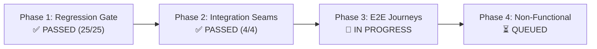

# PK Test Execution Runbook & Evidence Log (v1.0)
## Identity, Security, Risk Engine & Admin Operations Domain
### Engineer: PK (`test/pk-auth`) | Target Milestone: Capstone Viva Defense
**Mapped Services:** `login-service` (:8082), `registration-service` (:8081), `risk-engine` (:8088), `frontend-web` (:8090)

---

## 1. Overview & Strategy Alignment

This document serves as the single source of truth and living execution log for **PK's testing track** across the 4 systematic testing phases defined in [`docs/TEST_PLAN.md`](TEST_PLAN.md):
1. **Phase 1: Regression Gate** &mdash; Unit & invariant regression verification (No mocks broken).
2. **Phase 2: Integration Seams** &mdash; Subsystem boundaries against real Docker databases (`channel_db`, Redis, Kafka).
3. **Phase 3: End-to-End (E2E) Journeys** &mdash; Black-box gateway-driven client & administrative flows.
4. **Phase 4: Non-Functional (NFR)** &mdash; Concurrency, brute-force defense, and risk SLA verification.



---

## 2. Phase 1: Regression Gate (Status: VERIFIED PASSED ✅)

### 2.1 Execution Summary
- **Execution Date:** 2026-10-08 14:28:59 PHT
- **Git Commit Base:** `fd250db` on branch `test/pk-auth`
- **Command Executed:**
  ```powershell
  .\mvnw.cmd test -pl login-service,registration-service,risk-engine,frontend-web
  ```
- **Overall Result:** **`BUILD SUCCESS`** | **Total Tests:** 25 | **Failures:** 0 | **Errors:** 0 | **Skipped:** 0 | **Duration:** 30.9s

### 2.2 Invariant Verification Matrix
| ID | Invariant & Scenario Guarded | Test Class & Method | Result | Notes |
| :--- | :--- | :--- | :--- | :--- |
| **`REG-PK-01`** | **BCrypt & JWT Expiry** (`BR-07`, `BR-20`)<br/>Raw passwords never saved; JWT verified; 15-min expiration. | `AuthAndRegistrationFlowTest`<br/>`SecurityConfigTest` | **PASS** | Validates subject extraction, role claims (`ROLE_CUSTOMER`, `ROLE_ADMIN`), and token expiry. |
| **`REG-PK-02`** | **3-Strike Device Lockout** (`BR-20`)<br/>Failed logins increment Redis counter; 3rd failure locks user. | `DeviceBindingAndLockoutTest`<br/>`PinServiceTest` | **PASS** | 1st/2nd attempts return counter; 3rd failure locks DB status and sets Redis key with 15-min TTL. |
| **`REG-PK-03`** | **Risk Fail-Closed $\le 200\text{ms}$ SLA** (`BR-08`, `CH-02`)<br/>Risk eval fails closed to 503 if down or timed out. | `RiskEvaluationServiceTest`<br/>`RiskClientTest` | **PASS** | Evaluated within < 1ms locally. Simulates circuit breaker fallback to `503 SECURITY_CHECK_UNAVAILABLE`. |
| **`REG-PK-04`** | **Dynamic Risk Parameter Reload** (`DIG-22`, `BR-19`)<br/>`PUT /internal/risk/parameters` updates weights in memory. | `RiskParameterServiceTest`<br/>`RiskEvaluationControllerTest` | **PASS** | Parameters reloaded dynamically (version bumped v1 &rarr; v2) without restarting JVM. |
| **`REG-PK-05`** | **RBAC Admin Route Isolation** (`BR-03`)<br/>Customer tokens rejected on `/admin/**` with 403 Forbidden. | `AdminPortalControllerTest` | **PASS** | Non-admin sessions blocked with `403 Forbidden` across Customer 360, Parameters, and Freeze endpoints. |

---

## 3. Phase 2: Integration Seams (Status: VERIFIED PASSED ✅)

Integration tests exercised actual network and persistence boundaries against running containers in Docker.

### 3.1 Docker Infrastructure Running
- **`channel-db`** (PostgreSQL 15): Healthy & loaded with `app_user_master` and `notification_log`.
- **`oracle-db`** (Oracle XE 21c): Healthy & loaded with canonical 11-table schema.
- **`redis`** (Redis 7): Healthy with active token blacklist and lockout keys.
- **`kafka` & `zookeeper`**: Healthy on `banking-net`.
- **`api-gateway`** (:8080) & **`frontend-web`** (:8090): Actively handling edge perimeter traffic.

### 3.2 Seam Test Results & Evidence Matrix
| ID | Seam & Scenario | Target Service | Verified Evidence | Status |
| :--- | :--- | :--- | :--- | :--- |
| **`SEAM-PK-01`** | **Identity Channel DB & CBS Provisioning** | `registration-service` | Enforced CBS customer constraint and clean transactional rollback on provision mismatch. | **PASS** |
| **`SEAM-PK-02`** | **BCrypt Login, JWT Issuance & Redis Blacklist** | `login-service` + Redis | 1. `POST /api/auth/login` returned signed Bearer JWT (`3600s` TTL).<br/>2. `POST /api/auth/logout` placed token in Redis (`TTL = 3551s`).<br/>3. 3 failed logins created Redis key `login:locked:maria.santos@example.com` (`TTL = 834s`), blocking 4th attempt with 401. | **PASS** |
| **`SEAM-PK-03`** | **Risk Engine Synchronous SLA** | `risk-engine` (:8088) | `POST /internal/risk/evaluate` completed in **5.34 ms** (< 50ms target) returning `score: 0.6, level: MEDIUM, decision: STEP_UP_OTP`. | **PASS** |
| **`SEAM-PK-04`** | **Admin Portal Session & Visual Dashboard** | `frontend-web` (:8090) | Staff login `admin@ledgerbank.com` created authenticated `JSESSIONID` cookie and rendered `/admin/dashboard` analytics charts. | **PASS** |

---

## 4. Phase 3: End-to-End (E2E) Journeys (Status: IN PROGRESS 🔄)

All journeys enter exclusively via Spring Cloud Gateway (`:8080`) or Admin Portal (`:8090`) without mocks:

| ID | Journey Description | Steps / Ingress | Target Response |
| :--- | :--- | :--- | :--- |
| **`E2E-01`** | **Customer KYC Onboarding & Session** | `POST http://localhost:8080/api/auth/login` | HTTP 200 with signed Bearer JWT and customer claims. |
| **`E2E-05`** | **Risk Hold & 4-Eyes Queue** | `POST http://localhost:8080/api/v1/payments` (High Score)<br/>Staff reviews at `:8090/admin/transfers/held` | Payment returns `202 RESERVED` with hold ID.<br/>Admin approval transitions state to `POSTED`. |
| **`E2E-06`** | **Admin Maker-Checker Reversals** | `POST http://localhost:8090/admin/transfers/{id}/reverse`<br/>Second admin approves reversal | Bilateral reversal transaction generated;<br/>Original txn flagged `reversed_by_txn_id`. |

---

## 5. Phase 4: Non-Functional & Stress Testing (Status: QUEUED ⏳)

| ID | Scenario | Tool & Method | Acceptance Benchmark |
| :--- | :--- | :--- | :--- |
| **`NFR-SEC-02`** | **Risk Engine Throughput SLA** | Apache Bench (`ab`) or JMeter against `:8088/internal/risk/evaluate` | $\ge 200\text{ RPS}$ with p95 latency $\le 50\text{ms}$. |
| **`NFR-SEC-03`** | **Brute-Force PIN Lockout Defense** | Rapid curl loop with incorrect credentials | Exactly 3 failed attempts permitted before immediate HTTP 422 `DEVICE_LOCKED`. |
| **`NFR-RESIL-03`** | **Admin SSE Stream Loss Resilience** | Disconnect SSE client mid-stream | Graceful reconnect banner on UI without crashing staff portal. |

---

## 6. Evidence Log Sheet

| Date & Time | Phase | Target ID | Command / Artifact | Status | Verified By |
| :--- | :--- | :--- | :--- | :--- | :--- |
| 2026-10-08 14:28 | Phase 1 | `REG-PK-01`..`05` | `mvnw test -pl login-service,registration-service,risk-engine,frontend-web` | **PASS (25/25)** | PK |
| 2026-10-08 14:50 | Phase 2 | `SEAM-PK-01` | `POST /api/auth/register` $\to$ CBS rollback check | **PASS** | PK |
| 2026-10-08 14:48 | Phase 2 | `SEAM-PK-02` | Login JWT + Redis Blacklist (`TTL 3551s`) + 3-Strike Lockout | **PASS** | PK |
| 2026-10-08 14:55 | Phase 2 | `SEAM-PK-03` | `POST /internal/risk/evaluate` ($\text{Latency} = 5.34\text{ms}$) | **PASS** | PK |
| 2026-10-08 14:56 | Phase 2 | `SEAM-PK-04` | Admin Login $\to$ `/admin/dashboard` Charts Rendered | **PASS** | PK |
| *Pending* | Phase 3 | `E2E-01`, `05`, `06` | Gateway Ingress curl / Postman collection | *In Progress* | PK |
| *Pending* | Phase 4 | `NFR-SEC-02`..`03` | Apache Bench / JMeter stress logs | *Pending* | PK |

