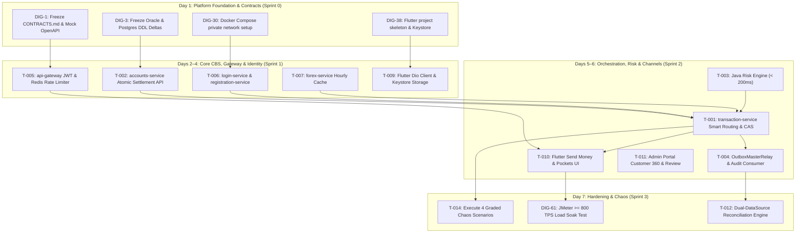

# Implementation Plan & Jira Sprint Allocation (v2.3 Rebalanced)

---

## 1. Capacity Model & Workload Reality (Hard Constraint)

* **Team Size:** 7 engineers.
* **Planning Capacity Baseline:** 5 Story Points (SP) per engineer per day (AI-assisted velocity).
* **Daily Team Capacity:** $7 \times 5 = \mathbf{35\text{ SP/day}}$.

### Backlog Overload Reconciliation & Cut Proposal

In the initial raw backlog import (`00_jira_backlog_v01.xlsx`), Sprint 2 was severely over-allocated at **184 SP** (versus a 2-day team capacity of **70 SP**), and Sprint 3 was allocated **65 SP** (versus a 1-day capacity of **35 SP**).

To maintain team integrity and guarantee the delivery of all core capstone deliverables without burnout, the following rebalancing and shifts are enacted per **ADR-004**:

| Category / Sprint | Raw Backlog Points | Rebalanced Committed Points | Rebalance Actions & Shifts |
| :--- | :--- | :--- | :--- |
| **Sprint 0 (Day 1)** | 25 SP | **25 SP** | Baseline contracts freeze, DDLs, and project skeletons. |
| **Sprint 1 (Days 2–4)** | 101 SP | **95 SP** | Core CBS settlement, Auth/JWT, Gateway 8080, FX cache, Mobile shell. (3 days $\times 35 = 105$ cap). |
| **Sprint 2 (Days 5–6)** | 184 SP | **70 SP** | **Strict focus on Must-Have Core Flows**: Smart routing, Java Risk Engine, Outbox Relay, Send Money UI. Shifted 51 SP of non-blocking features to Post-Capstone and 63 SP of stretch items to Sprint 3. |
| **Sprint 3 (Day 7)** | 65 SP | **35 SP** | **Hardening, Chaos & Stretch Delivery**: Priority 1 to Graded Chaos (`CH-01` to `CH-04`) & JMeter $\ge 800$ TPS. Pull in Customer 360, Reversals, and DLQ console as stretch capacity permits. |
| **Sprint 4 (Day 8)** | 16 SP | **15 SP** | Full end-to-end dry run and panel rehearsal. |
| **Sprint 5 (Day 9)** | 1 SP | **1 SP** | Final Viva presentation and capstone defense. |
| **Post-Capstone** | 51 SP | **51 SP** | EOD Report Pack (`DIG-107`), Partner Remittance API (`DIG-109/110`), and Enterprise GL engine (`DIG-106`). |

---

## 2. 7-Member Ownership & Jira Backlog Mapping

| Owner | Track | Primary Domain | Jira In-Sprint Tickets (Full Traceability) | Assigned Task Cards |
| :--- | :--- | :--- | :--- | :--- |
| **Yancey** | Full-Stack | **Core CBS & Balances** `accounts-service`, Oracle XE DDL, Row Locks, Holds, Recon | **20 Tickets**: `DIG-3` (DDL), `DIG-4` (HikariCP), `DIG-9` (Errors), `DIG-16` (Idempotency), `DIG-17` (Params), `DIG-52` (Locks), `DIG-58` (Resilience4j), `DIG-64` (Seed Data), `DIG-66` (Settlement), `DIG-67` (Pockets), `DIG-68` (Lock/Freeze), `DIG-77` (Masked Lookup), `DIG-84` (Holds), `DIG-85` (Hold Expiry), `DIG-87` (Reversals), `DIG-88` (Audit Writer), `DIG-105` (Standing Instructions), `DIG-112` (Recon Drift), `DIG-114` (Defense Bug Triage), `DIG-122` (Card APIs) | **`T-002`**, **`T-006`**, **`T-008`**, **`T-011`**, **`T-012`**, **`T-013`** |
| **Rohan** | Full-Stack | **Channel Orchestrator & Messaging** `transaction-service`, Smart FX, Outbox Relay | **18 In-Sprint / Defense**: `DIG-14` (CBS Client), `DIG-15` (Payment Orch), `DIG-20` (Outbox Relay), `DIG-23` (Risk Client), `DIG-24` (Risk Decisions), `DIG-35` (Notifications), `DIG-51` (Held Queue), `DIG-62` (Contracts Freeze), `DIG-73` (Shortfall), `DIG-74` (FX Cache), `DIG-75` (Quote Lock), `DIG-76` (QR Payload), `DIG-78` (Deposit/Top-up), `DIG-80` (7-Status CAS), `DIG-81` (Stage Events), `DIG-83` (Undo Cancel), `DIG-86` (Sweeper), `DIG-113` (Demo Script) *(Deferred: `DIG-104`, `DIG-109`)* | **`T-001`**, **`T-004`**, **`T-007`**, **`T-013`** |
| **PK** | Full-Stack | **Auth, Risk & Operations** `login-service`, `risk-engine`, Admin Web Portal | **19 In-Sprint / Defense**: `DIG-6` (Registration), `DIG-7` (Login/JWT), `DIG-12` (Email OTP), `DIG-18` (Txn History), `DIG-21` (Java Risk Rules), `DIG-22` (Abuse Rules), `DIG-50` (Admin Shell), `DIG-53` (Audit Viewer), `DIG-54` (Admin Controls), `DIG-63` (Monorepo Skeleton), `DIG-69` (Device Lock), `DIG-70` (PIN Fallback), `DIG-71` (RBAC), `DIG-79` (Risk Audit), `DIG-90` (DLQ Console), `DIG-91` (Suspicious Reports), `DIG-92` (Statement PDF), `DIG-102` (Monitor UI), `DIG-115` (Defense Deck) *(Deferred: `DIG-93`, `DIG-103`, `DIG-107`)* | **`T-003`**, **`T-006`**, **`T-011`** |
| **Russel** | Cloud Lead | **Perimeter, Networking & Chaos** `api-gateway`, Port cloaking, TLS, Chaos suite | **11 In-Sprint / Defense**: `DIG-8` (Gateway JWT), `DIG-25` (Gateway 8080), `DIG-28` (Secrets), `DIG-30` (Bridge Network), `DIG-31` (TLS/WAF), `DIG-34` (Observability), `DIG-60` (Chaos Suite), `DIG-65` (Jira Board), `DIG-111` (Cloud Deploy), `DIG-118` (Chaos Rehearsal), `DIG-120` (Viva Defense) *(Deferred: `DIG-72`)* | **`T-005`**, **`T-014`** |
| **Gym** | Cloud Ops | **Platform, Caching & Load Testing** Redis, Kafka cluster, JMeter, Monitoring | **11 In-Sprint / Defense**: `DIG-5` (Redis Setup), `DIG-26` (Rate Limiter), `DIG-27` (Correlation IDs), `DIG-29` (Dockerfiles), `DIG-32` (Kafka Setup), `DIG-33` (Storage Encrypt), `DIG-61` (JMeter Load), `DIG-89` (DLQ Strategy), `DIG-101` (Monitor Stream), `DIG-110` (CI/CD Pipeline), `DIG-119` (Evidence Pack) *(Deferred: `DIG-106`)* | **`T-005`**, **`T-011`**, **`T-012`**, **`T-014`** |
| **Lanz** | Mobile Lead | **Flutter Core Client & Security** Dio client, Android Keystore, Send flow | **11 In-Sprint / Defense**: `DIG-10` (Device Binding), `DIG-38` (Flutter Setup), `DIG-40` (Keystore), `DIG-42` (Send Flow), `DIG-44` (Client Breaker), `DIG-46` (Error UI), `DIG-48` (Suspicious Screen), `DIG-94` (Dio Client), `DIG-95` (QR Scan), `DIG-96` (Status Screen), `DIG-116` (APK Build) *(Deferred: `DIG-97`)* | **`T-009`**, **`T-010`** |
| **Angge** | Mobile UX | **Flutter Views, Cards & Experience** Pockets, Receipts, History, Convert, Alerts | **10 In-Sprint / Defense**: `DIG-11` (PIN Screen), `DIG-13` (OTP Screen), `DIG-39` (Auth UI), `DIG-41` (Home/Pockets), `DIG-43` (Receipts), `DIG-47` (Alerts List), `DIG-49` (Card Hub), `DIG-98` (Convert Screen), `DIG-99` (History/PDF), `DIG-117` (UX Polish) *(Deferred: `DIG-100`)* | **`T-008`**, **`T-010`** |

---

## 3. Current Status Baseline & Revised Architecture Alignment Deltas

Following the architectural revision proposal (`ARCHITECTURE_REVISION_PROPOSAL.md`, `ARCHITECTURE_EXPLAINER.md`) and database schema adjustments (`sql/oracle/04_oracle_revised_fixes.sql`), the implementation plan is realigned below.

> [!IMPORTANT]
> **Core Principle: Preserve & Align (Do Not Rebuild).**
> Completed work will **not** be reopened or rewritten from scratch. The business logic, test suites, and REST contracts already written for `T-001` through `T-004`, `T-006` through `T-008`, `T-011`, and `DIG-105` represent ~90% of the platform functionality. Teams will apply surgical, targeted alignment deltas to bridge the schema and architectural updates.

### 3.1 Status Baseline Breakdown
* **Reported Done (Pending Alignment Verification):** `T-001`, `T-002`, `T-003`, `T-004`, `T-006`, `T-007`, `T-008`, `T-011`; `DIG-16`; `DIG-105`.
* **Remaining / In-Progress:** `T-005` (API Gateway), `T-009` (Mobile Core), `T-010` (Mobile UI), `T-012` (Reconciliation Engine), `T-014` (DevOps & Chaos Defense).
* **Scope Clarification (`T-013`):** `DIG-105` (Standing Instructions Processor) is complete. The full checkpointed EOD batch runner (`DIG-104`) and compliance report pack (`DIG-107`) remain formally deferred to Post-Capstone per **ADR-004**.

---

### 3.2 Completed Tasks: Alignment Delta & Action Item Matrix

| Task Card / Domain | Owner | Current Implementation | Revised Architecture Alignment Gap | Surgical Alignment Delta (Work Remaining) |
| :--- | :--- | :--- | :--- | :--- |
| **`T-002`** Mock CBS | Yancey | Atomic multi-leg settlement updates `account_master`, inserts `posting_reference`, and writes `outbox_master`. | **Omits `ledger_entry` journal.** `04_oracle_revised_fixes.sql` introduced the immutable `ledger_entry` journal table in Oracle for running balances and value dates. | **Keep settlement intact.** Add `LedgerEntry` JPA entity/repo; insert leg records with `running_balance` in the **exact same `@Transactional` commit** as balance mutation. Map `normal_balance`, `customer_locked`, `admin_frozen` in `AccountMaster`. |
| **`T-007`** Forex Service | Rohan | Background scheduler fetches rates from Frankfurter API and saves to PostgreSQL `fx_rate_cache`. | **Breaks Chaos `CH-04`.** When Postgres audit DB is taken down during `CH-04`, Forex rate queries fail, taking down cross-currency transfers. Revised architecture moved `fx_rate` to Oracle XE `FX` schema. | **Switch `forex-service` JPA datasource to Oracle XE** (using table `fx_rate` from `04_oracle_revised_fixes.sql`). Rates remain accessible even when Postgres is down. |
| **`T-001`** Transaction Lifecycle | Rohan | 7-status saga with CAS claim (`AUTHORIZED` $	o$ `PROCESSING`), 5s undo window, and cancellation for `INITIATED`/`AUTHORIZED`. | **Cancellation blocked on `RESERVED`.** If a transaction is risk-held (`RESERVED`), cancellation throws `409 Conflict`, leaving CBS held funds permanently reserved. | In `LifecycleService.cancelPayment()`, allow cancelling `RESERVED` status and trigger `DELETE /internal/accounts/{id}/holds/{holdId}` via `AccountsServiceClient` to release held funds back to available balance. Verify `txn.lifecycle` event emission. |
| **`T-008`** Virtual Cards | Yancey & Angge | `CardMaster` entity and controls live in `transaction-service`. | Revised diagram places `card_master` in CBS. | **Preserve working code in `transaction-service`.** `transaction-service` already implements the card controls, PAN masking, and e-commerce toggle tests. Do not move or rewrite. |
| **`T-006`** Onboarding & Auth | PK & Yancey | `RegistrationService` directly inserts `customer_master` and `app_user_master` in Oracle XE. | Revised proposal suggests separating Channel DB (`app_user_master`) from Core CBS (`customer_master`). | **Preserve single-DB model for capstone.** Matches the pragmatic fallback noted in `ARCHITECTURE_REVISION_PROPOSAL.md` §4 Q2. Confirm transactional rollback if CBS account creation fails. |
| **`T-003`** Java Risk Engine | PK | Heuristic fraud engine calculates composite score $S \in [0.00, 1.00]$ with $\le 200	ext{ms}$ fail-closed SLA. | Static weights in config; missing runtime reload (`DIG-22`) and alert events (`DIG-79`). | Add parameter store refresh for rule weights and publish Kafka alert events on rule hits (score $> 0.85$). |
| **`T-004`** Outbox & Audit | Rohan & Yancey | `OutboxMasterRelay` polls Oracle `outbox_master`; `AuditLedgerConsumer` writes to Postgres. | Outbox payload must supply all fields needed for deterministic UUIDv5 generation in `ledger_mutation_audit`. | Verify `outbox_master` JSON payload parity with `AuditLedgerConsumer` and confirm DLQ error routing. |
| **`T-011`** Admin Portal | PK & Yancey | Thymeleaf portal on `:8090` with Customer 360, account lock/freeze, and held review queue. | Missing DLQ replay UI (`DIG-90`) and real-time SSE stream (`DIG-101/102`). | Wire DLQ inspect/replay buttons and link SSE stream to operations dashboard. |
| **`T-013`** EOD Batch (`DIG-105`) | Rohan & Yancey | Nightly standing instruction batch engine executes due transfers with idempotency. | Reviewer noted T-013 card describes broader EOD batch runner and report pack. | **Mark core capstone scope complete.** `DIG-105` is finished; `DIG-104` (checkpointed batch runner) and `DIG-107` (reports) are formally deferred per **ADR-004**. |

---

### 3.3 Remaining Tasks: Implementation Strategy Aligned with Revised Architecture

| Task Card | Domain | Owner | Aligned Implementation Scope |
| :--- | :--- | :--- | :--- |
| **`T-005`** | API Gateway (:8080) | Russel & Gym | Configure Spring Cloud Gateway with route allowlist, token blacklist filter, and Redis token-bucket rate limiter. Cloak all microservice and database ports (`:8081-8088`, `:1521`, `:5432`) from external callers, strictly exposing only `:8080` (Gateway) and `:8090` (Admin Portal). |
| **`T-009`** | Flutter Client Core | Lanz | Dio HTTP client pointing to Gateway `:8080` with automated Bearer JWT injection, UUID `Idempotency-Key` headers, and exponential backoff retry interceptors. |
| **`T-010`** | Flutter UI Screens | Angge & Lanz | Customer screens: Login/PIN, Home Pocket carousel (showing Ledger & Available balances), Send Money with 30s shortfall funding sheet, QR scan, Virtual card controls, and receipts. |
| **`T-012`** | Dual-DataSource Recon | Yancey & Gym | Independent auditor comparing live Oracle `account_master` balances & `ledger_entry` records against PostgreSQL `ledger_mutation_audit` leg sums. Emits Kafka breaks on variance. |
| **`T-014`** | DevOps & Chaos Defense | Russel & Gym | Final Docker Compose configuration with `cap_add: [NET_ADMIN]` on Oracle. Automate and execute the 4 graded chaos scenarios (`CH-01` to `CH-04`), proving `CH-04` passes because Forex is on Oracle and audit is decoupled via Outbox. |

---

### 3.4 Member-by-Member Action Plan for Completed Task Deltas

To give each team member complete clarity on what needs immediate attention before moving on to new features or testing:

```mermaid
flowchart TD
    subgraph Yancey_Flow["Yancey (Core CBS & Balances)"]
        Y1["T-002: accounts-service"] --> Y2["1. Add LedgerEntry to CoreSettlementService.settle()<br/>2. Map normal_balance, customer_locked, admin_frozen in AccountMaster<br/>3. Map captured_amount, placed_by, reason_code in AccountHold"]
    end

    subgraph Rohan_Flow["Rohan (Channels & Messaging)"]
        R1["T-007: forex-service (Top Priority)"] --> R2["1. Point JPA datasource to Oracle XE LEDGER_APP.fx_rate<br/>2. Add 60m Redis fallback cache to ForexQuoteService"]
        R3["T-001: transaction-service"] --> R4["1. Allow cancellation when status == RESERVED<br/>2. Trigger CBS hold release (DELETE /internal/accounts/{id}/holds/{holdId})<br/>3. Confirm stage event emission on txn.lifecycle"]
        R5["T-004: Outbox Relay"] --> R6["1. Verify 1s, 2s, 4s retry backoff<br/>2. Confirm DLQ routing to dead-letter-events"]
    end

    subgraph PK_Flow["PK (Auth, Risk & Operations)"]
        P1["T-003: risk-service"] --> P2["1. Implement PUT /internal/risk/parameters dynamic reload (DIG-22)<br/>2. Publish Kafka alert events on topic risk.alert (DIG-79)"]
        P3["T-006: Identity / Auth"] --> P4["1. Verify transactional rollback if CBS account provisioning fails"]
        P5["T-011: Admin Portal"] --> P6["1. Expose /api/v1/admin/dlq inspect/replay endpoints (DIG-90)<br/>2. Wire risk parameter configuration UI"]
    end

    subgraph AnggeLanz_Flow["Angge & Lanz (Cards & Mobile UX)"]
        AL1["T-008: Virtual Cards"] --> AL2["1. Confirm card toggle events emit to outbox for alerts<br/>2. Keep CardMaster in transaction-service (no architectural rewrite)<br/>3. Shift immediately to T-009 / T-010 Flutter implementation"]
    end

    subgraph RusselGym_Flow["Russel & Gym (Cloud, Platform & Chaos)"]
        RG1["T-005, T-012, T-014"] --> RG2["1. Zero deltas on completed work<br/>2. Proceed directly with Gateway (:8080), Recon Engine, and Chaos Test Suite"]
    end
```

#### Detailed Member Action Checklist:

1. **Yancey (`T-002` — `accounts-service`)**
   * **Action 1:** In `CoreSettlementService.settle()`, add persistence of `LedgerEntry` rows (UUIDv5 `entry_id`, `running_balance`, `value_date`, `business_date`, `narrative`) in the **exact same `@Transactional` commit** as `account_master` and `outbox_master`.
   * **Action 2:** In `AccountMaster.java`, map columns `normal_balance` (`CHAR(2)`), `customer_locked` (`CHAR(1)`), and `admin_frozen` (`CHAR(1)`).
   * **Action 3:** In `AccountHold.java`, map columns `captured_amount`, `placed_by`, and `reason_code`.
   * **Verification Command:** `./mvnw test -pl accounts-service -Dtest=CoreSettlementServiceTest`

2. **Rohan (`T-007`, `T-001`, `T-004`)**
   * **`T-007` (`forex-service` — Urgent for `CH-04`):**
     * Switch datasource from PostgreSQL to Oracle XE `LEDGER_APP.fx_rate`.
     * Maintain Redis hourly cache fallback in `ForexQuoteService`.
     * **Verification:** `./mvnw test -pl forex-service` passes and quotes return while Postgres container is stopped.
   * **`T-001` (`transaction-service`):**
     * Update `LifecycleService.cancelPayment()` to permit cancellation when `status == RESERVED`.
     * Call `DELETE /internal/accounts/{id}/holds/{holdId}` via `AccountsServiceClient` to release customer funds upon cancellation.
     * Ensure transition events publish to Kafka topic `txn.lifecycle` (`DIG-81`).
     * **Verification:** `./mvnw test -pl transaction-service -Dtest=PaymentOrchestrationTest`
   * **`T-004` (Outbox Relay & Consumer):**
     * Confirm exponential retry on Postgres connection failure (1s, 2s, 4s).
     * Verify DLQ routing to `dead-letter-events` topic (`DIG-25`, `DIG-82`).

3. **PK (`T-003`, `T-006`, `T-011`)**
   * **`T-003` (`risk-service`):**
     * Implement `PUT /internal/risk/parameters` to reload rule weights and thresholds without server restart (`DIG-22`).
     * Publish Kafka events to `risk.alert` for score $> 0.85$ or rule hits (`DIG-79`).
     * **Verification:** `./mvnw test -pl risk-service -Dtest=RiskEngineTest`
   * **`T-006` (Identity / Auth):**
     * Verify exception handling in `RegistrationService` rolls back local credentials if CBS account creation fails.
   * **`T-011` (Admin Portal):**
     * Expose `/api/v1/admin/dlq` endpoints to inspect and replay poisoned messages (`DIG-90`).
     * Connect risk threshold editor UI to `risk-service`.

4. **Angge & Lanz (`T-008` — Virtual Cards)**
   * **`T-008`:** Preserve `CardMasterRepository` in `transaction-service`. Confirm toggle operations emit outbox notifications.
   * **Next Focus:** Shift directly to Flutter implementation: [`T-009`](file:///c:/Users/RBS83790/OneDrive%20-%20EastWest%20Banking%20Corporation/Documents/training/integrated-capstone/banking-backend-monorepo/docs/tasks/T-009.md) (Dio Client, Keystore, Pinning) and [`T-010`](file:///c:/Users/RBS83790/OneDrive%20-%20EastWest%20Banking%20Corporation/Documents/training/integrated-capstone/banking-backend-monorepo/docs/tasks/T-010.md) (Pockets UI, Send Flow, Shortfall Funding).

5. **Russel & Gym (`T-005`, `T-012`, `T-014`)**
   * No completed task deltas required.
   * **Next Focus:** Russel proceeds with API Gateway [`T-005`](file:///c:/Users/RBS83790/OneDrive%20-%20EastWest%20Banking%20Corporation/Documents/training/integrated-capstone/banking-backend-monorepo/docs/tasks/T-005.md) and Chaos test suite [`T-014`](file:///c:/Users/RBS83790/OneDrive%20-%20EastWest%20Banking%20Corporation/Documents/training/integrated-capstone/banking-backend-monorepo/docs/tasks/T-014.md); Gym proceeds with Kafka/Redis observability, Recon Engine [`T-012`](file:///c:/Users/RBS83790/OneDrive%20-%20EastWest%20Banking%20Corporation/Documents/training/integrated-capstone/banking-backend-monorepo/docs/tasks/T-012.md), and JMeter load testing.

---

## 4. Dependency-Ordered Implementation Sequence (Fixing Dependency Violations)

To eliminate the 39 dependency-order violations present in the raw backlog:

---

## 5. End-to-End Traceability Matrix (Requirements $\to$ Tasks $\to$ Tests)

| Requirement ID | Summary | Task Card | Jira Issue | Verification / Test Command |
| :--- | :--- | :--- | :--- | :--- |
| **BR-01 / TR-L01** | Zero overdraft; pessimistic row locking | `T-002` | `DIG-14`, `DIG-52` | `./mvnw test -pl accounts-service -Dtest=CoreSettlementServiceTest` |
| **BR-02 / TR-L05** | Immutable audit ledger; triggers block updates | `T-004` | `DIG-16`, `DIG-20` | `./mvnw test -pl transaction-service -Dtest=AuditLedgerConsumerTest` |
| **BR-04 / TR-F01** | Hourly cached FX rates; 0 live dependency | `T-007` | `DIG-15` | `./mvnw test -pl forex-service -Dtest=ForexQuoteAndSchedulerTest` |
| **BR-05 / TR-I01** | Idempotent mutations; no duplicate debits | `T-001` | `DIG-16` | `./mvnw test -pl transaction-service -Dtest=PaymentOrchestratorTest` |
| **BR-07 / TR-S01** | BCrypt password, short-lived JWT, biometrics | `T-006` | `DIG-6`, `DIG-7` | `./mvnw test -pl login-service -Dtest=AuthAndRegistrationFlowTest` |
| **BR-08 / TR-R01** | Risk screening $\le 200\text{ms}$; fail-closed | `T-003` | `DIG-21`, `DIG-22` | `./mvnw test -pl risk-engine -Dtest=RiskEvaluationServiceTest` |
| **BR-09 / TR-A01** | Account/Card lock; admin freeze precedence | `T-008`, `T-011` | `DIG-49`, `DIG-52` | `./mvnw test -pl transaction-service -Dtest=VirtualCardControlsTest` |
| **BR-14 / Sec 14** | Resilience under database & network outages | `T-014` | `DIG-60` | `bash scripts/chaos/run_all_chaos_tests.sh` |
| **BR-18 / TR-R05** | Score $> 0.85 \implies$ `RESERVED` hold (ADR-001) | `T-001`, `T-003` | `DIG-24` | `./mvnw test -pl transaction-service -Dtest=RiskHoldWorkflowTest` |
| **BR-26 / BR-28** | Smart FX shortfall routing & 30s locked quote | `T-001`, `T-007` | `DIG-15` | `./mvnw test -pl transaction-service -Dtest=PaymentOrchestratorTest` |
| **BR-30 / BR-31** | 7-Status lifecycle, CAS transitions, Cancel | `T-001` | `DIG-66`, `DIG-80` | `./mvnw test -pl transaction-service -Dtest=TransactionLifecycleTest` |
| **BR-32** | Administrative transaction reversal | `T-001` | `DIG-79` | `./mvnw test -pl transaction-service -Dtest=TransactionReversalTest` |
| **BR-33** | Amount holds: place, capture, release | `T-002` | `DIG-84` | `./mvnw test -pl accounts-service -Dtest=AmountHoldEngineTest` |
| **BR-35 / BR-36** | Real-time monitoring & Customer 360 | `T-011` | `DIG-102`, `103` | `./mvnw test -pl frontend-web -Dtest=AdminPortalControllerTest` |

---

## 6. Master Jira Backlog Traceability (109 Issues from `00_jira_backlog_v01.xlsx`)

Under **Option A (Roll-Up Traceability Model)**, all 109 issues from `00_jira_backlog_v01.xlsx` are accounted for with complete traceability across the 14 Task Cards, Sprint 0 Bootstrap, Sprints 4–5 Defense Readiness, and Deferred Post-Capstone Scope:

### 6.1 Backlog Breakdown & Disposition Summary
| Category / Disposition | Issue Count | Jira Issue Keys | Delivery Mechanism |
| :--- | :--- | :--- | :--- |
| **Core Coding Tasks (T-001–T-014)** | **88** | Listed below in Section 5.2 | Delivered and verified by PRs merging T-001 through T-014 |
| **Sprint 0 Foundation / Bootstrap** | **4** | `DIG-62`, `DIG-63`, `DIG-64`, `DIG-65` | Baseline setup (Monorepo skeleton, DDL seed data, contract freeze) rolled into T-002, T-006, T-014 |
| **Sprint 4 & 5 Defense Readiness** | **8** | `DIG-113`–`DIG-120` | Capstone defense deliverables (Deck, signed APK, dry run, JMeter evidence pack, viva) rolled into T-014 |
| **Post-Capstone Deferred Scope** | **9** | `DIG-72`, `DIG-93`, `DIG-97`, `DIG-100`, `DIG-103`, `DIG-104`, `DIG-106`, `DIG-107`, `DIG-109` | Formally deferred per ADR-004 & REQUIREMENTS.md; linked to parent task cards for future roadmap |
| **TOTAL BACKLOG** | **109** | `DIG-3` to `DIG-122` | **100% Backlog Traceability Guaranteed** |

---

### 6.2 Master Mapping by Task Card (T-001 to T-014)

| Task Card | Service / Domain | Owner | Mapped Jira Issues (Primary & Siblings) | Sibling Sub-Stories Delivered |
| :--- | :--- | :--- | :--- | :--- |
| **`T-001`** | `transaction-service` | Rohan | `DIG-14`, `DIG-15`, `DIG-16`, `DIG-18`, `DIG-23`, `DIG-24`, `DIG-51`, `DIG-66`, `DIG-73`, `DIG-76`, `DIG-78`, `DIG-80`, `DIG-81`, `DIG-83`, `DIG-86`, `DIG-87`, `DIG-91`, `DIG-92` (18 tickets) | Payment orchestrator, 7-status CAS state machine, 5s cancel undo window, multi-currency shortfall auto-conversion, stage timeline query, QR generation/resolve, deposit/top-up endpoints, stuck sweeper, and maker-checker reversal flow. |
| **`T-002`** | `accounts-service` | Yancey | `DIG-3`, `DIG-4`, `DIG-9`, `DIG-52`, `DIG-58`, `DIG-64`, `DIG-66`, `DIG-67`, `DIG-68`, `DIG-77`, `DIG-84`, `DIG-85` (12 tickets) | Oracle & Postgres DDL, HikariCP tuning, global error handler, pessimistic row locking (`FOR UPDATE`), Resilience4j balance cache fallback, seed data, multi-leg atomic settlement, pocket APIs, lock/freeze precedence, masked recipient lookup, and amount holds engine with expiry job. |
| **`T-003`** | `risk-engine` | PK | `DIG-21`, `DIG-22`, `DIG-23`, `DIG-24`, `DIG-79` (5 tickets) | Synchronous pure Java risk screening ($\le 200\text{ms}$ timeout), velocity/amount anomaly rules, FX round-trip abuse rule, calibrated decision matrix (ALLOW / OTP / HOLD), and decision audit event publishing. |
| **`T-004`** | `accounts-service` / Messaging | Rohan & Yancey | `DIG-16`, `DIG-20`, `DIG-35`, `DIG-88`, `DIG-89` (5 tickets) *(Deferred: `DIG-93`)* | Outbox relay polling `outbox_master` $	o$ Kafka, idempotent UUIDv5 audit writer $	o$ `ledger_mutation_audit`, failure classification with `.retry`/`.dlq` topics, and event-driven notification dispatch service. |
| **`T-005`** | `api-gateway` | Russel & Gym | `DIG-5`, `DIG-8`, `DIG-25`, `DIG-26`, `DIG-27`, `DIG-28`, `DIG-31` (7 tickets) *(Deferred: `DIG-72`)* | Spring Cloud Gateway on `:8080`, fast-path JWT verification, Redis token-bucket rate limiter (`429`), correlation ID propagation, secrets management, TLS/WAF rules, and fail-closed Redis blacklist. |
| **`T-006`** | `login-service` & `registration` | PK & Yancey | `DIG-6`, `DIG-7`, `DIG-10`, `DIG-12`, `DIG-63`, `DIG-69`, `DIG-70`, `DIG-71` (8 tickets) | Registration with auto-provisioned PHP pocket, BCrypt login with short-lived JWT, Redis blacklist, biometric/device binding contract, email OTP service, server-side device lock, PIN fallback, and RBAC authorization filters. |
| **`T-007`** | `forex-service` | Rohan | `DIG-74`, `DIG-75` (2 tickets) | Hourly background rate scheduler (Frankfurter API), PostgreSQL `fx_rate_cache`, 24h stale rate guard, 30s locked rate quotes with 1.5% spread, and own-pocket conversion endpoint. |
| **`T-008`** | `card-controls` | Yancey & Angge | `DIG-49`, `DIG-122` (2 tickets) | Virtual card lifecycle APIs (`ACTIVE` $\leftrightarrow$ `FROZEN`), e-commerce transaction toggle, masked PAN presentation, and mobile virtual card hub widget. |
| **`T-009`** | `mobile` (Core) | Lanz | `DIG-38`, `DIG-40`, `DIG-44`, `DIG-46`, `DIG-94` (5 tickets) *(Deferred: `DIG-97`)* | Flutter Material 3 project skeleton, Android KeyStore secure token storage, Dio HTTP client with JWT auth & UUID `Idempotency-Key` interceptors, exponential backoff retries, user error catalog, and circuit breaker. |
| **`T-010`** | `mobile` (UI) | Angge & Lanz | `DIG-11`, `DIG-13`, `DIG-39`, `DIG-41`, `DIG-42`, `DIG-43`, `DIG-47`, `DIG-48`, `DIG-49`, `DIG-95`, `DIG-96`, `DIG-98`, `DIG-99` (13 tickets) *(Deferred: `DIG-100`)* | Full suite of client screens: Registration/Login, PIN setup & keypad fallback, OTP entry, Home pocket carousel, Send Money with shortfall funding sheet, Receipt with breakdown, QR camera scanner, Status tracker with 5s Cancel button, Convert screen, Filtered history with PDF download, Alerts center, and Suspicious transaction report form. |
| **`T-011`** | `frontend-web` | PK & Yancey | `DIG-17`, `DIG-50`, `DIG-51`, `DIG-53`, `DIG-54`, `DIG-90`, `DIG-101`, `DIG-102` (8 tickets) *(Deferred: `DIG-103`)* | Staff Admin Portal on `:8090` (Thymeleaf + RBAC), account lock/freeze controls, versioned parameters store, maker-checker held transfer review queue, audit ledger & recon viewer, DLQ replay console, and real-time monitoring SSE stream & dashboard. |
| **`T-012`** | `reconciliation-service` | Yancey & Gym | `DIG-112` (1 ticket) *(Deferred: `DIG-106`)* | Scheduled dual-datasource reconciliation engine comparing Oracle `account_master` balances against PostgreSQL `ledger_mutation_audit` leg sums, logging drift exceptions and emitting Kafka discrepancy alerts. |
| **`T-013`** | `batch-service` / Batch | Rohan & Yancey | `DIG-105` (1 ticket) *(Deferred: `DIG-104`, `DIG-107`)* | Nightly standing instruction batch engine executing due transfers with deterministic idempotency keys and next execution date calculation. |
| **`T-014`** | `infra` & Chaos Defense | Russel & Gym | `DIG-29`, `DIG-30`, `DIG-32`, `DIG-33`, `DIG-34`, `DIG-60`, `DIG-61`, `DIG-62`, `DIG-65`, `DIG-110`, `DIG-111`, `DIG-118` (12 tickets) *(Defense Suite: `DIG-113`–`DIG-120`)* | Docker Compose stack with healthchecks, zero-trust bridge cloaking `:8081-8088`, `:1521`, `:5432`, Kafka cluster provisioning, volume encryption, CI/CD pipeline, Prometheus/Grafana dashboards, JMeter $\ge 800\text{ TPS}$ load suite, 4 graded chaos test automation scripts (`CH-01`–`CH-04`), and oral defense rehearsal pack. |

---

### 6.3 Non-Coding Defense Readiness Suite (Sprints 4 & 5)
| Jira Key | Summary | Sprint | Owner | Capstone Defense Deliverable |
| :--- | :--- | :--- | :--- | :--- |
| `DIG-113` | End-to-end demo script & dry run on cloud | Sprint 4 | Rohan | Live demo runbook and choreography covering happy paths and failure scenarios |
| `DIG-114` | Bug triage and fix list from mock defense | Sprint 4 | Yancey | Punch list resolution and regression tests following mock panel trial |
| `DIG-115` | Defense deck: architecture, data ownership, risk engine | Sprint 4 | PK | Slide deck covering architecture, C4 diagrams, single-writer model, and risk calibration |
| `DIG-116` | Mobile demo build (signed APK) and device setup | Sprint 4 | Lanz | Signed release Android APK installed on physical demo device |
| `DIG-117` | Mobile UX polish and demo walkthrough rehearsal | Sprint 4 | Angge | Visual transition refinements, touch feedback, and panel walkthrough rehearsal |
| `DIG-118` | Live chaos demo rehearsal and cloud readiness | Sprint 4 | Russel | Live fault injection drills (`CH-01` to `CH-04`) executed under presentation conditions |
| `DIG-119` | Performance evidence pack (JMeter & Grafana) | Sprint 4 | Gym | Compiled PDF evidence pack with JMeter test reports, throughput graphs, and p95 latencies |
| `DIG-120` | Final viva defense, submission and code sign-off | Sprint 5 | Russel | Formal capstone defense presentation, panel defense, and monorepo delivery sign-off |

---

### 6.4 Formally Deferred Post-Capstone Scope (ADR-004)
| Jira Key | Summary | Component | Owner | Deferral Rationale (per ADR-004 & REQUIREMENTS.md) |
| :--- | :--- | :--- | :--- | :--- |
| `DIG-72` | Inbound partner callback route with HMAC & IP allowlist | `api-gateway` | Russel | External B2B partner webhooks deferred; internal mock APIs used for capstone scope |
| `DIG-93` | Monthly password-protected e-statement email | `notification-service` | PK | Batch PDF statements generated on-demand; monthly scheduled email delivery deferred |
| `DIG-97` | Root detection, screen-capture block and cert pinning | `mobile` | Lanz | Native OS root detection and SSL certificate pinning deferred to production hardening |
| `DIG-100` | Standing instruction screens | `mobile` | Angge | Mobile setup UI deferred; standing instructions managed via backend and seed data |
| `DIG-103` | Customer 360 dashboard | `admin-portal` | PK | Deep 360 analytics profile deferred; essential customer account & held review prioritized |
| `DIG-104` | EOD batch with business-date cut-off & checkpoints | `batch-service` | Rohan | Full enterprise EOD batch accounting cycle deferred; standing instructions delivered |
| `DIG-106` | GL chart of accounts, gl_journal consumer & GL recon | `reconciliation` | Gym | Full double-entry General Ledger deferred; core-vs-audit ledger reconciliation delivered |
| `DIG-107` | EOD report pack (CSV/PDF, checksum, download) | `batch-service` | PK | Multi-format EOD compliance reporting archive deferred to enterprise banking phase |
| `DIG-109` | Integration service: connector registry & circuit breakers | `integration-service` | Rohan | External core banking / partner integration gateway deferred; mock CBS services delivered |
