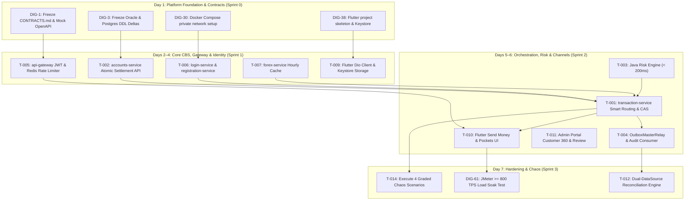

# Implementation Plan & Jira Sprint Allocation (v2.3 Rebalanced)

---

## 1. Capacity Model & Workload Reality (Hard Constraint)

* **Team Size:** 7 engineers.
* **Planning Capacity Baseline:** 5 Story Points (SP) per engineer per day (AI-assisted velocity).
* **Daily Team Capacity:** $7 \times 5 = \mathbf{35\text{ SP/day}}$.

### Backlog Overload Reconciliation & Cut Proposal

In the initial raw backlog import (`00_jira_backlog_v01.xlsx`), Sprint 2 was severely over-allocated at **184 SP** (versus a 2-day team capacity of **70 SP**), and Sprint 3 was allocated **65 SP** (versus a 1-day capacity of **35 SP**).

To maintain team integrity and guarantee the delivery of all core capstone deliverables without burnout, the following rebalancing and shifts are enacted per **ADR-004**:

| Category / Sprint | Raw Backlog Points | Rebalanced Committed Points | Rebalance Actions & Shifts |
| :--- | :--- | :--- | :--- |
| **Sprint 0 (Day 1)** | 25 SP | **25 SP** | Baseline contracts freeze, DDLs, and project skeletons. |
| **Sprint 1 (Days 2–4)** | 101 SP | **95 SP** | Core CBS settlement, Auth/JWT, Gateway 8080, FX cache, Mobile shell. (3 days $\times 35 = 105$ cap). |
| **Sprint 2 (Days 5–6)** | 184 SP | **70 SP** | **Strict focus on Must-Have Core Flows**: Smart routing, Java Risk Engine, Outbox Relay, Send Money UI. Shifted 51 SP of non-blocking features to Post-Capstone and 63 SP of stretch items to Sprint 3. |
| **Sprint 3 (Day 7)** | 65 SP | **35 SP** | **Hardening, Chaos & Stretch Delivery**: Priority 1 to Graded Chaos (`CH-01` to `CH-04`) & JMeter $\ge 800$ TPS. Pull in Customer 360, Reversals, and DLQ console as stretch capacity permits. |
| **Sprint 4 (Day 8)** | 16 SP | **15 SP** | Full end-to-end dry run and panel rehearsal. |
| **Sprint 5 (Day 9)** | 1 SP | **1 SP** | Final Viva presentation and capstone defense. |
| **Post-Capstone** | 51 SP | **51 SP** | EOD Report Pack (`DIG-107`), Partner Remittance API (`DIG-109/110`), and Enterprise GL engine (`DIG-106`). |

---

## 2. 7-Member Ownership & Jira Backlog Mapping

| Owner | Track | Primary Domain | Jira In-Sprint Tickets | Assigned Task Cards |
| :--- | :--- | :--- | :--- | :--- |
| **Yancey** | Full-Stack | **Core CBS & Balances** `accounts-service`, Oracle XE DDL, Row Locks, Holds | `DIG-3` (DDL deltas), `DIG-4` (HikariCP), `DIG-9` (Errors), `DIG-16` (Idempotency), `DIG-17` (Params), `DIG-52` (Locks), `DIG-58` (Resilience4j), `DIG-84/85` (Holds engine) | **`T-002`**, **`T-008`**, **`T-012`** |
| **Rohan** | Full-Stack | **Channel Orchestrator & Messaging** `transaction-service`, Smart FX, Outbox Relay | `DIG-14` (Core JSON bridge), `DIG-15` (Payment orchestrator), `DIG-20` (Kafka outbox), `DIG-23/24` (Risk decisions), `DIG-35` (Notifications), `DIG-66` (CAS transitions), `DIG-79` (Reversals), `DIG-80` (Cancel) | **`T-001`**, **`T-004`**, **`T-007`**, **`T-013`** |
| **PK** | Full-Stack | **Auth, Risk & Operations** `login-service`, `risk-engine`, Thymeleaf UI | `DIG-6` (Registration), `DIG-7` (Login/JWT), `DIG-12` (Email OTP), `DIG-18` (Txn history), `DIG-21/22` (Java Risk Engine), `DIG-50/53` (Admin login/audit), `DIG-102` (Monitor UI), `DIG-103` (Customer 360) | **`T-003`**, **`T-006`**, **`T-011`** |
| **Russel** | Cloud Lead | **Perimeter, Networking & Chaos** `api-gateway`, Port cloaking, TLS, Chaos suite | `DIG-8` (Gateway JWT), `DIG-25` (Gateway 8080), `DIG-28` (Secrets), `DIG-30` (Bridge network), `DIG-31` (TLS), `DIG-34` (Observability), `DIG-60` (Chaos tests), `DIG-118` (Chaos rehearsal) | **`T-005`**, **`T-014`** |
| **Gym** | Cloud Ops | **Platform, Caching & Load Testing** Redis rate limits, Kafka cluster, JMeter | `DIG-5` (Redis cache), `DIG-26` (Rate limiter), `DIG-27` (Correlation IDs), `DIG-29` (Dockerfiles), `DIG-32` (Kafka setup), `DIG-33` (Encrypted storage), `DIG-61` (JMeter load) | **`T-005`**, **`T-012`**, **`T-014`** |
| **Lanz** | Mobile Lead | **Flutter Core Client & Security** Dio client, Android Keystore, Send flow | `DIG-10` (Device binding), `DIG-38` (Flutter setup), `DIG-40` (Keystore), `DIG-42` (Send money flow), `DIG-44` (Client breaker), `DIG-46` (Error UI), `DIG-48` (Suspicious txn) | **`T-009`**, **`T-010`** |
| **Angge** | Mobile UX | **Flutter Views, Cards & Experience** Virtual card carousel, Pockets, Receipts | `DIG-11` (PIN fallback), `DIG-13` (OTP screens), `DIG-39` (Auth screens), `DIG-41` (Home & Pockets), `DIG-43` (Receipts), `DIG-47` (Alerts), `DIG-49` (Card lock UI) | **`T-010`** |

---

## 3. Dependency-Ordered Implementation Sequence (Fixing Dependency Violations)

To eliminate the 39 dependency-order violations present in the raw backlog:

---

## 4. End-to-End Traceability Matrix (Requirements $\to$ Tasks $\to$ Tests)

| Requirement ID | Summary | Task Card | Jira Issue | Verification / Test Command |
| :--- | :--- | :--- | :--- | :--- |
| **BR-01 / TR-L01** | Zero overdraft; pessimistic row locking | `T-002` | `DIG-14`, `DIG-52` | `./mvnw test -pl accounts-service -Dtest=CoreSettlementServiceTest` |
| **BR-02 / TR-L05** | Immutable audit ledger; triggers block updates | `T-004` | `DIG-16`, `DIG-20` | `./mvnw test -pl transaction-service -Dtest=AuditLedgerConsumerTest` |
| **BR-04 / TR-F01** | Hourly cached FX rates; 0 live dependency | `T-007` | `DIG-15` | `./mvnw test -pl forex-service -Dtest=ForexQuoteAndSchedulerTest` |
| **BR-05 / TR-I01** | Idempotent mutations; no duplicate debits | `T-001` | `DIG-16` | `./mvnw test -pl transaction-service -Dtest=PaymentOrchestratorTest` |
| **BR-07 / TR-S01** | BCrypt password, short-lived JWT, biometrics | `T-006` | `DIG-6`, `DIG-7` | `./mvnw test -pl login-service -Dtest=AuthAndRegistrationFlowTest` |
| **BR-08 / TR-R01** | Risk screening $\le 200\text{ms}$; fail-closed | `T-003` | `DIG-21`, `DIG-22` | `./mvnw test -pl risk-engine -Dtest=RiskEvaluationServiceTest` |
| **BR-09 / TR-A01** | Account/Card lock; admin freeze precedence | `T-008`, `T-011` | `DIG-49`, `DIG-52` | `./mvnw test -pl transaction-service -Dtest=VirtualCardControlsTest` |
| **BR-14 / Sec 14** | Resilience under database & network outages | `T-014` | `DIG-60` | `bash scripts/chaos/run_all_chaos_tests.sh` |
| **BR-18 / TR-R05** | Score $> 0.85 \implies$ `RESERVED` hold (ADR-001) | `T-001`, `T-003` | `DIG-24` | `./mvnw test -pl transaction-service -Dtest=RiskHoldWorkflowTest` |
| **BR-26 / BR-28** | Smart FX shortfall routing & 30s locked quote | `T-001`, `T-007` | `DIG-15` | `./mvnw test -pl transaction-service -Dtest=PaymentOrchestratorTest` |
| **BR-30 / BR-31** | 7-Status lifecycle, CAS transitions, Cancel | `T-001` | `DIG-66`, `DIG-80` | `./mvnw test -pl transaction-service -Dtest=TransactionLifecycleTest` |
| **BR-32** | Administrative transaction reversal | `T-001` | `DIG-79` | `./mvnw test -pl transaction-service -Dtest=TransactionReversalTest` |
| **BR-33** | Amount holds: place, capture, release | `T-002` | `DIG-84` | `./mvnw test -pl accounts-service -Dtest=AmountHoldEngineTest` |
| **BR-35 / BR-36** | Real-time monitoring & Customer 360 | `T-011` | `DIG-102`, `103` | `./mvnw test -pl frontend-web -Dtest=AdminPortalControllerTest` |

