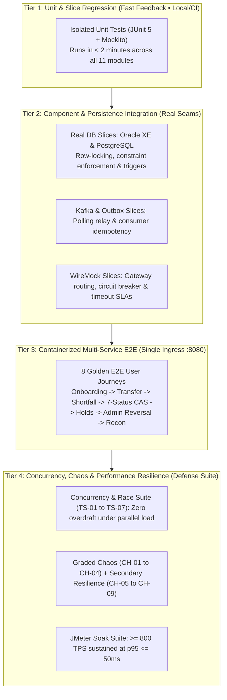
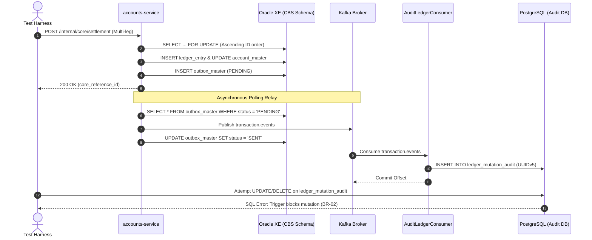
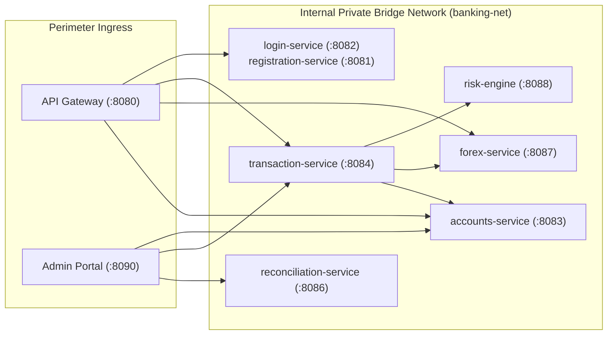

# Regression Testing & System Verification Master Plan (v1.0)
## Aligned with Jira Backlog v2.4 & Requirements Traceability

---

## 1. Executive Summary & Regression Testing Strategy

### 1.1 Objective & Guiding Principles
As the Capstone Banking System transitions from task implementation (`T-001` through `T-014` in [`docs/PLAN.md`](PLAN.md)) to platform stability, regression testing ensures that:
1. **No Core Banking Regressions Occur:** Pessimistic row locking, immutable audit journals, zero-overdraft constraints, and atomic settlement remain intact.
2. **End-to-End Seams Function Continuously:** API Gateway perimeter filters, JWT verification, asynchronous Kafka outbox pipelines, and PostgreSQL audit consumers operate seamlessly without data loss or stuck states.
3. **100% Backlog Traceability is Verified:** Every business requirement from BRD Section 6 (BR-01 through BR-42) in `GROUP-1 Jira_Backlog_Core_Retail_Ledger_v2.4.xlsx` is rigorously checked against automated tests.
4. **Defense Readiness is Proven:** All 4 graded chaos scenarios (`CH-01` to `CH-04`), secondary resilience tests (`CH-05` to `CH-09`), and JMeter performance criteria ($\ge 800\text{ TPS}$) pass with zero unhandled errors.

### 1.2 Regression Test Pyramid & Tiered Scope



---

## 2. 7-Member Ownership & Regression Suite Allocation

Each team member is assigned direct ownership of specific regression suites, requirements verification, and chaos/performance runbooks:

| Owner | Primary Domain | In-Scope Jira Tickets | Regression Test Suites & Verification Scope |
| :--- | :--- | :--- | :--- |
| **Yancey** | **Core CBS, Balances & Recon** | `DIG-3`, `DIG-4`, `DIG-9`, `DIG-16`, `DIG-17`, `DIG-52`, `DIG-58`, `DIG-64`, `DIG-66`, `DIG-67`, `DIG-68`, `DIG-77`, `DIG-84`, `DIG-85`, `DIG-87`, `DIG-88`, `DIG-105`, `DIG-112`, `DIG-114`, `DIG-122` | **CBS Balance & Lock Suite:** `TS-06` (Postgres trigger immutability), `TS-07` (Lock/freeze precedence), `AmountHoldEngineTest`, `CoreSettlementServiceTest`, `ReconciliationEngineTest` (Dual-DS drift detection). |
| **Rohan** | **Channels, FX & Lifecycle** | `DIG-14`, `DIG-15`, `DIG-20`, `DIG-23`, `DIG-24`, `DIG-35`, `DIG-51`, `DIG-62`, `DIG-73`, `DIG-74`, `DIG-75`, `DIG-76`, `DIG-78`, `DIG-80`, `DIG-81`, `DIG-83`, `DIG-86`, `DIG-113` | **Transaction Saga & FX Suite:** `PaymentOrchestratorTest`, `TransactionLifecycleTest`, `TS-04` (Cancel vs Process race), `TS-05` (Funding race), `CH-06` (FX API outage), `CH-08` (Mid-process kill sweeper). |
| **PK** | **Auth, Risk & Operations** | `DIG-6`, `DIG-7`, `DIG-12`, `DIG-18`, `DIG-21`, `DIG-22`, `DIG-50`, `DIG-53`, `DIG-54`, `DIG-63`, `DIG-69`, `DIG-70`, `DIG-71`, `DIG-79`, `DIG-90`, `DIG-91`, `DIG-92`, `DIG-102`, `DIG-115` | **Auth, Risk & Admin Portal Suite:** `AuthAndRegistrationFlowTest`, `RiskEvaluationServiceTest`, `CH-02` (Risk timeout $\le 200\text{ms}$ fail-closed), `CH-09` (Dashboard loss), Admin Held Review & DLQ Replay UI. |
| **Russel** | **Perimeter, Gateway & Chaos** | `DIG-8`, `DIG-25`, `DIG-28`, `DIG-30`, `DIG-31`, `DIG-34`, `DIG-60`, `DIG-65`, `DIG-111`, `DIG-118`, `DIG-120` | **Network & Chaos Suite:** Gateway route isolation, `CH-01` (Oracle netem delay 800ms), `CH-02` (Risk kill), `CH-03` (Port cloaking scan against `:8081-8088`, `:1521`, `:5432`), `CH-04` (Postgres outage & recovery). |
| **Gym** | **Platform, Caching & Load** | `DIG-5`, `DIG-26`, `DIG-27`, `DIG-29`, `DIG-32`, `DIG-33`, `DIG-61`, `DIG-89`, `DIG-101`, `DIG-110`, `DIG-119` | **Performance & Messaging Suite:** `TS-01` (Race withdraw $\implies 0$ overdraft), `TS-02` (Idempotency replay), `TS-03` (JMeter $\ge 800\text{ TPS}$ soak), `CH-04` (Audit consumer retry), `CH-05` (Kafka outage), `CH-07` (Poison message DLQ). |
| **Lanz** | **Mobile Core & Security** | `DIG-10`, `DIG-38`, `DIG-40`, `DIG-42`, `DIG-44`, `DIG-46`, `DIG-48`, `DIG-94`, `DIG-95`, `DIG-96`, `DIG-116` | **Mobile Client Integration Suite:** Dio HTTP client with JWT interceptor, UUID `Idempotency-Key` injection, Android KeyStore token security, client retry backoff, and signed release APK build. |
| **Angge** | **Mobile UI, Cards & UX** | `DIG-11`, `DIG-13`, `DIG-39`, `DIG-41`, `DIG-43`, `DIG-47`, `DIG-49`, `DIG-98`, `DIG-99`, `DIG-117` | **Mobile Experience & Visual Suite:** Registration/Login UI, PIN keypad fallback, Pockets carousel, 30s Shortfall funding sheet, Virtual card controls toggle, and filtered transaction history with PDF receipt. |

---

## 3. Comprehensive Requirements Completion Check Matrix

The following matrix audits all **41 Business Requirements (BR-01 through BR-42)** defined in `GROUP-1 Jira_Backlog_Core_Retail_Ledger_v2.4.xlsx` (Sheet 8, *Traceability*). It establishes whether each requirement is delivered in-scope or deferred post-capstone, maps its Jira issues, and designates the specific regression test verifying its complete fulfillment.

| BR ID | Business Requirement Summary | MoSCoW | Scope Status | Mapped Jira Issues | Primary Owner | Verification Mechanism & Test Identifier | Completion Check / Pass Condition |
| :--- | :--- | :--- | :--- | :--- | :--- | :--- | :--- |
| **BR-01** | Zero overdraft; balances never go negative under concurrent load | **Must** | **In-Scope** | `DIG-3`, `DIG-52`, `DIG-66`, `DIG-78`, `DIG-61` | Yancey & Gym | `TS-01` (JMeter Race Sampler) & `CoreSettlementServiceTest` | 100 concurrent withdrawals on a single pocket. Debits succeed until balance = 0.0000; remaining requests return `422 INSUFFICIENT_FUNDS`. No overdraft. |
| **BR-02** | Every balance mutation produces exactly one immutable audit record | **Must** | **In-Scope** | `DIG-3`, `DIG-66`, `DIG-32`, `DIG-20`, `DIG-88`, `DIG-53`, `DIG-112` | Yancey & Rohan | `TS-06` (Trigger Block) & `AuditLedgerConsumerTest` | Mutating balances writes `outbox_master`. Consumer appends to Postgres `ledger_mutation_audit`. SQL `UPDATE`/`DELETE` raises trigger exception. |
| **BR-03** | Mobile/web customers and web admins use the same APIs and rules | **Must** | **In-Scope** | `DIG-62`, `DIG-63`, `DIG-38`, `DIG-25`, `DIG-50`, `DIG-78` | Russel & PK | `CH-03` (Port Cloaking) & OpenAPI Contract Test | All clients call Gateway `:8080` (or Admin `:8090`). Identical validation rules and RFC 7807 error responses enforced everywhere. |
| **BR-04** | Cross-currency transfers use cached FX rates, never live calls | **Must** | **In-Scope** | `DIG-74` | Rohan | `ForexQuoteAndSchedulerTest` & `CH-06` | Scheduled hourly poll updates Oracle `fx_rate`. Live payment execution makes zero external HTTP calls to `api.frankfurter.dev`. |
| **BR-05** | Retried requests never create duplicate transactions | **Must** | **In-Scope** | `DIG-16`, `DIG-94`, `DIG-61` | Rohan & Gym | `TS-02` (Duplicate Key Replay) & `PaymentOrchestratorTest` | Resending request with identical `X-Idempotency-Key` replays original response; modified body returns `409/422`. Exactly one ledger debit. |
| **BR-07** | Password + biometric login; OTP for sensitive actions | **Must** | **In-Scope** | `DIG-7`, `DIG-39`, `DIG-12`, `DIG-10`, `DIG-13` | PK & Lanz | `AuthAndRegistrationFlowTest` & `OtpControllerTest` | BCrypt validation generates signed JWT. Sensitive/high-risk actions prompt step-up OTP with 5-minute expiry. |
| **BR-08** | Fraud screening; reject if not complete in 200 ms (fail-closed) | **Must** | **In-Scope** | `DIG-21`, `DIG-23` | PK & Rohan | `CH-02` (Risk Timeout) & `RiskClientTest` | Risk screening $> 200\text{ms}$ or container offline triggers fail-closed `503 SECURITY_CHECK_UNAVAILABLE`. Zero balance changes. |
| **BR-09** | Customer lock/unlock of accounts & cards; admin freeze precedence | **Must** | **In-Scope** | `DIG-68`, `DIG-122`, `DIG-49`, `DIG-54` | Yancey & Angge | `TS-07` (Lock Precedence) & `AccountLockPrecedenceTest` | When `admin_frozen = 'Y'`, customer unlock attempts are rejected. Admin freeze strictly overrides customer settings. |
| **BR-10** | Send money via account number or QR code | **Must** | **In-Scope** | `DIG-42`, `DIG-76`, `DIG-95` | Rohan & Lanz | E2E Golden Journey 2 & `PaymentControllerTest` | `POST /api/v1/payments/qr/generate` and `/qr/resolve` successfully translate to payment payload and execute transfer. |
| **BR-11** | Customer notification; flag AMLA/suspicious events to admins | **Should** | **In-Scope** | `DIG-79`, `DIG-35`, `DIG-54`, `DIG-47` | Rohan & PK | Kafka `risk.alert` Listener & Notification Test | Risk score $> 0.85$ or amount $> \text{limit}$ publishes alert to Kafka; admin flagged queue and customer notification records created. |
| **BR-12** | Issue a virtual card per eligible account | **Should** | **In-Scope** | `DIG-6`, `DIG-122` | PK & Yancey | `VirtualCardControlsTest` & Registration Test | User registration auto-provisions primary pocket and creates corresponding `card_master` row with masked PAN. |
| **BR-13** | Email password-protected monthly PDF summary | **Could** | **Deferred** | `DIG-93` | PK | Deferred per ADR-004 | Monthly email batch runner deferred; on-demand statement download (`DIG-92`) delivered for Capstone scope. |
| **BR-14** | Remain safe & consistent when DB, risk engine or network fails | **Must** | **In-Scope** | `DIG-30`, `DIG-58`, `DIG-23`, `DIG-44`, `DIG-86`, `DIG-60`, `DIG-118` | Russel & Gym | Graded Chaos Suite (`CH-01` through `CH-04`) | Automated chaos scripts execute with zero data corruption, clean circuit breaker trips, and full post-recovery parity. |
| **BR-15** | Cloud deployment with automated build, test, release | **Must** | **In-Scope** | `DIG-110`, `DIG-111`, `DIG-116` | Russel & Gym | CI/CD Pipeline & Docker Compose Smoke Test | `./mvnw clean package` compiles all modules; Docker Compose launches on isolated bridge network with healthchecks passing. |
| **BR-16** | Registration auto-provisions exactly one account (PHP pocket) | **Must** | **In-Scope** | `DIG-64`, `DIG-6`, `DIG-39`, `DIG-67` | PK & Yancey | `AuthAndRegistrationFlowTest` | Registration endpoint inserts customer and creates initial PHP savings pocket with `is_primary = 'Y'`. |
| **BR-18** | Every transfer gets a risk score deciding allow / step-up OTP / hold | **Must** | **In-Scope** | `DIG-21`, `DIG-24` | PK & Rohan | `RiskEvaluationServiceTest` & E2E Journey 5 | Heuristic risk engine scores transaction: $\le 0.60 \implies$ ALLOW, $0.61–0.85 \implies$ OTP, $> 0.85 \implies$ `RESERVED` hold. |
| **BR-19** | Admins edit limits, fees, AMLA thresholds without redeploy | **Must** | **In-Scope** | `DIG-17`, `DIG-54` | PK & Yancey | `AdminParameterControllerTest` | `PUT /internal/risk/parameters` and `/api/v1/admin/parameters` dynamically reloads weights in memory without restart. |
| **BR-20** | Device-bound sessions, token expiry, PIN fallback | **Must** | **In-Scope** | `DIG-7`, `DIG-10`, `DIG-11`, `DIG-69`, `DIG-70` | PK & Lanz | `DeviceBindingAndLockoutTest` | 3 failed PIN attempts locks device; unbinding invalidates session; JWT expiration strictly enforced at Gateway. |
| **BR-21** | Home screen: balance, account no., last 5 txns; cache fallback | **Must** | **In-Scope** | `DIG-67`, `DIG-58`, `DIG-41` | Yancey & Angge | `CircuitBreakerFallbackTest` & `CH-01` | When Oracle slows down, balance queries fall back to Redis `balance_cache:*` returning timestamped balances. |
| **BR-22** | Download statement; report suspicious transactions | **Must** | **In-Scope** | `DIG-91`, `DIG-92`, `DIG-48`, `DIG-99` | PK & Lanz | Statement & Suspicious Report API Tests | `GET /api/v1/statements/download` returns PDF stream; `POST /api/v1/transfers/{id}/report-suspicious` queues admin review. |
| **BR-23** | Distinct error messages (risk, funds, rate limit, unavailable) | **Must** | **In-Scope** | `DIG-9`, `DIG-26`, `DIG-46` | Yancey & Russel | RFC 7807 Error Code Verification Suite | Gateway and services return distinct error codes: `INSUFFICIENT_FUNDS`, `RATE_LIMIT_EXCEEDED`, `SECURITY_CHECK_UNAVAILABLE`, etc. |
| **BR-24** | Masked recipient name before confirming payment | **Should** | **In-Scope** | `DIG-42`, `DIG-77` | Yancey & Lanz | `RecipientLookupServiceTest` | `GET /api/v1/accounts/lookup?accountNo=...` returns masked name (e.g., `M***a S****s`) to prevent enumeration. |
| **BR-25** | Per-card e-commerce toggle; primary card visually distinct | **Should** | **In-Scope** | `DIG-122`, `DIG-49` | Yancey & Angge | `VirtualCardControlsTest` | Toggling `ecom_enabled = false` blocks online payment requests with `422 ECOM_TRANSACTIONS_DISABLED`. |
| **BR-26** | Convert between own currency pockets with a clear quote | **Must** | **In-Scope** | `DIG-75`, `DIG-98` | Rohan & Angge | `ForexConversionServiceTest` | `POST /api/v1/fx/convert` debits base pocket, credits target pocket using locked quote rate and spread margin. |
| **BR-27** | Pay in recipient's currency from matching pocket (lower fee) | **Must** | **In-Scope** | `DIG-15` | Rohan | E2E Golden Journey 2 | Direct same-currency pocket debit executes with 0 FX fees and standard 2-leg CBS settlement. |
| **BR-28** | Multi-pocket funding shortfall auto-conversion (atomic) | **Must** | **In-Scope** | `DIG-73`, `DIG-42` | Rohan & Lanz | `TS-05` (Funding Race) & E2E Journey 3 | When EUR pocket has partial funds, funding pocket auto-converts shortfall. Entire 6-leg settlement commits atomically. |
| **BR-29** | Admin-editable fees, spreads, quote validity, stale limits | **Should** | **In-Scope** | `DIG-74`, `DIG-17` | Rohan & Yancey | `FxRateControllerTest` | Admin updates FX spread in parameter store; subsequent quotes reflect modified spread immediately. |
| **BR-30** | Exactly one status per transaction and visible stage progress | **Must** | **In-Scope** | `DIG-80`, `DIG-18`, `DIG-81`, `DIG-96` | Rohan & PK | `TransactionLifecycleTest` | 7-status state machine with CAS transitions (`AUTHORIZED` $\to$ `PROCESSING`). Stage events published to Kafka `txn.lifecycle`. |
| **BR-31** | Customer cancel only before processing; never posts; hold released | **Must** | **In-Scope** | `DIG-83`, `DIG-96`, `DIG-61` | Rohan & Gym | `TS-04` (Cancel vs Process) & `TransactionLifecycleTest` | Cancel during 5s window succeeds if `INITIATED` or `AUTHORIZED`. If already `PROCESSING`, returns `409 Conflict`. Zero double debits. |
| **BR-32** | Admin reversal via linked compensating transaction | **Should** | **In-Scope** | `DIG-87` | Yancey | `TransactionReversalTest` & E2E Journey 6 | Maker-checker reversal generates linked compensating record (`reversal_of_txn_id`). Debits recipient, credits sender. |
| **BR-33** | Amount holds reduce available balance; release / capture / expire | **Must** | **In-Scope** | `DIG-84`, `DIG-85` | Yancey | `AccountHoldEngineTest` & `HoldExpiryJobTest` | Placing hold reduces available balance (`balance - held`). Expiry job releases expired holds back to available balance. |
| **BR-34** | Failures classified, transient retried, exhausted parked in DLQ | **Must** | **In-Scope** | `DIG-89` | Gym | `CH-07` (Poison Message) & Kafka DLQ Test | Transient errors retry with exponential backoff (1s, 2s, 4s). Permanent/exhausted errors route to `dead-letter-events`. |
| **BR-35** | Admins inspect, replay, discard DLQ entries with audit trail | **Should** | **In-Scope** | `DIG-90` | PK | Admin DLQ Controller & UI Test | Admin views poisoned messages on `:8090/admin/dlq` and triggers replay to original topic with audit log. |
| **BR-36** | Restartable EOD batch with business cut-off, no downtime | **Should** | **Deferred** | `DIG-104` | Rohan | Deferred per ADR-004 | Full checkpointed enterprise accounting cut-off deferred; standing instruction engine (`DIG-105`) delivered. |
| **BR-37** | Standing instructions executed exactly once per occurrence | **Should** | **In-Scope (Core)** | `DIG-105`, `DIG-100` | Yancey & Angge | `EodBatchSchedulerTest` | Scheduled standing instruction runner queries due transfers, executes with deterministic idempotency keys, advances date. (Mobile UI deferred). |
| **BR-38** | Reconcile ledger vs GL vs audit per txn and business date | **Should** | **Deferred** | `DIG-106` | Gym | Deferred per ADR-004 | General Ledger chart of accounts deferred; dual-datasource core-vs-audit reconciliation (`DIG-112`) delivered. |
| **BR-39** | Downloadable EOD report pack (CSV/PDF) | **Should** | **Deferred** | `DIG-107` | PK | Deferred per ADR-004 | Regulatory archive report pack deferred; on-demand statement download (`DIG-92`) delivered for Capstone. |
| **BR-40** | Resilient partner API integration without holding ledger locks | **Should** | **Deferred** | `DIG-72`, `DIG-109` | Rohan & Russel | Deferred per ADR-004 | External B2B partner webhooks deferred; internal mock CBS settlement delivered for Capstone. |
| **BR-41** | Admins monitor transactions in real time by status and stage | **Must** | **In-Scope** | `DIG-81`, `DIG-101`, `DIG-102` | PK & Gym | SSE Stream & Operations Dashboard Test | Admin Portal `:8090` connects to real-time Server-Sent Events stream rendering live status and stage transitions. |
| **BR-42** | Customer 360 view (balances, spending profile, risk score) | **Should** | **Deferred** | `DIG-103` | PK | Deferred per ADR-004 | Complex 360 spending analytics deferred; core customer profile and held transfers review delivered on `:8090`. |

---

## 4. Tiered Test Suites & Detailed Specifications

### 4.1 Suite 1: Full Monorepo Unit/Slice Regression
* **Objective:** Verify compilation integrity and business logic isolation across all 11 modules.
* **Execution Command:**
  ```bash
  ./mvnw clean test
  ```
* **Acceptance Gate:** 100% test pass rate across all modules; 0 compilation errors.

---

### 4.2 Suite 2: Component & Persistence Integration Slices
Tests execute against running database containers or embedded services to validate data integrity constraints:



1. **`TS-06`: Audit Trigger Block Verification (`BR-02`):**
   * Attempt direct `UPDATE ledger_mutation_audit SET amount = 999 WHERE ...` and `DELETE FROM ledger_mutation_audit`.
   * **Assertion:** Database trigger aborts execution with `RAISE EXCEPTION`; zero rows modified.
2. **`TS-07`: Account Lock & Admin Freeze Precedence (`BR-09`):**
   * Set `admin_frozen = 'Y'` on `acct-juan-php-01`.
   * Customer calls `POST /api/v1/accounts/acct-juan-php-01/unlock`.
   * **Assertion:** Status remains `FROZEN`; endpoint returns `422 ACCOUNT_FROZEN`.
3. **Dual-DataSource Reconciliation Run (`DIG-112`, `BR-02`):**
   * Run `ReconciliationEngine.runReconciliation()`.
   * **Assertion:** Compares live Oracle balances against sum of legs in PostgreSQL. Healthy state produces 0 exceptions. Synthetic ₱100 drift generates `recon_result_audit` record and publishes discrepancy event to Kafka.

---

### 4.3 Suite 3: Containerized End-to-End (E2E) Golden Journeys
All services run in Docker Compose (`docker compose up -d`). Tests communicate exclusively through **Port 8080** (API Gateway) or **Port 8090** (Admin Portal):



* **Journey 1: Onboarding & Auth Lifecycle (`BR-07`, `BR-16`, `BR-20`):**
  * Register new user $\implies$ verify auto-provisioned PHP pocket and active status.
  * Login with BCrypt credentials $\implies$ verify valid JWT and device binding.
  * Logout $\implies$ verify token hash stored in Redis blacklist; subsequent calls return `401 Unauthorized`.
* **Journey 2: Same-Currency Transfer & Idempotency (`BR-01`, `BR-05`, `BR-10`, `BR-27`):**
  * Transfer ₱5,000 from Juan to Maria with `X-Idempotency-Key: <UUID-1>`.
  * Verify 200 OK, `status: POSTED`, balances update, and outbox event creates 2 audit legs.
  * Replay request with `<UUID-1>` $\implies$ Returns identical response with zero double-debiting.
* **Journey 3: Smart Shortfall Auto-Conversion (`BR-04`, `BR-26`, `BR-28`):**
  * Juan sends €100 to Maria. Juan's EUR balance is €0.00.
  * Acquire 30s locked quote for PHP shortfall. Submit payment.
  * Verify atomic 6-leg balanced settlement, FX spread fee booking, and balanced audit records.
* **Journey 4: 7-Status CAS Lifecycle & 5s Cancel Window (`BR-30`, `BR-31`):**
  * Initiate payment. Issue cancel during 5s window $\implies$ Transitions to `CANCELLED`, funds untouched.
  * In second transfer, allow state to advance to `PROCESSING` $\implies$ Cancel returns `409 Conflict`.
* **Journey 5: Fraud Scoring & Admin Held Queue (`BR-08`, `BR-18`, `BR-33`, `BR-41`):**
  * Initiate payment triggering risk score $> 0.85$.
  * Verify response returns `202 Accepted`, `status: RESERVED`, and amount hold placed in CBS.
  * Staff logs into Admin Portal (`:8090`), reviews held transfer, and approves.
  * Verify transaction advances to `POSTED` and hold is captured.
* **Journey 6: Administrative Maker-Checker Reversal (`BR-32`):**
  * Post a transfer. Staff issues reverse on `:8090/api/v1/admin/transfers/{id}/reverse`.
  * Verify recipient has sufficient funds, compensating settlement legs execute, and transaction marked `REVERSED`.
* **Journey 7: Standing Instruction Auto-Debit Batch (`BR-37`):**
  * Seed standing instruction due on current date.
  * Trigger batch processor. Verify transfer executes with deterministic idempotency and next run date advances.
* **Journey 8: Dual-DataSource Reconciliation Verification (`BR-02`):**
  * Trigger reconciliation run. Verify Oracle balances match Postgres audit sums across all accounts.

---

### 4.4 Suite 4: Concurrency & Stress Testing Suite (`TS-01` to `TS-05`)
Using Apache JMeter (`tests/jmeter/`):

| Test ID | Test Scenario | Concurrency & Load Parameters | Pass / Acceptance Criteria |
| :--- | :--- | :--- | :--- |
| **`TS-01`** | **Race Sampler (Concurrent Withdrawals)** | 50 concurrent threads attempting to withdraw ₱1,500 each from a pocket containing ₱50,000. | Debits succeed until balance is exhausted; excess requests fail with `422 INSUFFICIENT_FUNDS`. **Zero overdraft; final balance $\ge 0.0000$**. |
| **`TS-02`** | **Replay / Duplicate Key Flood** | 100 concurrent requests sending identical `X-Idempotency-Key`. | Exactly 1 request acquires lock; 99 requests receive cached response or `409 IDEMPOTENCY_IN_PROGRESS`. Exactly one debit leg. |
| **`TS-03`** | **Sustained Throughput Soak** | Constant load across `/api/v1/payments` and balance inquiries. | **Throughput $\ge 800\text{ TPS}$** sustained; p95 latency $\le 50\text{ms}$; 0 HikariCP pool exhaustions. |
| **`TS-04`** | **Cancel vs Process CAS Race** | Customer cancel and background worker claim fired simultaneously for same transaction. | Compare-and-Set guarantees exactly one winner. Transaction resolves to either `CANCELLED` or `POSTED`; never both. |
| **`TS-05`** | **Funding Race Condition** | Two cross-currency payments concurrently draining the same funding pocket. | Atomic balance check serializes execution; funding pocket balance never drops below zero. |

---

### 4.5 Suite 5: Graded Chaos Engineering Suite (`CH-01` to `CH-04`) & Secondary Tests

Executed via automated shell scripts (`scripts/chaos/`):

```mermaid
flowchart TD
    subgraph CH01["CH-01: Oracle Netem Latency (800ms)"]
        C1_Inj["Inject netem 800ms delay"] --> C1_Trip["Resilience4j breaker trips to OPEN (180ms threshold)"]
        C1_Trip --> C1_Read["Balance reads served from Redis cache with timestamp"]
        C1_Trip --> C1_Mut["Mutations fail-safe with 503 SERVICE_DEGRADED"]
    end

    subgraph CH02["CH-02: Risk Engine Kill"]
        C2_Inj["docker stop risk-engine"] --> C2_SLA["TimeLimiter SLA triggers in <= 200ms"]
        C2_SLA --> C2_Fail["Payment fails closed with 503 SECURITY_CHECK_UNAVAILABLE"]
        C2_Fail --> C2_State["Zero partial debits written in Oracle"]
    end

    subgraph CH03["CH-03: Perimeter Port Cloaking"]
        C3_Scan["Scan ports 8081-8088, 1521, 5432"] --> C3_Refuse["All internal ports return Connection Refused"]
        C3_Refuse --> C3_Allow["Only :8080 (Gateway) and :8090 (Admin) accessible"]
    end

    subgraph CH04["CH-04: Postgres Audit Outage"]
        C4_Inj["docker stop postgres-audit-db"] --> C4_Cont["Oracle payments & Forex continue normally"]
        C4_Cont --> C4_Pause["Kafka Audit Consumer pauses and retries with backoff"]
        C4_Pause --> C4_Rec["docker start postgres-audit-db -> 100% audit parity restored"]
    end
```



* **`CH-01` (Oracle DB Degradation — Graded):**
  ```bash
  docker exec -u 0 oracle-db tc qdisc add dev eth0 root netem delay 800ms
  ```
  * Verify: Balance queries return cached Redis data (`balance_cache:*`); balance writes fail-safely with `503 SERVICE_DEGRADED`.
* **`CH-02` (Risk Engine Kill — Graded):**
  ```bash
  docker stop risk-engine
  ```
  * Verify: `POST /api/v1/payments` fails closed in $\le 200\text{ms}$ with `503 SECURITY_CHECK_UNAVAILABLE`. Zero balance changes.
* **`CH-03` (Perimeter Port Cloaking Scan — Graded):**
  ```powershell
  Test-NetConnection -ComputerName localhost -Port 8083 # Accounts
  Test-NetConnection -ComputerName localhost -Port 1521 # Oracle
  Test-NetConnection -ComputerName localhost -Port 5432 # Postgres
  ```
  * Verify: `TcpTestSucceeded : False` across all internal ports. Only `:8080` and `:8090` reachable.
* **`CH-04` (PostgreSQL Audit Outage & Recovery — Graded):**
  ```bash
  docker stop postgres-audit-db
  ```
  * Verify: Core Oracle payments continue without error. Audit consumer pauses and retries. Upon restart (`docker start postgres-audit-db`), audit consumer recovers to 100% parity.
* **Secondary Scenarios (`CH-05` to `CH-09`):**
  * `CH-05` (Kafka Outage): Outbox accumulates in Oracle `outbox_master`; drains on broker recovery.
  * `CH-06` (FX API Outage): Cached rates used; 24h stale guard blocks stale conversions with `FX_RATE_STALE`.
  * `CH-07` (Poison Message): Malformed JSON routes to `dead-letter-events` topic without blocking partition.
  * `CH-08` (Mid-Transaction Process Kill): Transaction stuck in `PROCESSING` is resolved to `POSTED` or `FAILED` by `StuckTransactionSweeper`.
  * `CH-09` (Dashboard Stream Loss): Admin UI gracefully falls back to polling if SSE stream disconnects.

---

## 5. Step-by-Step Regression Test Execution Runbook

Follow this precise sequence to execute the complete regression test regimen:

### Step 1: Execute Full Unit Regression (Local / CI)
```bash
./mvnw clean test
```
*Expected Result:* BUILD SUCCESS across all 11 modules. 0 test failures.

### Step 2: Launch Docker Compose Stack with Clean State
```bash
# Clean existing volumes and start stack
docker compose down -v
docker compose up -d

# Wait for database healthchecks
docker compose ps
```
*Expected Result:* All containers (`oracle-db`, `postgres-db`, `redis`, `kafka`, `api-gateway`, etc.) report `healthy` or `running`.

### Step 3: Run Perimeter Port Scan (`CH-03`)
```powershell
$ports = @(8081, 8082, 8083, 8084, 8085, 8086, 8087, 8088, 1521, 5432)
foreach ($p in $ports) {
    $res = Test-NetConnection -ComputerName localhost -Port $p -WarningAction SilentlyContinue
    Write-Host "Port $p Reachable: $($res.TcpTestSucceeded)"
}
```
*Expected Result:* All internal ports report `False`. External ports `:8080` and `:8090` report `True`.

### Step 4: Run Automated E2E Regression Suite
```bash
python -m pytest tests/e2e/ -v
```
*Expected Result:* 100% pass across all 8 Golden Journeys.

### Step 5: Execute Graded Chaos Automation Script
```bash
bash scripts/chaos/run_all_chaos_tests.sh
```
*Expected Result:* All 4 scenarios (`CH-01` to `CH-04`) pass and output green status indicators.

### Step 6: Execute JMeter Concurrency & Load Suite
```powershell
.\tests\jmeter\run-baseline-test.ps1
```
*Expected Result:* Sustained throughput $\ge 800\text{ TPS}$, p95 latency $\le 50\text{ms}$, 0 overdrafts detected.

---

## 6. Master Backlog Completion & Verification Traceability

Auditing all 109 tickets from `GROUP-1 Jira_Backlog_Core_Retail_Ledger_v2.4.xlsx`:

| Category / Disposition | Issue Count | Jira Issue Keys | Regression Test Verification Mechanism |
| :--- | :--- | :--- | :--- |
| **Core Coding Tasks (`T-001`–`T-014`)** | **88** | `DIG-3` through `DIG-112`, `DIG-122` | Verified across Unit test suites, E2E Golden Journeys 1–8, and Concurrency Tests `TS-01`–`TS-07`. |
| **Sprint 0 Foundation / Bootstrap** | **4** | `DIG-62`, `DIG-63`, `DIG-64`, `DIG-65` | Verified via schema bootstrap, contract tests, and repository compilation. |
| **Sprint 4 & 5 Defense Readiness** | **8** | `DIG-113`–`DIG-120` | Verified via JMeter performance reports, signed APK build, and mock defense rehearsal. |
| **Post-Capstone Deferred Scope** | **9** | `DIG-72`, `DIG-93`, `DIG-97`, `DIG-100`, `DIG-103`, `DIG-104`, `DIG-106`, `DIG-107`, `DIG-109` | Formally deferred per ADR-004; marked excluded from Capstone sign-off gate. |
| **TOTAL BACKLOG** | **109** | `DIG-3` to `DIG-122` | **100% Backlog Verification Accounted For** |

---

## 7. Capstone Defense Go/No-Go Decision Gate

The system is certified for Final Viva Defense (`DIG-120`) only when all criteria below are satisfied:

| Checkpoint | Gate Requirement | Verification Evidence | Sign-Off Lead |
| :---: | :--- | :--- | :---: |
| **Gate 1** | Monorepo compiles cleanly with zero test failures | `./mvnw clean test` output | Yancey / PK |
| **Gate 2** | Zero port leakage across perimeter | PowerShell port scan report (`CH-03`) | Russel |
| **Gate 3** | All 8 E2E Golden Journeys pass via Gateway `:8080` | Pytest / Newman automated test report | Rohan / Lanz |
| **Gate 4** | Zero balance overdraft under concurrent load | JMeter `TS-01` execution report | Gym |
| **Gate 5** | All 4 Graded Chaos tests pass cleanly | `scripts/chaos/run_all_chaos_tests.sh` log | Russel |
| **Gate 6** | Dual-DataSource Reconciliation reports 0 drift | `recon_run_audit` table snapshot | Yancey |
| **Gate 7** | Sustained load achieves $\ge 800\text{ TPS}$ at p95 $\le 50\text{ms}$ | JMeter dashboard HTML export | Gym |

