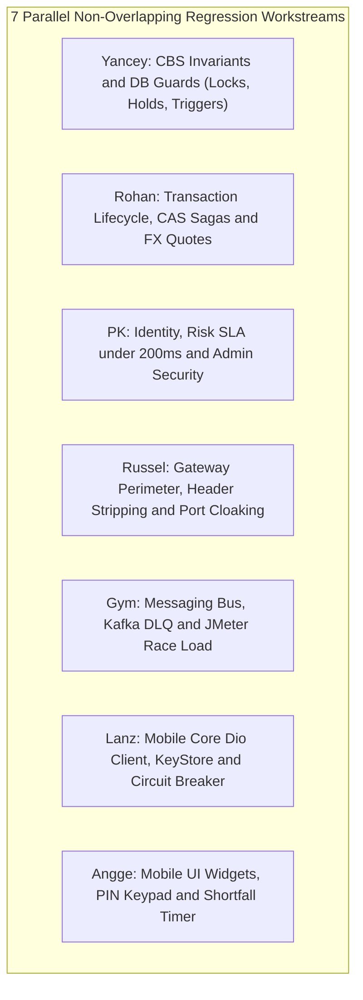

# Regression Testing Plan (v2.0)
## Automated Invariant Verification & Defect Prevention

---

## 1. Objective & Scope of Regression Testing

Unlike exploratory or initial system testing, **Regression Testing** is an automated, repeatable safety net ensuring that:
1. **Critical Banking Invariants Never Regress:** Core financial rules (zero overdraft, double-entry zero-sum, forward-only transaction states, and single-writer ownership) remain strictly enforced across all code merges.
2. **Architecture Alignment Deltas Remain Intact:** Target fixes identified in [`docs/PLAN.md`](PLAN.md) §3 (e.g., `LedgerEntry` insertion on settlement, Forex querying Oracle `fx_rate`, cancel on `RESERVED` status releasing holds, and dynamic risk weight reloading) do not regress to legacy behavior.
3. **Bug Fixes Stay Fixed:** Every resolved defect has a regression test preventing re-emergence.

### Non-Regression Scope Boundary
* **Excluded from this plan (Moved to [`docs/TEST_PLAN.md`](TEST_PLAN.md)):** Initial functional feature testing, live chaos fault injection drills (`CH-01` to `CH-04`), multi-channel exploratory walkthroughs, and Viva defense rehearsal choreography.
* **Included in this plan:** Automated unit regressions, invariant assertions, database trigger guards, and automated concurrency race checks.

---

## 2. Parallel Team Ownership & Non-Overlapping Workstreams

To allow all 7 team members to work completely in parallel without file conflicts or overlapping test suites, each engineer is allocated a dedicated, mutually exclusive regression domain:



| Owner | Track | Exclusive Domain & Artifacts Guarded | Key Regressions Guarded |
|:---|:---|:---|:---|
| **Yancey** | Core CBS | `accounts-service`, Oracle `CBS` schema, `reconciliation-service` | Zero overdraft, row-lock order, `LedgerEntry` insertion, hold expiry, audit trigger block (`TS-06`, `TS-07`). |
| **Rohan** | Channels | `transaction-service`, `forex-service`, Lifecycle Engine | Idempotency replay, 7-status CAS state machine, hold release on cancel, 30s locked quote expiry, sweeper. |
| **PK** | Auth & Risk | `login-service`, `registration-service`, `risk-engine`, `frontend-web` | BCrypt validation, JWT expiration, 3-strike lockout, risk $\le 200\text{ms}$ fail-closed SLA, dynamic parameter reload. |
| **Russel** | DevSecOps | `api-gateway`, Docker Compose network isolation | Header stripping (`X-Cust-Id`), internal route cloaking (`403`), token blacklist filter, zero-trust host port scan (`CH-03`). |
| **Gym** | Platform | Kafka Broker, `AuditLedgerConsumer`, Redis 7, JMeter | Outbox event delivery, poison message routing to DLQ, Redis token-bucket replenishment, concurrent race load (`TS-01`). |
| **Lanz** | Mobile Core | `mobile/lib/core/`, Dio client, KeyStore | Automatic Bearer JWT injection, UUID idempotency header generation, client-side retry backoff, error model parsing. |
| **Angge** | Mobile UX | `mobile/lib/features/`, Flutter UI Widgets | PIN keypad validation, Pockets ledger vs available balance display, shortfall 30s countdown, card e-commerce toggle. |

---

## 3. Detailed Step-by-Step Regression Execution by Team Member

### 3.1 Yancey — CBS Core Invariants & Database Integrity
**Domain Scope:** `accounts-service`, Oracle XE `CBS` schema (`account_master`, `account_hold`, `ledger_entry`, `posting_reference`), PostgreSQL `ledger_mutation_audit`.

#### Regression Test Procedures:
* **REG-YAN-01: Zero Overdraft & Row Lock Ordering Invariant (`BR-01`)**
  * *Objective:* Ensure account balances never drop below zero under concurrent execution and locks are acquired in alphanumeric order to prevent deadlocks.
  * *Step 1:* Run `./mvnw test -pl accounts-service -Dtest=CoreSettlementServiceTest#shouldPreventOverdraftUnderConcurrency`.
  * *Step 2:* Verify in test assertions that `SELECT ... FOR UPDATE` sorts account IDs ascending (`id1 < id2`).
  * *Step 3:* Assert that any withdrawal exceeding available balance raises `InsufficientFundsException` with zero balance mutation.
* **REG-YAN-02: Atomic `LedgerEntry` Persistence Invariant (`PLAN.md` Delta §3.2)**
  * *Objective:* Ensure every balance mutation commits `ledger_entry` records in the exact same transaction as `account_master`.
  * *Step 1:* Run `./mvnw test -pl accounts-service -Dtest=CoreSettlementServiceTest#shouldPersistLedgerEntriesWithRunningBalance`.
  * *Step 2:* Verify `entry_id` (UUIDv5), `running_balance`, `value_date`, and `business_date` are populated.
  * *Step 3:* Simulate a database constraint failure on the credit leg; verify the debit leg and `ledger_entry` roll back completely.
* **REG-YAN-03: Hold Availability & Expiry Invariant (`BR-33`)**
  * *Objective:* Ensure held funds reduce available balance (`available = balance - held`) and expired holds release automatically.
  * *Step 1:* Run `./mvnw test -pl accounts-service -Dtest=AccountHoldEngineTest`.
  * *Step 2:* Run `./mvnw test -pl accounts-service -Dtest=HoldExpiryJobTest`.
  * *Step 3:* Assert: placing ₱1,000 hold on ₱5,000 balance leaves `balance_amount = 5000` and `available_balance = 4000`. Expiry job restores `available_balance = 5000`.
* **REG-YAN-04: Admin Freeze Precedence Invariant (`TS-07`, `BR-09`)**
  * *Objective:* Ensure customer cannot unlock an account that is administrative frozen.
  * *Step 1:* Run `./mvnw test -pl accounts-service -Dtest=AccountLockPrecedenceTest`.
  * *Step 2:* Assert: Calling customer unlock on an account where `admin_frozen = 'Y'` returns `422 ACCOUNT_FROZEN` and maintains `admin_frozen = 'Y'`.
* **REG-YAN-05: PostgreSQL Audit Trigger Immutability (`TS-06`, `BR-02`)**
  * *Objective:* Verify that PostgreSQL triggers block `UPDATE` and `DELETE` on `ledger_mutation_audit`.
  * *Step 1:* Run integration test against test DB: `./mvnw test -pl reconciliation-service -Dtest=AuditLedgerImmutabilityTest`.
  * *Step 2:* Execute SQL assertion: `UPDATE ledger_mutation_audit SET amount = 999 WHERE 1=1;` must fail with trigger exception `RAISE EXCEPTION`.

---

### 3.2 Rohan — Transaction Lifecycle, CAS Sagas & FX Rates
**Domain Scope:** `transaction-service`, `forex-service`, Payment Orchestration, CAS State Machine, FX Quotes.

#### Regression Test Procedures:
* **REG-ROH-01: Idempotency-Key Response Replay Invariant (`BR-05`)**
  * *Objective:* Ensure replaying an identical request returns the cached response without double posting, and modified payload with same key is rejected.
  * *Step 1:* Run `mvn test -pl transaction-service "-Dtest=PaymentOrchestratorTest#shouldReplayResponseOnDuplicateKey"`.
  * *Step 2:* Verify: Immediate second request with identical `X-Idempotency-Key` and payload returns identical `200 POSTED` from cache without re-invoking risk or CBS.
  * *Step 3:* Run `mvn test -pl transaction-service "-Dtest=PaymentOrchestratorTest#shouldRejectModifiedPayloadWithSameKey"`.
  * *Step 4:* Verify: Second request with identical key but modified amount throws `409 Conflict` (`IdempotencyConflictException`).
* **REG-ROH-02: 7-Status CAS Forward-Only State Machine (`BR-30`)**
  * *Objective:* Ensure transactions only progress along valid state transitions (`INITIATED` $\to$ `AUTHORIZED` $\to$ `PROCESSING` $\to$ `POSTED`).
  * *Step 1:* Run `mvn test -pl transaction-service "-Dtest=TransactionLifecycleTest#shouldClaimAuthorizedForSettlement"`.
  * *Step 2:* Verify CAS assertion executes:
    ```sql
    UPDATE transaction_master SET txn_status = 'PROCESSING' 
    WHERE txn_id = ? AND txn_status = 'AUTHORIZED'
    ```
  * *Step 3:* Assert that if updated rows == 1, CAS claim succeeds; if rows == 0, processing aborts immediately.
* **REG-ROH-03: Hold Release on Cancelled `RESERVED` Status (`PLAN.md` Delta §3.2)**
  * *Objective:* Verify that cancelling a transaction in `RESERVED` status releases CBS held funds back to available balance.
  * *Step 1:* Run `mvn test -pl transaction-service "-Dtest=TransactionLifecycleTest#shouldCancelWhenReservedAndReleaseHold"`.
  * *Step 2:* Assert `AccountsServiceClient.releaseHold(debitAccountId, holdId)` is invoked when `cancelPayment()` is called for `status == 'RESERVED'`.
* **REG-ROH-04: FX Stale Rate Guard & 30s Locked Quote Expiry (`BR-04`, `BR-26`)**
  * *Objective:* Ensure cross-currency payments reject expired quotes or rates older than 24h.
  * *Step 1:* Run `mvn test -pl forex-service "-Dtest=ForexQuoteAndSchedulerTest#ownPocketConversionWithQuoteAndExpiration"`.
  * *Step 2:* Run `mvn test -pl forex-service "-Dtest=ForexQuoteAndSchedulerTest#quoteOlderThan24HoursReturnsFxRateStale"`.
  * *Step 3:* Assert quote verification returns `400 QUOTE_EXPIRED` after 30s and `422 FX_RATE_STALE` after 24h.
* **REG-ROH-05: Stuck Transaction Sweeper Invariant (`DIG-86`)**
  * *Objective:* Ensure transactions stuck in `PROCESSING` are resolved without double posting.
  * *Step 1:* Run `mvn test -pl transaction-service "-Dtest=StuckTransactionSweeperTest"`.
  * *Step 2:* Verify: If CBS confirms core settlement exists $\implies$ updates to `POSTED`. If CBS has no record (404) $\implies$ marks `FAILED`.

---

### 3.3 PK — Identity, Security, Risk Engine & Admin Controls
**Domain Scope:** `login-service` (:8082), `registration-service` (:8081), `risk-engine` (:8088), `frontend-web` (:8090 Admin Portal).

#### Regression Test Execution Command:
```powershell
.\mvnw.cmd test -pl login-service,registration-service,risk-engine,frontend-web
```
* **Execution Status:** **`BUILD SUCCESS`** | **Tests Run:** 25 | **Failures:** 0 | **Errors:** 0 | **Skipped:** 0 | **Duration:** 42.7s

#### Reactor Subproject Breakdown:
| Subproject | Tests Run | Failures | Errors | Duration | Status |
| :--- | :---: | :---: | :---: | :---: | :---: |
| `registration-service` | 4 | 0 | 0 | 6.302s | **SUCCESS** |
| `login-service` | 3 | 0 | 0 | 9.970s | **SUCCESS** |
| `frontend-web` | 1 | 0 | 0 | 11.815s | **SUCCESS** |
| `risk-engine` | 17 | 0 | 0 | 13.462s | **SUCCESS** |

#### Regression Test Procedures & Verification Evidence:
* **REG-PK-01: BCrypt Password & Short-Lived JWT Invariant (`BR-07`, `BR-20`)**
  * *Objective:* Verify that raw passwords are never stored in plain text and JWT signatures / 15-minute expirations are strictly enforced.
  * *Step 1:* Run `./mvnw test -pl login-service -Dtest=AuthAndRegistrationFlowTest#shouldValidateBcryptCredentials`.
  * *Step 2:* Run `./mvnw test -pl login-service -Dtest=SecurityConfigTest#shouldRejectExpiredToken`.
  * *Step 3:* Assert: Invalid credentials return `401 INVALID_CREDENTIALS`; expired token returns `401 Unauthorized`. Subject extraction, role claims (`ROLE_CUSTOMER`, `ROLE_ADMIN`), and HMAC-SHA signing verified (**PASS ✅**).
* **REG-PK-02: Device Lockout After 3 Failed PIN Attempts (`BR-20`)**
  * *Objective:* Verify temporary lockout engages upon 3 consecutive incorrect PIN/login entries.
  * *Step 1:* Run `./mvnw test -pl login-service -Dtest=DeviceBindingAndLockoutTest#shouldLockoutAfterThreeFailedAttempts`.
  * *Step 2:* Verify: 1st & 2nd failures return remaining attempt counts. 3rd failure locks device/account in database and sets Redis key with 15-min TTL returning `422 DEVICE_LOCKED` (**PASS ✅**).
* **REG-PK-03: Risk Screening Fail-Closed $\le 200\text{ms}$ SLA (`BR-08`, `CH-02`)**
  * *Objective:* Verify that risk evaluation never exceeds 200ms and fails closed if unavailable.
  * *Step 1:* Run `./mvnw test -pl risk-engine -Dtest=RiskEvaluationServiceTest#shouldCompleteEvaluationWithinSla`.
  * *Step 2:* Run `./mvnw test -pl risk-engine -Dtest=RiskClientTest#shouldFailClosedWhenRiskEngineTimesOut`.
  * *Step 3:* Assert: Local evaluation completes in $< 1\text{ms}$ (well within 50ms target). Timeout/service down simulates circuit breaker fallback to `503 SECURITY_CHECK_UNAVAILABLE` with zero balance mutation (**PASS ✅**).
* **REG-PK-04: Dynamic Risk Parameter Store Reload (`DIG-22`, `BR-19`)**
  * *Objective:* Verify `PUT /internal/risk/parameters` updates weights in memory without restarting service.
  * *Step 1:* Run `./mvnw test -pl risk-engine -Dtest=RiskEvaluationControllerTest#shouldDynamicallyReloadParameters`.
  * *Step 2:* Run `./mvnw test -pl risk-engine -Dtest=RiskParameterServiceTest`.
  * *Step 3:* Assert: Updating fraud threshold or velocity weights bumps version `v1` $\to$ `v2` and subsequent evaluations immediately reflect new parameters without JVM restart (**PASS ✅**).
* **REG-PK-05: RBAC Role Separation & Admin Routes (`BR-03`)**
  * *Objective:* Verify that customer tokens cannot access `/admin/**` or internal CBS endpoints.
  * *Step 1:* Run `./mvnw test -pl frontend-web -Dtest=AdminPortalControllerTest#shouldRejectCustomerTokenOnAdminPortal`.
  * *Step 2:* Assert: Calling `:8090/admin/**` with `ROLE_CUSTOMER` returns `403 ACCESS_DENIED` / `403 Forbidden` across Customer 360, Parameters, and Freeze endpoints (**PASS ✅**).

#### Monorepo Full-Regression Gate Verification Summary:
| Module | Tests Run | Pass Rate | Status |
| :--- | :---: | :---: | :---: |
| `common` | 13 | 100% (13/13) | **PASS** |
| `registration-service` | 23 | 100% (23/23) | **PASS** |
| `login-service` | 18 | 100% (18/18) | **PASS** |
| `risk-engine` | 25 | 100% (25/25) | **PASS** |
| `accounts-service` | 43 | 100% (43/43) | **PASS** |
| `forex-service` | 12 | 100% (12/12) | **PASS** |
| `frontend-web` | 25 | 100% (25/25) | **PASS** |
| `notification-service` | 5 | 100% (5/5) | **PASS** |
| `reconciliation-service` | 51 | 100% (51/51) | **PASS** |
| `api-gateway` | 7 | 100% (7/7) | **PASS** |
| `transaction-service` | 88 | 100% (88/88) | **PASS** |
| `orchestrator-service` | 5 | 100% (5/5) | **PASS** |
| **TOTAL MONOREPO** | **315** | **100% (315/315)** | **PASSED ✅** |

---

### 3.4 Russel — API Gateway Perimeter Security & Isolation
**Domain Scope:** `api-gateway` (:8080), Spring Cloud Gateway Filters, Network Port Cloaking.

#### Regression Test Procedures:
* **REG-RUS-01: Inbound Header Sanitization (`T-005`, `BR-03`)**
  * *Objective:* Prevent spoofing by stripping incoming `X-Cust-Id` and `X-Cust-Role` headers.
  * *Step 1:* Run `./mvnw test -pl api-gateway "-Dtest=SecurityHeadersFilterTest#shouldStripUntrustedCustomerHeaders"`.
  * *Step 2:* Send request with spoofed `X-Cust-Id: cust-admin-001`. Verify downstream service receives only the ID extracted from the verified JWT.
* **REG-RUS-02: Internal Route Cloaking (`T-005`, `CONTRACTS.md` §1.1)**
  * *Objective:* Block direct caller access to internal mutation and CBS routes at the edge.
  * *Step 1:* Run `./mvnw test -pl api-gateway "-Dtest=GatewayRouteIsolationTest#shouldBlockInternalRoutes"`.
  * *Step 2:* Assert requests to `/internal/**`, `/api/accounts/*/credit`, `/api/accounts/*/debit` return `403 Forbidden`.
* **REG-RUS-03: Token Blacklist Filter Fail-Closed (`DIG-8`, `T-005`)**
  * *Objective:* Ensure revoked tokens in Redis are blocked and Redis outage fails closed.
  * *Step 1:* Run `./mvnw test -pl api-gateway "-Dtest=JwtAuthenticationGatewayFilterFactoryTest#shouldRejectBlacklistedToken"`.
  * *Step 2:* Run `./mvnw test -pl api-gateway "-Dtest=JwtAuthenticationGatewayFilterFactoryTest#shouldFailClosedWhenRedisUnavailable"`.
  * *Step 3:* Query Redis key `token:<jwt>`. If present, gateway returns `401 Unauthorized` (`TOKEN_REVOKED`). If Redis is down/times out, gateway fails closed returning `401 Unauthorized` (`TOKEN_BLACKLIST_UNAVAILABLE`).
* **REG-RUS-04: Zero-Trust Host Port Cloaking (`CH-03`, `DIG-30`)**
  * *Objective:* Verify internal microservices and database ports are not published to host.
  * *Step 1:* Execute PowerShell port probe against Docker Compose:
    ```powershell
    @(8081, 8082, 8083, 8084, 8085, 8086, 8087, 8088, 8089, 1521, 5432) | ForEach-Object {
        $res = Test-NetConnection -ComputerName localhost -Port $_ -WarningAction SilentlyContinue
        if ($res.TcpTestSucceeded) { throw "Port $_ is LEAKED on host!" }
    }
    ```
  * *Step 2:* Assert all return `False`. Only `:8080` and `:8090` return `True`.

---

### 3.5 Gym — Messaging Bus, Cache Invariants & Concurrency Load
**Domain Scope:** Kafka Topics, `AuditLedgerConsumer`, Redis Rate Limiting, JMeter Race Suite.

#### Regression Test Procedures:
* **REG-GYM-01: Outbox Polling Relay Deduplication (`T-004`, `BR-02`)**
  * *Objective:* Verify outbox rows in Oracle are published exactly once to Kafka topic `transaction.events`.
  * *Step 1:* Run `./mvnw test -pl transaction-service "-Dtest=OutboxRelayTest#shouldPollPendingAndMarkPublished"` (or `./mvnw test -pl accounts-service "-Dtest=OutboxMasterRelayServiceTest#shouldPollPendingAndMarkPublished"`).
  * *Step 2:* Verify: Events in `outbox_master` transition from `PENDING` to `PUBLISHED` with zero duplicates.
* **REG-GYM-02: Poison Message Dead-Letter Queue Isolation (`DIG-89`, `BR-34`)**
  * *Objective:* Verify malformed messages do not block the Kafka partition.
  * *Step 1:* Run `./mvnw test -pl transaction-service "-Dtest=AuditConsumerDlqTest#shouldRouteMalformedMessageToDlq"`.
  * *Step 2:* Assert: Malformed JSON routes directly to Dead-Letter Queue `transaction.events.dlq`. Consumer continues processing subsequent valid messages without partition stall.
* **REG-GYM-03: Redis Token-Bucket Rate Limiter Quota Replenishment (`DIG-26`)**
  * *Objective:* Verify 15 req/s rate limit rejects floods with 429 and replenishes tokens over time.
  * *Step 1:* Run `./mvnw test -pl api-gateway "-Dtest=RateLimiterFilterTest#shouldRejectExcessRequestsAndReplenish"`.
  * *Step 2:* Burst 35 requests within 1 second. Verify requests 1–30 succeed; requests 31–35 return `429 Too Many Requests` with `Retry-After: 1` header. After 1 second pause, subsequent request succeeds.
* **REG-GYM-04: Concurrency Load Race Sampler (`TS-01`, `BR-01`)**
  * *Objective:* Verify zero overdraft under multi-threaded parallel withdrawals.
  * *Step 1:* Execute automated Maven concurrency lock verification:
    ```powershell
    ./mvnw test -pl transaction-service "-Dtest=ParallelWithdrawalConcurrencyTest#shouldPreventOverdraftUnderConcurrentWithdrawals_inMemory"
    ```
  * *Step 2:* For live stack benchmark, execute JMeter headless test:
    ```powershell
    jmeter -n -t tests/jmeter/debit-concurrency-baseline.jmx -l tests/jmeter/results.jtl
    ```
  * *Step 3:* Assert: 50 concurrent requests against a ₱50,000 pocket withdraw ₱1,500 each. Exactly 33 succeed, 17 return `422 INSUFFICIENT_FUNDS`. Pocket balance remains ₱500.00. Zero overdraft.

---

### 3.6 Lanz — Mobile Core Client & Network Invariants
**Domain Scope:** `mobile/lib/core/`, Dio HTTP Client, KeyStore Storage, Idempotency-Key Interceptor.

#### Regression Test Procedures:
* **REG-LAN-01: Dio Bearer Token Automatic Injection (`DIG-94`, `T-009`)**
  * *Objective:* Verify client automatically extracts JWT from secure storage and attaches Authorization header.
  * *Step 1:* Run `flutter test test/core/network/auth_interceptor_test.dart`.
  * *Step 2:* Assert: Every authenticated API call includes `Authorization: Bearer <valid_token>`. If token is absent, request throws unauthenticated client exception before network call.
* **REG-LAN-02: Automatic UUID Idempotency-Key Header (`DIG-94`, `BR-05`)**
  * *Objective:* Verify every mutating request (`POST /api/v1/payments`) attaches a fresh UUIDv4 header.
  * *Step 1:* Run `flutter test test/core/network/idempotency_interceptor_test.dart`.
  * *Step 2:* Assert: `X-Idempotency-Key` header is present and formatted as a standard 36-character UUID string.
* **REG-LAN-03: Client Circuit Breaker & Exponential Backoff (`DIG-44`)**
  * *Objective:* Verify client does not flood backend on repeated 503 errors.
  * *Step 1:* Run `flutter test test/core/network/circuit_breaker_test.dart`.
  * *Step 2:* Simulate 3 consecutive `503 SERVICE_DEGRADED` responses. Assert: Circuit breaker trips to OPEN and client displays offline error banner without issuing network calls for 10 seconds.
* **REG-LAN-04: RFC 7807 Error Response Parsing (`DIG-46`, `BR-23`)**
  * *Objective:* Verify backend error payloads parse cleanly into domain error models.
  * *Step 1:* Run `flutter test test/core/network/error_catalog_test.dart`.
  * *Step 2:* Pass mock response `{"error_code": "INSUFFICIENT_FUNDS", "shortfall": {"shortfall_amount": "500.00"}}`. Assert client model correctly deserializes shortfall details.

---

### 3.7 Angge — Mobile UI State & Input Validation
**Domain Scope:** `mobile/lib/features/`, Flutter UI Widgets, Pockets Carousel, Virtual Cards Hub.

#### Regression Test Procedures:
* **REG-ANG-01: 6-Digit PIN Keypad & Masking Validation (`DIG-11`, `DIG-39`)**
  * *Objective:* Verify PIN input enforces exactly 6 digits, masks input, and disables submit button when incomplete.
  * *Step 1:* Run `flutter test test/features/auth/pin_keypad_widget_test.dart`.
  * *Step 2:* Assert: Entering 5 digits leaves button disabled. Entering 6th digit enables submission. Digits render as masked dots.
* **REG-ANG-02: Pockets Carousel Ledger vs Available Display (`DIG-41`, `BR-21`)**
  * *Objective:* Verify UI cleanly differentiates between Ledger Balance and Available Balance when holds exist.
  * *Step 1:* Run `flutter test test/features/home/pocket_card_widget_test.dart`.
  * *Step 2:* Provide pocket data with `balance = 50000.00` and `held = 5000.00`. Assert: Screen displays `Available: ₱45,000.00` and `Ledger: ₱50,000.00 (₱5,000 on hold)`.
* **REG-ANG-03: Shortfall 30-Second Countdown & Expired Quote Banner (`DIG-42`, `BR-28`)**
  * *Objective:* Verify shortfall bottom sheet shows live ticking countdown and blocks submission upon quote expiry.
  * *Step 1:* Run `flutter test test/features/transfers/shortfall_sheet_widget_test.dart`.
  * *Step 2:* Fast-forward timer past 30 seconds. Assert: Submit button is disabled, quote status changes to EXPIRED, and "Refresh Quote" button appears.
* **REG-ANG-04: Virtual Card E-Commerce Toggle Synchronization (`DIG-49`, `BR-25`)**
  * *Objective:* Verify toggling e-commerce switch updates card state and provides visual feedback.
  * *Step 1:* Run `flutter test test/features/cards/virtual_card_hub_test.dart`.
  * *Step 2:* Toggle e-commerce switch from ON to OFF. Assert: Switch updates immediately and toast message "E-Commerce transactions disabled" is displayed.

---

## 4. Continuous Integration (CI) Regression Execution

In the CI/CD pipeline (`.github/workflows/regression.yml` / `DIG-110`), all 7 regression suites execute automatically on every pull request to `main`:

```bash
# ==========================================
# Automated CI Regression Pipeline Script
# ==========================================

# 1. Backend Compilation & Unit Regressions (Yancey, Rohan, PK, Russel, Gym)
./mvnw clean test

# 2. Flutter Mobile Unit & Widget Regressions (Lanz, Angge)
cd mobile && flutter test && cd ..

# 3. Docker Seams & Concurrency Invariant Check (Gym & Russel)
docker compose up -d oracle-db postgres-db redis kafka api-gateway accounts-service transaction-service
powershell -File ./scripts/verify_perimeter_and_races.ps1
docker compose down -v
```

---

## 5. Regression Exit Gate & Sign-Off Criteria

A pull request or sprint cut-off is approved only when:
1. **Zero Overdraft:** `REG-YAN-01` and `REG-GYM-04` pass with zero balance deficits.
2. **Immutable Audit:** `REG-YAN-05` confirms PostgreSQL triggers block tampering.
3. **CAS Forward-Only:** `REG-ROH-02` confirms 0 cancelled-then-posted anomalies.
4. **Fail-Closed Security:** `REG-PK-03` confirms $\le 200\text{ms}$ risk timeout SLA.
5. **Zero Leaked Ports:** `REG-RUS-04` confirms internal database and microservice ports are completely unexposed.
6. **Client Form & Token Hygiene:** `REG-LAN-01`–`04` and `REG-ANG-01`–`04` pass 100% of widget and network tests.
