> Capstone Banking System

# Functional-First Test Plan

Backend regression, integration, API functional, minimum non-functional (JMeter) and full-system testing on a local environment

| **Item** | **Detail** |
|----|----|
| Version / status | v1.0 draft for team review |
| Date | 7 October 2026 (Day 3 of the backlog calendar) |
| Owner | Rohan Solas |
| Basis | Jira backlog v2.4 (corrected statuses), task cards T-001 to T-014, architecture and contracts documents, `REGRESSION_TEST_PLAN.md`, Integration/E2E draft |
| Environment | Local Docker stack; cloud and gateway-level testing deferred |

## 1. Purpose, basis and scope

This plan sequences testing of the Capstone Banking System as: **backend regression gate, backend integration, black-box API functional suite, minimum non-functional testing (including JMeter), and finally full-system testing** with the Flutter app and the Thymeleaf admin portal. It assumes the cloud/perimeter team is unavailable, so everything runs on a local Docker stack.

**Basis.** Jira backlog v2.4 with corrected statuses (297 of 392 committed story points and 72 of 100 committed issues marked Done); task cards T-001 to T-014; the APD/architecture/contracts documents; `REGRESSION_TEST_PLAN.md`; and the Integration/E2E draft. **Important:** a Done status on the board means built, not verified. Nothing in this plan assumes a Done item works.

### 1.1 In scope and out of scope

| In scope (now) | Out of scope (deferred until the cloud team is available) |
|---|---|
| • Regression of all completed task cards • Backend integration on real Oracle, PostgreSQL, Redis, Kafka • Black-box API functional suite and error-contract probes • JMeter correctness races and a local capacity baseline • Local resilience tests (docker stop style) and basic security checks • Flutter app and admin portal on the local stack • Customer 360, standing instructions, reversal, DLQ console (built, so smoke-tested) | • Cloud deployment, CI/CD pipeline, container scanning, encryption at rest • Gateway-only behaviour: rate limiting, TLS/WAF, request-size limits, CORS, header stripping, port cloaking (CH-03) • Prometheus/Grafana verification • 800 TPS evidence run on target hardware (DIG-119) • Deferred backlog: DIG-72, 93, 97, 104, 106, 107, 109; mobile standing-instruction screens (DIG-100) |

### 1.2 Assumptions

- Backend team: Rohan, Yancey, PK run Phases 0 to 3. Lanz and Angge join for Phase 4 (smoke from Phase 3). Gym and Russel are unavailable.

- A development machine able to run Oracle XE, two PostgreSQL databases, Redis, a single Kafka broker and about ten JVMs (about 16 GB RAM recommended).

- Calendar follows the backlog (assumed dates): today is Day 3 (Wed 7 Oct); mock defense Day 8 (Wed 14 Oct); viva Day 9 (Thu 15 Oct). That leaves about five and a half working days of testing.

- Where documents disagree, the implemented behaviour is checked first and the document is corrected, unless the implementation violates a Must requirement (see Section 3.1).

## 2. Strategy at a glance

| **Phase** | **Goal** | **Who** | **When** | **Exit gate** |
|----|----|----|----|----|
| **P0 Readiness** | Close spec conflicts, build a minimal local stack, prepare fixtures | Rohan (decisions), Yancey (DB/stack), PK (auth/Redis) | Wed 7 to Thu 8 | One-command stack up/reset; decisions D-1 to D-12 closed |
| **P1 Regression gate** | Prove nothing already Done is broken | Rohan (solo; others on the stack) | Wed 7 to Thu 8, at most 1 day | All done-when suites run; failures routed to owners; no S1 open |
| **P2 Backend integration** | Test the real seams: DB locks, outbox, Kafka, Redis, service-to-service | Rohan, Yancey, PK | Thu 8 to Fri 9 | All P0 cases in workstreams A to E green |
| **P3 API functional + minimum NFR** | Black-box journeys, negatives, invariants, JMeter, local resilience, security | Backend team | Fri 9 to Tue 13 | P0 journeys, JM-01 to JM-05, RS-01/02 green; invariants clean |
| **P4 Full system** | Flutter app and admin portal against the local stack | Backend + Lanz, Angge | Mon 12 (smoke) to Tue 13 | P0 UI and cross-channel journeys green |
| **P5 Freeze and evidence** | Final rerun, rehearsal, evidence archive | All | Wed 14 | Gate + API suite + smoke green; evidence archived |

#### Principles

- **Bottom-up.** Test each layer before the layer above depends on it; do not discover a Kafka misconfiguration through a mobile screen.

- **One stack.** Every phase runs against the same compose profile so results are comparable.

- **Invariants after every test.** Money-conservation, parity and idempotency checks (Section 6.4) run automatically, not only in dedicated tests.

- **Correctness before capacity.** JMeter first proves concurrency correctness (pass/fail), then measures capacity (report).

- **Parameterise the entry point.** The same API suite and JMX files run against service ports now and against :8080 later by changing one base URL.

## 3. Phase 0: readiness

### 3.1 Spec decisions to close before writing assertions

These conflicts exist between the contracts, task cards, backlog and the draft test plans. Each unresolved item would make a test assert the wrong thing. Resolve by reading the implementation, then update whichever document is wrong.

| **ID** | **Conflict** | **Resolved Implementation** | **Owner** |
|----|----|----|----|
| D-1 | Risk bands: OTP from 0.60 vs 0.50 (T-003) | **0.50** (`RiskEngineProperties.java`). Hold > 0.85. | PK |
| D-2 | Reversal path & column | **Both paths** accepted. Column is `reversal_of_txn_id`. | Yancey / Rohan |
| D-3 | Idempotency code | **`REQUEST_IN_PROGRESS`** (`IdempotencyService`). | Rohan |
| D-4 | Outbox table and status | Table **`outbox_master`**, final status **`PUBLISHED`**. | Yancey |
| D-5 | Retry/DLQ naming | `<topic>.dlq` and `.retry` (not `dead-letter-events`). | Rohan |
| D-6 | Cancellable states | **`INITIATED`, `AUTHORIZED`, `RESERVED`** are all cancellable. | Rohan |
| D-7 | Reconciliation table | **`recon_result_audit`** (`ReconciliationController`). | Yancey |
| D-8 | Fixtures | Fix via API to setup pockets/thresholds. | Rohan |
| D-9 | Entry point and auth mode | **JWT** validated at the API Gateway (`JwtAuthenticationGatewayFilterFactory`). | Rohan / PK |
| D-10 | Exact balances | Calculated dynamically. | Rohan |
| D-11 | Store locations | FX rates in **`fx_rate_cache`** (Postgres). | Yancey |
| D-12 | Monitoring | **Done** (SSE feeds stream from services to Admin Portal). | PK |

### 3.2 Minimal local stack

| **Component** | **Needed for** | **Notes** |
|----|----|----|
| Oracle XE 21c (gvenzl/oracle-xe:21-slim-faststart) | CBS, PAYMENT (and FX if stored there) schemas | Init with DDL (DIG-3) and idempotent seed (DIG-64). First start is slow; keep the volume between runs, reset by script |
| PostgreSQL 15 | Channel DB, Audit DB (append-only triggers), recon/FX cache as designed | Separate databases per architecture; triggers installed |
| Redis 7 | JWT blacklist, OTP, idempotency, balance cache, monitoring window | Namespaces per DIG-5 acceptance |
| Kafka, single broker + topic init script | transaction.events, txn.lifecycle, retry/DLQ topics, fraud and notification topics | Topic script runs at start |
| Services | accounts :8083, transaction :8084, login :8082, registration :8081, risk :8088, forex :8087, notification :8085, reconciliation :8086, audit consumer, monitoring (if built), admin portal :8090 | Healthchecks gate the start of any test run |
| Harness | pytest, oracledb, psycopg2, JMeter 5.6.x, Android emulator or device | Read-only DB access for assertions |

**Stack rules.** One command to start, stop and reset (down -v plus seed gives a known state). A test profile publishes service ports to the host; this is for testing only and is not the evaluation profile. All container logs are captured to a folder per run.

**Ownership.** The backlog assigns compose, Kafka and Redis to the cloud team (DIG-29, DIG-32, DIG-5, all To Do). Until they are available, Yancey owns the DB containers and init, Rohan owns services, Kafka topics and the harness, PK owns Redis/auth configuration. This is a minimal test stack, not a replacement for those tickets' deliverables (healthchecks, volumes, network cloaking).

### 3.3 Entry point decision (gateway is unfinished)

| **Option** | **Use for** | **Trade-off** |
|----|----|----|
| A. Minimal real gateway (DIG-25, DIG-8: routing, JWT verify, `X-Cust-Id` injection, blacklist) | Phase 4 if it lands by Mon 12 | Closest to design; depends on someone finishing it |
| B. Local reverse-proxy stand-in (nginx/Traefik) on :8080 with path routing | Phase 4 if A is not ready | Quick; no JWT verification, so results are labelled no-gateway |
| C. Direct service ports | Phases 2 and 3 | No dependency; cannot test gateway enforcement |

**Recommendation:** C for Phases 2 and 3; A for Phase 4 if Russel can land DIG-25/DIG-8 by Monday, otherwise B. Mark gateway-enforced checks (blacklisted-token rejection, header stripping, CORS, rate limits) as **pending gateway** instead of silently skipping them. The mobile app targets one base URL (10.0.2.2:8080 on an emulator), so Phase 4 needs one entry point.

### 3.4 Test data and control parameters

- **Seeded users** (admin, Juan, Maria) are used for smoke only.

- **Per-test customers** are created through the API (register, then the demo top-up/deposit endpoint from DIG-78) so tests do not depend on shared balances or order.

- **Unique idempotency keys** per request; JMeter customer pools are generated by a setup script into CSV files.

Time-based behaviour is controlled through the parameter store (itself covered by J-13), then restored in teardown. Values below are proposals:

| **Parameter** | **Test value** | **Why** |
|----|----|----|
| `cancel_window_seconds` | 0 for load/race runs; default (5) for J-04 | The undo window would otherwise delay processing and distort latency (risk R-07) |
| AMLA / structuring threshold | Lowered so a seeded-balance payment crosses it | Avoids needing very large balances for the HIGH-risk path |
| Risk weights and level thresholds | Read, not assumed | Resolves D-1; tests follow the parameter store |
| FX quote validity | 30 s normal; about 3 s for expiry tests | Keeps expiry tests fast |
| FX max rate age | Shortened, or `fetched_at` aged in the test DB | Reaches `FX_RATE_STALE` quickly |
| Hold expiry (`expires_in_hours` or equivalent) | A few seconds | Exercises the expiry job (DIG-85) |
| Sweeper stuck threshold | About 10 s instead of 60 s | Exercises the sweeper (DIG-86) |

### 3.5 Defect handling

| **Severity** | **Definition** | **Rule** |
|----|----|----|
| S1 | Money or data integrity, security breach, duplicate or lost posting | Stops the phase; fix and rerun the gate subset before continuing |
| S2 | Core journey broken, no workaround | Fix before Phase 5 |
| S3 | Workaround exists or edge case | Triage daily; fix if time allows |
| S4 | Cosmetic | Backlog |

Route by component: accounts-service to Yancey; transaction, forex, batch, notification to Rohan; login, registration, risk, admin portal to PK; Flutter to Lanz and Angge. Hold a 15-minute triage after the 09:00 standup. Every fix reruns the affected module's tests plus the gate subset before merge.

## 4. Phase 1: regression gate (Rohan, solo)

**Is solo sound?** Yes for this phase: the gate is mechanical (run, record, route) and short if it is green. Two guard-rails: (1) timebox it to one day and log failures to owners instead of fixing other people's modules; (2) do not let it block Phase 0/2: Yancey builds the stack in parallel and S3 failures never block integration. You wrote T-001, T-004, T-007 and T-013, so ask a second person to rerun the gate once on a clean checkout.

| **Module** | **Done-when command (from task card)** | **Card** |
|----|----|----|
| all | ./mvnw clean test (record pass/fail per module) | \- |
| accounts-service | -Dtest=CoreSettlementServiceTest,AccountHoldEngineTest | T-002 |
| transaction-service | PaymentOrchestratorTest,TransactionLifecycleTest,TransactionReversalTest; AuditLedgerConsumerTest; VirtualCardControlsTest; EodBatchSchedulerTest | T-001, T-004, T-008, T-013 |
| risk-engine | RiskEvaluationServiceTest | T-003 |
| login / registration | AuthAndRegistrationFlowTest | T-006 |
| forex-service | ForexQuoteAndSchedulerTest | T-007 |
| frontend-web | AdminPortalControllerTest | T-011 |
| reconciliation-service | ReconciliationEngineTest | T-012 |
| api-gateway | GatewayRoutingAndSecurityTest if present; otherwise N/A (gateway in progress) | T-005 |
| mobile | flutter test for the T-009 and T-010 test files (Lanz/Angge report results) | T-009, T-010 |

`REGRESSION_TEST_PLAN.md` also names tests that are not in any done-when command (for example OtpControllerTest, DeviceBindingAndLockoutTest, AccountLockPrecedenceTest). Confirm they exist; where they do not, the corresponding Phase 2 cases cover that behaviour.

#### Design-conformance spot checks (about one hour, code and SQL reading)

- Does settlement write `ledger_entry` legs, balances, `posting_reference` and the outbox row in one transaction?

- Which store holds FX rates, stage events and DLQ entries (D-11)?

- Who writes the credentials and customer records during registration (single-writer rule)?

- Does transaction-service write `card_master` directly, or call CBS?

- Is RESERVED cancellable (D-6)? Which reversal columns exist (D-2)? Which outbox status values (D-4)?

**Exit gate.** All suites run once; every failure has an owner and severity; no open S1. Phase 2 starts as soon as the stack is up, without waiting for S3 fixes.

## 5. Phase 2: backend integration

Run against the real databases, Kafka and Redis. Workstreams run in parallel; each owner writes and runs their cases, and another team member reviews the results (single-owner knowledge is already a listed risk, R-11). Priority: **P0** must pass before Phase 3, **P1** should.

#### A. CBS and persistence (Yancey)

| **ID** | **Case** | **Pri** |
|----|----|----|
| A1 | 50 then 100 concurrent debits on one pocket: balance never below zero; locks taken in one ascending `account_id` query (check SQL log) | P0 |
| A2 | Concurrent A to B and B to A transfers: zero deadlocks (no ORA-00060), totals conserved | P0 |
| A3 | 6-leg settlement atomicity: `account_master`, `ledger_entry`, `posting_reference` and the outbox row commit together; inject a failure on leg k and verify nothing partial is left in any table | P0 |
| A4 | Settlement idempotency by posting reference: same hash returns the original result; different hash returns 409; an ABORTED tombstone blocks a late settlement | P0 |
| A5 | Constraints: negative customer balance rejected; held not above balance; unique (`txn_id`, `leg_no`); status CHECK allows only the 7 statuses; unique reversal link; internal accounts may go negative without violating checks | P0 |
| A6 | Holds: place, release, capture (partial capture releases the remainder), expire; held amount equals the sum of ACTIVE holds; credits are not blocked by holds or freezes | P0 |
| A7 | Lock/freeze precedence (TS-07): customer unlock cannot override admin freeze; frozen pockets cannot pay or fund | P0 |
| A8 | Audit immutability (TS-06): UPDATE and DELETE on `ledger_mutation_audit` and every append-only table raise an exception | P0 |
| A9 | Seed scripts run twice with no error or duplicates; seeded logins work | P1 |
| A10 | Balance-cache fallback: with Oracle unavailable or slow, reads return the cached value with a timestamp and writes return 503 with no partial state | P1 |

#### B. Messaging and audit (Rohan with Yancey)

| **ID** | **Case** | **Pri** |
|----|----|----|
| B1 | Outbox row PENDING is published to Kafka and marked PUBLISHED; event key is the transaction id | P0 |
| B2 | Audit consumer writes deterministic UUIDv5 rows; redelivering the same event creates no duplicate; every settled leg appears exactly once | P0 |
| B3 | PostgreSQL audit DB down: consumer pauses and retries, does not DLQ ledger events; after restart parity is 100% | P0 |
| B4 | Kafka down: outbox accumulates; after restart it drains and audit catches up | P0 |
| B5 | Poison message: retried via the retry topics, then DLQ; consumer keeps processing; DLQ entry stored with masked payload | P0 |
| B6 | Stage events: 11 stages emitted on txn.lifecycle, persisted to the stage table, non-applicable stages marked SKIPPED | P1 |
| B7 | Risk decisions and rule hits reach the risk audit table and the admin alert queue | P1 |
| B8 | Notification consumer creates inbox entries; a notification failure never changes a transaction status | P1 |

#### C. Service-to-service seams (Rohan)

| **ID** | **Case** | **Pri** |
|----|----|----|
| C1 | Settlement timeout (unknown outcome): the client queries the ledger by transaction id and never blindly re-posts | P0 |
| C2 | Risk engine slower than 200 ms or down: 503 `SECURITY_CHECK_UNAVAILABLE`, no retry, zero balance change | P0 |
| C3 | FX: expired quote returns `QUOTE_EXPIRED`; stale rate returns `FX_RATE_STALE` while same-currency payments continue; no external HTTP call during a payment | P0 |
| C4 | CAS at database level: cancel versus claim has exactly one winner; the worker re-checks status under the row lock | P0 |
| C5 | Sweeper: a transaction stuck in PROCESSING is resolved to POSTED (ledger has it) or FAILED `STUCK_TIMEOUT` with a tombstone (ledger does not); admin alert raised | P0 |
| C6 | Idempotency: replay, same key with different payload (409 or 422), concurrent duplicate; behaviour after a Redis flush (durable backup) | P0 |
| C7 | Funding-assisted payment: only the shortfall is converted; screened once as a whole; any failure rolls back everything | P1 |

#### D. Identity and risk (PK)

| **ID** | **Case** | **Pri** |
|----|----|----|
| D1 | Registration provisions customer, PHP pocket and virtual card, then writes credentials; inject failure between steps (CBS down, channel DB down) and verify no orphan or inconsistent state and a clean retry | P0 |
| D2 | Login, refresh rotation and logout: BCrypt, 15-minute JWT, blacklist entry with TTL equal to the remaining lifetime | P0 |
| D3 | OTP: 6 digits, 5-minute expiry, 3 attempts, stored hashed in Redis; used for new device, step-up and card unlock | P0 |
| D4 | Risk rules table-driven: each rule and each level boundary, thresholds taken from the parameter store (D-1) | P0 |
| D5 | Risk parameter change takes effect without restart; typical evaluation latency under 50 ms | P1 |
| D6 | Device binding and temporary lock after repeated failures; PIN hashed, attempt-limited, lockout | P1 |
| D7 | RBAC: customer token rejected on admin routes; owner-only checks on customer resources | P0 |

#### E. Admin portal and operations (PK)

| **ID** | **Case** | **Pri** |
|----|----|----|
| E1 | Admin login with `ROLE_ADMIN`; customer credentials and tokens rejected | P0 |
| E2 | Account freeze/unfreeze reflects in CBS and blocks the customer's next payment | P0 |
| E3 | Parameter editor: validation, versioning, audit record; change affects the next transaction; the transaction stores its parameter version | P0 |
| E4 | Held queue: approve leads to AUTHORIZED then POSTED with hold captured; reject leads to FAILED `DECLINED_BY_ADMIN` with hold released; decisions audited | P0 |
| E5 | DLQ console: inspect, replay (original key, no duplicate posting), discard (reason required) | P1 |
| E6 | Audit and reconciliation viewer is read-only; access is audited | P1 |
| E7 | Suspicious-report queue and alert feed | P1 |
| E8 | Monitoring dashboard and SSE feed with stale-feed banner (only if the monitoring service exists, D-12) | P1 |
| E9 | Customer 360 smoke (post-capstone but built): loads, shows balances and last transactions | P1 |

**Exit gate.** All P0 cases green; every P1 failure logged with severity. The stack can be reset and re-run without manual DB edits.

## 6. Phase 3: black-box API functional suite

### 6.1 Harness

- **pytest** over HTTP with read-only Oracle and PostgreSQL connections for assertions. One `BASE_URL` per service now; a single gateway URL later.

- Fixtures: `make_customer`(balance, currencies) (register, top up, open pockets), login(customer) with token cache, `set_param`(name, value) with automatic restore, `wait_until`(condition, timeout) for asynchronous effects.

- **No sleeps.** Poll for outbox drain, audit parity, notifications and status changes with a timeout.

- Every module ends by running the invariant checks in 6.4; any violation fails the run.

- Outputs: JUnit XML and an HTML report per run, stored under a dated evidence folder.

### 6.2 Journey catalogue

| **ID** | **Journey and key assertions** | **Pri** |
|----|----|----|
| J-01 | **Onboarding and auth.** Register creates customer, PHP pocket, primary virtual card; login returns a signed JWT; logout writes the blacklist entry. Enforcement of a blacklisted token at the gateway is marked pending gateway | P0 |
| J-02 | **Same-currency transfer.** POSTED with a core reference; sender and recipient balances change by the amount (plus the configured fee); replaying the same key returns the identical response with no second debit; audit has exactly the expected legs | P0 |
| J-03 | **Shortfall payment.** Open the EUR pocket; fetch a quote; pay with funding pocket and quote id; 6 balanced legs; fee booked; `funding_breakdown` correct; audit parity | P0 |
| J-04 | **Lifecycle and cancel.** Cancel inside the undo window gives CANCELLED, no debit, hold released; cancel after PROCESSING returns 409 `TXN_NOT_CANCELLABLE`; stage timeline readable | P0 |
| J-05 | **Risk paths.** MEDIUM requires OTP, then AUTHORIZED and POSTED; HIGH returns 202 RESERVED with a hold; admin approve gives POSTED and captured hold; admin reject gives FAILED `DECLINED_BY_ADMIN` and releases the hold; hold expiry gives FAILED `HOLD_EXPIRED` | P0 |
| J-06 | **Reversal.** Admin reverses a POSTED payment: new REVERSAL transaction, original stays POSTED with reversed flag, mirrored legs; second attempt returns `TXN_ALREADY_REVERSED`; spent recipient funds return `REVERSAL_INSUFFICIENT_FUNDS`; maker is not checker above threshold | P0 |
| J-07 | **Standing instructions.** A due instruction runs once with key SI-{id}-{date}; a rerun of the batch does not duplicate; insufficient funds retries then FAILED; repeated failures give SUSPENDED; next date advances | P1 |
| J-08 | **Reconciliation.** Baseline run shows zero drift; an injected drift is detected, recorded and alerted | P1 |
| J-09 | **Controls.** Card freeze/unfreeze (unfreeze needs OTP); e-commerce toggle gives 422 `ECOM_TRANSACTIONS_DISABLED`; customer lock versus admin freeze precedence; frozen account payment gives `ACCOUNT_FROZEN` | P1 |
| J-10 | **FX convert.** Own-pocket conversion with quote; expired quote; same-currency conversion rejected; stale rates blocked | P1 |
| J-11 | **QR, lookup, cash movements.** QR generate and resolve (signature, expiry, external QR rejected); masked recipient lookup; deposit, withdraw (cannot overdraw), transfer | P1 |
| J-12 | **History and reports.** Status and timeline, filtered history, statement PDF by date range, notification inbox, suspicious report creating an admin case, Kafka event and customer notification | P1 |
| J-13 | **Admin operations.** Parameter edit changes the next transaction and records the version; DLQ replay and discard; audit viewer; Customer 360 smoke | P1 |

### 6.3 Error-contract probes

One probe per catalogue code so the mobile error screens (DIG-46) have something stable to rely on. Assert HTTP status, error code, RFC 7807 envelope, and no stack trace or SQL in the body.

| **Probe** | **Trigger** | **Expected** |
|----|----|----|
| Validation | Malformed body, missing field, non-numeric or over-scaled amount, zero or negative amount | 400 `VALIDATION_FAILED` |
| Missing idempotency key | POST mutation without the header | 400 |
| Insufficient funds | Pay more than the pocket holds | 422 `INSUFFICIENT_FUNDS` with `funding_options` |
| Quote expired / rate stale | Use an old quote; age the rate | 400 `QUOTE_EXPIRED`; 422 `FX_RATE_STALE` |
| Idempotency conflict | Same key, different payload; concurrent duplicate | 409 or 422; in-progress code per D-3 |
| Account frozen / e-commerce off | Payment from frozen pocket; card toggle off | 422 `ACCOUNT_FROZEN`; 422 `ECOM_TRANSACTIONS_DISABLED` |
| High risk / risk unavailable | HIGH score; risk engine down | 202 RESERVED or 422 `DECLINED_HIGH_RISK`; 503 `SECURITY_CHECK_UNAVAILABLE` |
| Not cancellable / already reversed | Cancel in PROCESSING; second reversal | 409 `TXN_NOT_CANCELLABLE`; 422 `TXN_ALREADY_REVERSED` |
| Authorization | No, expired or wrong-role token; another customer's resource | 401 / 403 `ACCESS_DENIED` (blacklist check pending gateway) |
| Service degraded | Oracle breaker open on a mutation | 503 `SERVICE_DEGRADED` |

### 6.4 Invariant checks (run after every module and at the end)

| **ID** | **Invariant** |
|----|----|
| I-1 | No CUSTOMER account has a negative balance; held amount is not above balance |
| I-2 | For every transaction, total debits equal total credits per currency in `ledger_entry` |
| I-3 | (`txn_id`, `leg_no`) is unique; every POSTED transaction has a core reference and at least two legs; CANCELLED and FAILED transactions have no legs |
| I-4 | Every ledger transaction has an outbox event; once the relay runs, no PENDING outbox row is older than a few seconds |
| I-5 | Audit parity: after the queue drains, legs in PostgreSQL equal legs in Oracle (count and amount) for every transaction |
| I-6 | For every account, held amount equals the sum of ACTIVE holds |
| I-7 | No transaction remains in INITIATED, AUTHORIZED or PROCESSING beyond the sweeper threshold |
| I-8 | At most one reversal exists per original transaction; the original stays POSTED |
| I-9 | Per currency, the sum of all account balances (customer and bank accounts) is unchanged by transfers, conversions and cash movements. This holds only if every account treats DEBIT as decrease and CREDIT as increase, as in the contract examples; confirm the sign convention first |

**Exit gate.** All P0 journeys and probes green with clean invariants; P1 failures logged. The same suite is rerun unchanged in Phase 5.

## 7. Minimum non-functional testing

Cloud-dependent checks are deferred, but several non-functional requirements are really correctness requirements (zero overdraft, no duplicate postings, exactly one cancel/process winner, audit parity after failure). These stay in scope and are pass/fail. Capacity is measured and reported, not assumed.

### 7.1 JMeter

#### Posture

- **Job 1, correctness under concurrency (pass/fail):** BR-01, BR-05, BR-28, BR-31.

- **Job 2, capacity on local hardware (measure and report):** the KPI of at least 800 TPS with p95 mutation latency of 50 ms or less is a target to validate on target hardware. Locally it is unlikely to be reached: Oracle XE is capped (published limits are 2 CPU threads and 2 GB RAM; verify for your version), Docker on a laptop adds overhead, and cross-currency payments serialise on the shared bank FX and fee accounts by design. Record the ceiling and the bottleneck instead of hiding a miss.

#### Prerequisites

- Services called directly (no gateway), so numbers exclude gateway overhead. State this on every report.

- `cancel_window_seconds` = 0 for load and throughput runs; unique idempotency key per request (`${__UUID()}`); JWT obtained in a setUp thread group (15-minute expiry, so keep runs under 12 minutes or refresh).

- Customer pools created by script (register, top up, open pockets) and exported to CSV, with at least 200 distinct customers for throughput runs to avoid artificial single-row contention.

- For race tests, relax the risk velocity weight through the parameter store so a risk step-up or hold on repeated requests does not mask the race; restore it afterwards.

- Non-GUI mode only; parameters for threads and target TPS; .jtl plus the HTML dashboard saved to the evidence folder; invariant checks run in tearDown.

#### Test catalogue

| **ID** | **Scenario (reference)** | **Load shape** | **Pass criteria** | **Pri** |
|----|----|----|----|----|
| JM-01 | **Concurrent withdrawals** on one pocket (TS-01, BR-01) | 50 threads released together by a Synchronizing Timer, each withdrawing P1,500 from a P50,000 pocket; repeat at 100 threads | Exactly 33 succeed and 17 return 422 `INSUFFICIENT_FUNDS` (assumes no fee; recompute if a fee applies); final balance P500.00; no 5xx; no deadlock errors; invariants I-1 to I-5 clean | P0 |
| JM-02 | **Duplicate-key flood** (TS-02, BR-05) | 100 threads, identical key and body; then same key with a different body | Exactly one transaction and one set of legs; all others replay the original response or return the in-progress code; different body returns 409 or 422 | P0 |
| JM-03 | **Bidirectional transfers** (DIG-52) | 25 A to B and 25 B to A at once, repeated across several pairs | No deadlock; A + B total conserved; no negative balance | P0 |
| JM-04 | **Cancel versus process** (TS-04, BR-31) | Race customer cancel against admin approve on RESERVED transactions, and against the worker claim at the undo-window boundary (window greater than 0 for this test only) | Exactly one winner per transaction; CANCELLED has no legs and the hold is released; POSTED makes the cancel return 409; never both | P0 |
| JM-05 | **Funding race** (TS-05, BR-28) | Two simultaneous shortfall payments from one PHP pocket that can fund only one | One POSTED, one `INSUFFICIENT_FUNDS`; no partial legs; FX position and fee accounts consistent; pocket never negative | P0 |
| JM-06 | **Throughput baseline** | Step load against distinct customer pairs at rising target TPS (for example 25, 50, 100, 200, 400, then 800 if stable), 1 minute warm-up and 3 minutes per step; mix of 70% same-currency payments, 20% balance reads, 5% history, 5% quotes | Tier 1 correctness at every step; knee point identified (highest step with acceptable errors and latency); see tiers below | P0 |
| JM-07 | **Hot-account contention** | Cross-currency payments from distinct customers, all touching the same bank FX and fee accounts | No deadlock; TPS ceiling reported next to JM-06 to show the cost of shared accounts | P1 |
| JM-08 | **Short soak** | 15 to 30 minutes at about 50% of the knee | No memory growth or pool leak; outbox backlog and Kafka lag stay flat; parity 100% after drain | P1 |

#### Measurement points

- **JMeter side:** achieved throughput, p50/p95/p99, error percentage by response code, per transaction type.

- **Server side:** HikariCP active, pending and timeouts; accounts-service settlement timer; JVM heap and GC; Oracle container CPU; outbox PENDING count; Kafka consumer lag; audit parity after drain.

- Report **two latencies**: end-to-end HTTP (includes the risk call, which may take up to 200 ms by design) and **settlement phase** from PROCESSING, which is how the 50 ms KPI is defined (risk R-07).

#### Acceptance tiers

| **Tier** | **Criteria** | **Effect** |
|----|----|----|
| **1. Gate** | At or below 50% of the measured knee: no overdraft, no duplicate posting, no deadlock, no unexpected 5xx, no pool exhaustion, parity 100% after drain; JM-01 to JM-05 pass | Must pass to exit Phase 3 |
| **2. Target** | At least 800 TPS sustained with p95 settlement latency of 50 ms or less | Report achieved or not; not a gate on local hardware |
| **3. Report** | Knee point, limiting resource, tuning tried (at most two timeboxed rounds: pool sizing, relay batch size, stage events off, window 0) | Goes into the evidence pack |

The same JMX files, parameterised by base URL, are reused for the cloud run (DIG-61, DIG-119). **If Tier 2 is missed locally, say so in the defense material with the measured ceiling and bottleneck rather than presenting an untested claim.**

### 7.2 Minimum resilience tests (local, docker stop style)

Run each while a light JMeter load (for example 20 TPS) is active, then run invariants I-1 to I-9 after recovery.

| **ID** | **Scenario (ref)** | **Injection** | **Expected** | **Pri** |
|----|----|----|----|----|
| RS-01 | Risk engine down (CH-02, graded) | Stop the risk-engine container | 503 `SECURITY_CHECK_UNAVAILABLE` within the 200 ms budget; zero balance change; recovers on restart | P0 |
| RS-02 | Audit DB down (CH-04, graded) | Stop the audit PostgreSQL container, post payments, restart | Payments succeed; consumer pauses and retries; audit parity 100% after restart | P0 |
| RS-03 | Kafka down (CH-05) | Stop Kafka, post payments, restart | Outbox accumulates; no loss; drains and audit catches up | P1 |
| RS-04 | Poison message (CH-07) | Publish a malformed event | Retry topics then DLQ; consumer continues; entry visible in the DLQ console and replayable | P1 |
| RS-05 | Service killed mid-transaction (CH-08) | Kill transaction-service during load | Sweeper resolves to POSTED or FAILED; no double posting; admin alert | P1 |
| RS-06 | FX source unavailable (CH-06) | Block egress or age the cached rate | Cached rates used; after max age conversions return `FX_RATE_STALE`; same-currency continues | P1 |
| RS-07 | Oracle latency (CH-01, graded) | 800 ms delay via tc netem (needs `NET_ADMIN` on the Oracle container) or a TCP latency proxy | Breaker opens; reads from cache with timestamp; writes 503 with no partial state; breaker closes after recovery | P1 |

CH-01 and CH-04 are graded scenarios; run the local versions now and plan a final rerun in the evaluation environment. CH-03 (perimeter scan) depends on the cloaked network and is deferred.

### 7.3 Minimum security checks

| **ID** | **Check** | **Pri** |
|----|----|----|
| SEC-01 | Authorization matrix: customer token on admin routes; customer A reading or paying from customer B's pocket, transaction, card or hold; missing, expired or wrong-role token; maker equals checker rejected | P0 |
| SEC-02 | Error hygiene: no stack traces, SQL or internal hostnames in error bodies; malformed JSON and bad amounts handled with the standard envelope | P0 |
| SEC-03 | Log hygiene: after a full run, search all captured logs for PAN, CVV, passwords, JWTs and OTP values; only masked PAN appears | P0 |
| SEC-04 | Credential storage: BCrypt hashes for passwords and PINs; OTP hashed in Redis; lockouts engage; access token lifetime is 15 minutes | P1 |
| SEC-05 | Recipient lookup returns masked names only (enumeration rate limiting is gateway-dependent and deferred) | P1 |

## 8. Phase 4: full-system testing with the Flutter app and admin portal

**Entry criteria:** Phase 3 P0 green; entry point decided (Section 3.3) and reachable from the emulator or device; seeded users available; the app built with the local base URL (DIG-38 environment config). Lanz and Angge start with smoke on Monday 12 Oct so contract mismatches surface early; the Flutter app is largely built (only QR scan and history were still in progress), so the main risk is integration with the live backend, not missing screens.

### 8.1 Step 1: contract smoke (1 to 2 hours)

Walk each built screen once against the live backend and log every mismatch (field names, error codes, timestamps, money formats) to the owning service. This catches problems that unit tests and the mock server cannot, because the OpenAPI freeze (DIG-62) is still open.

### 8.2 Step 2: customer app journeys

| **ID** | **Flow** | **Backend journey** | **Pri** |
|----|----|----|----|
| UI-01 | Register, log in, set PIN, biometric (device or emulator caveat), log out; session cleared | J-01 | P0 |
| UI-02 | Home: pockets with ledger, held and available; last 5 transactions | J-02 | P0 |
| UI-03 | Send money same-currency by account number with masked recipient name; receipt with reference | J-02, J-11 | P0 |
| UI-04 | Shortfall: funding sheet with fee breakdown and 30-second countdown; explicit pocket selection; receipt breakdown | J-03 | P0 |
| UI-05 | Step-up OTP screen for a MEDIUM-risk payment | J-05 | P0 |
| UI-06 | Status screen: timeline, pending list, Cancel visible only while cancellable, 'already being processed' message | J-04 | P0 |
| UI-07 | Error screens for insufficient funds, high risk, security unavailable; 'Try again' only when retryable | 6.3 | P0 |
| UI-08 | Card hub: primary badge, status colours, freeze/unfreeze (OTP), e-commerce toggle | J-09 | P1 |
| UI-09 | Convert screen with live quote countdown and auto-refresh | J-10 | P1 |
| UI-10 | QR scan pre-fills transfer (use a physical device or emulator camera scene) | J-11 | P1 |
| UI-11 | History with filters; statement PDF download; alerts list; suspicious report | J-12 | P1 |
| UI-12 | Degraded mode: stop accounts-service or Oracle; app shows cached balance with timestamp or the service-unavailable screen with retry | A10, RS-07 | P1 |

### 8.3 Step 3: admin portal (:8090) walk-through

Login with RBAC (customer rejected), freeze/unfreeze, parameter editor, held-transfer queue, DLQ console, audit and reconciliation viewer, suspicious-report queue, monitoring dashboard (if backed), Customer 360. Each screen must be checked for data correctness against the database, not only for rendering.

### 8.4 Step 4: cross-channel journeys

| **ID** | **Journey** | **Pri** |
|----|----|----|
| X-01 | Customer sends a high-risk payment in the app, so it is held; admin approves in the portal; the app status changes to completed and a notification arrives | P0 |
| X-02 | Admin freezes the customer's account; the app payment fails with the correct message; admin unfreezes; payment succeeds | P0 |
| X-03 | Admin reverses a payment; the customer sees the reversal in history and alerts; balances match | P1 |
| X-04 | Admin changes a limit or fee parameter; the next app payment reflects it and the receipt shows the new fee | P1 |
| X-05 | Customer reports a transaction as suspicious; the case appears in the admin queue | P1 |

**Exit gate.** All P0 UI and cross-channel journeys pass with no open S1 or S2. Any client-side defect that is really a backend contract difference is fixed at the source, not worked around in the app. Optional (P2): add Flutter `integration_test` flows for UI-03 and UI-04 once the manual passes are stable.

## 9. Phase 5: freeze and evidence (Wed 14 Oct)

- Code freeze on Tuesday evening except S1 and S2 fixes.

- Rerun from a clean reset: regression gate, Phase 2 P0 cases, the full API suite with invariants, JM-01 to JM-05, RS-01 and RS-02, then the app and portal P0 journeys.

- Rehearse the demo path locally (onboard, login, QR or account transfer, FX funding, notification, admin view). This is the Day 8 mock defense without cloud.

- Archive evidence: test reports, JMeter HTML dashboards and .jtl files, parity and invariant outputs, container logs, and the defect list with final status.

- Write the known-gaps list (deferred items in Section 10) so the defense does not overclaim.

## 10. Graded Chaos Engineering Defense Suite (ADR-003 & T-014)

With Russel and Gym leading the Cloud DevSecOps track (`T-005`, `T-014`), the 4 Graded Chaos Scenarios from [`docs/ACCEPTANCE.md`](ACCEPTANCE.md) and task card `T-014` are incorporated directly into the master defense readiness verification:

```mermaid
flowchart TD
    subgraph CH01["CH-01: Oracle Netem Latency (800ms)"]
        C1_Inj["Inject netem 800ms delay"] --> C1_Trip["Resilience4j breaker trips to OPEN (180ms threshold)"]
        C1_Trip --> C1_Read["Balance reads served from Redis cache with timestamp"]
        C1_Trip --> C1_Mut["Mutations fail-safe with 503 SERVICE_DEGRADED"]
    end

    subgraph CH02["CH-02: Risk Engine Kill"]
        C2_Inj["docker stop risk-engine"] --> C2_SLA["TimeLimiter SLA triggers in <= 200ms"]
        C2_SLA --> C2_Fail["Payment fails closed with 503 SECURITY_CHECK_UNAVAILABLE"]
        C2_Fail --> C2_State["Zero partial debits written in Oracle"]
    end

    subgraph CH03["CH-03: Perimeter Port Cloaking"]
        C3_Scan["Scan ports 8081-8088, 1521, 5432"] --> C3_Refuse["All internal ports return Connection Refused"]
        C3_Refuse --> C3_Allow["Only :8080 (Gateway) and :8090 (Admin) accessible"]
    end

    subgraph CH04["CH-04: Postgres Audit Outage"]
        C4_Inj["docker stop postgres-audit-db"] --> C4_Cont["Oracle payments & Forex continue normally"]
        C4_Cont --> C4_Pause["Kafka Audit Consumer pauses and retries with backoff"]
        C4_Pause --> C4_Rec["docker start postgres-audit-db -> 100% audit parity restored"]
    end
```

| **ID** | **Scenario** | **Chaos Injection** | **Expected Defense Behaviour** | **Graded** | **Owner** |
|:---:|:---|:---|:---|:---:|:---:|
| **`CH-01`** | **Oracle Database Latency Degradation** | `docker exec -u 0 oracle-db tc qdisc add dev eth0 root netem delay 800ms` | Latency exceeds 180ms $\implies$ Resilience4j breaker trips to `OPEN`. Reads served from Redis cache (`balance_cache:*`) with timestamp; mutations fail safe with `503 SERVICE_DEGRADED`. | **Yes** | Russel |
| **`CH-02`** | **Risk Engine Timeout / Outage** | `docker stop risk-engine` | TimeLimiter SLA triggers $\le 200\text{ms}$. Payment fails closed with `503 SECURITY_CHECK_UNAVAILABLE`. Zero balance changes. | **Yes** | Russel & PK |
| **`CH-03`** | **Perimeter Port Scan & Zero-Trust Cloaking** | Scan `:8081-8088`, `:1521`, `:5432` from external host | All internal ports refuse connection (`TcpTestSucceeded : False`). Strictly only `:8080` (Gateway) and `:8090` (Admin Portal) exposed. | **Yes** | Russel & Gym |
| **`CH-04`** | **PostgreSQL Audit DB Outage & Recovery** | `docker stop postgres-audit-db`; post payment; restart | Oracle balance mutations and Forex quotes succeed. Audit consumer pauses/retries with backoff without dropping to DLQ. Parity reaches 100% upon restart. | **Yes** | Russel & Gym |
| **`CH-05`** | Kafka Broker Outage | `docker stop kafka`; post payment; restart | Outbox rows accumulate as `PENDING` in Oracle `outbox_master`; drains cleanly upon Kafka recovery. | No | Gym |
| **`CH-06`** | FX Provider Feed Outage | Disconnect `api.frankfurter.dev`; age cache past 24h | Cached rates served. After 24h stale guard trips, cross-currency payments reject with `422 FX_RATE_STALE`; same-currency transfers continue. | No | Rohan |
| **`CH-07`** | Poison Message in Kafka Partition | Publish malformed JSON to `transaction.events` | Retries via exponential backoff (1s, 2s, 4s) then parks in `<topic>.dlq` without stalling consumer partition. | No | Gym |
| **`CH-08`** | Process Killed Mid-Transaction | Kill `transaction-service` during `PROCESSING` state | `StuckTransactionSweeper` queries CBS settlement state, resolving transaction cleanly to `POSTED` or `FAILED`. Zero double postings. | No | Rohan |
| **`CH-09`** | Admin Monitoring Feed Loss | Terminate SSE event stream connection | Admin portal UI displays stale-feed warning banner and gracefully falls back to polling without crashing. | No | PK |

---

## 11. Schedule and Team Ownership

| **Day** | **Backend (Rohan, Yancey, PK)** | **Cloud & DevSecOps (Russel, Gym)** | **Frontend (Lanz, Angge)** | **Milestone** |
|:---|:---|:---|:---|:---|
| **Wed 7 Oct** | P0 decisions D-1 to D-12; Rohan executes unit regression; Yancey initializes Oracle schemas | Russel configures Gateway routes `:8080`; Gym provisions Kafka topics & Redis | Lanz sets up Dio environment; Angge reviews screen contracts | **Stack & Baseline Ready** |
| **Thu 8 Oct** | Backend Integration Workstreams (A to E in parallel) | Russel implements port cloaking (`CH-03`); Gym builds JMeter race scripts (`TS-01`) | Contract smoke walkthrough against live endpoints | **Seams Verified; Ports Cloaked** |
| **Fri 9 Oct** | Black-box API functional journeys J-01 to J-04 | Gym runs JMeter concurrency correctness races (`JM-01` to `JM-05`) | Finish QR scan, Virtual Card hub, history screens | **Core Journeys & Races Green** |
| **Mon 12 Oct** | Advanced journeys (J-05, J-06, Reversals, Invariants) | Russel automates Graded Chaos scripts (`CH-01` to `CH-04`); Gym runs soak | Mobile UI journeys UI-01 to UI-07 via Gateway `:8080` | **Backend & Mobile Flows Integrated** |
| **Tue 13 Oct** | Standing instructions, Recon runs, DLQ replay | Russel & Gym execute full Chaos suite; compile Grafana dashboards | Cross-channel journeys X-01 to X-05 with Admin Portal | **All P0 Flows Green; Code Freeze** |
| **Wed 14 Oct** | End-to-end rehearsal; punch-list bug remediation | Performance evidence pack compilation (`DIG-119`); cloud dry run | Signed release APK build (`DIG-116`); demo rehearsal | **Evidenced Frozen Build** |
| **Thu 15 Oct** | Capstone Viva Oral Defense | Capstone Viva Oral Defense | Capstone Viva Oral Defense | **Final Viva Presentation** |

### 7-Member Responsibility Matrix
* **Rohan:** Transaction Lifecycle, Payment Orchestrator, CAS transitions, Smart FX shortfall, Sweeper, JMeter test scenarios.
* **Yancey:** CBS balances, row-level pessimistic locks, atomic 6-leg settlement, hold engine, dual-datasource reconciliation.
* **PK:** Identity, BCrypt/JWT, Redis token blacklist, Risk engine fail-closed SLA, Admin Web Portal (:8090).
* **Russel:** Spring Cloud Gateway (:8080), perimeter route isolation, port cloaking (`CH-03`), and graded chaos test harness.
* **Gym:** Kafka cluster & DLQ strategy, PostgreSQL single-writer audit consumer, Redis infrastructure, JMeter load suite ($\ge 800\text{ TPS}$).
* **Lanz:** Flutter Dio HTTP client, Android KeyStore token security, UUID idempotency injection, error catalog mapping, release APK build.
* **Angge:** Flutter UI screens (Home Pockets, Shortfall sheet, Card controls, QR scanner), UX transitions, receipt generation.

---

## 12. Master Backlog Traceability (109 Issues from Backlog v2.4)

Every ticket in `GROUP-1 Jira_Backlog_Core_Retail_Ledger_v2.4.xlsx` is tracked to its test verification mechanism:

| Category / Disposition | Issue Count | Jira Issue Keys | Delivery & Test Verification Mechanism |
|:---|:---:|:---|:---|
| **Core Coding Tasks (`T-001`–`T-014`)** | **88** | `DIG-3` through `DIG-112`, `DIG-122` | Verified via Unit test suites, Backend Integration Workstreams A–E, Black-Box API Journeys J-01–J-13, and Concurrency Tests JM-01–JM-05. |
| **Sprint 0 Foundation / Bootstrap** | **4** | `DIG-62`, `DIG-63`, `DIG-64`, `DIG-65` | Verified via initial DDL executions, OpenAPI contracts freeze, and monorepo compilation. |
| **Sprint 4 & 5 Defense Readiness** | **8** | `DIG-113`–`DIG-120` | Capstone defense deliverables (signed APK, slide deck, JMeter evidence pack, live dry run rehearsal). |
| **Post-Capstone Deferred Scope** | **9** | `DIG-72`, `DIG-93`, `DIG-97`, `DIG-100`, `DIG-103`, `DIG-104`, `DIG-106`, `DIG-107`, `DIG-109` | Formally deferred per ADR-004 & BRD; linked to roadmap and excluded from Capstone sign-off gate. |
| **TOTAL BACKLOG** | **109** | `DIG-3` to `DIG-122` | **100% Backlog Verification Traceability Guaranteed** |

---

## 13. Capstone Defense Go/No-Go Decision Gate

The platform is officially signed off for Viva Oral Defense (`DIG-120`) only when all seven gates are green:

| Gate | Verification Area | Acceptance Threshold | Sign-Off Lead |
|:---:|:---|:---|:---:|
| **Gate 1** | **Monorepo Compilation** | `./mvnw clean test` passes with zero failures across all 11 modules. | Yancey / PK |
| **Gate 2** | **Zero-Trust Network Perimeter** | External scan against `:8081-8088`, `:1521`, `:5432` returns Connection Refused (`CH-03`). Only `:8080` and `:8090` reachable. | Russel |
| **Gate 3** | **Core API Journeys** | Journeys J-01 to J-06 pass with 100% success rate through Gateway `:8080`. | Rohan / Lanz |
| **Gate 4** | **Financial Invariants & Zero Overdraft** | JMeter 100-thread race (`JM-01`) proves zero negative balances; invariants I-1 to I-9 hold clean. | Gym / Yancey |
| **Gate 5** | **Graded Chaos Scenarios** | Automated chaos scripts execute `CH-01`, `CH-02`, and `CH-04` with green status and zero data loss. | Russel |
| **Gate 6** | **Dual-DataSource Audit Parity** | `ReconciliationEngine` reports 0 balance drift between Oracle CBS and PostgreSQL audit. | Yancey |
| **Gate 7** | **Signed Client Build** | Signed Android release APK (`DIG-116`) communicates seamlessly with Gateway `:8080`. | Lanz / Angge |

## Appendix A: requirement traceability (in-scope business requirements)

Cloud-dependent parts of each requirement are listed in Section 10. BR-13, 15, 36, 38, 39 and 40 are deferred or cloud-only and are omitted.

| **BR** | **Requirement (short)** | **Verified by** |
|----|----|----|
| BR-01 | No negative balance under concurrency | A1, A2, A5, JM-01, JM-03, I-1 |
| BR-02 | One immutable audit record per mutation | A8, B2, B3, I-4, I-5, J-02, RS-02 |
| BR-03 | Same APIs and rules for all clients | Contract smoke, J-13, X-01 to X-05 (gateway part pending) |
| BR-04 | Cached FX only, no live calls | C3, J-10, RS-06 |
| BR-05 | Retries never duplicate | C6, JM-02, J-02 |
| BR-07 | Password, biometric, OTP | D2, D3, J-01, UI-01, UI-05 |
| BR-08 | Risk screening within 200 ms, fail-closed | C2, D4, RS-01 |
| BR-09 | Lock/unlock and admin freeze precedence | A7, E2, J-09, X-02 |
| BR-10 | Send money by account number or QR | J-02, J-11, UI-03, UI-10 |
| BR-11 | Notifications and AML/suspicious alerts | B7, B8, E7, J-12, UI-11 |
| BR-12 | Virtual card per account | D1, J-01, J-09 |
| BR-14 | Safe under DB, risk or network failure | A10, RS-01 to RS-07 (CH-03 deferred) |
| BR-16 | Registration provisions one PHP pocket | D1, J-01 |
| BR-18 | Risk score decides allow, OTP or hold | D4, J-05, UI-05 |
| BR-19 | Admin-editable parameters | E3, J-13, X-04 |
| BR-20 | Device-bound sessions, token expiry, PIN | D2, D6, SEC-04 |
| BR-21 | Home screen and cached fallback | A10, UI-02, UI-12 |
| BR-22 | Statements and suspicious reports | J-12, UI-11, X-05 |
| BR-23 | Distinct error messages | 6.3 probes, UI-07 (rate-limit part pending gateway) |
| BR-24 | Masked recipient name | J-11, UI-03, SEC-05 |
| BR-25 | E-commerce toggle, primary card | J-09, UI-08 |
| BR-26 | Convert between own pockets | J-10, UI-09 |
| BR-27 | Same-currency payment | J-02 |
| BR-28 | Funding options with atomic conversion | C7, J-03, JM-05, UI-04 |
| BR-29 | Admin-editable FX parameters | E3, J-10 |
| BR-30 | One status per transaction, visible stages | C4, B6, J-04, UI-06 |
| BR-31 | Cancel only before processing | C4, J-04, JM-04, UI-06 |
| BR-32 | Reversal via compensating transaction | J-06, I-8, X-03 |
| BR-33 | Holds: place, capture, release, expire | A6, J-05, I-6 |
| BR-34 | Failure classification, retry, DLQ | B5, RS-04 |
| BR-35 | DLQ inspect, replay, discard | E5, RS-04 |
| BR-37 | Standing instructions exactly once | J-07 (mobile screens deferred) |
| BR-41 | Real-time monitoring | E8 (if the monitoring service exists) |
| BR-42 | Customer 360 | E9 (smoke; post-capstone) |
